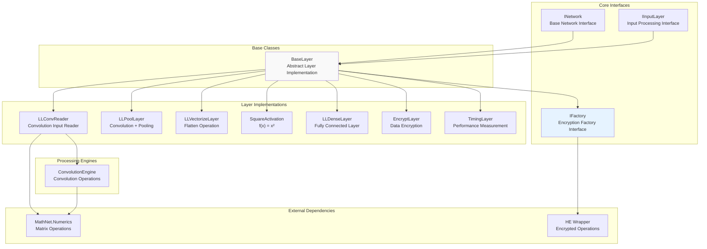
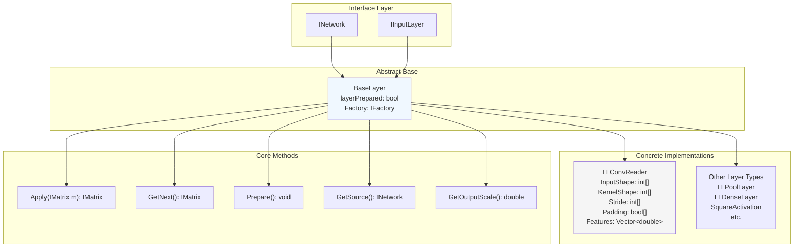
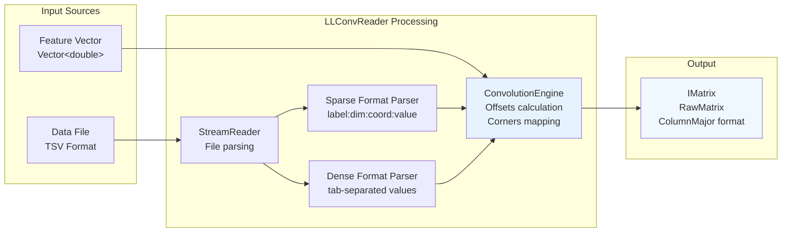
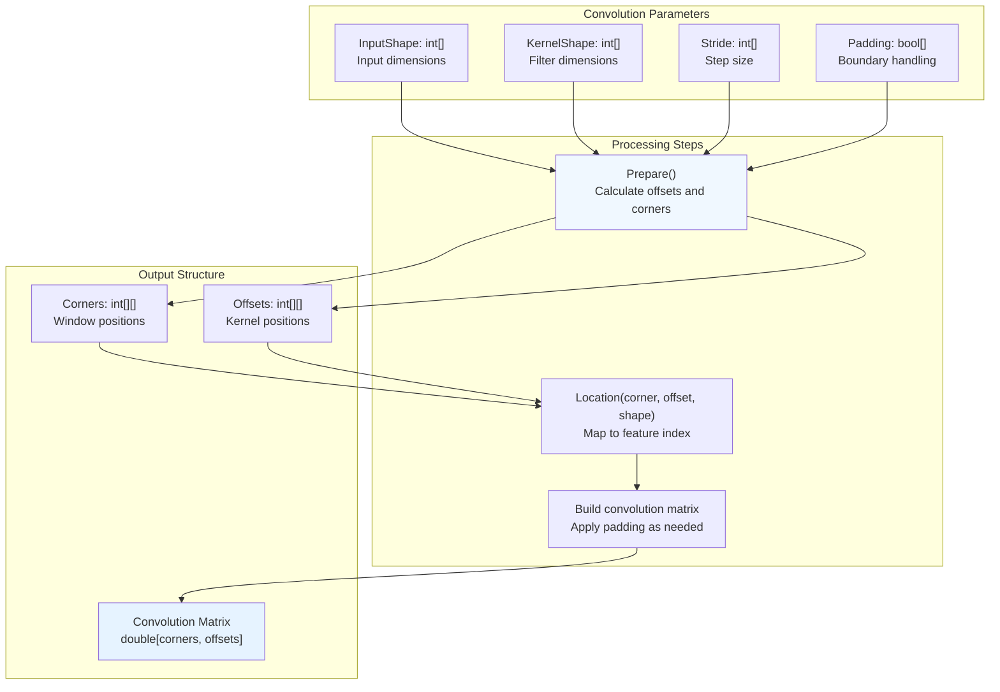
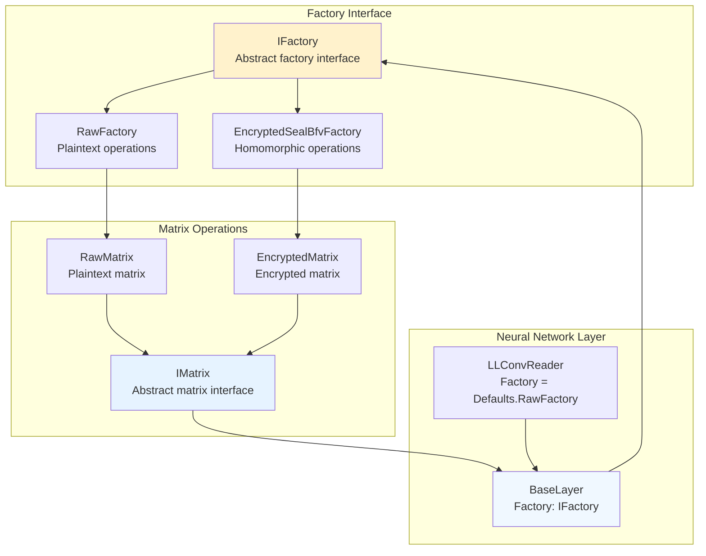

<!-- source: DeepWiki mcp.deepwiki.com · repo microsoft/CryptoNets · page 2.2 Neural Network Framework · fetched 2026-10-26 -->

# Neural Network Framework

Relevant source files

The following files were used as context for generating this wiki page:

- [DataPreprocess/GetCIFAR.cs](DataPreprocess/GetCIFAR.cs)
- [NeuralNetworks/LLConvReader.cs](NeuralNetworks/LLConvReader.cs)
- [NeuralNetworksTest/NeuralNetworksTest.csproj](NeuralNetworksTest/NeuralNetworksTest.csproj)

## Purpose and Scope

The Neural Network Framework provides the foundational layer implementations and base classes for building privacy-preserving neural networks that operate on encrypted data. This framework defines the core abstractions for neural network layers, data flow, and integration with homomorphic encryption operations.

This document covers the base neural network infrastructure and layer implementations. For details about the homomorphic encryption integration, see [Homomorphic Encryption Wrapper](#2.1). For specific neural network applications and their implementations, see [Neural Network Implementations](#3).

## Framework Architecture

The neural network framework is built around a layered architecture with clear interfaces for different types of network components. The framework supports both encrypted and plaintext operations through a factory pattern abstraction.

### Core Framework Diagram

Sources: [NeuralNetworks/LLConvReader.cs:12-14](), [NeuralNetworksTest/NeuralNetworksTest.csproj:104-111]()

## Base Layer Architecture

The framework is built on a hierarchical class structure where all neural network layers inherit from `BaseLayer` and implement specific interfaces based on their functionality.

### Layer Inheritance Structure

Sources: [NeuralNetworks/LLConvReader.cs:12](), [NeuralNetworks/LLConvReader.cs:76-88]()

## Input Layer Implementation

The `LLConvReader` class serves as the primary input layer for convolutional neural networks, handling data ingestion and initial convolution operations.

### LLConvReader Component Structure

| Property | Type | Purpose |
|----------|------|---------|
| `InputShape` | `int[]` | Dimensions of input data |
| `KernelShape` | `int[]` | Convolution kernel dimensions |
| `Stride` | `int[]` | Convolution stride parameters |
| `Padding` | `bool[]` | Padding configuration |
| `Features` | `Vector<double>` | Input feature vector |
| `FileName` | `string` | Data source file path |
| `NormalizationFactor` | `double` | Input scaling factor |
| `SparseFormat` | `bool` | Data format specification |

### Data Processing Flow

Sources: [NeuralNetworks/LLConvReader.cs:34-44](), [NeuralNetworks/LLConvReader.cs:96-158](), [NeuralNetworks/LLConvReader.cs:108-142]()

## Convolution Engine

The `ConvolutionEngine` handles the mathematical operations for convolution layers, calculating spatial transformations and managing padding operations.

### Convolution Operations

The convolution engine processes input data through several key operations:

1. **Offset Calculation**: Determines pixel positions for convolution kernels
2. **Corner Mapping**: Maps convolution windows to input coordinates  
3. **Padding Handling**: Applies zero-padding for boundary conditions
4. **Location Mapping**: Translates 2D coordinates to 1D feature indices

Sources: [NeuralNetworks/LLConvReader.cs:14-24](), [NeuralNetworks/LLConvReader.cs:144-156]()

## Integration with HE Wrapper

The neural network framework integrates with the homomorphic encryption system through the factory pattern, allowing layers to operate on both encrypted and plaintext data seamlessly.

### Factory Pattern Integration

Sources: [NeuralNetworks/LLConvReader.cs:72-74](), [NeuralNetworks/LLConvReader.cs:154]()

## Testing Framework

The neural network framework includes comprehensive testing through the `NeuralNetworksTest` project, which validates layer functionality and integration with encryption systems.

### Test Project Structure

| Test Component | Purpose |
|----------------|---------|
| `LayersTest.cs` | Unit tests for individual layer implementations |
| `CaltechTests.cs` | Integration tests for CalTech-101 dataset processing |
| `TestNetwork.cs` | End-to-end network architecture testing |
| `FakeLayer.cs` | Mock layer implementation for testing |

### Test Dependencies

The testing framework includes the following key dependencies:

- **MSTest Framework**: Unit testing infrastructure
- **MathNet.Numerics**: Mathematical operations validation
- **SEALNET**: Homomorphic encryption testing
- **Project References**: All CryptoNets implementations for integration testing

Sources: [NeuralNetworksTest/NeuralNetworksTest.csproj:82-86](), [NeuralNetworksTest/NeuralNetworksTest.csproj:92-111](), [NeuralNetworksTest/NeuralNetworksTest.csproj:60-79]()

---

