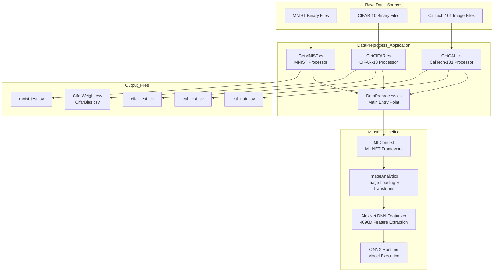
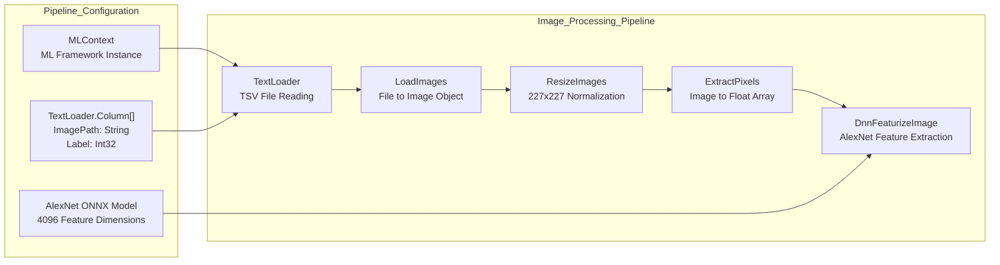
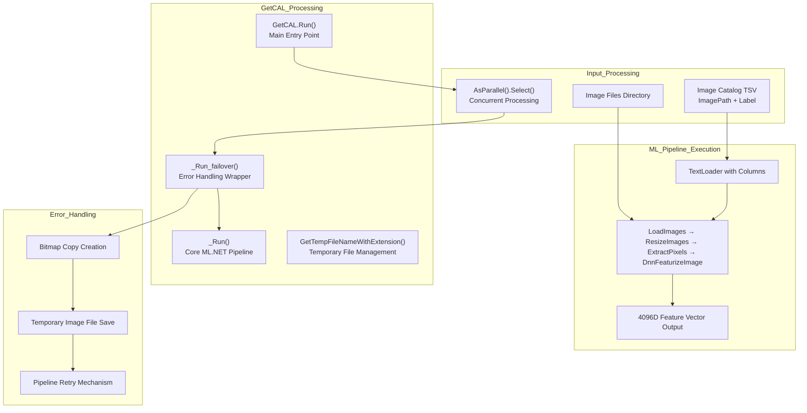

<!-- source: DeepWiki mcp.deepwiki.com · repo microsoft/CryptoNets · page 2.3 Data Preprocessing Pipeline · fetched 2026-10-26 -->

# Data Preprocessing Pipeline

<details>
<summary>Relevant source files</summary>

The following files were used as context for generating this wiki page:

- [DataPreprocess/DataPreprocess.csproj](DataPreprocess/DataPreprocess.csproj)
- [DataPreprocess/GetCAL.cs](DataPreprocess/GetCAL.cs)
- [DataPreprocess/packages.config](DataPreprocess/packages.config)

</details>


## Purpose and Scope

The Data Preprocessing Pipeline is a Microsoft.ML-based system that converts raw dataset files into the standardized TSV (Tab-Separated Values) format required by CryptoNets neural network applications. This system handles three primary datasets: MNIST handwritten digits, CIFAR-10 image classification, and CalTech-101 object recognition datasets.

The pipeline transforms raw binary data and images into feature vectors and structured data that can be consumed by the homomorphic encryption-enabled neural networks. For information about the neural network implementations that consume this processed data, see [Neural Network Implementations](#3).

## System Architecture

The preprocessing system is built as a console application (`DataPreprocess.exe`) that leverages the Microsoft.ML framework for data transformation and feature extraction.



**Sources:** [DataPreprocess/DataPreprocess.csproj:260-266](), [DataPreprocess/packages.config:1-71]()

## Core Components

The preprocessing system consists of four main C# classes that handle different aspects of data processing:

| Component | Purpose | Primary Dependencies |
|-----------|---------|---------------------|
| `DataPreprocess.cs` | Main entry point and command-line interface | Microsoft.ML |
| `GetMNIST.cs` | MNIST dataset binary file processing | Standard .NET I/O |
| `GetCIFAR.cs` | CIFAR-10 binary to TSV conversion | Microsoft.ML |
| `GetCAL.cs` | CalTech-101 image feature extraction | Microsoft.ML.ImageAnalytics, AlexNet |

The application uses a command-line interface where the first argument specifies the dataset type (`MNIST`, `CIFAR`, or `CAL`), followed by dataset-specific parameters.

**Sources:** [DataPreprocess/DataPreprocess.csproj:260-266]()

## ML.NET Processing Pipeline

The system leverages Microsoft.ML's transform pipeline architecture, particularly for image processing tasks. The CalTech-101 processor demonstrates the most sophisticated pipeline:



The pipeline processes images through these transforms:
- `LoadImages`: Converts file paths to `ImageType` objects [GetCAL.cs:100]()
- `ResizeImages`: Standardizes images to 227×227 pixels [GetCAL.cs:101]()
- `ExtractPixels`: Converts images to float arrays [GetCAL.cs:102]()
- `DnnFeaturizeImage`: Applies AlexNet feature extraction to produce 4096-dimensional vectors [GetCAL.cs:103]()

**Sources:** [GetCAL.cs:88-104](), [DataPreprocess/packages.config:8-12]()

## Dataset Processors

### CalTech-101 Processor (`GetCAL.cs`)

The CalTech-101 processor implements the most complex processing logic, handling image feature extraction using pre-trained AlexNet models:



Key features:
- **Parallel Processing**: Uses `AsParallel()` for concurrent image processing [GetCAL.cs:31]()
- **Error Handling**: Implements failover logic with image format conversion [GetCAL.cs:38-78]()
- **Feature Extraction**: Produces sparse 4096-dimensional feature vectors [GetCAL.cs:114-118]()
- **AlexNet Integration**: Uses pre-trained AlexNet model via ML.NET DNN transforms [GetCAL.cs:103]()

**Sources:** [GetCAL.cs:17-125]()

## Output Data Formats

The preprocessing pipeline generates several standardized output formats consumed by the neural network applications:

### TSV File Structure

| Dataset | File Name | Columns | Format Description |
|---------|-----------|---------|-------------------|
| MNIST | `mnist-test.tsv` | Label + 784 pixel values | Grayscale 28×28 images flattened |
| CIFAR-10 | `cifar-test.tsv` | Label + 3072 pixel values | RGB 32×32 images flattened |
| CalTech-101 | `cal_train.tsv`, `cal_test.tsv` | Label + sparse 4096 features | AlexNet feature vectors |

### CalTech-101 Sparse Format

The CalTech-101 processor outputs sparse feature vectors in the format:
```
{label}\t4096\t{index1}:{value1}\t{index2}:{value2}...
```

This format only includes non-zero feature values to optimize storage and processing efficiency [GetCAL.cs:114-118]().

### CIFAR-10 Model Parameters

The CIFAR-10 processor additionally generates pre-trained model parameter files:
- `CifarWeight.csv`: Neural network weight matrices
- `CifarBias.csv`: Neural network bias vectors

**Sources:** [GetCAL.cs:114-118](), [DataPreprocess/DataPreprocess.csproj:269-274]()

## Dependencies and Configuration

### Core Dependencies

The system relies on several Microsoft.ML packages and supporting libraries:

| Package | Version | Purpose |
|---------|---------|---------|
| `Microsoft.ML` | 1.3.1 | Core ML.NET framework |
| `Microsoft.ML.ImageAnalytics` | 1.3.1 | Image processing transforms |
| `Microsoft.ML.DnnImageFeaturizer.AlexNet` | 0.15.1 | AlexNet feature extraction |
| `Microsoft.ML.OnnxRuntime` | 0.5.0 | ONNX model execution |
| `SharpZipLib` | 1.3.3 | Archive extraction utilities |

### Build Configuration

The project targets `.NET Framework 4.6.2` and supports both `AnyCPU` and `x64` platforms with separate output directories for Debug and Release configurations [DataPreprocess/DataPreprocess.csproj:40-59]().

### Pre-bundled Data Files

The project includes pre-processed CalTech-101 catalog files:
- `cal_train.tsv`: Training set catalog [DataPreprocess/DataPreprocess.csproj:272]()
- `cal_test.tsv`: Test set catalog [DataPreprocess/DataPreprocess.csproj:269]()

These files are automatically copied to the output directory during build.

**Sources:** [DataPreprocess/packages.config:1-71](), [DataPreprocess/DataPreprocess.csproj:8-20](), [DataPreprocess/DataPreprocess.csproj:269-274]()

---

