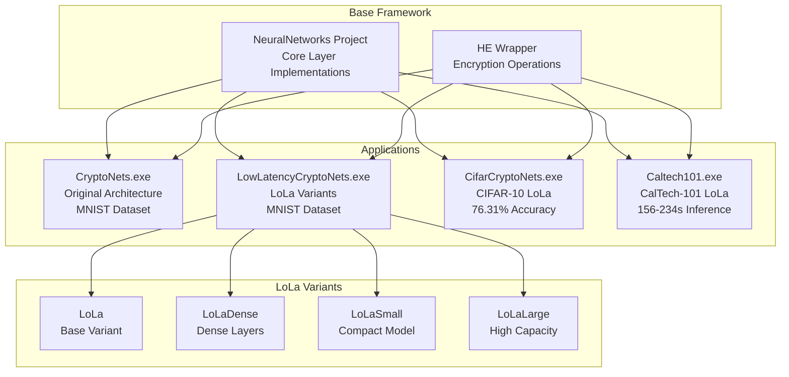
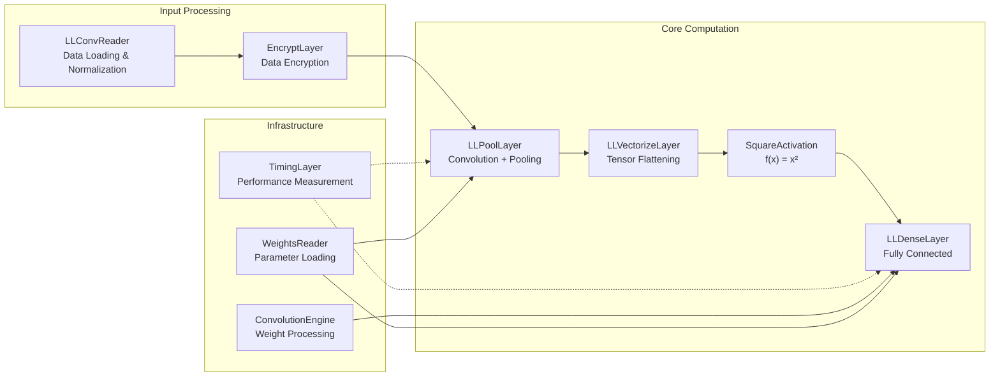
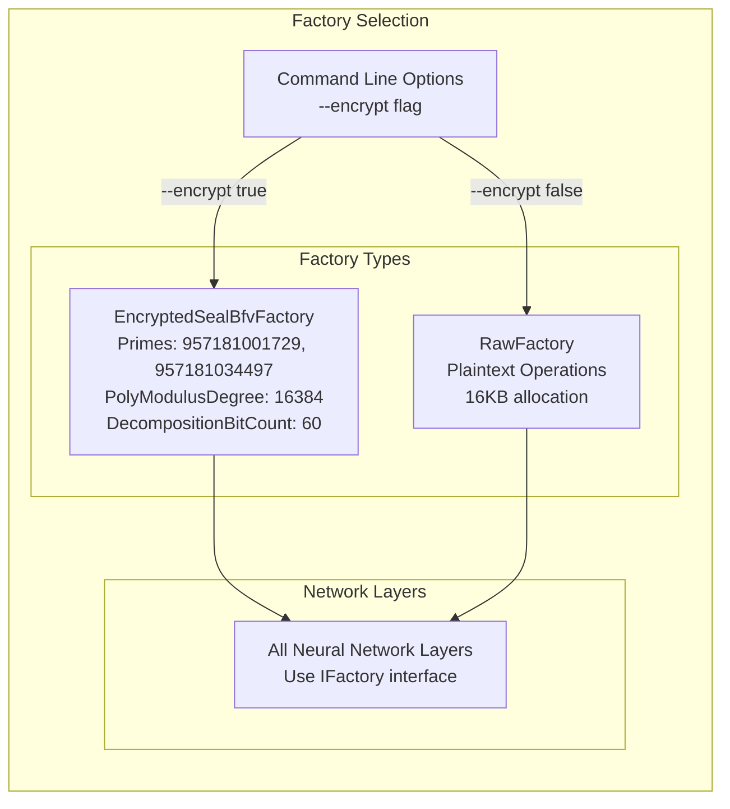
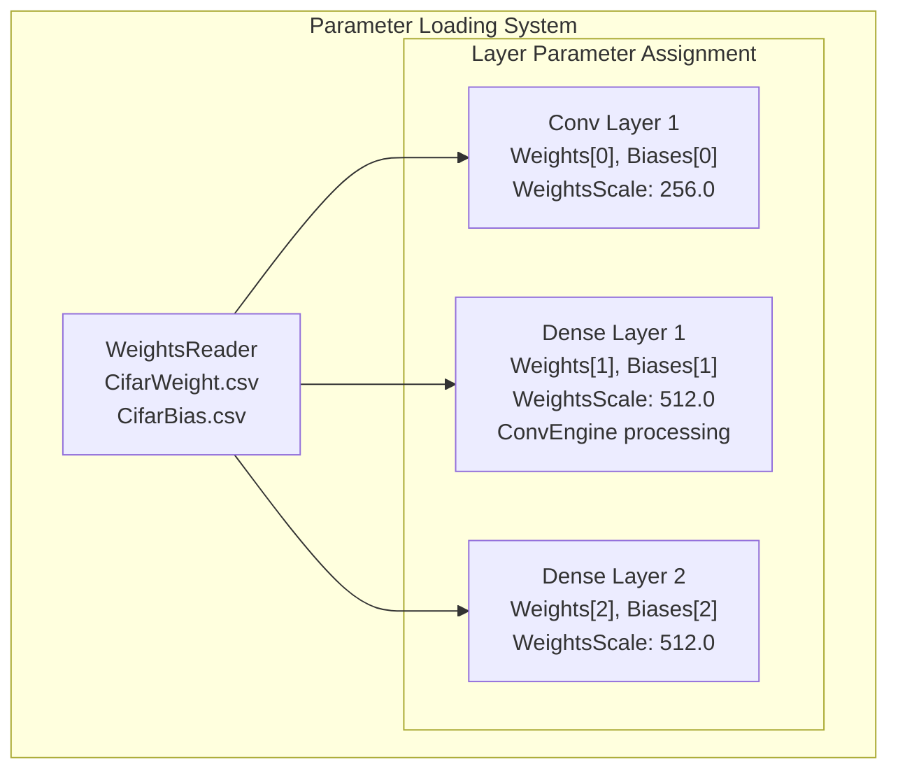

<!-- source: DeepWiki mcp.deepwiki.com · repo microsoft/CryptoNets · page 3 Neural Network Implementations · fetched 2026-10-26 -->

# Neural Network Implementations

Relevant source files

The following files were used as context for generating this wiki page:

- [CifarCryptoNet/LolaCifarCryptoNet.cs](CifarCryptoNet/LolaCifarCryptoNet.cs)
- [README.md](README.md)

This document provides an overview of the different CryptoNets neural network implementations available in the codebase. These implementations demonstrate privacy-preserving inference using homomorphic encryption across multiple datasets and architectural variants.

For detailed information about the homomorphic encryption layer that powers these implementations, see [Homomorphic Encryption Wrapper](#2.1). For specifics about data preprocessing required before running these networks, see [Data Preprocessing Pipeline](#2.3).

## Implementation Overview

The CryptoNets project includes four main neural network applications, each optimized for different datasets and performance characteristics:

Sources: [README.md:19-21](), [README.md:108-115]()

## Common Layer Architecture

All neural network implementations share a common set of layer types that form the building blocks for encrypted inference:

Sources: [CifarCryptoNet/LolaCifarCryptoNet.cs:43-131]()

## Implementation Specifications

### Network Architecture Comparison

| Implementation | Dataset | Architecture | Accuracy | Inference Time | Key Features |
|---|---|---|---|---|---|
| CryptoNets | MNIST | Original design | ~98.8% | ~27s | SEAL 3.2 upgrade |
| LoLa variants | MNIST | 4 variants | Variable | ~2s | Low-latency optimization |
| CIFAR-10 LoLa | CIFAR-10 | Custom CNN | 76.31% | ~740s | Complex image classification |
| CalTech-101 LoLa | CalTech-101 | AlexNet features | Variable | 156-234s | Transfer learning approach |

Sources: [README.md:95-104](), [README.md:136-171](), [README.md:174-199]()

### CIFAR-10 Implementation Details

The CIFAR-10 implementation represents the most sophisticated neural network in the project, featuring a multi-layer architecture optimized for encrypted inference:

```mermaid
graph TB
    subgraph "CIFAR-10 Network Pipeline"
        Input["LLConvReader<br/>cifar-test.tsv<br/>3×32×32 input<br/>Scale: 8"]
        
        Encrypt["EncryptLayer<br/>Factory: EncryptedSealBfvFactory"]
        
        StartTiming["TimingLayer<br/>StartCounters: Inference-Time"]
        
        Conv1["LLPoolLayer<br/>Conv Layer 1<br/>3×8×8 kernels<br/>83 maps<br/>WeightsScale: 256.0"]
        
        Vectorize["LLVectorizeLayer<br/>Flatten to 1D"]
        
        Activation1["SquareActivation<br/>f(x) = x²"]
        
        subgraph "ConvolutionEngine Processing"
            ConvEngine["ConvolutionEngine<br/>83×10×10 kernels<br/>112 output maps"]
        end
        
        Dense1["LLDenseLayer<br/>Dense Layer 1<br/>WeightsScale: 512.0<br/>ForceDenseFormat: true"]
        
        Activation2["SquareActivation<br/>f(x) = x²"]
        
        Dense2["LLDenseLayer<br/>Output Layer<br/>WeightsScale: 512.0<br/>10 classes"]
        
        StopTiming["TimingLayer<br/>StopCounters: Inference-Time"]
    end
    
    Input --> Encrypt
    Encrypt --> StartTiming
    StartTiming --> Conv1
    Conv1 --> Vectorize
    Vectorize --> Activation1
    Activation1 --> Dense1
    Dense1 --> Activation2
    Activation2 --> Dense2
    Dense2 --> StopTiming
    
    ConvEngine -.-> Dense1
```

Sources: [CifarCryptoNet/LolaCifarCryptoNet.cs:43-131]()

### Encryption Configuration

The implementations support both encrypted and plaintext modes through factory pattern implementation:

Sources: [CifarCryptoNet/LolaCifarCryptoNet.cs:33-37]()

## Performance Characteristics

### Execution Modes and Trade-offs

Each implementation supports dual execution modes with distinct performance profiles:

| Mode | Security | Speed | Use Case |
|---|---|---|---|
| Plaintext (`RawFactory`) | None | Fast | Development & debugging |
| Encrypted (`EncryptedSealBfvFactory`) | Full HE | Slow | Production privacy-preserving inference |

### CIFAR-10 Performance Metrics

The CIFAR-10 implementation demonstrates real-world performance characteristics:

- **Model Accuracy**: 76.31% on test set
- **Encryption Budget**: 78.55 + 1 bits in message length  
- **Inference Latency**: ~740 seconds per image (Azure B8ms)
- **Parameter Loading**: Uses `WeightsReader` with `CifarWeight.csv` and `CifarBias.csv`

Sources: [CifarCryptoNet/LolaCifarCryptoNet.cs:27-30](), [README.md:136-139]()

### Weight and Bias Management

The implementations use a systematic approach to parameter management:

Sources: [CifarCryptoNet/LolaCifarCryptoNet.cs:27](), [CifarCryptoNet/LolaCifarCryptoNet.cs:72-73](), [CifarCryptoNet/LolaCifarCryptoNet.cs:105-106](), [CifarCryptoNet/LolaCifarCryptoNet.cs:122-124]()

---

