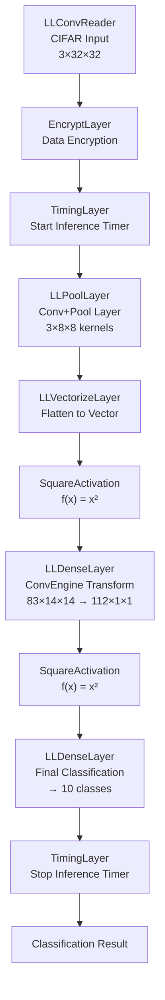
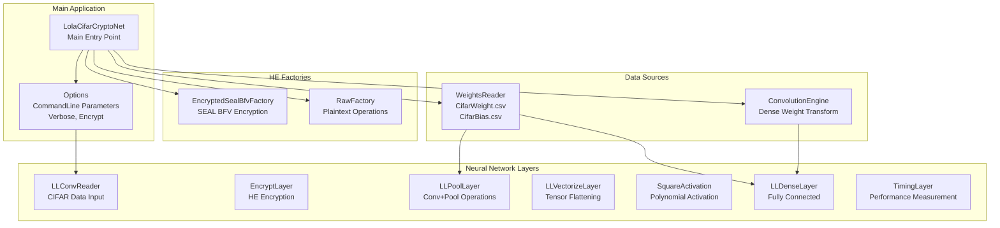

<!-- source: DeepWiki mcp.deepwiki.com · repo microsoft/CryptoNets · page 3.1 CIFAR-10 CryptoNets · fetched 2026-10-26 -->

# CIFAR-10 CryptoNets

<details>
<summary>Relevant source files</summary>

The following files were used as context for generating this wiki page:

- [CifarCryptoNet/CifarCryptoNet.csproj](CifarCryptoNet/CifarCryptoNet.csproj)
- [CifarCryptoNet/LolaCifarCryptoNet.cs](CifarCryptoNet/LolaCifarCryptoNet.cs)
- [CifarCryptoNet/packages.config](CifarCryptoNet/packages.config)

</details>


## Purpose and Scope

This document covers the CIFAR-10 CryptoNets implementation, which represents the most sophisticated neural network application in the CryptoNets repository. This implementation uses the Low-Latency (LoLa) CryptoNets architecture to perform privacy-preserving image classification on the CIFAR-10 dataset using homomorphic encryption.

The CIFAR-10 implementation achieves 76.31% accuracy with an inference latency of approximately 740 seconds on the reference Azure B8ms server configuration. For information about the original MNIST-focused CryptoNets implementation, see [Original CryptoNets](#3.2). For details about the CalTech-101 implementation, see [CalTech-101 Implementation](#3.3).

## Application Overview

The CIFAR-10 CryptoNets application (`CifarCryptoNet.exe`) is implemented as a console application that performs encrypted neural network inference on 32x32 color images from the CIFAR-10 test dataset. The application can operate in both plaintext mode (for development and debugging) and encrypted mode (for privacy-preserving inference).

### Command Line Interface

The application accepts the following command-line parameters:

| Parameter | Short | Default | Description |
|-----------|-------|---------|-------------|
| `--verbose` | `-v` | `false` | Enable verbose output messages |
| `--encrypt` | `-e` | `false` | Use homomorphic encryption |

### Performance Characteristics

| Metric | Value |
|--------|-------|
| **Accuracy** | 76.31% |
| **Inference Latency** | ~740 seconds per batch |
| **Message Length** | 78.55 + 1 bits |
| **Test Dataset Size** | 10,000 images |
| **Input Dimensions** | 3 × 32 × 32 (RGB) |
| **Output Classes** | 10 |

Sources: [CifarCryptoNet/LolaCifarCryptoNet.cs:28-30]()

## Neural Network Architecture

### High-Level Architecture Flow



Sources: [CifarCryptoNet/LolaCifarCryptoNet.cs:43-129]()

### Layer Configuration Details

```mermaid
graph LR
    subgraph "Input Processing"
        Reader["LLConvReader<br/>File: cifar-test.tsv<br/>Shape: [3,32,32]<br/>Kernel: [3,8,8]<br/>Stride: [1000,2,2]<br/>Scale: 8"]
    end
    
    subgraph "Convolution Layer"
        PoolLayer["LLPoolLayer<br/>Input: [3,32,32]<br/>Kernel: [3,8,8]<br/>Output: [83,14,14]<br/>WeightsScale: 256.0"]
    end
    
    subgraph "Dense Layers"
        Dense1["LLDenseLayer<br/>ConvEngine Transform<br/>WeightsScale: 512.0<br/>Format: dense"]
        Dense2["LLDenseLayer<br/>Final Layer<br/>WeightsScale: 512.0<br/>Output: 10 classes"]
    end
    
    subgraph "Activation"
        Activation["SquareActivation<br/>Polynomial f(x) = x²<br/>HE-compatible"]
    end
    
    Reader --> PoolLayer
    PoolLayer --> Dense1
    Dense1 --> Activation
    Activation --> Dense2
```

### ConvolutionEngine Configuration

The application uses a specialized `ConvolutionEngine` to transform the convolutional layer output into dense layer format:

| Parameter | Value |
|-----------|-------|
| **InputShape** | [83, 14, 14] |
| **KernelShape** | [83, 10, 10] |
| **Upperpadding** | [0, 4, 4] |
| **Lowerpadding** | [0, 4, 4] |
| **Stride** | [83, 2, 2] |
| **MapCount** | [112, 1, 1] |

Sources: [CifarCryptoNet/LolaCifarCryptoNet.cs:91-99]()

## Implementation Details

### Core Classes and Dependencies



Sources: [CifarCryptoNet/LolaCifarCryptoNet.cs:1-170]()

### Encryption Configuration

When encryption is enabled (`--encrypt` flag), the application uses the following SEAL BFV parameters:

| Parameter | Value |
|-----------|-------|
| **Primes** | [957181001729, 957181034497] |
| **PolyModulusDegree** | 16384 |
| **DecompositionBitCount** | 60 |
| **GaloisDecompositionBitCount** | 60 |
| **SmallModulusCount** | 8 |

In plaintext mode, a `RawFactory` with 16KB capacity is used for fast development and testing.

Sources: [CifarCryptoNet/LolaCifarCryptoNet.cs:34-37]()

### Pre-trained Model Parameters

The neural network uses pre-trained weights and biases loaded from CSV files:

- **CifarWeight.csv**: Contains the weight matrices for all layers
- **CifarBias.csv**: Contains the bias vectors for all layers

The weights are accessed through a `WeightsReader` that loads three sets of parameters:
1. **Layer 0**: Convolutional layer weights and biases
2. **Layer 1**: First dense layer weights and biases (transformed via `ConvolutionEngine`)
3. **Layer 2**: Final classification layer weights and biases

Sources: [CifarCryptoNet/LolaCifarCryptoNet.cs:27](), [CifarCryptoNet/LolaCifarCryptoNet.cs:72-73](), [CifarCryptoNet/LolaCifarCryptoNet.cs:105-106](), [CifarCryptoNet/LolaCifarCryptoNet.cs:122-123]()

## Inference Process

### Batch Processing Flow

The application processes the CIFAR-10 test dataset one image at a time, performing the following steps for each inference:

1. **Data Loading**: Read image data from `cifar-test.tsv`
2. **Encryption**: Apply homomorphic encryption if enabled
3. **Forward Pass**: Execute neural network layers sequentially
4. **Decryption**: Decrypt the output predictions
5. **Classification**: Determine predicted class by finding maximum logit
6. **Accuracy Tracking**: Compare prediction with ground truth label

### Performance Monitoring

The application includes comprehensive timing and accuracy reporting:

```csharp
// Accuracy calculation and reporting
if (pred != readerLayer.Labels[0]) errs++;
count++;
if (count % batchSize == 0)
{
    Console.Write("errs {0}/{1} accuracy {2:0.000}% prediction {3} label {4} {5}ms", 
                  errs, count, 100 - (100.0 * errs / (count)), 
                  pred, readerLayer.Labels[0], TimingLayer.GetStats());
}
```

Sources: [CifarCryptoNet/LolaCifarCryptoNet.cs:149-159]()

## Project Configuration

### Dependencies and References

The CIFAR-10 CryptoNets project depends on the following components:

| Dependency | Purpose |
|------------|---------|
| **NeuralNetworks** | Core neural network layer implementations |
| **HE Wrapper** | Homomorphic encryption abstraction layer |
| **CommandLineParser** | Command-line argument processing |
| **MathNet.Numerics** | Mathematical operations and linear algebra |

### Build Configuration

The project supports multiple build configurations:

- **Debug/Release**: Standard .NET build configurations
- **x64 Platform**: Optimized for 64-bit architecture
- **Target Framework**: .NET Framework 4.6.2

Sources: [CifarCryptoNet/CifarCryptoNet.csproj:1-105]()

## Usage Examples

### Basic Execution (Plaintext Mode)
```bash
CifarCryptoNet.exe
```

### Encrypted Inference with Verbose Output
```bash
CifarCryptoNet.exe --encrypt --verbose
```

### Expected Output Format
```
Generating encryption keys [timestamp]
Encryption keys ready [timestamp]
Preparing
errs 234/1000 accuracy 76.600% prediction 3 label 5 [timing]ms
errs 468/2000 accuracy 76.600% prediction 7 label 1 [timing]ms
...
errs 2369/10000 accuracy 76.310%
```

Sources: [CifarCryptoNet/LolaCifarCryptoNet.cs:32-38](), [CifarCryptoNet/LolaCifarCryptoNet.cs:153-164]()

---

