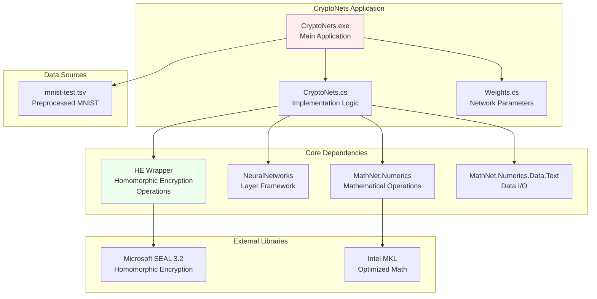

<!-- source: DeepWiki mcp.deepwiki.com · repo microsoft/CryptoNets · page 3.2 Original CryptoNets · fetched 2026-10-26 -->

# Original CryptoNets

<details>
<summary>Relevant source files</summary>

The following files were used as context for generating this wiki page:

- [CryptoNets/CryptoNets.csproj](CryptoNets/CryptoNets.csproj)
- [CryptoNets/packages.config](CryptoNets/packages.config)
- [README.md](README.md)

</details>


This document covers the original CryptoNets implementation for the MNIST dataset, which serves as the foundational privacy-preserving neural network architecture in the repository. This implementation demonstrates homomorphic encryption applied to neural network inference using Microsoft SEAL 3.2.

For information about the enhanced Low-Latency CryptoNets variants, see [Low-Latency CryptoNets](#3.1). For the CIFAR-10 implementation, see [CIFAR-10 CryptoNets](#3.1). For CalTech-101 support, see [CalTech-101 Implementation](#3.3).

## Purpose and Architecture

The Original CryptoNets implementation (`CryptoNets.exe`) provides a proof-of-concept for performing neural network inference on encrypted data without ever decrypting it during computation. This implementation is based on the original CryptoNets paper but updated to use Microsoft SEAL 3.2 instead of SEAL 1.0.

### System Dependencies



**Sources:** [CryptoNets/CryptoNets.csproj:1-102](), [CryptoNets/packages.config:1-6](), [README.md:14-17]()

## Network Architecture

The Original CryptoNets uses a specific sequence of neural network layers optimized for homomorphic encryption operations. The architecture is designed to minimize the multiplicative depth required for encrypted computation.

### Layer Sequence

```mermaid
graph TD
    subgraph "Input Processing"
        Input["MNIST Input<br/>28x28 pixels<br/>784 features"]
        EncryptLayer["EncryptLayer<br/>Data Encryption<br/>Width: (8192,784)"]
        TimingLayer1["TimingLayer<br/>Performance Monitoring"]
    end
    
    subgraph "Feature Extraction"
        PoolLayer1["PoolLayer (no-bias)<br/>5 maps, 169 locations<br/>kernel size 26<br/>Width: (8192,845)"]
        SquareActivation1["SquareActivation<br/>f(x) = x²<br/>Non-linear activation"]
    end
    
    subgraph "Classification Layers"
        PoolLayer2["PoolLayer (bias)<br/>100 maps, 1 location<br/>kernel size 845<br/>Width: (8192,100)"]
        SquareActivation2["SquareActivation<br/>f(x) = x²"]
        PoolLayer3["PoolLayer (bias)<br/>10 maps, 1 location<br/>kernel size 100<br/>Width: (8192,10)"]
    end
    
    subgraph "Output"
        TimingLayer2["TimingLayer<br/>Final Timing"]
        Output["Classification Result<br/>10 class probabilities"]
    end
    
    Input --> EncryptLayer
    EncryptLayer --> TimingLayer1
    TimingLayer1 --> PoolLayer1
    PoolLayer1 --> SquareActivation1
    SquareActivation1 --> PoolLayer2
    PoolLayer2 --> SquareActivation2
    SquareActivation2 --> PoolLayer3
    PoolLayer3 --> TimingLayer2
    TimingLayer2 --> Output
    
    style EncryptLayer fill:#ffeeee
    style SquareActivation1 fill:#eeffee
    style SquareActivation2 fill:#eeffee
```

**Sources:** [README.md:84-94]()

## Performance Characteristics

The Original CryptoNets demonstrates the fundamental trade-offs between privacy preservation and computational efficiency. Based on the reference implementation output, the system achieves the following performance profile:

| Layer Type | Computation Time | Layer Width | Notes |
|------------|------------------|-------------|-------|
| EncryptLayer | ~2.27 seconds | (8192,784) | Initial data encryption |
| PoolLayer (first) | ~5.16 seconds | (8192,845) | Feature extraction |
| SquareActivation (first) | ~9.75 seconds | (8192,845) | Most expensive operation |
| PoolLayer (second) | ~9.33 seconds | (8192,100) | Classification preparation |
| SquareActivation (second) | ~1.16 seconds | (8192,100) | Reduced complexity |
| PoolLayer (final) | ~0.19 seconds | (8192,10) | Output layer |

### Accuracy Performance

The implementation achieves high accuracy on MNIST classification:
- Typical accuracy: 98-99% on test samples
- Maintains consistent performance across the dataset
- Real-time accuracy reporting during inference

**Sources:** [README.md:84-105]()

## Implementation Details

The Original CryptoNets implementation consists of three main components:

### Core Files

- `CryptoNets.cs`: Main application logic and neural network orchestration
- `Weights.cs`: Pre-trained network parameters and weight management
- `CryptoNets.csproj`: Project configuration with dependencies on HE Wrapper and NeuralNetworks

### Key Dependencies

The implementation relies on:
- **HE Wrapper**: Provides homomorphic encryption operations through Microsoft SEAL
- **NeuralNetworks**: Supplies the layer implementations (`EncryptLayer`, `PoolLayer`, `SquareActivation`, `TimingLayer`)
- **MathNet.Numerics**: Mathematical operations and linear algebra support

**Sources:** [CryptoNets/CryptoNets.csproj:75-93]()

## Usage and Execution

The Original CryptoNets requires preprocessed MNIST data and executes as a standalone console application:

### Prerequisites
- Preprocessed MNIST data (`mnist-test.tsv`) generated by `DataPreprocess.exe`
- Microsoft SEAL 3.2 installation
- x64 build configuration (Release or Debug)

### Execution
```bash
.\CryptoNets.exe
```

The application processes MNIST test samples sequentially, displaying:
- Per-layer computation times with timestamps
- Running accuracy statistics
- Individual prediction results with labels
- Total processing time for each inference

### Expected Output Format
- Layer timing: `Layer [LayerType] computed in [time] seconds ([start] -- [end]) layer width ([rows],[cols])`
- Accuracy tracking: `errs [errors]/[total] accuracy [percentage]% prediction [pred] label [actual]`
- Real-time performance monitoring through `TimingLayer` components

**Sources:** [README.md:79-105](), [README.md:50-53]()

---

