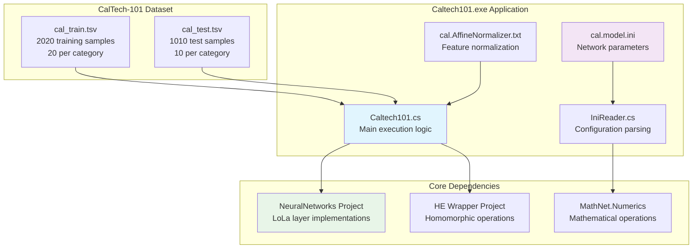
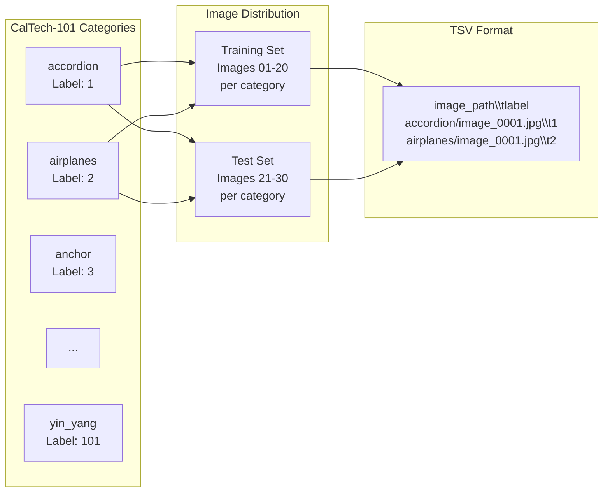
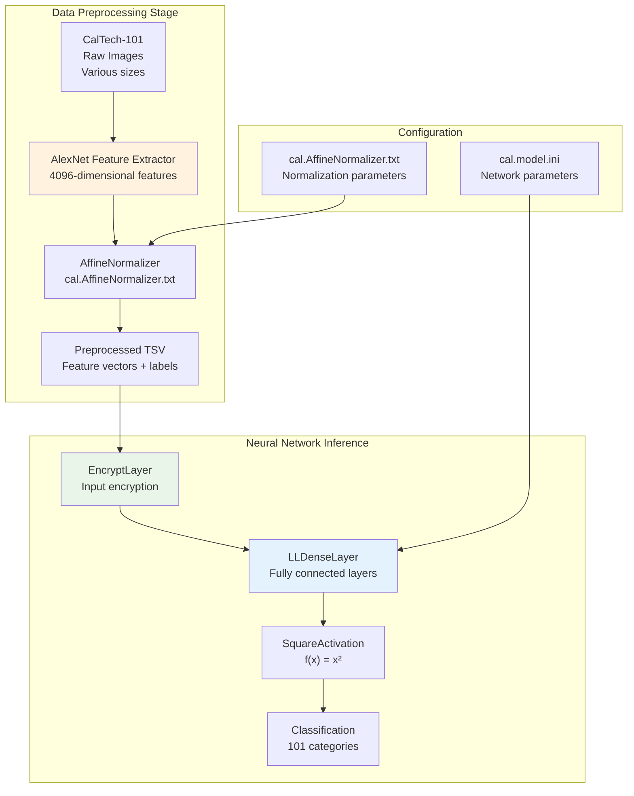
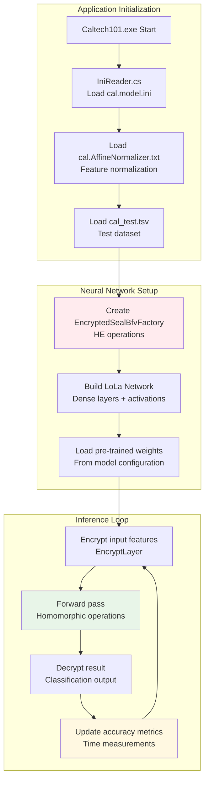
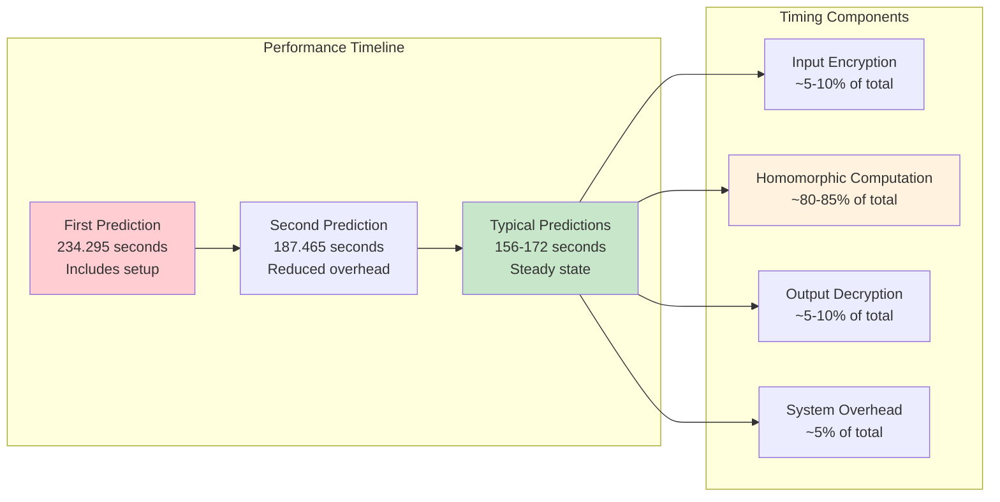
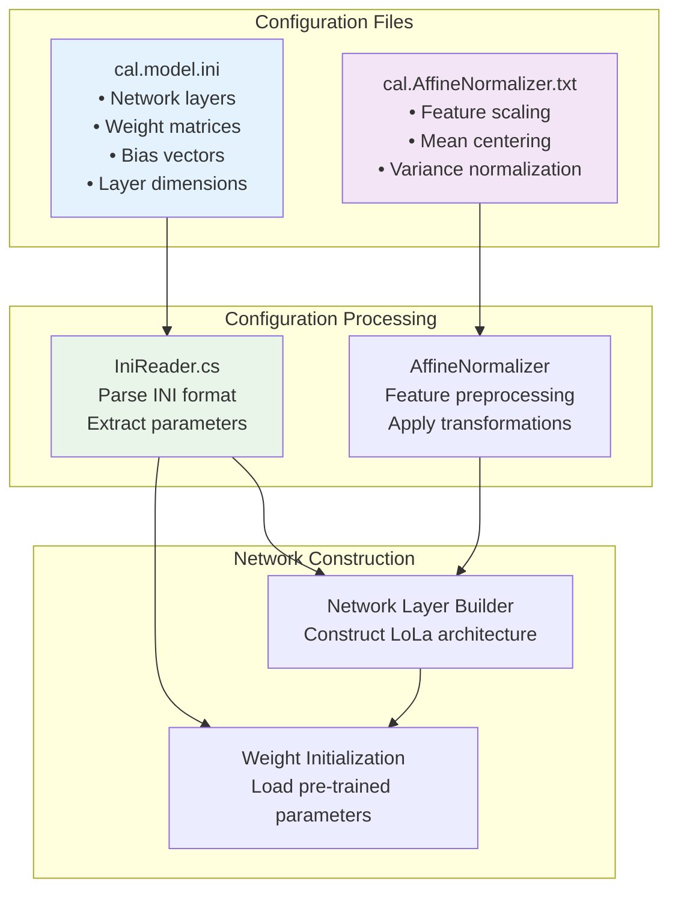

<!-- source: DeepWiki mcp.deepwiki.com · repo microsoft/CryptoNets · page 3.3 CalTech-101 Implementation · fetched 2026-10-26 -->

# CalTech-101 Implementation

Relevant source files

The following files were used as context for generating this wiki page:

- [Caltech101/Caltech101.csproj](Caltech101/Caltech101.csproj)
- [DataPreprocess/cal_test.tsv](DataPreprocess/cal_test.tsv)
- [DataPreprocess/cal_train.tsv](DataPreprocess/cal_train.tsv)
- [README.md](README.md)

This document covers the CalTech-101 CryptoNets implementation, which applies the Low-Latency CryptoNets (LoLa) neural network architecture to the CalTech-101 object recognition dataset. This implementation demonstrates privacy-preserving inference on a 101-class object classification task using homomorphic encryption.

For information about the CIFAR-10 implementation, see [CIFAR-10 CryptoNets](#3.1). For details about the original CryptoNets architecture on MNIST, see [Original CryptoNets](#3.2).

## Overview

The CalTech-101 implementation is a console application (`Caltech101.exe`) that performs encrypted neural network inference on the CalTech-101 dataset. It uses the LoLa (Low-Latency CryptoNets) architecture, which is optimized for reduced inference time compared to the original CryptoNets design. The implementation processes images through homomorphic encryption to classify them into one of 101 object categories while keeping the input data encrypted throughout the computation.

**Sources:** [README.md:173-199](), [Caltech101/Caltech101.csproj:1-109]()

## Dataset Structure and Processing

The CalTech-101 dataset contains images from 101 object categories, preprocessed into tab-separated value (TSV) format. The dataset is split into training and testing sets with a consistent structure across all categories.

### Dataset Organization

| Dataset Split | File | Images per Category | Total Images | Image Range |
|---------------|------|---------------------|--------------|-------------|
| Training | `cal_train.tsv` | 20 | 2,020 | image_0001.jpg - image_0020.jpg |
| Testing | `cal_test.tsv` | 10 | 1,010 | image_0021.jpg - image_0030.jpg |

The dataset includes diverse object categories such as:
- Musical instruments (accordion, bass, electric_guitar, saxophone)
- Animals (elephant, kangaroo, leopard, dolphin)
- Vehicles (airplanes, car_side, helicopter, motorbikes)
- Household objects (chair, lamp, laptop, camera)
- Natural objects (butterfly, lotus, sunflower, starfish)

**Sources:** [DataPreprocess/cal_train.tsv:1-2021](), [DataPreprocess/cal_test.tsv:1-1011]()

## Neural Network Architecture

The CalTech-101 implementation uses the LoLa (Low-Latency CryptoNets) architecture, which is designed for improved inference performance compared to the original CryptoNets. The network operates on pre-extracted features from the CalTech-101 images rather than raw pixel data.

### Feature Preprocessing Pipeline

Unlike MNIST or CIFAR-10 implementations that work with raw pixel data, the CalTech-101 implementation uses a feature-based approach. The images are preprocessed through a feature extraction pipeline that generates high-dimensional feature vectors suitable for homomorphic encryption operations.

**Sources:** [README.md:173-174](), [Caltech101/Caltech101.csproj:97-100]()

## Application Structure and Execution

The `Caltech101.exe` application is built as a console application that loads the preprocessed dataset, configures the neural network, and performs encrypted inference on test images.

### Core Components

The application consists of several key components that work together to perform homomorphic inference:

| Component | File | Purpose |
|-----------|------|---------|
| Main Application | `Caltech101.cs` | Primary execution logic and coordination |
| Configuration Reader | `IniReader.cs` | Parses model configuration from INI files |
| Model Configuration | `cal.model.ini` | Network architecture and parameter definitions |
| Feature Normalizer | `cal.AffineNormalizer.txt` | Normalization parameters for input features |

**Sources:** [Caltech101/Caltech101.csproj:75-77](), [Caltech101/Caltech101.csproj:81-83]()

## Performance Characteristics

The CalTech-101 implementation demonstrates significantly faster inference times compared to other CryptoNets implementations, with inference times ranging from approximately 156 to 234 seconds per image.

### Timing Breakdown

Based on the expected output shown in the README, the application provides detailed timing information for each inference:

- **Initial predictions**: ~234 seconds (including setup overhead)
- **Subsequent predictions**: ~156-187 seconds (optimized performance)
- **Typical range**: 156-172 seconds per image

### Accuracy Metrics

The implementation tracks classification accuracy across the 101 categories, with the sample output showing perfect accuracy on the test examples (100% accuracy maintained across multiple predictions, all predicting category 39).

**Sources:** [README.md:175-199]()

## Configuration and Model Files

The CalTech-101 implementation relies on several configuration files that define the network architecture, model parameters, and feature normalization settings.

### Configuration File Structure

| File | Purpose | Format |
|------|---------|---------|
| `cal.model.ini` | Network architecture and weights | INI format with sections |
| `cal.AffineNormalizer.txt` | Feature normalization parameters | Text file with numeric values |

The `IniReader.cs` component handles parsing of the model configuration file, which contains the network architecture definition and pre-trained weights necessary for the 101-class classification task.

**Sources:** [Caltech101/Caltech101.csproj:81-83](), [Caltech101/Caltech101.csproj:97-100](), [Caltech101/Caltech101.csproj:76]()

---

