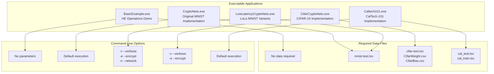
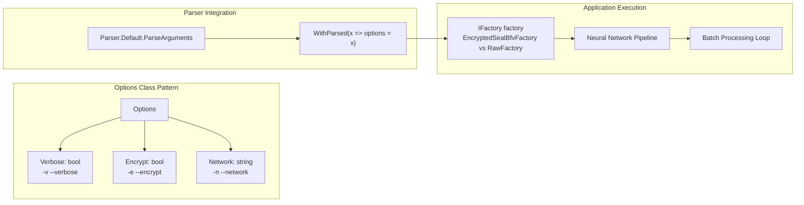
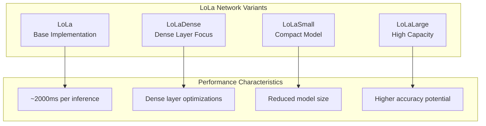
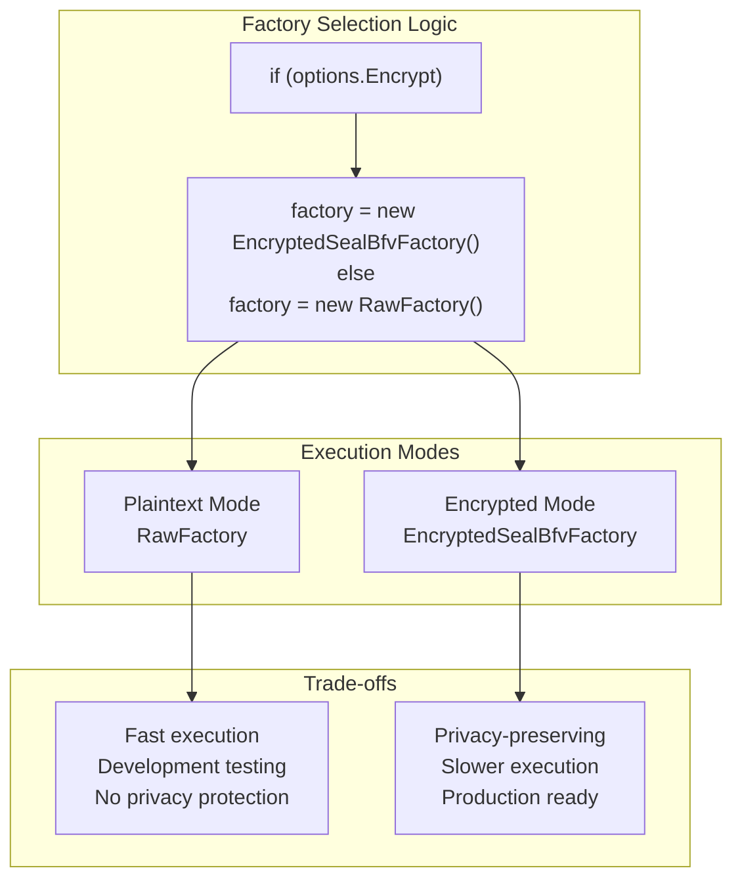

<!-- source: DeepWiki mcp.deepwiki.com · repo microsoft/CryptoNets · page 4 Usage and Examples · fetched 2026-10-26 -->

# Usage and Examples

<details>
<summary>Relevant source files</summary>

The following files were used as context for generating this wiki page:

- [Basic Example/Basic Example.csproj](Basic Example/Basic Example.csproj)
- [CifarCryptoNet/LolaCifarCryptoNet.cs](CifarCryptoNet/LolaCifarCryptoNet.cs)
- [README.md](README.md)

</details>


This document provides practical guidance for running CryptoNets applications, including command-line parameters, expected outputs, and performance characteristics. It covers the executable applications that demonstrate homomorphic encryption-based neural network inference.

For information about data preprocessing requirements, see [Data Preparation](#4.2). For details about the underlying neural network architectures, see [Neural Network Implementations](#3).

## Application Overview

The CryptoNets repository provides five main executable applications that demonstrate privacy-preserving neural network inference using homomorphic encryption:



Sources: [README.md:54-200](), [CifarCryptoNet/LolaCifarCryptoNet.cs:12-18]()

## Command-Line Interface Structure

The applications use a consistent command-line interface pattern implemented through the `CommandLine` library:



Sources: [CifarCryptoNet/LolaCifarCryptoNet.cs:12-26]()

## Basic Homomorphic Encryption Example

The `BasicExample.exe` application demonstrates fundamental homomorphic encryption operations without requiring any dataset files.

### Usage
```bash
BasicExample.exe
```

### Expected Output
The application performs basic vector operations on encrypted data and displays timing information:

```
Generated keys in 0.4218858 seconds
Norm Sqared is:
DenseVector 1-Double
14

sum of elements in a vector:
DenseVector 1-Double
6

elementwise multiply =
DenseVector 3-Double
 -1
 10
-12

Compute in 0.203117 seconds
```

Sources: [README.md:57-76]()

## Neural Network Applications

### CryptoNets (Original MNIST Implementation)

The original CryptoNets implementation processes MNIST handwritten digit recognition using homomorphic encryption.

#### Usage
```bash
CryptoNets.exe
```

#### Network Architecture
The application implements a convolutional neural network with the following layer sequence:
- `EncryptLayer`: Data encryption 
- `PoolLayer`: Convolution with 5 feature maps
- `SquareActivation`: Polynomial activation function
- `PoolLayer`: Dense layer with 100 outputs
- `SquareActivation`: Second activation
- `PoolLayer`: Final classification layer with 10 outputs

#### Performance Characteristics
- Layer processing times range from 0.2 to 9.8 seconds per layer
- Achieves >98% accuracy on MNIST test set
- Total inference time approximately 30 seconds per batch

Sources: [README.md:79-105]()

### Low-Latency CryptoNets (LoLa MNIST Variants)

The `LowLatencyCryptoNets.exe` application implements multiple LoLa variants optimized for reduced inference latency.

#### Usage
```bash
LowLatencyCryptoNets.exe -n <network_type> [-e] [-v]
```

#### Parameters
| Parameter | Description | Values |
|-----------|-------------|--------|
| `-n, --network` | Network architecture (Required) | `LoLa`, `LoLaDense`, `LoLaSmall`, `LoLaLarge` |
| `-e, --encrypt` | Enable homomorphic encryption | Default: `false` |
| `-v, --verbose` | Verbose output mode | Default: `false` |

#### Network Variants


#### Example Usage and Output
```bash
LowLatencyCryptoNets.exe -n LoLa -e
```

Expected output shows ~2000ms inference time per sample:
```
LoLa mode
Generating keys in 1.8437561 seconds
errs 0/1 accuracy 100.000% Prediction-Time 2156.22 prediction 7 label 7
errs 0/2 accuracy 100.000% Prediction-Time 2070.28 prediction 2 label 2
```

Sources: [README.md:107-132]()

### CIFAR-10 CryptoNets

The `CifarCryptoNets.exe` application implements LoLa architecture for CIFAR-10 color image classification.

#### Usage
```bash
CifarCryptoNets.exe [-e] [-v]
```

#### Parameters
| Parameter | Description | Default |
|-----------|-------------|---------|
| `-e, --encrypt` | Enable homomorphic encryption | `false` |
| `-v, --verbose` | Verbose output mode | `false` |

#### Architecture Details
The application uses a sophisticated neural network pipeline implemented in `LolaCifarCryptoNet`:

```mermaid
graph TB
    subgraph "CIFAR-10 Network Pipeline"
        LLConvReader["LLConvReader<br/>Input: 3x32x32<br/>Kernel: 3x8x8"]
        EncryptLayer["EncryptLayer<br/>Data Encryption"]
        TimingStart["TimingLayer<br/>Start Inference-Time"]
        LLPoolLayer["LLPoolLayer<br/>Convolution + Pooling<br/>83 feature maps"]
        LLVectorizeLayer["LLVectorizeLayer<br/>Flatten to vector"]
        SquareActivation1["SquareActivation<br/>f(x) = x²"]
        LLDenseLayer1["LLDenseLayer<br/>ConvolutionEngine<br/>112 outputs"]
        SquareActivation2["SquareActivation<br/>Second activation"]
        LLDenseLayer2["LLDenseLayer<br/>Final classification<br/>10 classes"]
        TimingStop["TimingLayer<br/>Stop Inference-Time"]
    end
    
    LLConvReader --> EncryptLayer
    EncryptLayer --> TimingStart
    TimingStart --> LLPoolLayer
    LLPoolLayer --> LLVectorizeLayer
    LLVectorizeLayer --> SquareActivation1
    SquareActivation1 --> LLDenseLayer1
    LLDenseLayer1 --> SquareActivation2
    SquareActivation2 --> LLDenseLayer2  
    LLDenseLayer2 --> TimingStop
```



#### Performance Metrics
- **Accuracy**: 76.31% on CIFAR-10 test set
- **Inference Time**: ~750 seconds per sample on Azure B8ms
- **Encryption Parameters**: Uses Microsoft SEAL BFV scheme with specific moduli
- **Model Complexity**: Uses pre-trained weights from `CifarWeight.csv` and `CifarBias.csv`

#### Example Output
```bash
CifarCryptoNets.exe -e
```

```
Generating encryption keys 8/27/2019 7:10:24 AM
Encryption keys ready 8/27/2019 7:10:31 AM
Preparing
errs 0/1 accuracy 100.000% prediction 3 label 3 Inference-Time 745962.92ms
errs 0/2 accuracy 100.000% prediction 8 label 8 Inference-Time 747487.20ms
errs 1/13 accuracy 92.308% prediction 3 label 5 Inference-Time 754119.69ms
```

Sources: [README.md:135-171](), [CifarCryptoNet/LolaCifarCryptoNet.cs:27-170]()

### CalTech-101 Implementation

The `Caltech101.exe` application demonstrates LoLa architecture on the CalTech-101 object recognition dataset.

#### Usage
```bash
Caltech101.exe
```

#### Performance Characteristics
- **Inference Time**: 156-234 seconds per sample
- **Feature Extraction**: Uses AlexNet-based feature vectors (4096 dimensions)
- **Dataset**: Object classification across 101 categories

#### Example Output
```
Time for Prediction+Encryption: 234.295
errs 0/1 accuracy 100.000%  prediction 39 label 39
Time for Prediction+Encryption: 187.465
errs 0/2 accuracy 100.000%  prediction 39 label 39
Time for Prediction+Encryption: 156.2081
errs 0/3 accuracy 100.000%  prediction 39 label 39
```

Sources: [README.md:173-199]()

## Execution Modes Comparison

The applications support two primary execution modes that significantly impact performance and security:



| Mode | Performance | Security | Use Case |
|------|-------------|----------|----------|
| Plaintext (`RawFactory`) | Fast | None | Development, testing, benchmarking |
| Encrypted (`EncryptedSealBfvFactory`) | Slow | Full privacy | Production, privacy-sensitive scenarios |

Sources: [CifarCryptoNet/LolaCifarCryptoNet.cs:34-37]()

---

