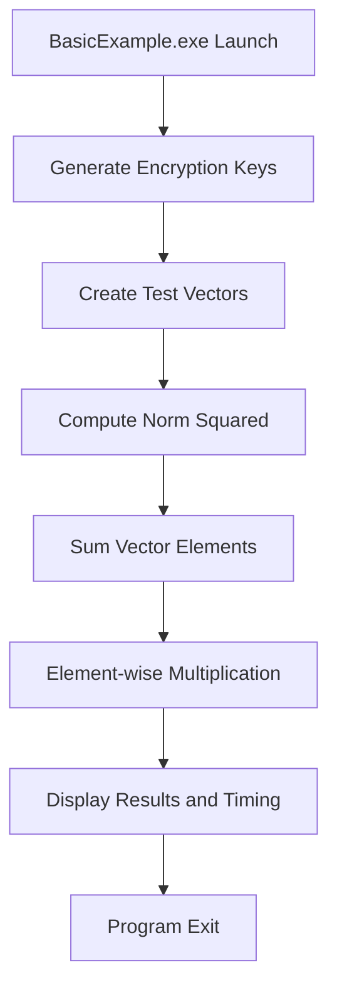
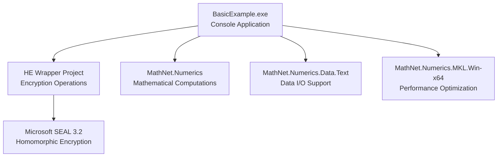
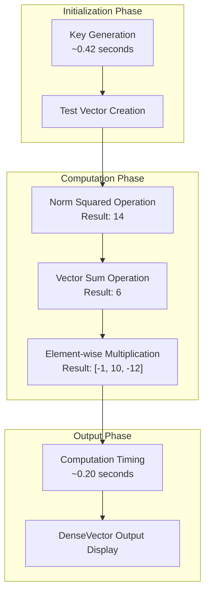
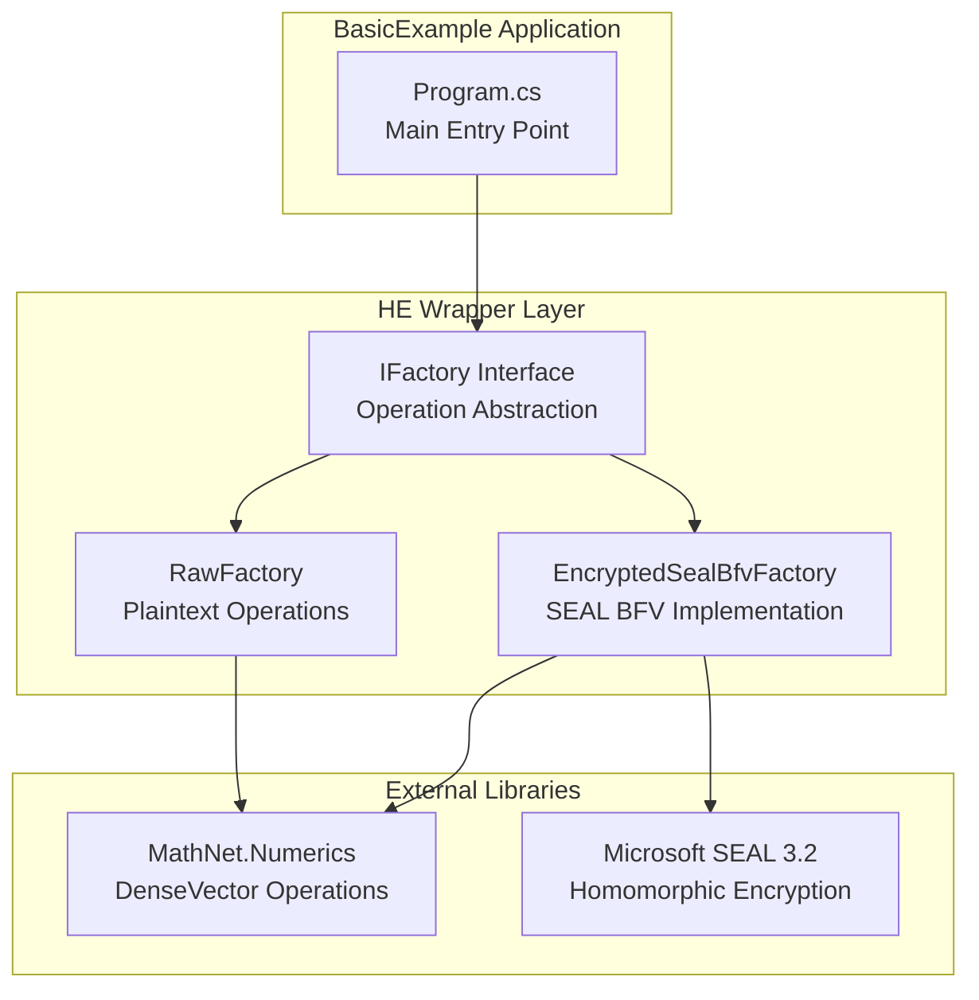

<!-- source: DeepWiki mcp.deepwiki.com · repo microsoft/CryptoNets · page 4.1 Basic Homomorphic Encryption Example · fetched 2026-10-26 -->

# Basic Homomorphic Encryption Example

<details>
<summary>Relevant source files</summary>

The following files were used as context for generating this wiki page:

- [Basic Example/Basic Example.csproj](Basic Example/Basic Example.csproj)
- [Basic Example/packages.config](Basic Example/packages.config)
- [README.md](README.md)

</details>


This document covers the BasicExample application, which provides a simple demonstration of core homomorphic encryption operations using Microsoft SEAL. This standalone example showcases fundamental encrypted computation capabilities without requiring datasets or neural network complexity.

For information about neural network implementations using homomorphic encryption, see [Neural Network Implementations](#3). For details about the underlying encryption wrapper, see [Homomorphic Encryption Wrapper](#2.1).

## Overview

The BasicExample application (`BasicExample.exe`) serves as an introductory demonstration of homomorphic encryption operations. It performs basic vector and matrix computations on encrypted data, including norm calculations, summation, and element-wise operations. This example requires no external datasets and runs entirely with generated test data.

**Application Flow**


Sources: [README.md:57-76](), [Basic Example/Basic Example.csproj:1-97]()

## Project Structure

The BasicExample project has a minimal structure focused on demonstrating core HE operations:

**Project Dependencies**


Sources: [Basic Example/Basic Example.csproj:84-87](), [Basic Example/packages.config:1-6]()

## Core Operations Demonstrated

The BasicExample application demonstrates three fundamental homomorphic encryption operations:

| Operation | Description | Output Format |
|-----------|-------------|---------------|
| Norm Squared | Computes the squared Euclidean norm of an encrypted vector | Single encrypted scalar value |
| Vector Summation | Sums all elements in an encrypted vector | Single encrypted scalar value |  
| Element-wise Multiplication | Multiplies corresponding elements of two encrypted vectors | Encrypted vector result |

**Operation Execution Flow**


Sources: [README.md:59-76]()

## Running the Application

The BasicExample application requires no data preparation or command-line arguments:

```bash
BasicExample.exe
```

### Expected Output

The application produces deterministic output demonstrating each operation:

```
Generated keys in 0.4218858 seconds
Norm Sqared is:
DenseVector 1-Double
14

sum of elements in a vector:
DenseVector 1-Double
6

elementwise multiply =
DenseVector 3-Double
 -1
 10
-12

Compute in 0.203117 seconds
```

The output includes:
- **Key Generation Timing**: Time required to generate encryption keys (~0.42 seconds)
- **Operation Results**: Each encrypted computation result displayed as `DenseVector` format
- **Total Computation Time**: Time for all encrypted operations (~0.20 seconds)

Sources: [README.md:58-76]()

## Build Configuration

The BasicExample project supports multiple build configurations:

| Configuration | Platform | Output Directory | Purpose |
|---------------|----------|------------------|---------|
| Debug | x64 | `bin\x64\Debug\` | Development with debug symbols |
| Release | x64 | `bin\x64\Release\` | Optimized production build |

**Key Build Settings:**
- **Target Framework**: .NET Framework 4.6.2
- **Platform Target**: x64 (required for Microsoft SEAL)
- **Dependencies**: HE Wrapper project reference, MathNet.Numerics packages

Sources: [Basic Example/Basic Example.csproj:37-56]()

## Technical Implementation

The BasicExample application serves as a minimal wrapper around the HE Wrapper functionality. It demonstrates the `IFactory` interface pattern used throughout the CryptoNets framework for abstracting encrypted and unencrypted operations.

**Component Integration**


The application demonstrates how the factory pattern enables seamless switching between encrypted and plaintext operations while maintaining identical API signatures.

Sources: [Basic Example/Basic Example.csproj:84-87](), [README.md:14-17]()

---

