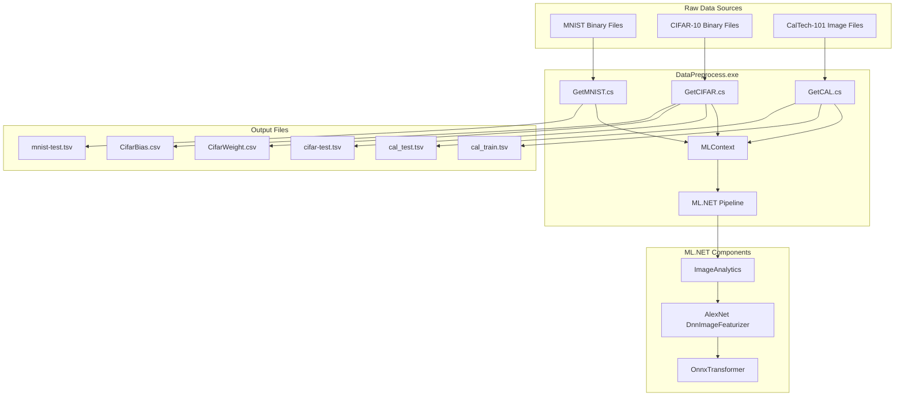
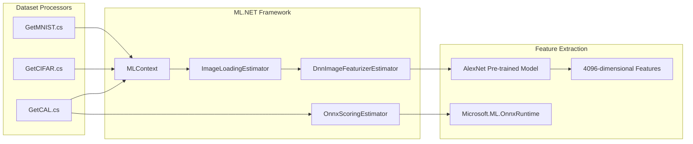
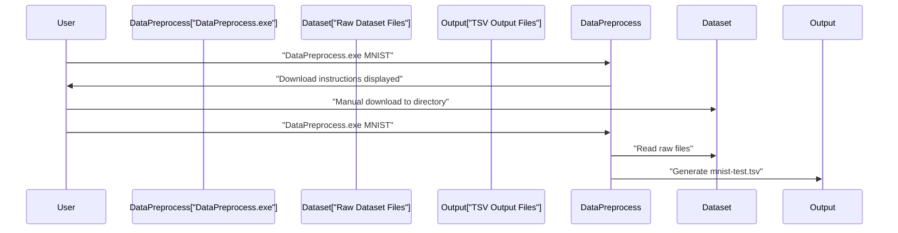
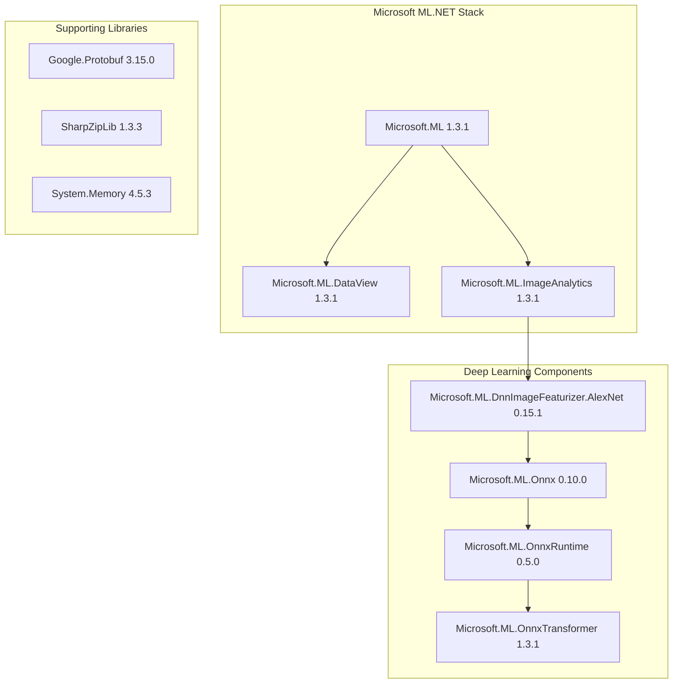

<!-- source: DeepWiki mcp.deepwiki.com · repo microsoft/CryptoNets · page 4.2 Data Preparation · fetched 2026-10-26 -->

# Data Preparation

<details>
<summary>Relevant source files</summary>

The following files were used as context for generating this wiki page:

- [DataPreprocess/cal_test.tsv](DataPreprocess/cal_test.tsv)
- [DataPreprocess/cal_train.tsv](DataPreprocess/cal_train.tsv)
- [DataPreprocess/packages.config](DataPreprocess/packages.config)
- [README.md](README.md)

</details>


This document covers the data preprocessing pipeline that prepares datasets for use with CryptoNets neural network applications. The `DataPreprocess.exe` application converts raw dataset files into the tab-separated value (TSV) format required by the neural network implementations and generates pre-trained model parameters where applicable.

For information about the neural network implementations that consume this preprocessed data, see [Neural Network Implementations](#3). For details about the specific dataset formats generated, see [Dataset Formats](#6.2).

## Overview

The data preparation system is built on Microsoft's ML.NET framework and handles three primary datasets: MNIST handwritten digits, CIFAR-10 color images, and CalTech-101 object categories. The preprocessing pipeline converts raw dataset files into standardized TSV format and extracts features using pre-trained models where necessary.



**Sources:** [README.md:50-52](), system architecture diagrams

## Dataset Processing Components

The data preprocessing system uses dedicated processor classes for each supported dataset, leveraging ML.NET's machine learning pipeline capabilities.

### Dataset Processors

| Dataset | Processor Class | Input Format | Special Processing |
|---------|----------------|--------------|-------------------|
| MNIST | `GetMNIST.cs` | Binary IDX files | Direct pixel extraction |
| CIFAR-10 | `GetCIFAR.cs` | Binary batch files | RGB channel processing, weight extraction |
| CalTech-101 | `GetCAL.cs` | JPEG image files | AlexNet feature extraction |



**Sources:** System architecture diagrams, [DataPreprocess/packages.config:8-12]()

## Command-Line Usage

The `DataPreprocess.exe` application accepts dataset names as command-line arguments and must be run from the build output directory.

### Basic Usage Pattern

```bash
# Navigate to build output directory
cd .\bin\x64\Release

# Process each dataset
DataPreprocess.exe MNIST
DataPreprocess.exe CIFAR
DataPreprocess.exe CAL
```

### Processing Workflow

1. **Initial Run**: Displays download instructions for the specified dataset
2. **Manual Download**: User downloads raw data files to the current directory  
3. **Second Run**: Processes downloaded files and generates TSV outputs



**Sources:** [README.md:52]()

## Output File Formats

The preprocessing pipeline generates standardized TSV files with consistent structure across all datasets, plus additional parameter files for CIFAR-10.

### TSV File Structure

All generated TSV files follow a two-column format:
- **Column 1**: Image identifier or file path
- **Column 2**: Numeric class label (tab-separated)

#### CalTech-101 Example Format
```
accordion/image_0001.jpg	1
accordion/image_0002.jpg	1
airplanes/image_0001.jpg	2
anchor/image_0001.jpg	3
```

### Generated Files by Dataset

| Dataset | Output Files | Records | Classes |
|---------|-------------|---------|---------|
| MNIST | `mnist-test.tsv` | ~10,000 | 10 digits (0-9) |
| CIFAR-10 | `cifar-test.tsv`, `CifarWeight.csv`, `CifarBias.csv` | ~10,000 | 10 object classes |
| CalTech-101 | `cal_train.tsv`, `cal_test.tsv` | ~9,020 total | 101 object categories |

**Sources:** [DataPreprocess/cal_train.tsv:1-10](), [DataPreprocess/cal_test.tsv:1-10]()

## Technical Dependencies

The data preprocessing system relies on Microsoft's ML.NET ecosystem and ONNX runtime for advanced image processing capabilities.

### Core Dependencies



### Feature Extraction Pipeline

For CalTech-101 dataset processing, the system uses a sophisticated feature extraction pipeline:

1. **Image Loading**: `ImageAnalytics` loads JPEG files
2. **Feature Extraction**: `AlexNet DnnImageFeaturizer` generates 4096-dimensional feature vectors
3. **Model Execution**: `OnnxRuntime` processes the pre-trained AlexNet model
4. **Output Generation**: Features are serialized to TSV format with class labels

**Sources:** [DataPreprocess/packages.config:3-12](), [DataPreprocess/packages.config:43-44]()

---

