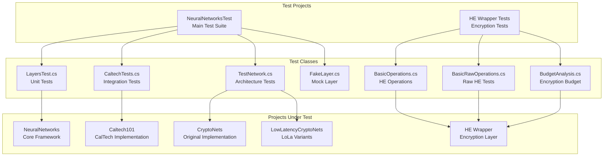
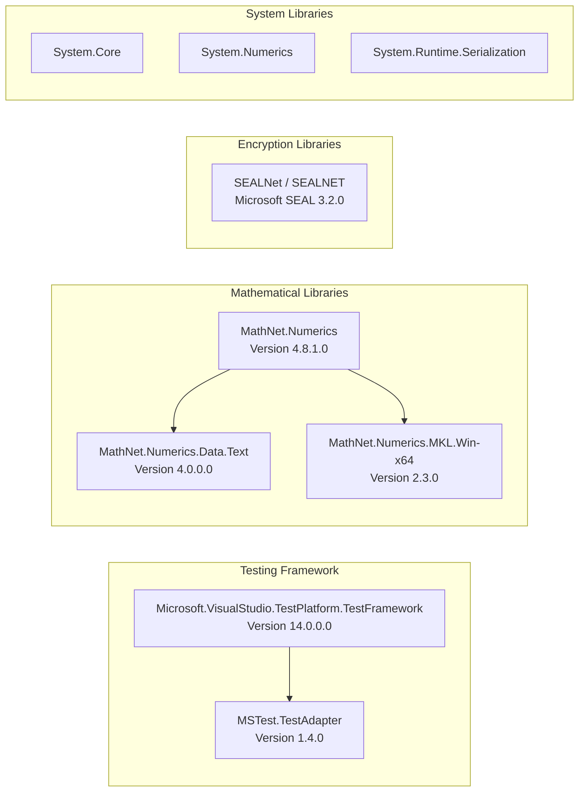
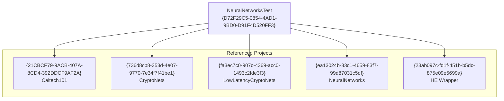
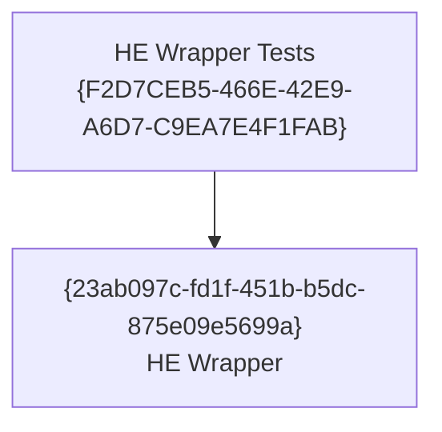

<!-- source: DeepWiki mcp.deepwiki.com · repo microsoft/CryptoNets · page 5 Development and Testing · fetched 2026-10-26 -->

# Development and Testing

Relevant source files

The following files were used as context for generating this wiki page:

- [HE Wrapper Tests/HE Wrapper Tests.csproj](HE Wrapper Tests/HE Wrapper Tests.csproj)
- [NeuralNetworksTest/NeuralNetworksTest.csproj](NeuralNetworksTest/NeuralNetworksTest.csproj)

This document provides essential information for developers working on the CryptoNets codebase, covering the testing framework architecture, build configurations, and project structure. It details the MSTest-based test suites and their dependencies across the neural network and homomorphic encryption components.

For information about using the applications, see [Usage and Examples](#4). For details about the specific testing framework implementation, see [Testing Framework](#5.1).

## Testing Architecture Overview

The CryptoNets repository implements a comprehensive testing strategy using two primary test projects that validate both the neural network implementations and the homomorphic encryption wrapper functionality.

### Test Project Structure

**Sources:** [NeuralNetworksTest/NeuralNetworksTest.csproj:82-86](), [HE Wrapper Tests/HE Wrapper Tests.csproj:81-84](), [NeuralNetworksTest/NeuralNetworksTest.csproj:92-111](), [HE Wrapper Tests/HE Wrapper Tests.csproj:90-93]()

### Build Configuration Matrix

The test projects support multiple build configurations to accommodate different development and deployment scenarios:

| Configuration | Platform | Target Directory | Purpose |
|---------------|----------|------------------|---------|
| Debug | AnyCPU | `bin\Debug\` | Development testing |
| Release | AnyCPU | `bin\Release\` | Performance validation |
| Debug | x64 | `..\bin\x64\Debug\` | 64-bit debugging |
| Release | x64 | `..\bin\x64\Release\` | Production testing |

**Sources:** [NeuralNetworksTest/NeuralNetworksTest.csproj:24-58](), [HE Wrapper Tests/HE Wrapper Tests.csproj:24-58]()

## Framework Dependencies

Both test projects utilize a consistent set of dependencies for mathematical operations, testing infrastructure, and homomorphic encryption:

### Core Testing Dependencies

**Sources:** [NeuralNetworksTest/NeuralNetworksTest.csproj:60-79](), [HE Wrapper Tests/HE Wrapper Tests.csproj:60-78]()

### Target Framework and Platform Requirements

Both test projects target `.NET Framework 4.6.2` and require specific platform configurations:

- **Target Framework:** `v4.6.2`
- **Supported Platforms:** AnyCPU, x64
- **Project Type:** Unit Test Library
- **Visual Studio Compatibility:** 15.0+

The x64 platform requirement is particularly important for the Microsoft SEAL homomorphic encryption library integration.

**Sources:** [NeuralNetworksTest/NeuralNetworksTest.csproj:12-22](), [HE Wrapper Tests/HE Wrapper Tests.csproj:12-22]()

## Project Reference Architecture

### NeuralNetworksTest Dependencies

The main test project references all primary application projects to enable comprehensive integration testing:

**Sources:** [NeuralNetworksTest/NeuralNetworksTest.csproj:92-111]()

### HE Wrapper Tests Dependencies

The HE Wrapper test project maintains a focused scope, testing only the homomorphic encryption functionality:

**Sources:** [HE Wrapper Tests/HE Wrapper Tests.csproj:90-93]()

## Development Environment Setup

### Required NuGet Packages

Developers must ensure the following NuGet packages are properly restored before building:

| Package | Version | Purpose |
|---------|---------|---------|
| `MSTest.TestFramework` | 1.4.0 | Unit testing framework |
| `MSTest.TestAdapter` | 1.4.0 | Test discovery and execution |
| `MathNet.Numerics` | 4.8.1 | Mathematical computations |
| `MathNet.Numerics.Data.Text` | 4.0.0 | Data I/O operations |
| `MathNet.Numerics.MKL.Win-x64` | 2.3.0 | Intel MKL optimization |
| `Microsoft.Research.SEALNet` | 3.2.0 | Homomorphic encryption |

### Build Targets and Validation

The project includes automatic validation for missing NuGet packages and required build targets:

- **MathNet MKL Target:** `..\packages\MathNet.Numerics.MKL.Win-x64.2.3.0\build\MathNet.Numerics.MKL.Win-x64.targets`
- **MSTest Adapter Targets:** `..\packages\MSTest.TestAdapter.1.4.0\build\net45\MSTest.TestAdapter.targets`
- **SEAL Target:** `..\packages\Microsoft.Research.SEALNet.3.2.0\build\Microsoft.Research.SEALNet.targets`

**Sources:** [NeuralNetworksTest/NeuralNetworksTest.csproj:115-124](), [HE Wrapper Tests/HE Wrapper Tests.csproj:97-108]()

## Code Analysis and Quality

Both test projects are configured with `MinimumRecommendedRules.ruleset` for code analysis, ensuring consistent code quality standards across the development team.

**Sources:** [NeuralNetworksTest/NeuralNetworksTest.csproj:48-57](), [HE Wrapper Tests/HE Wrapper Tests.csproj:48-57]()

---

