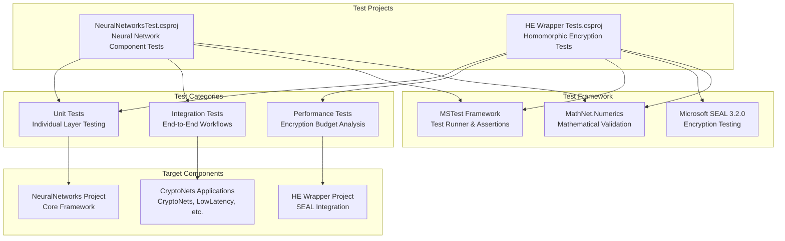
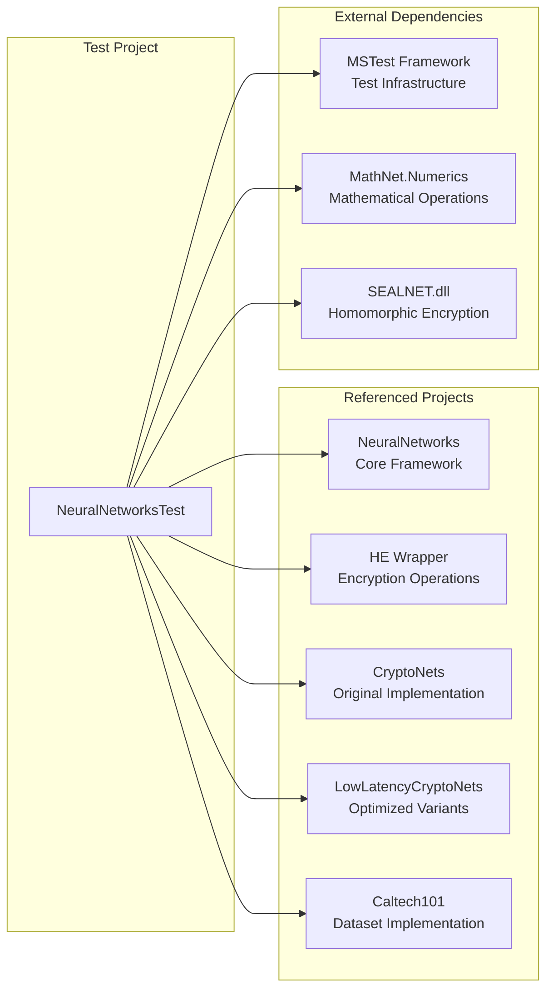
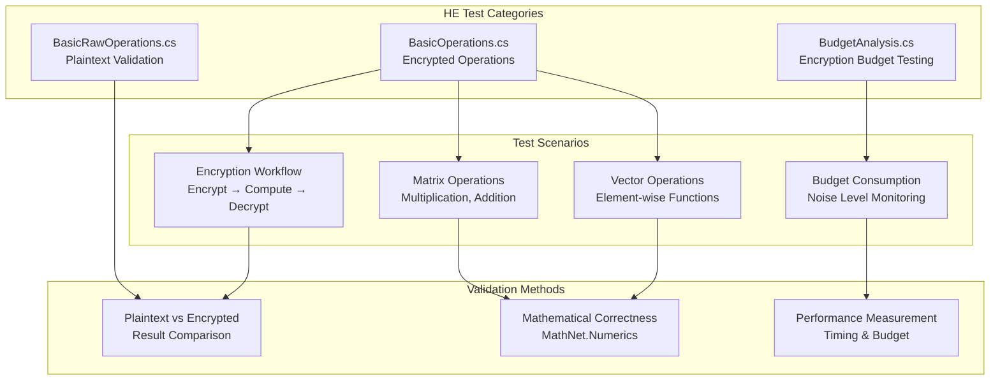

<!-- source: DeepWiki mcp.deepwiki.com · repo microsoft/CryptoNets · page 5.1 Testing Framework · fetched 2026-10-26 -->

# Testing Framework

Relevant source files

The following files were used as context for generating this wiki page:

- [HE Wrapper Tests/HE Wrapper Tests.csproj](HE Wrapper Tests/HE Wrapper Tests.csproj)
- [HE Wrapper Tests/packages.config](HE Wrapper Tests/packages.config)
- [NeuralNetworksTest/NeuralNetworksTest.csproj](NeuralNetworksTest/NeuralNetworksTest.csproj)

This document covers the comprehensive testing infrastructure for the CryptoNets project, including both neural network component tests and homomorphic encryption wrapper tests. The testing framework ensures the correctness of cryptographic neural network operations and validates the integration between Microsoft SEAL homomorphic encryption and the neural network layers.

For information about the actual build configuration and project setup, see [Build Configuration](#5.2).

## Test Suite Architecture

The CryptoNets testing framework consists of two primary test projects that validate different components of the system:

**Sources:** [NeuralNetworksTest/NeuralNetworksTest.csproj:1-125](), [HE Wrapper Tests/HE Wrapper Tests.csproj:1-109]()

## Neural Network Test Suite

The `NeuralNetworksTest` project provides comprehensive testing for the neural network components and their integration with homomorphic encryption:

### Test Components

| Test Class | Purpose | Target Components |
|------------|---------|-------------------|
| `LayersTest` | Unit testing of individual neural network layers | Individual layer implementations |
| `CaltechTests` | Integration testing for CalTech-101 dataset processing | CalTech-101 application workflow |
| `TestNetwork` | Architecture testing for complete neural networks | End-to-end network validation |
| `FakeLayer` | Mock layer implementation for testing purposes | Test infrastructure support |

### Project Dependencies

The neural network test suite references multiple CryptoNets projects to enable comprehensive integration testing:

**Sources:** [NeuralNetworksTest/NeuralNetworksTest.csproj:92-111](), [NeuralNetworksTest/NeuralNetworksTest.csproj:82-86]()

## Homomorphic Encryption Test Suite

The `HE Wrapper Tests` project focuses specifically on validating the homomorphic encryption operations and their mathematical correctness:

### Test Components

| Test Class | Purpose | Key Focus Areas |
|------------|---------|----------------|
| `BasicOperations` | Core homomorphic encryption operations testing | Encrypted matrix/vector operations |
| `BasicRawOperations` | Plaintext operation validation | Baseline mathematical correctness |
| `BudgetAnalysis` | Encryption budget consumption analysis | Performance and capacity planning |

### Encryption Testing Architecture

**Sources:** [HE Wrapper Tests/HE Wrapper Tests.csproj:81-84]()

## Test Framework Configuration

Both test projects are configured with identical framework dependencies and build configurations:

### Framework Dependencies

| Dependency | Version | Purpose |
|------------|---------|---------|
| `MSTest.TestFramework` | 1.4.0 | Core testing framework and assertions |
| `MSTest.TestAdapter` | 1.4.0 | Visual Studio test runner integration |
| `MathNet.Numerics` | 4.8.1 | Mathematical operations and validation |
| `MathNet.Numerics.Data.Text` | 4.0.0 | Data file I/O for test scenarios |
| `Microsoft.Research.SEALNet` | 3.2.0 | Homomorphic encryption library |

### Build Configurations

Both test projects support multiple build configurations:

- **Debug|AnyCPU**: Development testing with full debug symbols
- **Release|AnyCPU**: Optimized testing for performance validation  
- **Debug|x64**: 64-bit debugging for encryption operations
- **Release|x64**: Production-level 64-bit testing

The x64 configurations are essential for Microsoft SEAL operations, which require 64-bit architecture.

**Sources:** [NeuralNetworksTest/NeuralNetworksTest.csproj:24-58](), [HE Wrapper Tests/HE Wrapper Tests.csproj:24-58](), [HE Wrapper Tests/packages.config:1-9]()

## Test Execution Environment

### Platform Requirements

- **.NET Framework 4.6.2**: Target framework for all test projects
- **x64 Architecture**: Required for Microsoft SEAL homomorphic encryption operations
- **MathNet.Numerics.MKL.Win-x64**: High-performance mathematical operations on Windows x64

### Output Locations

Test assemblies are built to centralized output directories:
- Debug builds: `../bin/x64/Debug/`
- Release builds: `../bin/x64/Release/`

This centralized build structure ensures that all test dependencies and target assemblies are co-located for proper test execution.

**Sources:** [NeuralNetworksTest/NeuralNetworksTest.csproj:12-22](), [HE Wrapper Tests/HE Wrapper Tests.csproj:12-22](), [NeuralNetworksTest/NeuralNetworksTest.csproj:41-57]()

---

