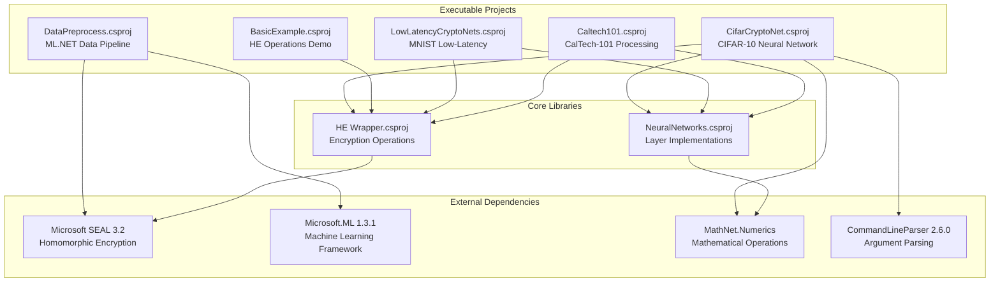
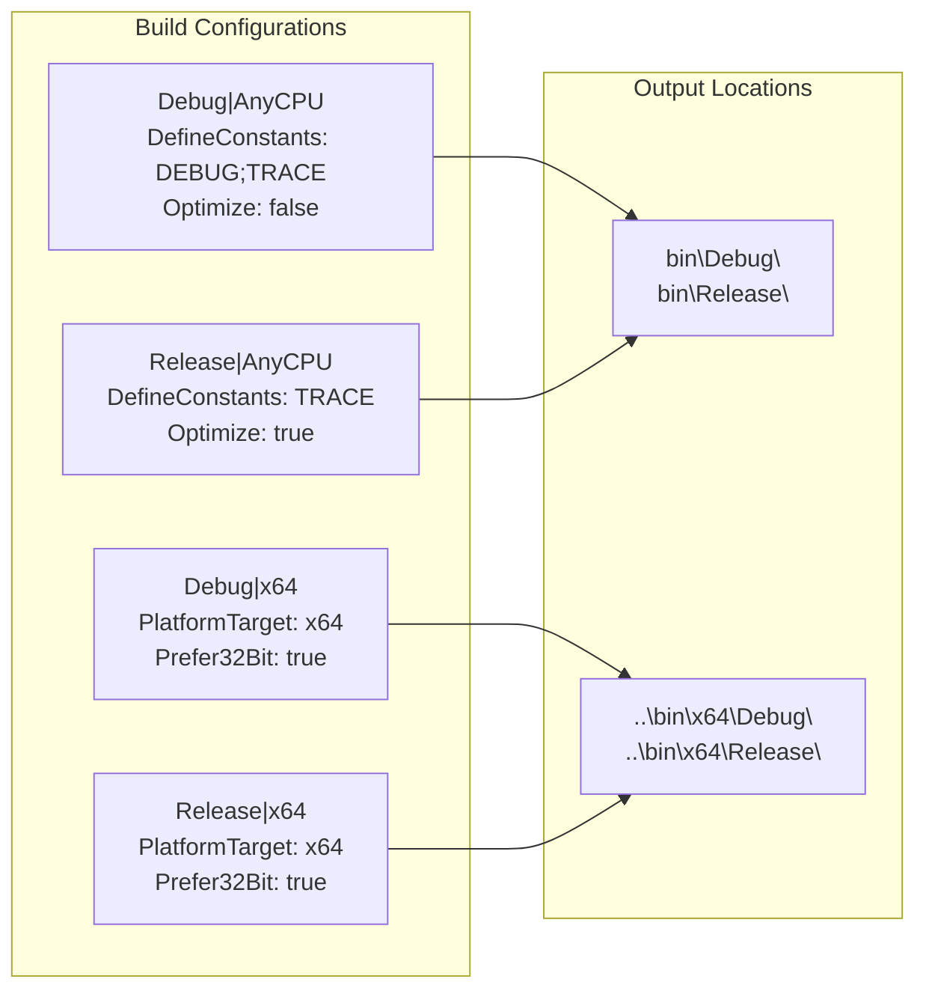
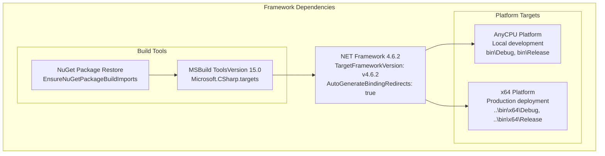
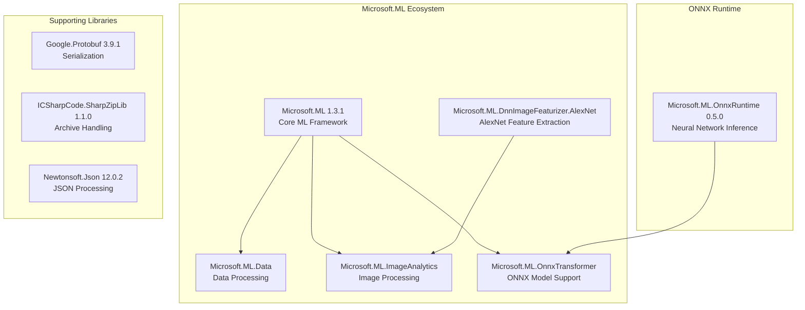
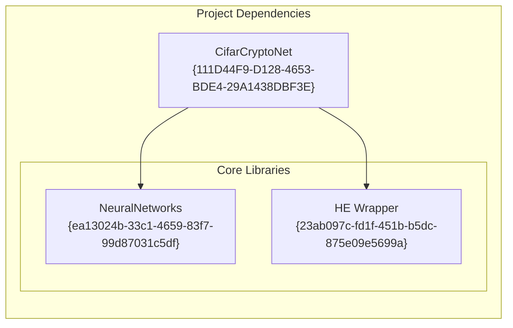
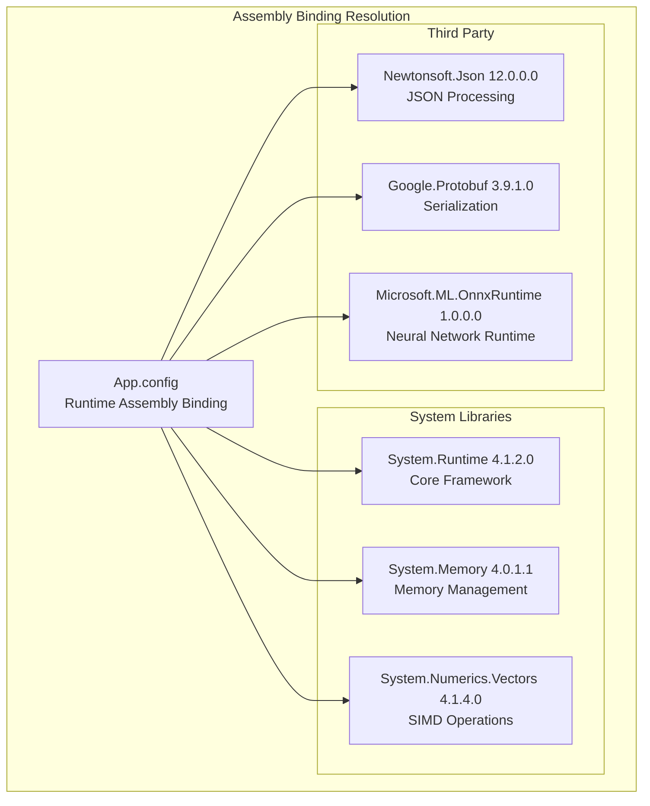

<!-- source: DeepWiki mcp.deepwiki.com · repo microsoft/CryptoNets · page 5.2 Build Configuration · fetched 2026-10-26 -->

# Build Configuration

Relevant source files

The following files were used as context for generating this wiki page:

- [CifarCryptoNet/CifarCryptoNet.csproj](CifarCryptoNet/CifarCryptoNet.csproj)
- [DataPreprocess/App.config](DataPreprocess/App.config)
- [DataPreprocess/DataPreprocess.csproj](DataPreprocess/DataPreprocess.csproj)

This document covers the MSBuild project configurations, dependencies, and build settings for the CryptoNets codebase. It details the .NET Framework targets, platform configurations, NuGet package management, and assembly binding redirects used across the different executable projects.

For information about the testing framework configuration, see [Testing Framework](#5.1). For details about the neural network implementations that these projects build, see [Neural Network Implementations](#3).

## Project Structure Overview

The CryptoNets solution contains multiple C# projects with different build configurations and dependency requirements. Each executable project targets .NET Framework 4.6.2 and uses MSBuild for compilation.

**Sources:** [CifarCryptoNet/CifarCryptoNet.csproj:1-105](), [DataPreprocess/DataPreprocess.csproj:1-293]()

## Build Configurations

All projects use a standardized set of build configurations supporting both development and production deployment scenarios.

### Configuration Matrix

| Configuration | Platform | Output Path | Optimization | Debug Symbols |
|---------------|----------|-------------|--------------|---------------|
| Debug | AnyCPU | `bin\Debug\` | Disabled | Full |
| Release | AnyCPU | `bin\Release\` | Enabled | PDB Only |
| Debug | x64 | `..\bin\x64\Debug\` | Disabled | Full |
| Release | x64 | `..\bin\x64\Release\` | Enabled | PDB Only |

**Sources:** [CifarCryptoNet/CifarCryptoNet.csproj:18-55](), [DataPreprocess/DataPreprocess.csproj:21-58]()

## Platform Targets and Framework Support

### Target Framework Configuration

All projects target `.NET Framework 4.6.2` as specified in the `TargetFrameworkVersion` property. This provides compatibility with Windows systems while supporting the required cryptographic and mathematical libraries.

**Sources:** [CifarCryptoNet/CifarCryptoNet.csproj:11-16](), [DataPreprocess/DataPreprocess.csproj:15-19]()

## Dependencies and Package Management

### Core NuGet Packages

The projects use different sets of NuGet packages based on their functional requirements:

#### CifarCryptoNet Dependencies
- `CommandLineParser 2.6.0` - Command line argument parsing [CifarCryptoNet/CifarCryptoNet.csproj:58-60]()
- `MathNet.Numerics` - Mathematical computations [CifarCryptoNet/CifarCryptoNet.csproj:61]()
- `MathNet.Numerics.MKL.Win-x64 2.3.0` - Intel MKL acceleration [CifarCryptoNet/CifarCryptoNet.csproj:98-104]()

#### DataPreprocess Dependencies
The `DataPreprocess` project has extensive ML.NET dependencies for data processing:

**Sources:** [DataPreprocess/DataPreprocess.csproj:70-114](), [DataPreprocess/DataPreprocess.csproj:82-98]()

### Project References

Projects maintain dependencies on core library components:

**Sources:** [CifarCryptoNet/CifarCryptoNet.csproj:87-96]()

## Assembly Binding Configuration

The `App.config` files contain extensive assembly binding redirects to resolve version conflicts between NuGet packages and their transitive dependencies.

### Critical Binding Redirects

The most important binding redirects handle core .NET Framework and third-party library version conflicts:

| Assembly | Old Version Range | New Version | Purpose |
|----------|-------------------|-------------|---------|
| System.Runtime | 0.0.0.0-4.1.2.0 | 4.1.2.0 | Core runtime compatibility |
| Microsoft.ML.OnnxRuntime | 0.0.0.0-1.0.0.0 | 1.0.0.0 | ONNX model execution |
| Newtonsoft.Json | 0.0.0.0-12.0.0.0 | 12.0.0.0 | JSON serialization |
| System.Numerics.Vectors | 0.0.0.0-4.1.4.0 | 4.1.4.0 | SIMD operations |

**Sources:** [DataPreprocess/App.config:6-65]()

### NuGet Package Import Validation

Build targets include validation to ensure all required NuGet packages are available before compilation:

The `EnsureNuGetPackageBuildImports` target validates the presence of:
- MathNet.Numerics.MKL.Win-x64 build targets [CifarCryptoNet/CifarCryptoNet.csproj:99-104]()
- Microsoft.ML framework components [DataPreprocess/DataPreprocess.csproj:278-292]()
- ONNX Runtime build properties [DataPreprocess/DataPreprocess.csproj:287-288]()

**Sources:** [CifarCryptoNet/CifarCryptoNet.csproj:99-104](), [DataPreprocess/DataPreprocess.csproj:278-292]()

---

