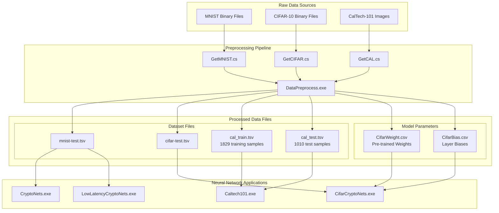
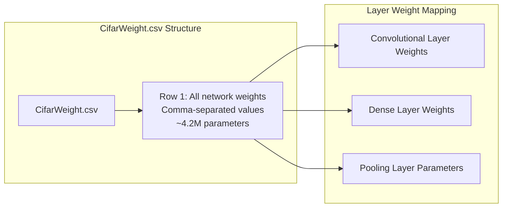
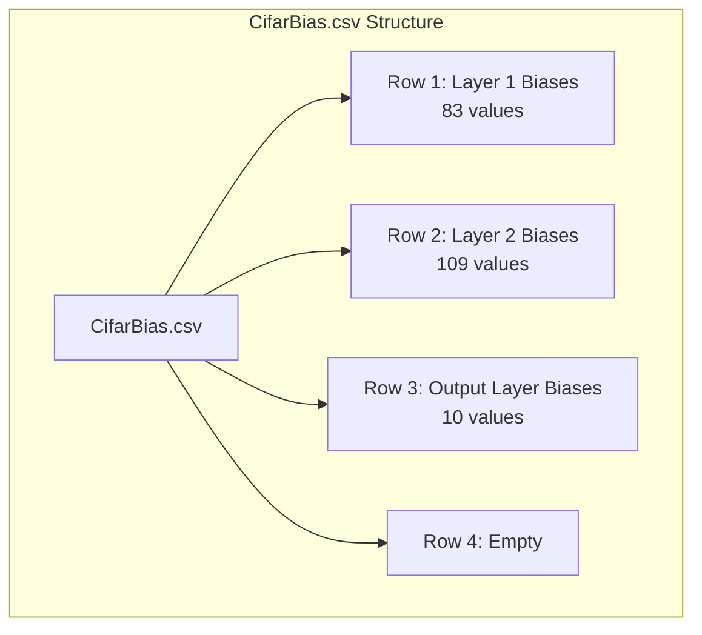
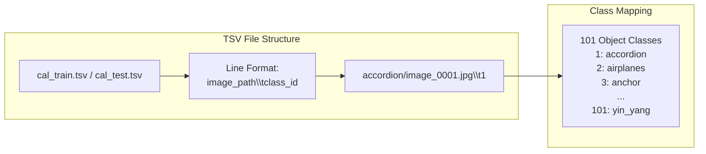
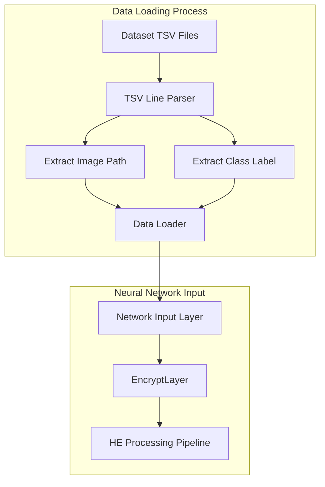

<!-- source: DeepWiki mcp.deepwiki.com · repo microsoft/CryptoNets · page 6 Data Reference · fetched 2026-10-26 -->

# Data Reference

Relevant source files

The following files were used as context for generating this wiki page:

- [CifarCryptoNet/CifarBias.csv](CifarCryptoNet/CifarBias.csv)
- [CifarCryptoNet/CifarWeight.csv](CifarCryptoNet/CifarWeight.csv)
- [DataPreprocess/cal_test.tsv](DataPreprocess/cal_test.tsv)
- [DataPreprocess/cal_train.tsv](DataPreprocess/cal_train.tsv)

This page provides reference documentation for data files, model parameters, and file formats used throughout the CryptoNets system. It covers the structure and purpose of pre-trained neural network parameters, processed dataset files, and their relationships within the overall data processing pipeline.

For information about using these data files with specific neural network implementations, see [Neural Network Parameters](#6.1). For details about dataset preprocessing and conversion processes, see [Dataset Formats](#6.2).

## Data File Overview

The CryptoNets system uses several categories of data files to support privacy-preserving neural network inference:

- **Pre-trained Model Parameters**: CSV files containing weights and biases for trained neural networks
- **Processed Dataset Files**: TSV files containing preprocessed training and test data
- **Raw Dataset Sources**: Binary format datasets that are converted during preprocessing

## Data File Architecture

**Sources**: [CifarCryptoNet/CifarBias.csv:1-4](), [CifarCryptoNet/CifarWeight.csv:1-1](), [DataPreprocess/cal_train.tsv:1-1829](), [DataPreprocess/cal_test.tsv:1-1010]()

## Pre-trained Model Parameters

### CIFAR-10 Neural Network Parameters

The CIFAR-10 CryptoNets implementation uses pre-trained parameters stored in CSV format:

| File | Purpose | Structure | Size |
|------|---------|-----------|------|
| `CifarWeight.csv` | Neural network weights | Single row of comma-separated values | ~21MB |
| `CifarBias.csv` | Layer bias parameters | 4 rows representing different layers | ~500 bytes |

#### Weight File Structure

The `CifarWeight.csv` file contains weights for the Low-Latency CryptoNets architecture in a flattened format:

**Sources**: [CifarCryptoNet/CifarWeight.csv:1-1]()

#### Bias File Structure

The `CifarBias.csv` file contains bias parameters organized by network layer:

**Sources**: [CifarCryptoNet/CifarBias.csv:1-4]()

## Dataset File Formats

### CalTech-101 Dataset Files

The CalTech-101 dataset is processed into tab-separated value (TSV) format for use with the homomorphic encryption neural networks:

| File | Records | Purpose | Format |
|------|---------|---------|--------|
| `cal_train.tsv` | 1,829 | Training data | `<image_path>\t<class_id>` |
| `cal_test.tsv` | 1,010 | Test data | `<image_path>\t<class_id>` |

#### CalTech-101 TSV Format Specification

**Sources**: [DataPreprocess/cal_train.tsv:1-1829](), [DataPreprocess/cal_test.tsv:1-1010]()

#### Class Distribution

The CalTech-101 dataset contains images organized into 101 object categories, with consistent naming conventions:

- **Training set**: 20 images per class (1,829 total after filtering)
- **Test set**: 10 images per class (1,010 total)
- **Image paths**: Format `<category>/<filename>.jpg`
- **Class IDs**: Sequential integers from 1 to 101

### Dataset Loading Pipeline

**Sources**: [DataPreprocess/cal_train.tsv:1-10](), [DataPreprocess/cal_test.tsv:1-10]()

## File Format Specifications

### CSV Parameter Files

- **Encoding**: UTF-8 text
- **Delimiter**: Comma (`,`)
- **Decimal format**: Standard floating-point notation
- **Line endings**: Platform-specific (`\r\n` on Windows)
- **Header**: None (data starts immediately)

### TSV Dataset Files  

- **Encoding**: UTF-8 text
- **Delimiter**: Tab character (`\t`)
- **Line format**: `<string>\t<integer>`
- **Line endings**: Platform-specific
- **Header**: None (data starts immediately)

## Data File Dependencies

The relationship between data files and neural network applications follows a specific dependency pattern:

| Application | Required Data Files | Purpose |
|-------------|-------------------|---------|
| `CifarCryptoNets.exe` | `CifarWeight.csv`, `CifarBias.csv`, `cifar-test.tsv` | CIFAR-10 inference with pre-trained model |
| `Caltech101.exe` | `cal_train.tsv`, `cal_test.tsv` | CalTech-101 classification |
| `CryptoNets.exe` | `mnist-test.tsv` | Original MNIST CryptoNets |
| `LowLatencyCryptoNets.exe` | `mnist-test.tsv` | Optimized MNIST inference |

**Sources**: [CifarCryptoNet/CifarBias.csv:1-4](), [CifarCryptoNet/CifarWeight.csv:1-1](), [DataPreprocess/cal_train.tsv:1-1829](), [DataPreprocess/cal_test.tsv:1-1010]()

---

