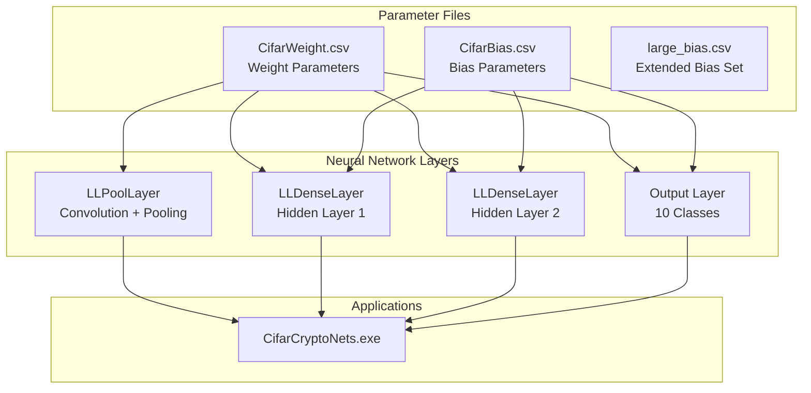
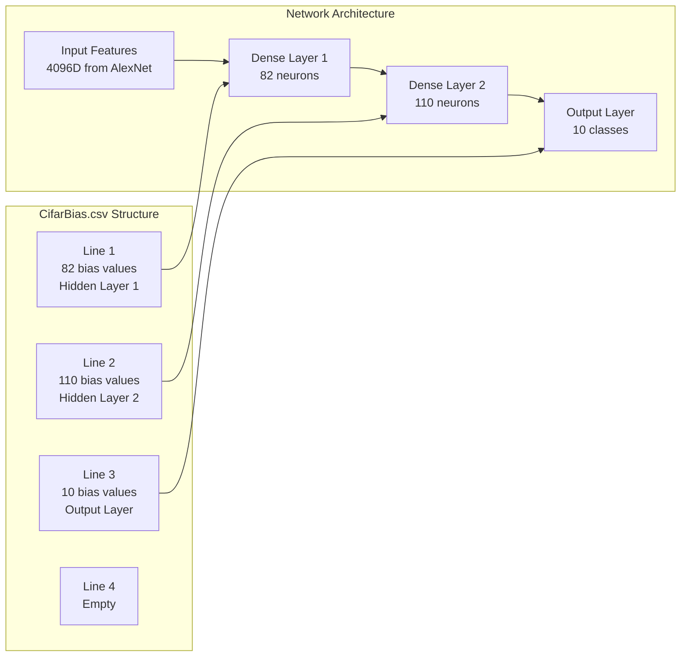
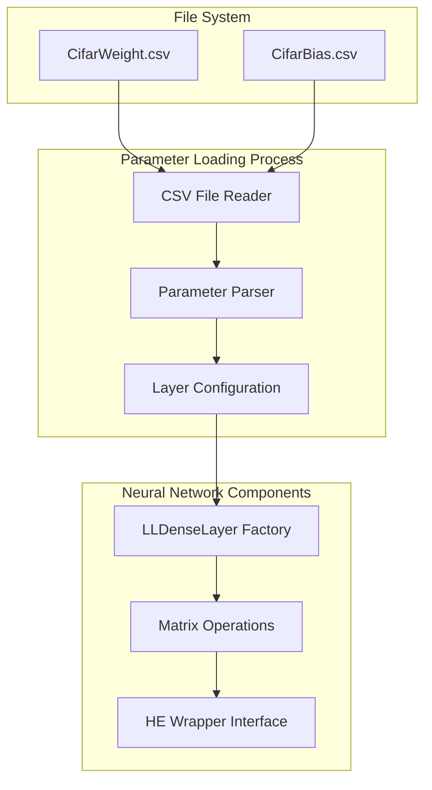

<!-- source: DeepWiki mcp.deepwiki.com · repo microsoft/CryptoNets · page 6.1 Neural Network Parameters · fetched 2026-10-26 -->

# Neural Network Parameters

Relevant source files

The following files were used as context for generating this wiki page:

- [CifarCryptoNet/CifarBias.csv](CifarCryptoNet/CifarBias.csv)
- [CifarCryptoNet/CifarWeight.csv](CifarCryptoNet/CifarWeight.csv)
- [CifarCryptoNet/large_bias.csv](CifarCryptoNet/large_bias.csv)

This document provides reference information for the pre-trained neural network parameter files used by the CIFAR-10 CryptoNets implementation. These parameter files contain the weights and biases that define the trained neural network model used for encrypted inference.

For information about dataset file formats and preprocessing, see [Dataset Formats](#6.2). For details about the CIFAR-10 neural network implementation, see [CIFAR-10 CryptoNets](#3.1).

## Parameter File Overview

The CryptoNets system uses pre-trained neural network parameters stored in CSV format to perform inference on encrypted data. These parameters are loaded during application initialization and used to configure the neural network layers for homomorphic computation.

Sources: [CifarCryptoNet/CifarWeight.csv:1-1](), [CifarCryptoNet/CifarBias.csv:1-4](), [CifarCryptoNet/large_bias.csv:1-1]()

## File Structure and Format

### CifarWeight.csv

Contains the complete weight matrix for all neural network layers in a single comma-separated line. The weights are stored in a flattened format representing the connections between neurons across all layers.

| Property | Value |
|----------|-------|
| Format | Single-line CSV |
| Total Parameters | ~1.2M weight values |
| Precision | Double precision floating point |
| Encoding | ASCII text |

### CifarBias.csv

Contains bias values organized by layer, with each line representing the bias vector for a specific neural network layer.

| Layer | Line | Parameter Count | Purpose |
|-------|------|-----------------|---------|
| Hidden Layer 1 | 1 | 82 | First dense layer biases |
| Hidden Layer 2 | 2 | 110 | Second dense layer biases |
| Output Layer | 3 | 10 | Final classification layer (CIFAR-10 classes) |
| Reserved | 4 | 0 | Empty line |

Sources: [CifarCryptoNet/CifarBias.csv:1-4]()

### large_bias.csv

Currently an empty placeholder file, likely reserved for extended bias configurations or alternative network architectures.

Sources: [CifarCryptoNet/large_bias.csv:1-1]()

## Parameter Loading and Usage

The parameter files are loaded by the CIFAR-10 CryptoNets application during initialization. The system reads these CSV files and configures the neural network layers with the pre-trained parameters for encrypted inference.

Sources: [CifarCryptoNet/CifarWeight.csv:1-1](), [CifarCryptoNet/CifarBias.csv:1-4]()

## Parameter Specifications

### Weight Matrix Organization

The `CifarWeight.csv` file contains a flattened representation of the complete neural network weight matrices. The weights are organized to match the layer-by-layer structure of the LoLa (Low-Latency) CryptoNets architecture.

### Bias Vector Structure

The bias parameters in `CifarBias.csv` are organized as follows:

- **Layer 1 Biases (82 values)**: Applied to the first dense layer after feature extraction
- **Layer 2 Biases (110 values)**: Applied to the second dense layer 
- **Output Biases (10 values)**: Applied to the final classification layer for CIFAR-10's 10 classes

### Numerical Precision

All parameters are stored as double-precision floating-point values with sufficient precision to maintain model accuracy during homomorphic encryption operations. The parameter values range approximately from -0.5 to +0.5, which is compatible with the BFV encryption scheme's plaintext space.

| Parameter Type | Range | Precision | Storage Format |
|----------------|-------|-----------|----------------|
| Weights | [-0.5, +0.5] | Double | CSV float |
| Biases | [-1.0, +1.0] | Double | CSV float |

Sources: [CifarCryptoNet/CifarWeight.csv:1-1](), [CifarCryptoNet/CifarBias.csv:1-3]()

## Integration with Homomorphic Encryption

These parameter files are specifically designed for use with the Microsoft SEAL homomorphic encryption library. The parameter values and precision are chosen to work within the constraints of the BFV encryption scheme while maintaining neural network accuracy.

The parameters undergo the following transformations during encrypted inference:

1. **Loading**: CSV values parsed as plaintext doubles
2. **Encoding**: Converted to SEAL plaintext polynomials
3. **Multiplication**: Applied to encrypted feature vectors via homomorphic operations
4. **Accumulation**: Bias values added to weighted sums in encrypted space

Sources: [CifarCryptoNet/CifarWeight.csv:1-1](), [CifarCryptoNet/CifarBias.csv:1-4]()

---

