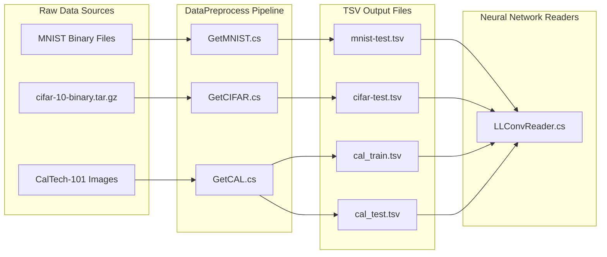
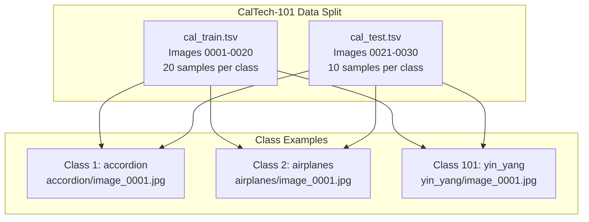
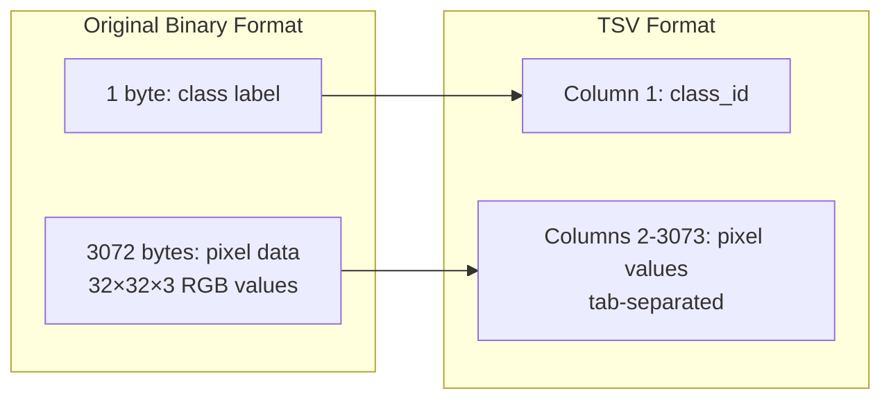
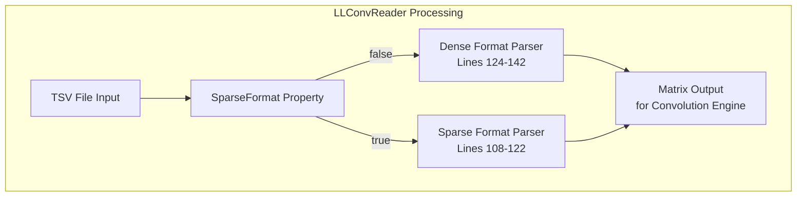
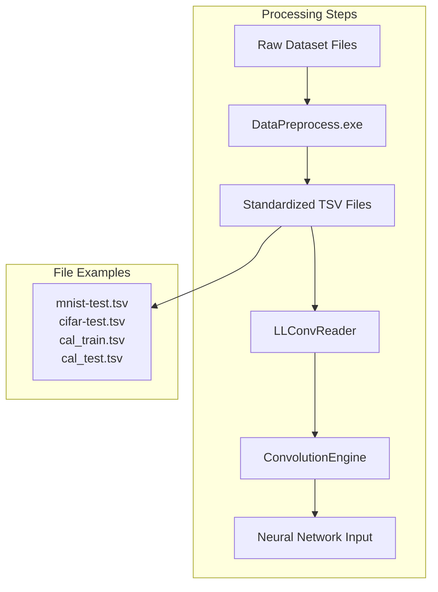

<!-- source: DeepWiki mcp.deepwiki.com · repo microsoft/CryptoNets · page 6.2 Dataset Formats · fetched 2026-10-26 -->

# Dataset Formats

<details>
<summary>Relevant source files</summary>

The following files were used as context for generating this wiki page:

- [DataPreprocess/GetCIFAR.cs](DataPreprocess/GetCIFAR.cs)
- [DataPreprocess/cal_test.tsv](DataPreprocess/cal_test.tsv)
- [DataPreprocess/cal_train.tsv](DataPreprocess/cal_train.tsv)
- [NeuralNetworks/LLConvReader.cs](NeuralNetworks/LLConvReader.cs)

</details>


This document describes the Tab-Separated Values (TSV) file formats used for training and testing data across the MNIST, CIFAR-10, and CalTech-101 datasets in the CryptoNets system. These standardized formats enable the neural network implementations to consume preprocessed data efficiently.

For information about the data preprocessing pipeline that generates these files, see [Data Preprocessing Pipeline](#2.3). For details about pre-trained neural network parameters, see [Neural Network Parameters](#6.1).

## Overview

The CryptoNets system uses standardized TSV formats to represent image datasets after preprocessing. These files serve as the input interface between the data preprocessing pipeline and the neural network applications. The format supports both dense and sparse representations, though the current implementations primarily use dense format.



Sources: [DataPreprocess/GetCIFAR.cs:1-55](), [NeuralNetworks/LLConvReader.cs:1-165]()

## CalTech-101 Dataset Format

The CalTech-101 dataset uses a simple two-column TSV format that maps image file paths to class identifiers. This format is generated by the preprocessing pipeline and consumed directly by the neural network implementations.

### File Structure

| Column | Type | Description |
|--------|------|-------------|
| 1 | String | Relative path to image file |
| 2 | Integer | Class ID (1-101) |

### Example Records

```
accordion/image_0001.jpg	1
airplanes/image_0001.jpg	2
anchor/image_0001.jpg	3
ant/image_0001.jpg	4
```

### Training vs Testing Split

The dataset is split into training and testing sets based on image numbering:

- **Training Set** (`cal_train.tsv`): Images `_0001` through `_0020` for each class
- **Testing Set** (`cal_test.tsv`): Images `_0021` through `_0030` for each class



Sources: [DataPreprocess/cal_train.tsv:1-100](), [DataPreprocess/cal_test.tsv:1-100]()

## CIFAR-10 Dataset Format

The CIFAR-10 dataset is converted from its original binary format to a dense TSV representation. Each row represents a single 32×32 color image with 3,072 pixel values plus a class label.

### Binary to TSV Conversion

The conversion process transforms the original CIFAR-10 binary format into a tab-separated format suitable for the neural network reader:



### Pixel Organization

The pixel data follows a specific channel-major ordering as implemented in the conversion logic:

| Position | Content |
|----------|---------|
| Column 1 | Class ID (0-9) |
| Columns 2-1025 | Red channel (32×32 values) |
| Columns 1026-2049 | Green channel (32×32 values) |
| Columns 2050-3073 | Blue channel (32×32 values) |

Sources: [DataPreprocess/GetCIFAR.cs:16-30]()

## Data Reader Implementation

The `LLConvReader` class handles reading and parsing of these TSV formats, supporting both dense and sparse representations. The reader integrates with the convolution engine to transform linear pixel data into appropriate matrix formats for neural network processing.

### Format Detection and Parsing



### Key Implementation Features

- **Label Extraction**: Configurable label column position via `LabelColumn` property
- **Normalization**: Applied through `NormalizationFactor` property
- **Memory Efficiency**: Processes one record at a time via `GetNext()` method
- **Convolution Integration**: Transforms data using `ConvolutionEngine.Location()` for spatial operations

Sources: [NeuralNetworks/LLConvReader.cs:63-67](), [NeuralNetworks/LLConvReader.cs:91-158]()

## File Processing Pipeline

The complete data flow from raw datasets to neural network input follows a standardized pipeline that ensures consistent formatting across all supported datasets.



The standardized TSV format enables consistent data handling across different neural network architectures while maintaining compatibility with the homomorphic encryption operations performed by the CryptoNets implementations.

Sources: [NeuralNetworks/LLConvReader.cs:144-157](), [DataPreprocess/GetCIFAR.cs:32-53]()

---

