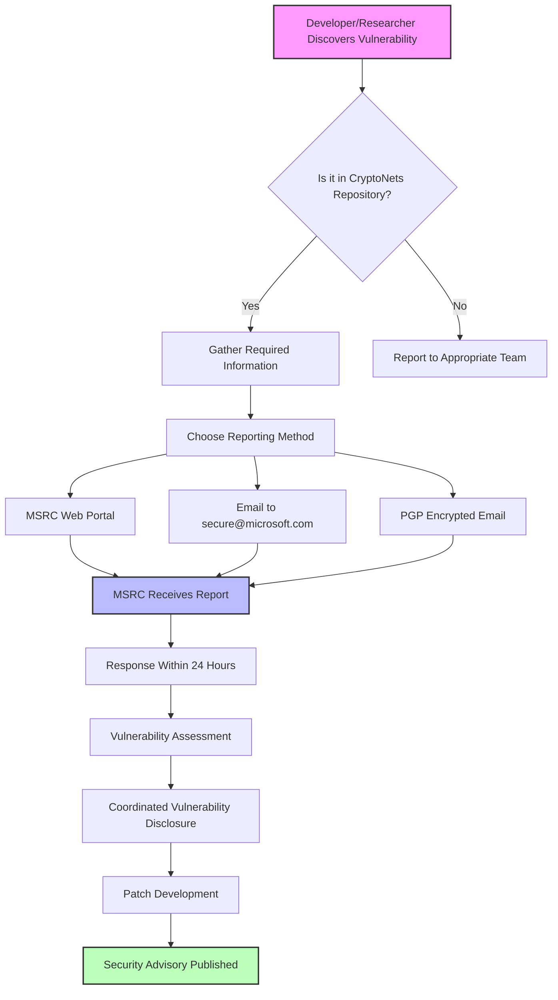
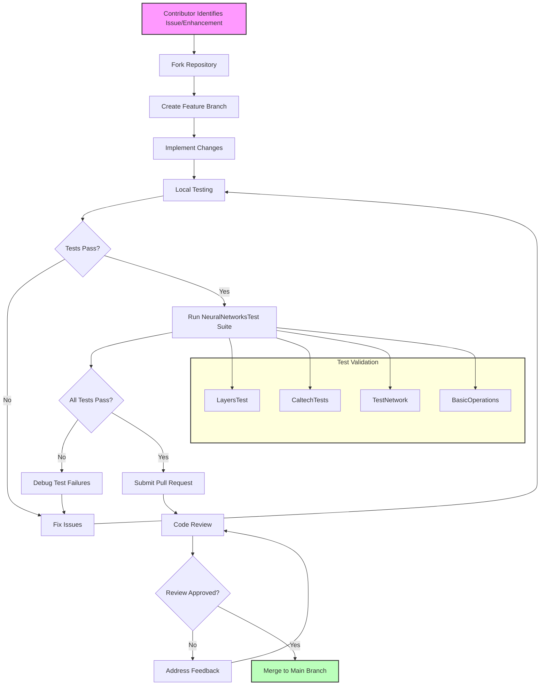
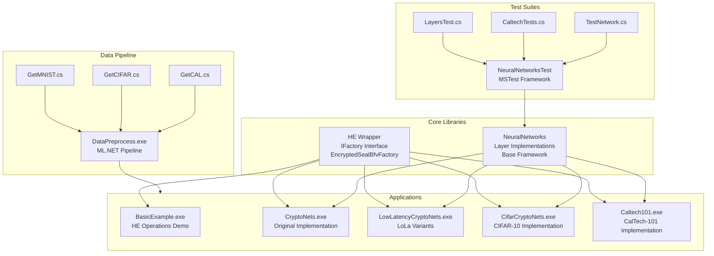

<!-- source: DeepWiki mcp.deepwiki.com · repo microsoft/CryptoNets · page 7 Security and Contributing · fetched 2026-10-26 -->

# Security and Contributing

Relevant source files

The following files were used as context for generating this wiki page:

- [LICENSE](LICENSE)
- [SECURITY.md](SECURITY.md)

This document covers security policies and guidelines for contributing to the CryptoNets project. It outlines the vulnerability reporting process, license terms, and general contribution workflows. For information about the testing framework used to validate contributions, see [Testing Framework](#5.1). For details about build configuration and project structure, see [Build Configuration](#5.2).

## Security Vulnerability Reporting

Microsoft takes security seriously across all repositories, including CryptoNets. The project follows Microsoft's standard security response procedures for vulnerability disclosure and remediation.

### Reporting Process

Security vulnerabilities should **never** be reported through public GitHub issues. Instead, all security issues must be reported through the Microsoft Security Response Center (MSRC) using one of the following methods:

| Method | Contact | Notes |
|--------|---------|--------|
| Web Portal | https://msrc.microsoft.com/create-report | Preferred method with tracking |
| Email | secure@microsoft.com | Alternative for users who prefer not to log in |
| PGP Encrypted Email | secure@microsoft.com | Use Microsoft's PGP key for sensitive reports |

The security team commits to responding within 24 hours of receiving a report. If no response is received within this timeframe, follow up via email to ensure the original message was received.

### Required Information

When reporting a security vulnerability, include as much of the following information as possible to help with triage and resolution:

- **Issue Type**: Buffer overflow, injection vulnerability, cryptographic weakness, etc.
- **Affected Files**: Full paths to source files related to the issue
- **Source Location**: Specific tag, branch, commit, or direct URL
- **Reproduction Steps**: Detailed step-by-step instructions
- **Configuration**: Any special setup required to reproduce the issue
- **Proof of Concept**: Exploit code or demonstration (if available)
- **Impact Assessment**: How an attacker might exploit the vulnerability

### Security Reporting Workflow

**Sources**: [SECURITY.md:1-42]()

### Bug Bounty Program

Security researchers may be eligible for rewards through Microsoft's Bug Bounty Program. More complete and detailed vulnerability reports can contribute to higher bounty awards. The program covers qualifying vulnerabilities found in Microsoft-owned repositories.

## Contributing Guidelines

CryptoNets is an open-source project released under the MIT License. Contributors must understand the licensing terms and follow standard open-source contribution practices.

### License Requirements

The project uses the MIT License with Microsoft Corporation holding the copyright. All contributions become part of the licensed codebase under these terms:

- **Permission Granted**: Use, modify, publish, distribute, sublicense, and sell
- **Conditions**: Include copyright notice and license in all copies
- **Limitations**: No warranty provided; no liability assumed by Microsoft

### Contribution Workflow

**Sources**: [LICENSE:1-22]()

### Code Quality Standards

Contributors should ensure their changes maintain the existing code quality and testing standards:

| Component | Test Project | Key Test Classes |
|-----------|--------------|------------------|
| Neural Networks | NeuralNetworksTest | `LayersTest`, `TestNetwork` |
| HE Operations | HE Wrapper Tests | `BasicOperations`, `BudgetAnalysis` |
| Dataset Processing | Integration Tests | `CaltechTests` |

### Codebase Integration Points

Understanding the major components helps contributors identify where their changes fit within the system architecture:

**Sources**: Project structure analysis

## Legal and Compliance

### Copyright Notice

All source code in the CryptoNets repository is copyrighted by Microsoft Corporation. The copyright notice must be preserved in all derivative works and distributions.

### License Terms Summary

| Aspect | Requirement |
|--------|-------------|
| **Usage** | Free for any purpose including commercial use |
| **Modification** | Permitted with copyright notice preservation |
| **Distribution** | Allowed with license inclusion |
| **Sublicensing** | Permitted under same terms |
| **Warranty** | None provided - software used "as is" |
| **Liability** | Microsoft assumes no liability for damages |

### Vulnerability Disclosure Policy

Microsoft follows the principle of **Coordinated Vulnerability Disclosure (CVD)**. This means:

- Security issues are disclosed responsibly
- Sufficient time is provided for patches before public disclosure
- Credit is given to security researchers following responsible disclosure
- Public disclosure includes sufficient detail for users to assess risk

**Sources**: [SECURITY.md:39](), [LICENSE:1-22]()

---

