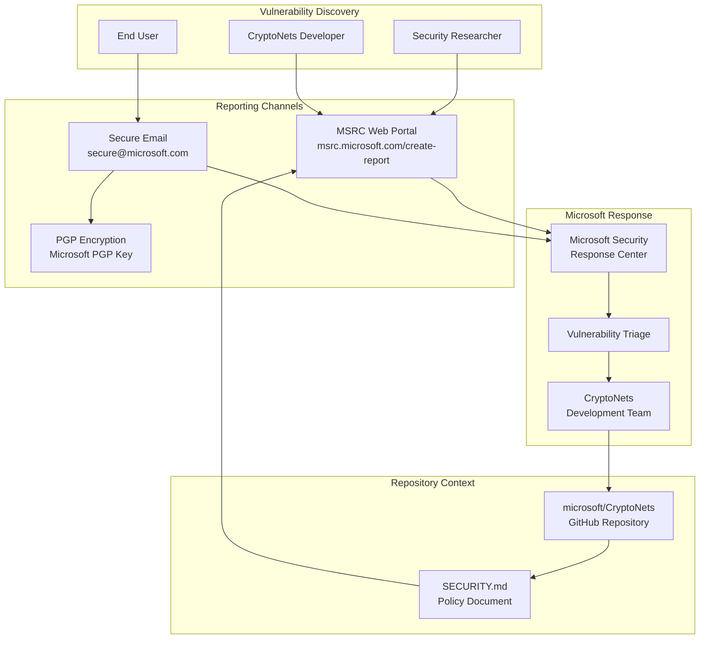
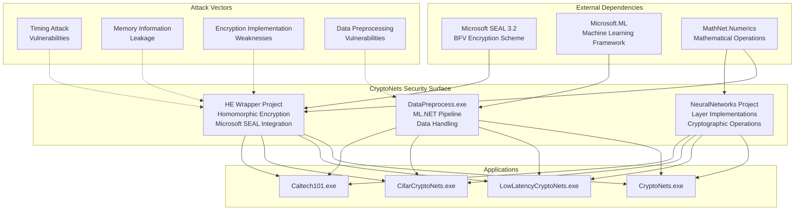

<!-- source: DeepWiki mcp.deepwiki.com · repo microsoft/CryptoNets · page 7.1 Security Vulnerability Reporting · fetched 2026-10-26 -->

# Security Vulnerability Reporting

Relevant source files

The following files were used as context for generating this wiki page:

- [SECURITY.md](SECURITY.md)

This document outlines the process for reporting security vulnerabilities found in the CryptoNets repository. It covers Microsoft's standard security response procedures and provides specific guidance for reporting issues in privacy-preserving neural network systems.

For information about the cryptographic security features and homomorphic encryption implementation details, see [Homomorphic Encryption Wrapper](#2.1).

## Overview

Microsoft maintains a coordinated vulnerability disclosure process for all repositories, including CryptoNets. Given that CryptoNets implements privacy-preserving neural network inference using homomorphic encryption, security vulnerabilities could have significant implications for data privacy and cryptographic integrity.

The security reporting process follows Microsoft's standardized approach as defined in [SECURITY.md:1-42](), ensuring that vulnerabilities are handled confidentially and responsibly before public disclosure.

Sources: [SECURITY.md:1-42]()

## Reporting Channels

### Microsoft Security Response Center (MSRC)

The primary channel for reporting security vulnerabilities is through the Microsoft Security Response Center. This centralized system ensures proper triage and coordinated response across Microsoft's security teams.

**Vulnerability Reporting Workflow**

Sources: [SECURITY.md:11-17]()

### Communication Methods

| Method | URL/Contact | Encryption | Response Time |
|--------|-------------|------------|---------------|
| MSRC Web Portal | `https://msrc.microsoft.com/create-report` | HTTPS | Within 24 hours |
| Secure Email | `secure@microsoft.com` | Optional PGP | Within 24 hours |
| PGP Key | Microsoft PGP Key page | Required for email | N/A |

**Important**: Do not report security vulnerabilities through public GitHub issues, as this could expose the vulnerability before it can be properly addressed.

Sources: [SECURITY.md:11-17]()

## CryptoNets-Specific Security Components

When reporting vulnerabilities in CryptoNets, it's important to identify which components are affected. The following diagram shows the security-relevant components that might be subject to vulnerability reports:

**CryptoNets Security-Relevant Components**

Sources: Based on repository structure analysis

## Required Information for Vulnerability Reports

When submitting a security vulnerability report for CryptoNets, include the following information to help with proper triage and assessment:

### Technical Details

- **Type of issue**: Specify the vulnerability category (e.g., timing attack, memory disclosure, cryptographic weakness, input validation flaw)
- **Affected components**: Identify specific projects or files using full paths from the repository root
- **Source code location**: Provide tag/branch/commit hash or direct file references
- **Configuration requirements**: Note any special setup needed to reproduce the issue

### Reproduction Information

- **Step-by-step instructions**: Detailed reproduction steps
- **Test environment**: Operating system, .NET version, dataset used
- **Command-line parameters**: Exact parameters used with CryptoNets applications
- **Proof-of-concept**: Code or exploit demonstration if available

### Impact Assessment

- **Privacy implications**: How the vulnerability affects data privacy guarantees
- **Cryptographic impact**: Effects on homomorphic encryption security
- **Performance impact**: Timing or resource-based attack potential
- **Data integrity**: Potential for data corruption or manipulation

Sources: [SECURITY.md:19-28]()

## Response Timeline and Process

### Initial Response

Microsoft aims to provide an initial response within 24 hours of receiving a vulnerability report. If you don't receive a response within this timeframe, follow up via email to ensure the report was received.

### Coordinated Disclosure

Microsoft follows the principle of Coordinated Vulnerability Disclosure (CVD), which means:

1. **Confidential handling**: Vulnerabilities are not disclosed publicly until a fix is available
2. **Coordinated timeline**: Microsoft works with researchers to establish appropriate disclosure timelines
3. **Credit attribution**: Security researchers receive appropriate credit for their discoveries
4. **Bug bounty eligibility**: Complete reports may qualify for Microsoft's Bug Bounty Program

### Communication Language

All communications should be conducted in English to ensure proper understanding and response.

Sources: [SECURITY.md:17-40]()

## Special Considerations for Cryptographic Software

CryptoNets implements privacy-preserving computation using homomorphic encryption, which introduces unique security considerations:

### Cryptographic Vulnerabilities

- **Side-channel attacks**: Timing, power, or cache-based information leakage
- **Implementation flaws**: Incorrect use of Microsoft SEAL operations
- **Parameter selection**: Inappropriate cryptographic parameters affecting security levels

### Privacy-Preserving Guarantees

- **Data leakage**: Unintended information disclosure through computation patterns
- **Noise management**: Incorrect noise handling in homomorphic operations
- **Key management**: Issues with encryption key generation or storage

### Performance-Security Trade-offs

- **Optimization vulnerabilities**: Security weaknesses introduced by performance optimizations
- **Resource exhaustion**: Denial-of-service through expensive cryptographic operations

Sources: Based on CryptoNets architecture analysis

## Microsoft Bug Bounty Program

Security vulnerability reports that meet Microsoft's criteria may be eligible for the Microsoft Bug Bounty Program. More complete and detailed reports generally contribute to higher bounty awards. Visit the Microsoft Bug Bounty Program page for current program details and eligibility requirements.

Sources: [SECURITY.md:31-32]()

---

