# Page: Overview

# Overview

<details>
<summary>Relevant source files</summary>

The following files were used as context for generating this wiki page:

- [CifarCryptoNet/LolaCifarCryptoNet.cs](CifarCryptoNet/LolaCifarCryptoNet.cs)
- [README.md](README.md)

</details>


This document provides a comprehensive overview of the CryptoNets repository, which demonstrates privacy-preserving neural network inference using homomorphic encryption. CryptoNets enables neural network predictions on encrypted data without ever decrypting it, making it suitable for scenarios where data privacy is critical, such as healthcare or finance applications.

The repository implements the [CryptoNets](http://proceedings.mlr.press/v48/gilad-bachrach16.pdf) and [Low-Latency CryptoNets (LoLa)](https://arxiv.org/abs/1812.10659) architectures across multiple datasets including MNIST, CIFAR-10, and CalTech-101. For detailed information about specific neural network implementations, see [Neural Network Implementations](#3). For data preprocessing workflows, see [Data Preprocessing Pipeline](#2.3).

## System Purpose and Capabilities

CryptoNets addresses the Prediction as a Service (PaaS) use case where users need neural network predictions but cannot share their raw data due to privacy constraints. The system uses Microsoft SEAL 3.2 homomorphic encryption to perform mathematical operations directly on encrypted data, ensuring that sensitive information never exists in plaintext during computation.

The framework supports both encrypted and plaintext modes for development and testing, with the encrypted mode providing full privacy preservation while the plaintext mode enables faster development cycles and debugging.

## High-Level Architecture

The CryptoNets system consists of three primary architectural layers that work together to enable privacy-preserving neural network inference:

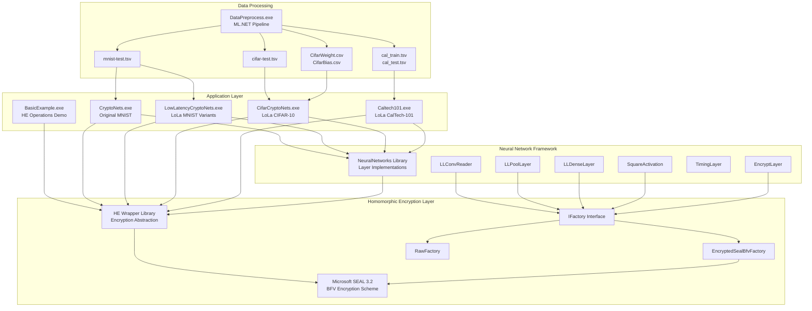

**Sources:** [README.md:14-17](), [CifarCryptoNet/LolaCifarCryptoNet.cs:1-170]()

## Core System Components

### Homomorphic Encryption Wrapper

The HE Wrapper provides a high-level abstraction over Microsoft SEAL's homomorphic encryption operations, enabling matrix and vector computations on encrypted data through the `IFactory` interface pattern. The wrapper supports two operational modes:

| Factory Type | Purpose | Use Case |
|--------------|---------|----------|
| `EncryptedSealBfvFactory` | Encrypted operations using SEAL BFV scheme | Production privacy-preserving inference |
| `RawFactory` | Plaintext operations | Development, testing, and debugging |

### Neural Network Framework

The neural network framework implements specialized layers optimized for homomorphic encryption constraints. Key layer types include:

- `LLConvReader`: Input data loading and initial convolution operations
- `LLPoolLayer`: Combined convolution and pooling operations
- `LLDenseLayer`: Fully connected layers with configurable input formats
- `SquareActivation`: Polynomial activation function (f(x) = x²) compatible with HE
- `EncryptLayer`: Data encryption interface between plaintext and encrypted domains
- `TimingLayer`: Performance measurement and benchmarking

### Application Implementations

The system includes five main executable applications, each targeting different use cases and datasets:

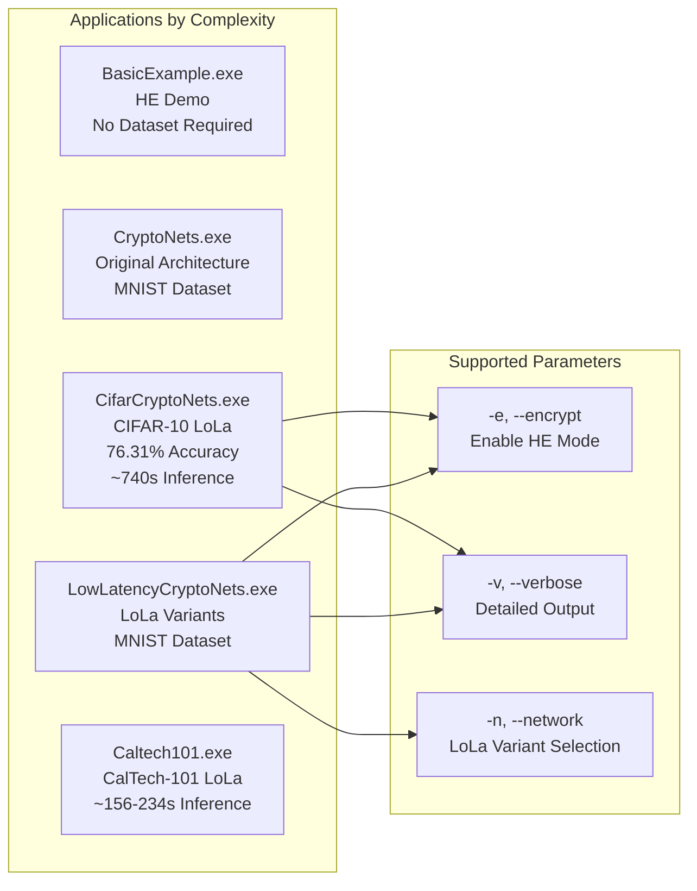

**Sources:** [README.md:54-200](), [CifarCryptoNet/LolaCifarCryptoNet.cs:12-18]()

## Data Processing Pipeline

The system uses a Microsoft.ML-based preprocessing pipeline to convert raw datasets into formats suitable for encrypted neural network inference:

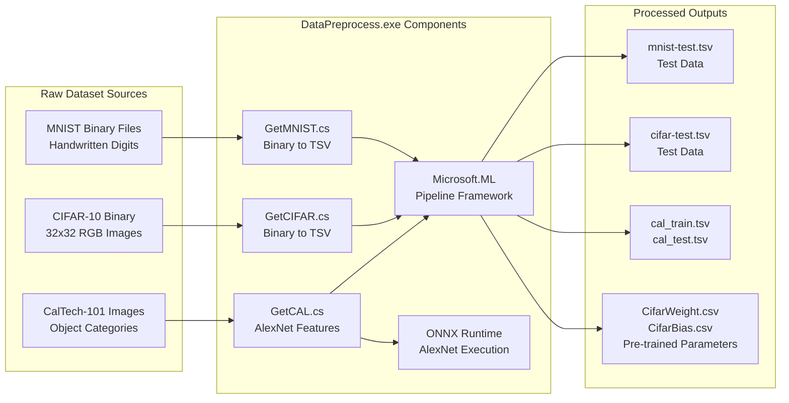

**Sources:** [README.md:50-52]()

## Performance Characteristics

The system demonstrates varying performance profiles across different implementations and datasets:

| Implementation | Dataset | Accuracy | Inference Time | Key Features |
|----------------|---------|----------|----------------|--------------|
| CryptoNets | MNIST | ~98.8% | ~27s | Original architecture, SEAL 3.2 |
| LoLa | MNIST | High | ~2014ms | Low-latency optimization |
| LoLa CIFAR-10 | CIFAR-10 | 76.31% | ~740-750s | Complex color image processing |
| LoLa CalTech-101 | CalTech-101 | Variable | ~156-234s | Object recognition categories |

The performance metrics are measured on Azure B8ms reference hardware and include full encryption/decryption cycles when operating in encrypted mode.

**Sources:** [README.md:108-200](), [CifarCryptoNet/LolaCifarCryptoNet.cs:28-30]()

---

# Page: System Architecture

# System Architecture

<details>
<summary>Relevant source files</summary>

The following files were used as context for generating this wiki page:

- [DataPreprocess/GetCIFAR.cs](DataPreprocess/GetCIFAR.cs)
- [HE Wrapper/RawMatrix.cs](HE Wrapper/RawMatrix.cs)
- [NeuralNetworks/LLConvReader.cs](NeuralNetworks/LLConvReader.cs)
- [README.md](README.md)

</details>


This document provides a comprehensive overview of the CryptoNets system architecture, covering the three core architectural components and their interactions. CryptoNets enables privacy-preserving neural network inference using homomorphic encryption through a layered architecture that abstracts cryptographic operations while maintaining computational efficiency.

For information about specific neural network implementations and their performance characteristics, see [Neural Network Implementations](#3). For usage instructions and command-line parameters, see [Usage and Examples](#4).

## Core Architectural Components

The CryptoNets system is built around three fundamental architectural layers that work together to enable homomorphic encryption-based neural network inference:

### Three-Layer Architecture Overview

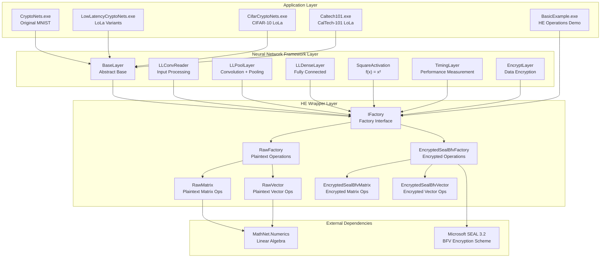

Sources: [README.md:14-17](), [HE Wrapper/RawMatrix.cs:12-13](), [NeuralNetworks/LLConvReader.cs:12]()

## Component 1: Homomorphic Encryption Wrapper

The HE Wrapper provides a unified interface for matrix and vector operations that can operate on both plaintext and encrypted data. This abstraction allows the neural network layers to be encryption-agnostic.

### Factory Pattern Implementation

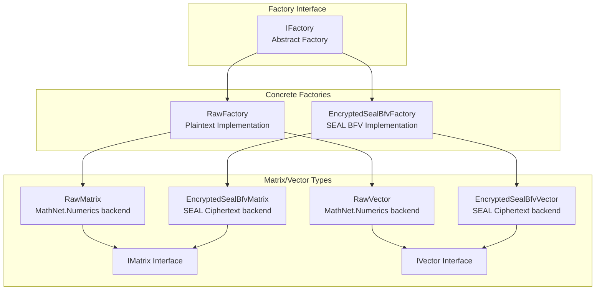

The `RawMatrix` class implements core matrix operations using `MathNet.Numerics.LinearAlgebra` as the computational backend. Key operations include:

| Operation | Method | Purpose |
|-----------|--------|---------|
| Matrix-Vector Multiplication | `Mul(IVector v, IComputationEnvironment env)` | Core neural network computation |
| Element-wise Multiplication | `ElementWiseMultiply(IMatrix m, IComputationEnvironment env)` | Activation functions |
| Matrix Addition | `Add(IMatrix m, IComputationEnvironment env)` | Bias addition |
| Matrix Interleaving | `Interleave(int shift, IComputationEnvironment env)` | Convolution operations |

Sources: [HE Wrapper/RawMatrix.cs:12-174](), [README.md:15]()

## Component 2: Neural Network Framework

The neural network framework provides layer implementations that operate transparently on both encrypted and plaintext data through the HE Wrapper interface.

### Layer Hierarchy and Specialization

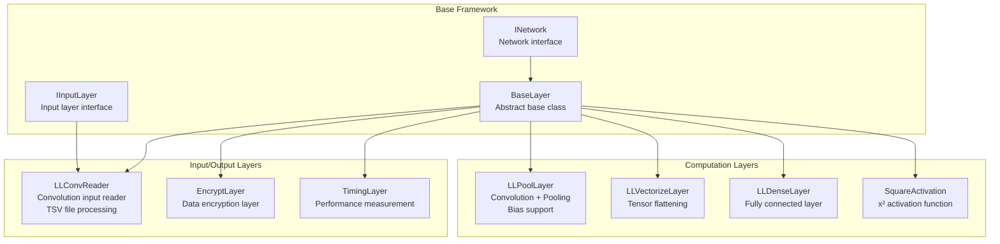

The `LLConvReader` class demonstrates the framework's approach to input processing, supporting both sparse and dense data formats while handling convolution-specific data layout:

- **Sparse Format**: `label:dimension:index:value` pairs from TSV files
- **Dense Format**: Tab-separated values with configurable label column
- **Convolution Mapping**: Transforms input vectors into convolution matrices using `ConvolutionEngine`

Sources: [NeuralNetworks/LLConvReader.cs:12-164](), [README.md:16]()

## Component 3: Application Implementations

The application layer contains specific neural network implementations that combine the HE Wrapper and Neural Network Framework to solve different classification problems.

### Application Architecture and Data Flow

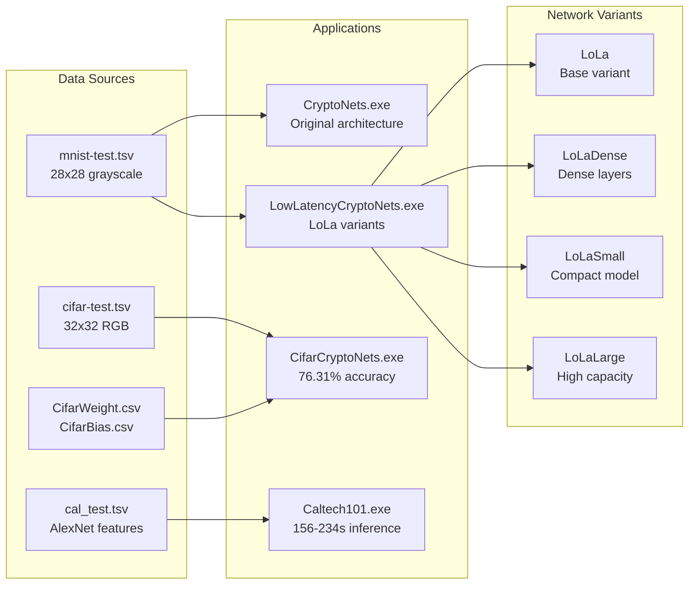

### Performance Characteristics

| Application | Dataset | Inference Time | Accuracy | Key Features |
|-------------|---------|----------------|----------|--------------|
| `CryptoNets.exe` | MNIST | ~27 seconds | 98.7% | Original architecture, SEAL 3.2 |
| `LowLatencyCryptoNets.exe` | MNIST | ~2000ms | High | Multiple LoLa variants |
| `CifarCryptoNets.exe` | CIFAR-10 | ~740 seconds | 76.31% | Color image classification |
| `Caltech101.exe` | CalTech-101 | 156-234 seconds | Varies | Object recognition |

Sources: [README.md:19-21](), [README.md:136-139](), [README.md:148-171]()

## System Execution Flow

The system follows a consistent execution pattern across all applications, with mode selection determining whether operations occur on plaintext or encrypted data.

### Execution Mode Selection

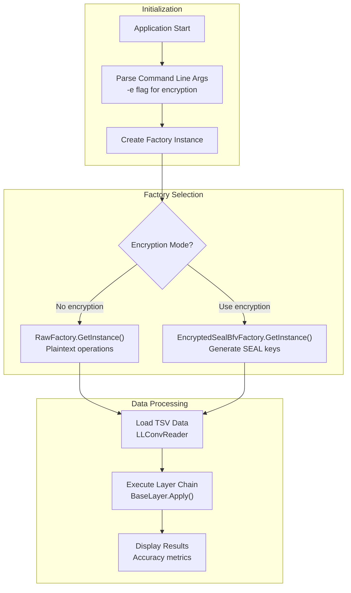

### Layer Execution Chain

The neural network layers execute in a pipeline, with each layer's output becoming the next layer's input:

1. **`LLConvReader`**: Reads TSV data and converts to convolution format
2. **`EncryptLayer`** (encrypted mode only): Encrypts input data
3. **`LLPoolLayer`**: Applies convolution and pooling operations  
4. **`SquareActivation`**: Applies polynomial activation function
5. **`LLDenseLayer`**: Performs fully connected layer computation
6. **`TimingLayer`**: Records performance metrics

Sources: [README.md:82-104](), [README.md:117-132](), [DataPreprocess/GetCIFAR.cs:32-53]()

## Data Preprocessing Integration

The system includes a comprehensive data preprocessing pipeline implemented in `DataPreprocess.exe` that prepares datasets for the neural network applications.

### Preprocessing Pipeline Architecture

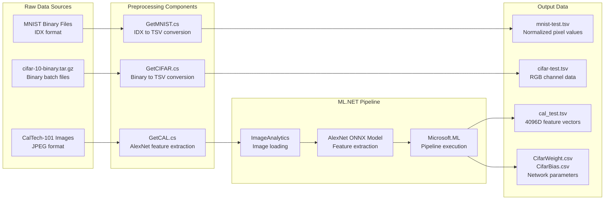

The `GetCIFAR` class exemplifies the preprocessing approach, reading binary data and converting it to the TSV format expected by the neural network layers. The conversion process handles the CIFAR-10 data layout where each record contains a label byte followed by 3072 bytes (32×32×3 RGB values).

Sources: [DataPreprocess/GetCIFAR.cs:14-54](), [README.md:50-52]()

---

# Page: Homomorphic Encryption Wrapper

# Homomorphic Encryption Wrapper

<details>
<summary>Relevant source files</summary>

The following files were used as context for generating this wiki page:

- [HE Wrapper Tests/HE Wrapper Tests.csproj](HE Wrapper Tests/HE Wrapper Tests.csproj)
- [HE Wrapper/HE Wrapper.csproj](HE Wrapper/HE Wrapper.csproj)
- [HE Wrapper/RawMatrix.cs](HE Wrapper/RawMatrix.cs)

</details>


The Homomorphic Encryption Wrapper provides a unified interface for matrix and vector operations that can be performed on both plaintext and homomorphically encrypted data. This component serves as the foundational cryptographic layer for the CryptoNets neural network implementations, abstracting Microsoft SEAL's BFV encryption scheme behind standard linear algebra operations.

The wrapper enables seamless switching between plaintext and encrypted computation modes through a factory pattern, allowing neural network layers to operate identically regardless of whether data is encrypted or not. For information about the neural network layers that use this wrapper, see [Neural Network Framework](#2.2). For details about specific neural network implementations, see [Neural Network Implementations](#3).

## Architecture Overview

The HE Wrapper implements a factory-based architecture that provides identical interfaces for both encrypted and plaintext operations:

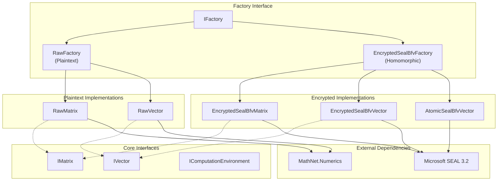

**Sources:** [HE Wrapper/HE Wrapper.csproj:80-94](), [HE Wrapper/RawMatrix.cs:1-175]()

## Core Interfaces and Data Structures

The wrapper defines three primary interfaces that establish the contract for all matrix and vector operations:

### Interface Hierarchy

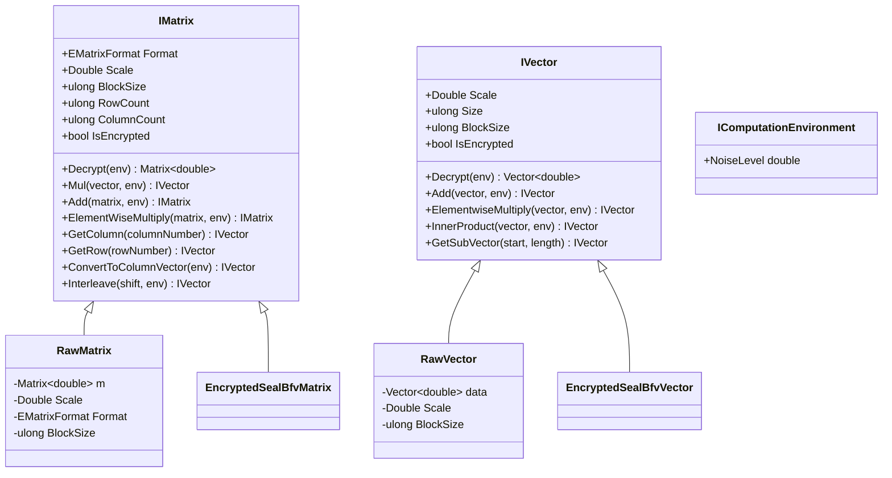

**Sources:** [HE Wrapper/RawMatrix.cs:12-175](), [HE Wrapper/HE Wrapper.csproj:88-90]()

## Matrix Operations and Scaling

The `RawMatrix` class implements plaintext matrix operations using MathNet.Numerics as the underlying mathematical library. Key features include:

| Operation | Method | Description |
|-----------|--------|-------------|
| Matrix-Vector Multiplication | `Mul(IVector v, IComputationEnvironment env)` | Multiplies matrix by vector, handling scale propagation |
| Element-wise Multiplication | `ElementWiseMultiply(IMatrix m, IComputationEnvironment env)` | Point-wise multiplication with format validation |
| Matrix Addition | `Add(IMatrix m, IComputationEnvironment env)` | Addition with scale and dimension validation |
| Column/Row Extraction | `GetColumn(int columnNumber)` / `GetRow(int rowNumber)` | Extract vectors respecting matrix format |
| Vectorization | `ConvertToColumnVector(IComputationEnvironment env)` | Flatten matrix to column vector |
| Interleaving | `Interleave(int shift, IComputationEnvironment env)` | Shift-and-add operation for convolution |

### Scaling and Precision Management

The wrapper implements a scaling system to maintain precision when working with integer-based homomorphic encryption:

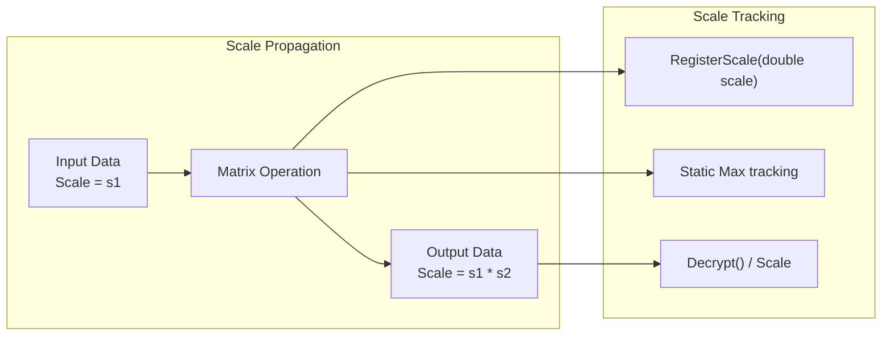

**Sources:** [HE Wrapper/RawMatrix.cs:23-30](), [HE Wrapper/RawMatrix.cs:128-131](), [HE Wrapper/RawMatrix.cs:34-39]()

## Factory Pattern Implementation

The wrapper uses the factory pattern to enable runtime selection between plaintext and encrypted computation modes:

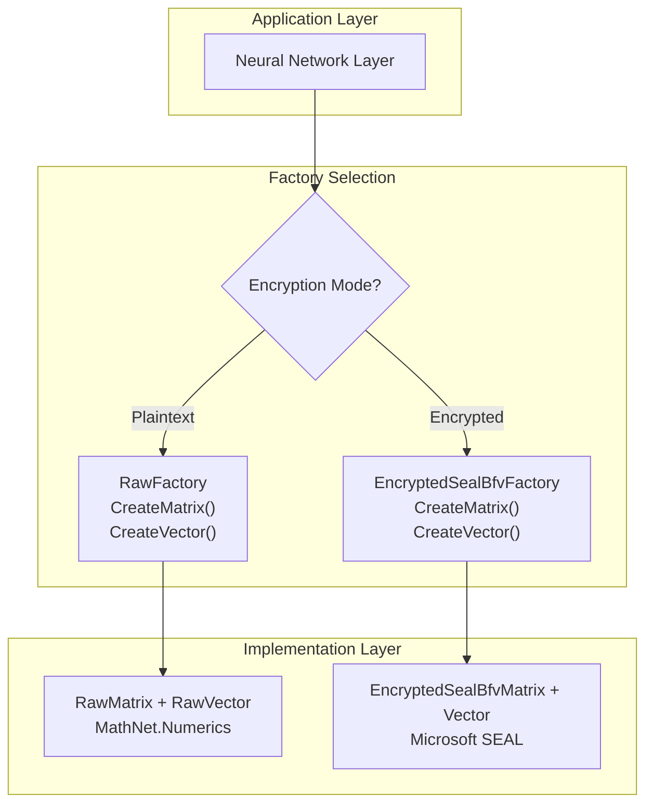

This pattern allows identical neural network code to operate on both plaintext and encrypted data by simply changing the factory instance used for matrix and vector creation.

**Sources:** [HE Wrapper/HE Wrapper.csproj:85]()

## Serialization and Persistence

The wrapper provides serialization capabilities for both matrices and vectors through `Read` and `Write` methods:

| Component | Read Method | Write Method | Format |
|-----------|-------------|--------------|--------|
| RawMatrix | `Read(StreamReader str)` | `Write(StreamWriter str)` | Scale + Delimited Matrix + BlockSize |
| RawVector | Similar pattern | Similar pattern | Scale + Delimited Vector + BlockSize |

The serialization format preserves scaling information and block size parameters necessary for homomorphic operations.

**Sources:** [HE Wrapper/RawMatrix.cs:42-53](), [HE Wrapper/RawMatrix.cs:59-64]()

## Dependencies and Build Configuration

The HE Wrapper project has the following key dependencies:

| Dependency | Version | Purpose |
|------------|---------|---------|
| Microsoft.Research.SEALNet | 3.2.0 | Homomorphic encryption operations |
| MathNet.Numerics | 4.8.1 | Linear algebra for plaintext operations |
| MathNet.Numerics.Data.Text | 4.0.0 | Matrix/vector file I/O |
| MathNet.Numerics.MKL.Win-x64 | 2.3.0 | Optimized mathematical operations |

The project supports both Debug and Release configurations with x64 platform targeting for optimal performance with the mathematical libraries.

**Sources:** [HE Wrapper/HE Wrapper.csproj:54-78](), [HE Wrapper/HE Wrapper.csproj:100-108]()

## Testing Infrastructure

The HE Wrapper includes comprehensive testing through the HE Wrapper Tests project:

| Test Category | Purpose |
|---------------|---------|
| BasicOperations | Test encrypted homomorphic operations |
| BasicRawOperations | Test plaintext mathematical operations |
| BudgetAnalysis | Analyze encryption noise budget consumption |

**Sources:** [HE Wrapper Tests/HE Wrapper Tests.csproj:81-84]()

---

# Page: Neural Network Framework

# Neural Network Framework

<details>
<summary>Relevant source files</summary>

The following files were used as context for generating this wiki page:

- [DataPreprocess/GetCIFAR.cs](DataPreprocess/GetCIFAR.cs)
- [NeuralNetworks/LLConvReader.cs](NeuralNetworks/LLConvReader.cs)
- [NeuralNetworksTest/NeuralNetworksTest.csproj](NeuralNetworksTest/NeuralNetworksTest.csproj)

</details>


## Purpose and Scope

The Neural Network Framework provides the foundational layer implementations and base classes for building privacy-preserving neural networks that operate on encrypted data. This framework defines the core abstractions for neural network layers, data flow, and integration with homomorphic encryption operations.

This document covers the base neural network infrastructure and layer implementations. For details about the homomorphic encryption integration, see [Homomorphic Encryption Wrapper](#2.1). For specific neural network applications and their implementations, see [Neural Network Implementations](#3).

## Framework Architecture

The neural network framework is built around a layered architecture with clear interfaces for different types of network components. The framework supports both encrypted and plaintext operations through a factory pattern abstraction.

### Core Framework Diagram
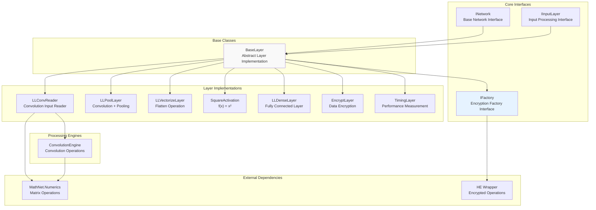

Sources: [NeuralNetworks/LLConvReader.cs:12-14](), [NeuralNetworksTest/NeuralNetworksTest.csproj:104-111]()

## Base Layer Architecture

The framework is built on a hierarchical class structure where all neural network layers inherit from `BaseLayer` and implement specific interfaces based on their functionality.

### Layer Inheritance Structure

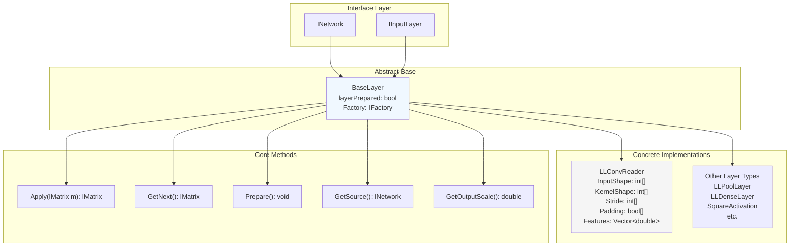

Sources: [NeuralNetworks/LLConvReader.cs:12](), [NeuralNetworks/LLConvReader.cs:76-88]()

## Input Layer Implementation

The `LLConvReader` class serves as the primary input layer for convolutional neural networks, handling data ingestion and initial convolution operations.

### LLConvReader Component Structure

| Property | Type | Purpose |
|----------|------|---------|
| `InputShape` | `int[]` | Dimensions of input data |
| `KernelShape` | `int[]` | Convolution kernel dimensions |
| `Stride` | `int[]` | Convolution stride parameters |
| `Padding` | `bool[]` | Padding configuration |
| `Features` | `Vector<double>` | Input feature vector |
| `FileName` | `string` | Data source file path |
| `NormalizationFactor` | `double` | Input scaling factor |
| `SparseFormat` | `bool` | Data format specification |

### Data Processing Flow

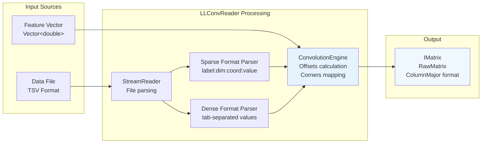

Sources: [NeuralNetworks/LLConvReader.cs:34-44](), [NeuralNetworks/LLConvReader.cs:96-158](), [NeuralNetworks/LLConvReader.cs:108-142]()

## Convolution Engine

The `ConvolutionEngine` handles the mathematical operations for convolution layers, calculating spatial transformations and managing padding operations.

### Convolution Operations

The convolution engine processes input data through several key operations:

1. **Offset Calculation**: Determines pixel positions for convolution kernels
2. **Corner Mapping**: Maps convolution windows to input coordinates  
3. **Padding Handling**: Applies zero-padding for boundary conditions
4. **Location Mapping**: Translates 2D coordinates to 1D feature indices

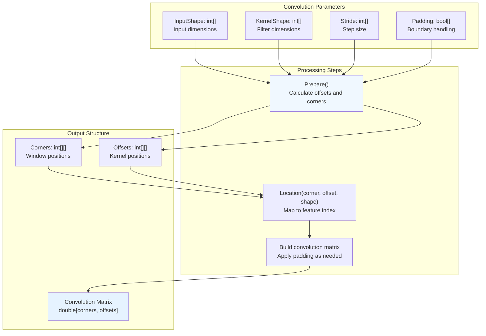

Sources: [NeuralNetworks/LLConvReader.cs:14-24](), [NeuralNetworks/LLConvReader.cs:144-156]()

## Integration with HE Wrapper

The neural network framework integrates with the homomorphic encryption system through the factory pattern, allowing layers to operate on both encrypted and plaintext data seamlessly.

### Factory Pattern Integration

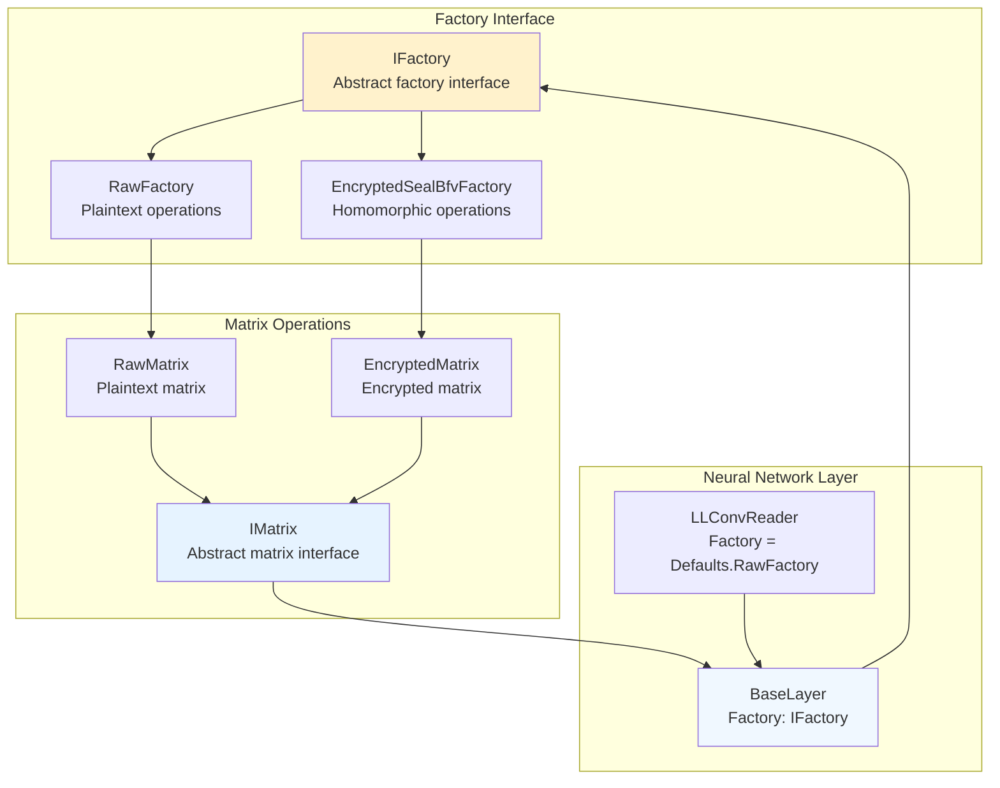

Sources: [NeuralNetworks/LLConvReader.cs:72-74](), [NeuralNetworks/LLConvReader.cs:154]()

## Testing Framework

The neural network framework includes comprehensive testing through the `NeuralNetworksTest` project, which validates layer functionality and integration with encryption systems.

### Test Project Structure

| Test Component | Purpose |
|----------------|---------|
| `LayersTest.cs` | Unit tests for individual layer implementations |
| `CaltechTests.cs` | Integration tests for CalTech-101 dataset processing |
| `TestNetwork.cs` | End-to-end network architecture testing |
| `FakeLayer.cs` | Mock layer implementation for testing |

### Test Dependencies

The testing framework includes the following key dependencies:

- **MSTest Framework**: Unit testing infrastructure
- **MathNet.Numerics**: Mathematical operations validation
- **SEALNET**: Homomorphic encryption testing
- **Project References**: All CryptoNets implementations for integration testing

Sources: [NeuralNetworksTest/NeuralNetworksTest.csproj:82-86](), [NeuralNetworksTest/NeuralNetworksTest.csproj:92-111](), [NeuralNetworksTest/NeuralNetworksTest.csproj:60-79]()

---

# Page: Data Preprocessing Pipeline

# Data Preprocessing Pipeline

<details>
<summary>Relevant source files</summary>

The following files were used as context for generating this wiki page:

- [DataPreprocess/DataPreprocess.csproj](DataPreprocess/DataPreprocess.csproj)
- [DataPreprocess/GetCAL.cs](DataPreprocess/GetCAL.cs)
- [DataPreprocess/packages.config](DataPreprocess/packages.config)

</details>


## Purpose and Scope

The Data Preprocessing Pipeline is a Microsoft.ML-based system that converts raw dataset files into the standardized TSV (Tab-Separated Values) format required by CryptoNets neural network applications. This system handles three primary datasets: MNIST handwritten digits, CIFAR-10 image classification, and CalTech-101 object recognition datasets.

The pipeline transforms raw binary data and images into feature vectors and structured data that can be consumed by the homomorphic encryption-enabled neural networks. For information about the neural network implementations that consume this processed data, see [Neural Network Implementations](#3).

## System Architecture

The preprocessing system is built as a console application (`DataPreprocess.exe`) that leverages the Microsoft.ML framework for data transformation and feature extraction.

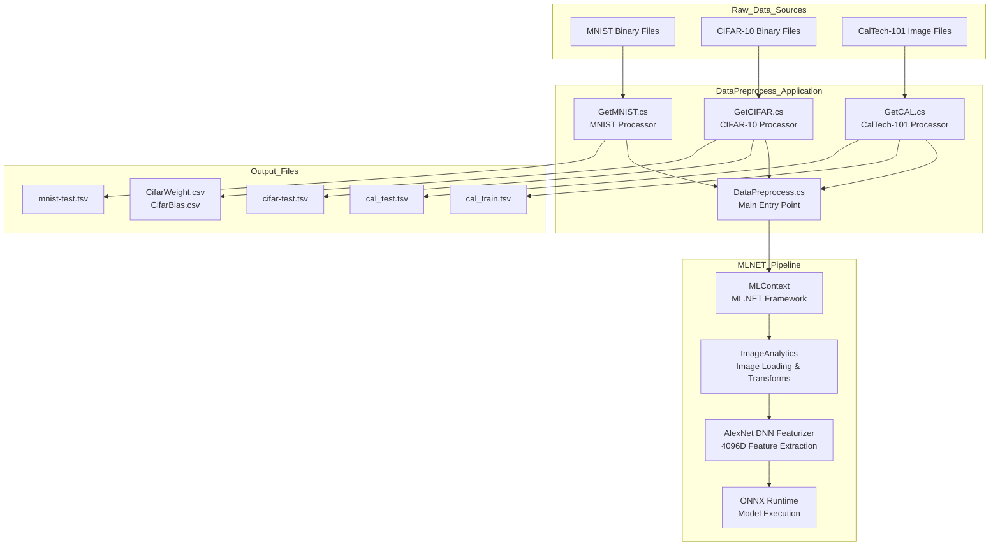

**Sources:** [DataPreprocess/DataPreprocess.csproj:260-266](), [DataPreprocess/packages.config:1-71]()

## Core Components

The preprocessing system consists of four main C# classes that handle different aspects of data processing:

| Component | Purpose | Primary Dependencies |
|-----------|---------|---------------------|
| `DataPreprocess.cs` | Main entry point and command-line interface | Microsoft.ML |
| `GetMNIST.cs` | MNIST dataset binary file processing | Standard .NET I/O |
| `GetCIFAR.cs` | CIFAR-10 binary to TSV conversion | Microsoft.ML |
| `GetCAL.cs` | CalTech-101 image feature extraction | Microsoft.ML.ImageAnalytics, AlexNet |

The application uses a command-line interface where the first argument specifies the dataset type (`MNIST`, `CIFAR`, or `CAL`), followed by dataset-specific parameters.

**Sources:** [DataPreprocess/DataPreprocess.csproj:260-266]()

## ML.NET Processing Pipeline

The system leverages Microsoft.ML's transform pipeline architecture, particularly for image processing tasks. The CalTech-101 processor demonstrates the most sophisticated pipeline:

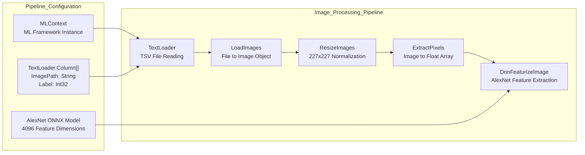

The pipeline processes images through these transforms:
- `LoadImages`: Converts file paths to `ImageType` objects [GetCAL.cs:100]()
- `ResizeImages`: Standardizes images to 227×227 pixels [GetCAL.cs:101]()
- `ExtractPixels`: Converts images to float arrays [GetCAL.cs:102]()
- `DnnFeaturizeImage`: Applies AlexNet feature extraction to produce 4096-dimensional vectors [GetCAL.cs:103]()

**Sources:** [GetCAL.cs:88-104](), [DataPreprocess/packages.config:8-12]()

## Dataset Processors

### CalTech-101 Processor (`GetCAL.cs`)

The CalTech-101 processor implements the most complex processing logic, handling image feature extraction using pre-trained AlexNet models:

```mermaid
graph TB
    subgraph "GetCAL_Processing"
        Run["GetCAL.Run()<br/>Main Entry Point"]
        RunFailover["_Run_failover()<br/>Error Handling Wrapper"]
        RunCore["_Run()<br/>Core ML.NET Pipeline"]
        TempFileGen["GetTempFileNameWithExtension()<br/>Temporary File Management"]
    end
    
    subgraph "Input_Processing"
        CatalogFile["Image Catalog TSV<br/>ImagePath + Label"]
        ImageDirectory["Image Files Directory"]
        ParallelProcessing["AsParallel().Select()<br/>Concurrent Processing"]
    end
    
    subgraph "ML_Pipeline_Execution"
        DataLoader["TextLoader with Columns"]
        ImagePipeline["LoadImages → ResizeImages → ExtractPixels → DnnFeaturizeImage"]
        FeatureExtraction["4096D Feature Vector Output"]
    end
    
    subgraph "Error_Handling"
        ImageCopy["Bitmap Copy Creation"]
        TempImageSave["Temporary Image File Save"]
        RetryLogic["Pipeline Retry Mechanism"]
    end
    
    Run --> ParallelProcessing
    ParallelProcessing --> RunFailover
    RunFailover --> RunCore
    RunFailover --> ImageCopy
    
    CatalogFile --> DataLoader
    ImageDirectory --> ImagePipeline
    DataLoader --> ImagePipeline
    ImagePipeline --> FeatureExtraction
    
    ImageCopy --> TempImageSave
    TempImageSave --> RetryLogic
```

Key features:
- **Parallel Processing**: Uses `AsParallel()` for concurrent image processing [GetCAL.cs:31]()
- **Error Handling**: Implements failover logic with image format conversion [GetCAL.cs:38-78]()
- **Feature Extraction**: Produces sparse 4096-dimensional feature vectors [GetCAL.cs:114-118]()
- **AlexNet Integration**: Uses pre-trained AlexNet model via ML.NET DNN transforms [GetCAL.cs:103]()

**Sources:** [GetCAL.cs:17-125]()

## Output Data Formats

The preprocessing pipeline generates several standardized output formats consumed by the neural network applications:

### TSV File Structure

| Dataset | File Name | Columns | Format Description |
|---------|-----------|---------|-------------------|
| MNIST | `mnist-test.tsv` | Label + 784 pixel values | Grayscale 28×28 images flattened |
| CIFAR-10 | `cifar-test.tsv` | Label + 3072 pixel values | RGB 32×32 images flattened |
| CalTech-101 | `cal_train.tsv`, `cal_test.tsv` | Label + sparse 4096 features | AlexNet feature vectors |

### CalTech-101 Sparse Format

The CalTech-101 processor outputs sparse feature vectors in the format:
```
{label}\t4096\t{index1}:{value1}\t{index2}:{value2}...
```

This format only includes non-zero feature values to optimize storage and processing efficiency [GetCAL.cs:114-118]().

### CIFAR-10 Model Parameters

The CIFAR-10 processor additionally generates pre-trained model parameter files:
- `CifarWeight.csv`: Neural network weight matrices
- `CifarBias.csv`: Neural network bias vectors

**Sources:** [GetCAL.cs:114-118](), [DataPreprocess/DataPreprocess.csproj:269-274]()

## Dependencies and Configuration

### Core Dependencies

The system relies on several Microsoft.ML packages and supporting libraries:

| Package | Version | Purpose |
|---------|---------|---------|
| `Microsoft.ML` | 1.3.1 | Core ML.NET framework |
| `Microsoft.ML.ImageAnalytics` | 1.3.1 | Image processing transforms |
| `Microsoft.ML.DnnImageFeaturizer.AlexNet` | 0.15.1 | AlexNet feature extraction |
| `Microsoft.ML.OnnxRuntime` | 0.5.0 | ONNX model execution |
| `SharpZipLib` | 1.3.3 | Archive extraction utilities |

### Build Configuration

The project targets `.NET Framework 4.6.2` and supports both `AnyCPU` and `x64` platforms with separate output directories for Debug and Release configurations [DataPreprocess/DataPreprocess.csproj:40-59]().

### Pre-bundled Data Files

The project includes pre-processed CalTech-101 catalog files:
- `cal_train.tsv`: Training set catalog [DataPreprocess/DataPreprocess.csproj:272]()
- `cal_test.tsv`: Test set catalog [DataPreprocess/DataPreprocess.csproj:269]()

These files are automatically copied to the output directory during build.

**Sources:** [DataPreprocess/packages.config:1-71](), [DataPreprocess/DataPreprocess.csproj:8-20](), [DataPreprocess/DataPreprocess.csproj:269-274]()

---

# Page: Neural Network Implementations

# Neural Network Implementations

<details>
<summary>Relevant source files</summary>

The following files were used as context for generating this wiki page:

- [CifarCryptoNet/LolaCifarCryptoNet.cs](CifarCryptoNet/LolaCifarCryptoNet.cs)
- [README.md](README.md)

</details>


This document provides an overview of the different CryptoNets neural network implementations available in the codebase. These implementations demonstrate privacy-preserving inference using homomorphic encryption across multiple datasets and architectural variants.

For detailed information about the homomorphic encryption layer that powers these implementations, see [Homomorphic Encryption Wrapper](#2.1). For specifics about data preprocessing required before running these networks, see [Data Preprocessing Pipeline](#2.3).

## Implementation Overview

The CryptoNets project includes four main neural network applications, each optimized for different datasets and performance characteristics:

```mermaid
graph TB
    subgraph "Base Framework"
        NeuralNetworks["NeuralNetworks Project<br/>Core Layer Implementations"]
        HEWrapper["HE Wrapper<br/>Encryption Operations"]
    end
    
    subgraph "Applications"
        CryptoNets["CryptoNets.exe<br/>Original Architecture<br/>MNIST Dataset"]
        LowLatency["LowLatencyCryptoNets.exe<br/>LoLa Variants<br/>MNIST Dataset"]
        CifarCrypto["CifarCryptoNets.exe<br/>CIFAR-10 LoLa<br/>76.31% Accuracy"]
        Caltech["Caltech101.exe<br/>CalTech-101 LoLa<br/>156-234s Inference"]
    end
    
    subgraph "LoLa Variants"
        LoLaBase["LoLa<br/>Base Variant"]
        LoLaDense["LoLaDense<br/>Dense Layers"]
        LoLaSmall["LoLaSmall<br/>Compact Model"]
        LoLaLarge["LoLaLarge<br/>High Capacity"]
    end
    
    NeuralNetworks --> CryptoNets
    NeuralNetworks --> LowLatency
    NeuralNetworks --> CifarCrypto
    NeuralNetworks --> Caltech
    
    HEWrapper --> CryptoNets
    HEWrapper --> LowLatency
    HEWrapper --> CifarCrypto
    HEWrapper --> Caltech
    
    LowLatency --> LoLaBase
    LowLatency --> LoLaDense
    LowLatency --> LoLaSmall
    LowLatency --> LoLaLarge
```

Sources: [README.md:19-21](), [README.md:108-115]()

## Common Layer Architecture

All neural network implementations share a common set of layer types that form the building blocks for encrypted inference:

```mermaid
graph LR
    subgraph "Input Processing"
        LLConvReader["LLConvReader<br/>Data Loading & Normalization"]
        EncryptLayer["EncryptLayer<br/>Data Encryption"]
    end
    
    subgraph "Core Computation"
        LLPoolLayer["LLPoolLayer<br/>Convolution + Pooling"]
        LLVectorizeLayer["LLVectorizeLayer<br/>Tensor Flattening"]
        SquareActivation["SquareActivation<br/>f(x) = x²"]
        LLDenseLayer["LLDenseLayer<br/>Fully Connected"]
    end
    
    subgraph "Infrastructure"
        TimingLayer["TimingLayer<br/>Performance Measurement"]
        ConvolutionEngine["ConvolutionEngine<br/>Weight Processing"]
        WeightsReader["WeightsReader<br/>Parameter Loading"]
    end
    
    LLConvReader --> EncryptLayer
    EncryptLayer --> LLPoolLayer
    LLPoolLayer --> LLVectorizeLayer
    LLVectorizeLayer --> SquareActivation
    SquareActivation --> LLDenseLayer
    
    TimingLayer -.-> LLPoolLayer
    TimingLayer -.-> LLDenseLayer
    ConvolutionEngine --> LLDenseLayer
    WeightsReader --> LLPoolLayer
    WeightsReader --> LLDenseLayer
```

Sources: [CifarCryptoNet/LolaCifarCryptoNet.cs:43-131]()

## Implementation Specifications

### Network Architecture Comparison

| Implementation | Dataset | Architecture | Accuracy | Inference Time | Key Features |
|---|---|---|---|---|---|
| CryptoNets | MNIST | Original design | ~98.8% | ~27s | SEAL 3.2 upgrade |
| LoLa variants | MNIST | 4 variants | Variable | ~2s | Low-latency optimization |
| CIFAR-10 LoLa | CIFAR-10 | Custom CNN | 76.31% | ~740s | Complex image classification |
| CalTech-101 LoLa | CalTech-101 | AlexNet features | Variable | 156-234s | Transfer learning approach |

Sources: [README.md:95-104](), [README.md:136-171](), [README.md:174-199]()

### CIFAR-10 Implementation Details

The CIFAR-10 implementation represents the most sophisticated neural network in the project, featuring a multi-layer architecture optimized for encrypted inference:

```mermaid
graph TB
    subgraph "CIFAR-10 Network Pipeline"
        Input["LLConvReader<br/>cifar-test.tsv<br/>3×32×32 input<br/>Scale: 8"]
        
        Encrypt["EncryptLayer<br/>Factory: EncryptedSealBfvFactory"]
        
        StartTiming["TimingLayer<br/>StartCounters: Inference-Time"]
        
        Conv1["LLPoolLayer<br/>Conv Layer 1<br/>3×8×8 kernels<br/>83 maps<br/>WeightsScale: 256.0"]
        
        Vectorize["LLVectorizeLayer<br/>Flatten to 1D"]
        
        Activation1["SquareActivation<br/>f(x) = x²"]
        
        subgraph "ConvolutionEngine Processing"
            ConvEngine["ConvolutionEngine<br/>83×10×10 kernels<br/>112 output maps"]
        end
        
        Dense1["LLDenseLayer<br/>Dense Layer 1<br/>WeightsScale: 512.0<br/>ForceDenseFormat: true"]
        
        Activation2["SquareActivation<br/>f(x) = x²"]
        
        Dense2["LLDenseLayer<br/>Output Layer<br/>WeightsScale: 512.0<br/>10 classes"]
        
        StopTiming["TimingLayer<br/>StopCounters: Inference-Time"]
    end
    
    Input --> Encrypt
    Encrypt --> StartTiming
    StartTiming --> Conv1
    Conv1 --> Vectorize
    Vectorize --> Activation1
    Activation1 --> Dense1
    Dense1 --> Activation2
    Activation2 --> Dense2
    Dense2 --> StopTiming
    
    ConvEngine -.-> Dense1
```

Sources: [CifarCryptoNet/LolaCifarCryptoNet.cs:43-131]()

### Encryption Configuration

The implementations support both encrypted and plaintext modes through factory pattern implementation:

```mermaid
graph LR
    subgraph "Factory Selection"
        Options["Command Line Options<br/>--encrypt flag"]
        
        subgraph "Factory Types"
            EncryptedFactory["EncryptedSealBfvFactory<br/>Primes: 957181001729, 957181034497<br/>PolyModulusDegree: 16384<br/>DecompositionBitCount: 60"]
            
            RawFactory["RawFactory<br/>Plaintext Operations<br/>16KB allocation"]
        end
        
        subgraph "Network Layers"
            NetworkLayers["All Neural Network Layers<br/>Use IFactory interface"]
        end
    end
    
    Options -->|--encrypt true| EncryptedFactory
    Options -->|--encrypt false| RawFactory
    
    EncryptedFactory --> NetworkLayers
    RawFactory --> NetworkLayers
```

Sources: [CifarCryptoNet/LolaCifarCryptoNet.cs:33-37]()

## Performance Characteristics

### Execution Modes and Trade-offs

Each implementation supports dual execution modes with distinct performance profiles:

| Mode | Security | Speed | Use Case |
|---|---|---|---|
| Plaintext (`RawFactory`) | None | Fast | Development & debugging |
| Encrypted (`EncryptedSealBfvFactory`) | Full HE | Slow | Production privacy-preserving inference |

### CIFAR-10 Performance Metrics

The CIFAR-10 implementation demonstrates real-world performance characteristics:

- **Model Accuracy**: 76.31% on test set
- **Encryption Budget**: 78.55 + 1 bits in message length  
- **Inference Latency**: ~740 seconds per image (Azure B8ms)
- **Parameter Loading**: Uses `WeightsReader` with `CifarWeight.csv` and `CifarBias.csv`

Sources: [CifarCryptoNet/LolaCifarCryptoNet.cs:27-30](), [README.md:136-139]()

### Weight and Bias Management

The implementations use a systematic approach to parameter management:

```mermaid
graph TB
    subgraph "Parameter Loading System"
        WeightsReader["WeightsReader<br/>CifarWeight.csv<br/>CifarBias.csv"]
        
        subgraph "Layer Parameter Assignment"
            Conv1Weights["Conv Layer 1<br/>Weights[0], Biases[0]<br/>WeightsScale: 256.0"]
            Dense1Weights["Dense Layer 1<br/>Weights[1], Biases[1]<br/>WeightsScale: 512.0<br/>ConvEngine processing"]
            Dense2Weights["Dense Layer 2<br/>Weights[2], Biases[2]<br/>WeightsScale: 512.0"]
        end
    end
    
    WeightsReader --> Conv1Weights
    WeightsReader --> Dense1Weights
    WeightsReader --> Dense2Weights
```

Sources: [CifarCryptoNet/LolaCifarCryptoNet.cs:27](), [CifarCryptoNet/LolaCifarCryptoNet.cs:72-73](), [CifarCryptoNet/LolaCifarCryptoNet.cs:105-106](), [CifarCryptoNet/LolaCifarCryptoNet.cs:122-124]()

---

# Page: CIFAR-10 CryptoNets

# CIFAR-10 CryptoNets

<details>
<summary>Relevant source files</summary>

The following files were used as context for generating this wiki page:

- [CifarCryptoNet/CifarCryptoNet.csproj](CifarCryptoNet/CifarCryptoNet.csproj)
- [CifarCryptoNet/LolaCifarCryptoNet.cs](CifarCryptoNet/LolaCifarCryptoNet.cs)
- [CifarCryptoNet/packages.config](CifarCryptoNet/packages.config)

</details>


## Purpose and Scope

This document covers the CIFAR-10 CryptoNets implementation, which represents the most sophisticated neural network application in the CryptoNets repository. This implementation uses the Low-Latency (LoLa) CryptoNets architecture to perform privacy-preserving image classification on the CIFAR-10 dataset using homomorphic encryption.

The CIFAR-10 implementation achieves 76.31% accuracy with an inference latency of approximately 740 seconds on the reference Azure B8ms server configuration. For information about the original MNIST-focused CryptoNets implementation, see [Original CryptoNets](#3.2). For details about the CalTech-101 implementation, see [CalTech-101 Implementation](#3.3).

## Application Overview

The CIFAR-10 CryptoNets application (`CifarCryptoNet.exe`) is implemented as a console application that performs encrypted neural network inference on 32x32 color images from the CIFAR-10 test dataset. The application can operate in both plaintext mode (for development and debugging) and encrypted mode (for privacy-preserving inference).

### Command Line Interface

The application accepts the following command-line parameters:

| Parameter | Short | Default | Description |
|-----------|-------|---------|-------------|
| `--verbose` | `-v` | `false` | Enable verbose output messages |
| `--encrypt` | `-e` | `false` | Use homomorphic encryption |

### Performance Characteristics

| Metric | Value |
|--------|-------|
| **Accuracy** | 76.31% |
| **Inference Latency** | ~740 seconds per batch |
| **Message Length** | 78.55 + 1 bits |
| **Test Dataset Size** | 10,000 images |
| **Input Dimensions** | 3 × 32 × 32 (RGB) |
| **Output Classes** | 10 |

Sources: [CifarCryptoNet/LolaCifarCryptoNet.cs:28-30]()

## Neural Network Architecture

### High-Level Architecture Flow

```mermaid
graph TD
    Input["LLConvReader<br/>CIFAR Input<br/>3×32×32"] --> Encrypt["EncryptLayer<br/>Data Encryption"]
    Encrypt --> StartTiming["TimingLayer<br/>Start Inference Timer"]
    StartTiming --> Conv1["LLPoolLayer<br/>Conv+Pool Layer<br/>3×8×8 kernels"]
    Conv1 --> Vectorize["LLVectorizeLayer<br/>Flatten to Vector"]
    Vectorize --> Square1["SquareActivation<br/>f(x) = x²"]
    Square1 --> Dense1["LLDenseLayer<br/>ConvEngine Transform<br/>83×14×14 → 112×1×1"]
    Dense1 --> Square2["SquareActivation<br/>f(x) = x²"]
    Square2 --> Dense2["LLDenseLayer<br/>Final Classification<br/>→ 10 classes"]
    Dense2 --> StopTiming["TimingLayer<br/>Stop Inference Timer"]
    StopTiming --> Output["Classification Result"]
```

Sources: [CifarCryptoNet/LolaCifarCryptoNet.cs:43-129]()

### Layer Configuration Details

```mermaid
graph LR
    subgraph "Input Processing"
        Reader["LLConvReader<br/>File: cifar-test.tsv<br/>Shape: [3,32,32]<br/>Kernel: [3,8,8]<br/>Stride: [1000,2,2]<br/>Scale: 8"]
    end
    
    subgraph "Convolution Layer"
        PoolLayer["LLPoolLayer<br/>Input: [3,32,32]<br/>Kernel: [3,8,8]<br/>Output: [83,14,14]<br/>WeightsScale: 256.0"]
    end
    
    subgraph "Dense Layers"
        Dense1["LLDenseLayer<br/>ConvEngine Transform<br/>WeightsScale: 512.0<br/>Format: dense"]
        Dense2["LLDenseLayer<br/>Final Layer<br/>WeightsScale: 512.0<br/>Output: 10 classes"]
    end
    
    subgraph "Activation"
        Activation["SquareActivation<br/>Polynomial f(x) = x²<br/>HE-compatible"]
    end
    
    Reader --> PoolLayer
    PoolLayer --> Dense1
    Dense1 --> Activation
    Activation --> Dense2
```

### ConvolutionEngine Configuration

The application uses a specialized `ConvolutionEngine` to transform the convolutional layer output into dense layer format:

| Parameter | Value |
|-----------|-------|
| **InputShape** | [83, 14, 14] |
| **KernelShape** | [83, 10, 10] |
| **Upperpadding** | [0, 4, 4] |
| **Lowerpadding** | [0, 4, 4] |
| **Stride** | [83, 2, 2] |
| **MapCount** | [112, 1, 1] |

Sources: [CifarCryptoNet/LolaCifarCryptoNet.cs:91-99]()

## Implementation Details

### Core Classes and Dependencies

```mermaid
graph TD
    subgraph "Main Application"
        LolaCifarCryptoNet["LolaCifarCryptoNet<br/>Main Entry Point"]
        Options["Options<br/>CommandLine Parameters<br/>Verbose, Encrypt"]
    end
    
    subgraph "Neural Network Layers"
        LLConvReader["LLConvReader<br/>CIFAR Data Input"]
        EncryptLayer["EncryptLayer<br/>HE Encryption"]
        LLPoolLayer["LLPoolLayer<br/>Conv+Pool Operations"]
        LLVectorizeLayer["LLVectorizeLayer<br/>Tensor Flattening"]
        SquareActivation["SquareActivation<br/>Polynomial Activation"]
        LLDenseLayer["LLDenseLayer<br/>Fully Connected"]
        TimingLayer["TimingLayer<br/>Performance Measurement"]
    end
    
    subgraph "HE Factories"
        EncryptedSealBfvFactory["EncryptedSealBfvFactory<br/>SEAL BFV Encryption"]
        RawFactory["RawFactory<br/>Plaintext Operations"]
    end
    
    subgraph "Data Sources"
        WeightsReader["WeightsReader<br/>CifarWeight.csv<br/>CifarBias.csv"]
        ConvolutionEngine["ConvolutionEngine<br/>Dense Weight Transform"]
    end
    
    LolaCifarCryptoNet --> Options
    LolaCifarCryptoNet --> WeightsReader
    LolaCifarCryptoNet --> ConvolutionEngine
    LolaCifarCryptoNet --> EncryptedSealBfvFactory
    LolaCifarCryptoNet --> RawFactory
    
    Options --> LLConvReader
    WeightsReader --> LLPoolLayer
    WeightsReader --> LLDenseLayer
    ConvolutionEngine --> LLDenseLayer
```

Sources: [CifarCryptoNet/LolaCifarCryptoNet.cs:1-170]()

### Encryption Configuration

When encryption is enabled (`--encrypt` flag), the application uses the following SEAL BFV parameters:

| Parameter | Value |
|-----------|-------|
| **Primes** | [957181001729, 957181034497] |
| **PolyModulusDegree** | 16384 |
| **DecompositionBitCount** | 60 |
| **GaloisDecompositionBitCount** | 60 |
| **SmallModulusCount** | 8 |

In plaintext mode, a `RawFactory` with 16KB capacity is used for fast development and testing.

Sources: [CifarCryptoNet/LolaCifarCryptoNet.cs:34-37]()

### Pre-trained Model Parameters

The neural network uses pre-trained weights and biases loaded from CSV files:

- **CifarWeight.csv**: Contains the weight matrices for all layers
- **CifarBias.csv**: Contains the bias vectors for all layers

The weights are accessed through a `WeightsReader` that loads three sets of parameters:
1. **Layer 0**: Convolutional layer weights and biases
2. **Layer 1**: First dense layer weights and biases (transformed via `ConvolutionEngine`)
3. **Layer 2**: Final classification layer weights and biases

Sources: [CifarCryptoNet/LolaCifarCryptoNet.cs:27](), [CifarCryptoNet/LolaCifarCryptoNet.cs:72-73](), [CifarCryptoNet/LolaCifarCryptoNet.cs:105-106](), [CifarCryptoNet/LolaCifarCryptoNet.cs:122-123]()

## Inference Process

### Batch Processing Flow

The application processes the CIFAR-10 test dataset one image at a time, performing the following steps for each inference:

1. **Data Loading**: Read image data from `cifar-test.tsv`
2. **Encryption**: Apply homomorphic encryption if enabled
3. **Forward Pass**: Execute neural network layers sequentially
4. **Decryption**: Decrypt the output predictions
5. **Classification**: Determine predicted class by finding maximum logit
6. **Accuracy Tracking**: Compare prediction with ground truth label

### Performance Monitoring

The application includes comprehensive timing and accuracy reporting:

```csharp
// Accuracy calculation and reporting
if (pred != readerLayer.Labels[0]) errs++;
count++;
if (count % batchSize == 0)
{
    Console.Write("errs {0}/{1} accuracy {2:0.000}% prediction {3} label {4} {5}ms", 
                  errs, count, 100 - (100.0 * errs / (count)), 
                  pred, readerLayer.Labels[0], TimingLayer.GetStats());
}
```

Sources: [CifarCryptoNet/LolaCifarCryptoNet.cs:149-159]()

## Project Configuration

### Dependencies and References

The CIFAR-10 CryptoNets project depends on the following components:

| Dependency | Purpose |
|------------|---------|
| **NeuralNetworks** | Core neural network layer implementations |
| **HE Wrapper** | Homomorphic encryption abstraction layer |
| **CommandLineParser** | Command-line argument processing |
| **MathNet.Numerics** | Mathematical operations and linear algebra |

### Build Configuration

The project supports multiple build configurations:

- **Debug/Release**: Standard .NET build configurations
- **x64 Platform**: Optimized for 64-bit architecture
- **Target Framework**: .NET Framework 4.6.2

Sources: [CifarCryptoNet/CifarCryptoNet.csproj:1-105]()

## Usage Examples

### Basic Execution (Plaintext Mode)
```bash
CifarCryptoNet.exe
```

### Encrypted Inference with Verbose Output
```bash
CifarCryptoNet.exe --encrypt --verbose
```

### Expected Output Format
```
Generating encryption keys [timestamp]
Encryption keys ready [timestamp]
Preparing
errs 234/1000 accuracy 76.600% prediction 3 label 5 [timing]ms
errs 468/2000 accuracy 76.600% prediction 7 label 1 [timing]ms
...
errs 2369/10000 accuracy 76.310%
```

Sources: [CifarCryptoNet/LolaCifarCryptoNet.cs:32-38](), [CifarCryptoNet/LolaCifarCryptoNet.cs:153-164]()

---

# Page: Original CryptoNets

# Original CryptoNets

<details>
<summary>Relevant source files</summary>

The following files were used as context for generating this wiki page:

- [CryptoNets/CryptoNets.csproj](CryptoNets/CryptoNets.csproj)
- [CryptoNets/packages.config](CryptoNets/packages.config)
- [README.md](README.md)

</details>


This document covers the original CryptoNets implementation for the MNIST dataset, which serves as the foundational privacy-preserving neural network architecture in the repository. This implementation demonstrates homomorphic encryption applied to neural network inference using Microsoft SEAL 3.2.

For information about the enhanced Low-Latency CryptoNets variants, see [Low-Latency CryptoNets](#3.1). For the CIFAR-10 implementation, see [CIFAR-10 CryptoNets](#3.1). For CalTech-101 support, see [CalTech-101 Implementation](#3.3).

## Purpose and Architecture

The Original CryptoNets implementation (`CryptoNets.exe`) provides a proof-of-concept for performing neural network inference on encrypted data without ever decrypting it during computation. This implementation is based on the original CryptoNets paper but updated to use Microsoft SEAL 3.2 instead of SEAL 1.0.

### System Dependencies

```mermaid
graph TB
    subgraph "CryptoNets Application"
        CryptoNetsExe["CryptoNets.exe<br/>Main Application"]
        CryptoNetsCs["CryptoNets.cs<br/>Implementation Logic"]
        WeightsCs["Weights.cs<br/>Network Parameters"]
    end
    
    subgraph "Core Dependencies"
        HEWrapper["HE Wrapper<br/>Homomorphic Encryption<br/>Operations"]
        NeuralNetworks["NeuralNetworks<br/>Layer Framework"]
        MathNetNumerics["MathNet.Numerics<br/>Mathematical Operations"]
        MathNetText["MathNet.Numerics.Data.Text<br/>Data I/O"]
    end
    
    subgraph "External Libraries"
        SEAL["Microsoft SEAL 3.2<br/>Homomorphic Encryption"]
        MKL["Intel MKL<br/>Optimized Math"]
    end
    
    subgraph "Data Sources"
        MNISTData["mnist-test.tsv<br/>Preprocessed MNIST"]
    end
    
    CryptoNetsExe --> CryptoNetsCs
    CryptoNetsExe --> WeightsCs
    CryptoNetsCs --> HEWrapper
    CryptoNetsCs --> NeuralNetworks
    CryptoNetsCs --> MathNetNumerics
    CryptoNetsCs --> MathNetText
    
    HEWrapper --> SEAL
    MathNetNumerics --> MKL
    CryptoNetsExe --> MNISTData
    
    style CryptoNetsExe fill:#ffeeee
    style HEWrapper fill:#eeffee
    style NeuralNetworks fill:#eeeeff
```

**Sources:** [CryptoNets/CryptoNets.csproj:1-102](), [CryptoNets/packages.config:1-6](), [README.md:14-17]()

## Network Architecture

The Original CryptoNets uses a specific sequence of neural network layers optimized for homomorphic encryption operations. The architecture is designed to minimize the multiplicative depth required for encrypted computation.

### Layer Sequence

```mermaid
graph TD
    subgraph "Input Processing"
        Input["MNIST Input<br/>28x28 pixels<br/>784 features"]
        EncryptLayer["EncryptLayer<br/>Data Encryption<br/>Width: (8192,784)"]
        TimingLayer1["TimingLayer<br/>Performance Monitoring"]
    end
    
    subgraph "Feature Extraction"
        PoolLayer1["PoolLayer (no-bias)<br/>5 maps, 169 locations<br/>kernel size 26<br/>Width: (8192,845)"]
        SquareActivation1["SquareActivation<br/>f(x) = x²<br/>Non-linear activation"]
    end
    
    subgraph "Classification Layers"
        PoolLayer2["PoolLayer (bias)<br/>100 maps, 1 location<br/>kernel size 845<br/>Width: (8192,100)"]
        SquareActivation2["SquareActivation<br/>f(x) = x²"]
        PoolLayer3["PoolLayer (bias)<br/>10 maps, 1 location<br/>kernel size 100<br/>Width: (8192,10)"]
    end
    
    subgraph "Output"
        TimingLayer2["TimingLayer<br/>Final Timing"]
        Output["Classification Result<br/>10 class probabilities"]
    end
    
    Input --> EncryptLayer
    EncryptLayer --> TimingLayer1
    TimingLayer1 --> PoolLayer1
    PoolLayer1 --> SquareActivation1
    SquareActivation1 --> PoolLayer2
    PoolLayer2 --> SquareActivation2
    SquareActivation2 --> PoolLayer3
    PoolLayer3 --> TimingLayer2
    TimingLayer2 --> Output
    
    style EncryptLayer fill:#ffeeee
    style SquareActivation1 fill:#eeffee
    style SquareActivation2 fill:#eeffee
```

**Sources:** [README.md:84-94]()

## Performance Characteristics

The Original CryptoNets demonstrates the fundamental trade-offs between privacy preservation and computational efficiency. Based on the reference implementation output, the system achieves the following performance profile:

| Layer Type | Computation Time | Layer Width | Notes |
|------------|------------------|-------------|-------|
| EncryptLayer | ~2.27 seconds | (8192,784) | Initial data encryption |
| PoolLayer (first) | ~5.16 seconds | (8192,845) | Feature extraction |
| SquareActivation (first) | ~9.75 seconds | (8192,845) | Most expensive operation |
| PoolLayer (second) | ~9.33 seconds | (8192,100) | Classification preparation |
| SquareActivation (second) | ~1.16 seconds | (8192,100) | Reduced complexity |
| PoolLayer (final) | ~0.19 seconds | (8192,10) | Output layer |

### Accuracy Performance

The implementation achieves high accuracy on MNIST classification:
- Typical accuracy: 98-99% on test samples
- Maintains consistent performance across the dataset
- Real-time accuracy reporting during inference

**Sources:** [README.md:84-105]()

## Implementation Details

The Original CryptoNets implementation consists of three main components:

### Core Files

- `CryptoNets.cs`: Main application logic and neural network orchestration
- `Weights.cs`: Pre-trained network parameters and weight management
- `CryptoNets.csproj`: Project configuration with dependencies on HE Wrapper and NeuralNetworks

### Key Dependencies

The implementation relies on:
- **HE Wrapper**: Provides homomorphic encryption operations through Microsoft SEAL
- **NeuralNetworks**: Supplies the layer implementations (`EncryptLayer`, `PoolLayer`, `SquareActivation`, `TimingLayer`)
- **MathNet.Numerics**: Mathematical operations and linear algebra support

**Sources:** [CryptoNets/CryptoNets.csproj:75-93]()

## Usage and Execution

The Original CryptoNets requires preprocessed MNIST data and executes as a standalone console application:

### Prerequisites
- Preprocessed MNIST data (`mnist-test.tsv`) generated by `DataPreprocess.exe`
- Microsoft SEAL 3.2 installation
- x64 build configuration (Release or Debug)

### Execution
```bash
.\CryptoNets.exe
```

The application processes MNIST test samples sequentially, displaying:
- Per-layer computation times with timestamps
- Running accuracy statistics
- Individual prediction results with labels
- Total processing time for each inference

### Expected Output Format
- Layer timing: `Layer [LayerType] computed in [time] seconds ([start] -- [end]) layer width ([rows],[cols])`
- Accuracy tracking: `errs [errors]/[total] accuracy [percentage]% prediction [pred] label [actual]`
- Real-time performance monitoring through `TimingLayer` components

**Sources:** [README.md:79-105](), [README.md:50-53]()

---

# Page: CalTech-101 Implementation

# CalTech-101 Implementation

<details>
<summary>Relevant source files</summary>

The following files were used as context for generating this wiki page:

- [Caltech101/Caltech101.csproj](Caltech101/Caltech101.csproj)
- [DataPreprocess/cal_test.tsv](DataPreprocess/cal_test.tsv)
- [DataPreprocess/cal_train.tsv](DataPreprocess/cal_train.tsv)
- [README.md](README.md)

</details>


This document covers the CalTech-101 CryptoNets implementation, which applies the Low-Latency CryptoNets (LoLa) neural network architecture to the CalTech-101 object recognition dataset. This implementation demonstrates privacy-preserving inference on a 101-class object classification task using homomorphic encryption.

For information about the CIFAR-10 implementation, see [CIFAR-10 CryptoNets](#3.1). For details about the original CryptoNets architecture on MNIST, see [Original CryptoNets](#3.2).

## Overview

The CalTech-101 implementation is a console application (`Caltech101.exe`) that performs encrypted neural network inference on the CalTech-101 dataset. It uses the LoLa (Low-Latency CryptoNets) architecture, which is optimized for reduced inference time compared to the original CryptoNets design. The implementation processes images through homomorphic encryption to classify them into one of 101 object categories while keeping the input data encrypted throughout the computation.

```mermaid
graph TB
    subgraph "CalTech-101 Dataset"
        TrainTSV["cal_train.tsv<br/>2020 training samples<br/>20 per category"]
        TestTSV["cal_test.tsv<br/>1010 test samples<br/>10 per category"]
    end
    
    subgraph "Caltech101.exe Application"
        MainApp["Caltech101.cs<br/>Main execution logic"]
        IniReader["IniReader.cs<br/>Configuration parsing"]
        ModelIni["cal.model.ini<br/>Network parameters"]
        Normalizer["cal.AffineNormalizer.txt<br/>Feature normalization"]
    end
    
    subgraph "Core Dependencies"
        NeuralNets["NeuralNetworks Project<br/>LoLa layer implementations"]
        HEWrapper["HE Wrapper Project<br/>Homomorphic operations"]
        MathNet["MathNet.Numerics<br/>Mathematical operations"]
    end
    
    TrainTSV --> MainApp
    TestTSV --> MainApp
    ModelIni --> IniReader
    Normalizer --> MainApp
    
    MainApp --> NeuralNets
    MainApp --> HEWrapper
    IniReader --> MathNet
    
    style MainApp fill:#e1f5fe
    style ModelIni fill:#f3e5f5
    style NeuralNets fill:#e8f5e8
```

**Sources:** [README.md:173-199](), [Caltech101/Caltech101.csproj:1-109]()

## Dataset Structure and Processing

The CalTech-101 dataset contains images from 101 object categories, preprocessed into tab-separated value (TSV) format. The dataset is split into training and testing sets with a consistent structure across all categories.

### Dataset Organization

| Dataset Split | File | Images per Category | Total Images | Image Range |
|---------------|------|---------------------|--------------|-------------|
| Training | `cal_train.tsv` | 20 | 2,020 | image_0001.jpg - image_0020.jpg |
| Testing | `cal_test.tsv` | 10 | 1,010 | image_0021.jpg - image_0030.jpg |

The dataset includes diverse object categories such as:
- Musical instruments (accordion, bass, electric_guitar, saxophone)
- Animals (elephant, kangaroo, leopard, dolphin)
- Vehicles (airplanes, car_side, helicopter, motorbikes)
- Household objects (chair, lamp, laptop, camera)
- Natural objects (butterfly, lotus, sunflower, starfish)

```mermaid
graph LR
    subgraph "CalTech-101 Categories"
        Cat1["accordion<br/>Label: 1"]
        Cat2["airplanes<br/>Label: 2"]
        Cat3["anchor<br/>Label: 3"]
        CatDots["..."]
        Cat101["yin_yang<br/>Label: 101"]
    end
    
    subgraph "Image Distribution"
        Train["Training Set<br/>Images 01-20<br/>per category"]
        Test["Test Set<br/>Images 21-30<br/>per category"]
    end
    
    subgraph "TSV Format"
        TSVFormat["image_path\\tlabel<br/>accordion/image_0001.jpg\\t1<br/>airplanes/image_0001.jpg\\t2"]
    end
    
    Cat1 --> Train
    Cat1 --> Test
    Cat2 --> Train
    Cat2 --> Test
    
    Train --> TSVFormat
    Test --> TSVFormat
```

**Sources:** [DataPreprocess/cal_train.tsv:1-2021](), [DataPreprocess/cal_test.tsv:1-1011]()

## Neural Network Architecture

The CalTech-101 implementation uses the LoLa (Low-Latency CryptoNets) architecture, which is designed for improved inference performance compared to the original CryptoNets. The network operates on pre-extracted features from the CalTech-101 images rather than raw pixel data.

### Feature Preprocessing Pipeline

Unlike MNIST or CIFAR-10 implementations that work with raw pixel data, the CalTech-101 implementation uses a feature-based approach. The images are preprocessed through a feature extraction pipeline that generates high-dimensional feature vectors suitable for homomorphic encryption operations.

```mermaid
graph TB
    subgraph "Data Preprocessing Stage"
        RawImages["CalTech-101<br/>Raw Images<br/>Various sizes"]
        FeatureExtractor["AlexNet Feature Extractor<br/>4096-dimensional features"]
        Normalizer["AffineNormalizer<br/>cal.AffineNormalizer.txt"]
        TSVOutput["Preprocessed TSV<br/>Feature vectors + labels"]
    end
    
    subgraph "Neural Network Inference"
        EncryptLayer["EncryptLayer<br/>Input encryption"]
        LLDense["LLDenseLayer<br/>Fully connected layers"]
        SquareAct["SquareActivation<br/>f(x) = x²"]
        Output["Classification<br/>101 categories"]
    end
    
    subgraph "Configuration"
        ModelConfig["cal.model.ini<br/>Network parameters"]
        NormConfig["cal.AffineNormalizer.txt<br/>Normalization parameters"]
    end
    
    RawImages --> FeatureExtractor
    FeatureExtractor --> Normalizer
    Normalizer --> TSVOutput
    
    TSVOutput --> EncryptLayer
    EncryptLayer --> LLDense
    LLDense --> SquareAct
    SquareAct --> Output
    
    ModelConfig --> LLDense
    NormConfig --> Normalizer
    
    style FeatureExtractor fill:#fff3e0
    style EncryptLayer fill:#e8f5e8
    style LLDense fill:#e3f2fd
```

**Sources:** [README.md:173-174](), [Caltech101/Caltech101.csproj:97-100]()

## Application Structure and Execution

The `Caltech101.exe` application is built as a console application that loads the preprocessed dataset, configures the neural network, and performs encrypted inference on test images.

### Core Components

The application consists of several key components that work together to perform homomorphic inference:

| Component | File | Purpose |
|-----------|------|---------|
| Main Application | `Caltech101.cs` | Primary execution logic and coordination |
| Configuration Reader | `IniReader.cs` | Parses model configuration from INI files |
| Model Configuration | `cal.model.ini` | Network architecture and parameter definitions |
| Feature Normalizer | `cal.AffineNormalizer.txt` | Normalization parameters for input features |

```mermaid
graph TB
    subgraph "Application Initialization"
        Start["Caltech101.exe Start"]
        LoadConfig["IniReader.cs<br/>Load cal.model.ini"]
        LoadNorm["Load cal.AffineNormalizer.txt<br/>Feature normalization"]
        LoadData["Load cal_test.tsv<br/>Test dataset"]
    end
    
    subgraph "Neural Network Setup"
        CreateFactory["Create EncryptedSealBfvFactory<br/>HE operations"]
        BuildNetwork["Build LoLa Network<br/>Dense layers + activations"]
        LoadWeights["Load pre-trained weights<br/>From model configuration"]
    end
    
    subgraph "Inference Loop"
        EncryptInput["Encrypt input features<br/>EncryptLayer"]
        Forward["Forward pass<br/>Homomorphic operations"]
        Decrypt["Decrypt result<br/>Classification output"]
        Metrics["Update accuracy metrics<br/>Time measurements"]
    end
    
    Start --> LoadConfig
    LoadConfig --> LoadNorm
    LoadNorm --> LoadData
    LoadData --> CreateFactory
    CreateFactory --> BuildNetwork
    BuildNetwork --> LoadWeights
    LoadWeights --> EncryptInput
    EncryptInput --> Forward
    Forward --> Decrypt
    Decrypt --> Metrics
    Metrics --> EncryptInput
    
    style CreateFactory fill:#ffebee
    style Forward fill:#e8f5e8
    style Metrics fill:#fff8e1
```

**Sources:** [Caltech101/Caltech101.csproj:75-77](), [Caltech101/Caltech101.csproj:81-83]()

## Performance Characteristics

The CalTech-101 implementation demonstrates significantly faster inference times compared to other CryptoNets implementations, with inference times ranging from approximately 156 to 234 seconds per image.

### Timing Breakdown

Based on the expected output shown in the README, the application provides detailed timing information for each inference:

- **Initial predictions**: ~234 seconds (including setup overhead)
- **Subsequent predictions**: ~156-187 seconds (optimized performance)
- **Typical range**: 156-172 seconds per image

```mermaid
graph LR
    subgraph "Performance Timeline"
        First["First Prediction<br/>234.295 seconds<br/>Includes setup"]
        Second["Second Prediction<br/>187.465 seconds<br/>Reduced overhead"]
        Typical["Typical Predictions<br/>156-172 seconds<br/>Steady state"]
    end
    
    subgraph "Timing Components"
        Encrypt["Input Encryption<br/>~5-10% of total"]
        Compute["Homomorphic Computation<br/>~80-85% of total"]
        Decrypt["Output Decryption<br/>~5-10% of total"]
        Overhead["System Overhead<br/>~5% of total"]
    end
    
    First --> Second
    Second --> Typical
    
    Typical --> Encrypt
    Typical --> Compute
    Typical --> Decrypt
    Typical --> Overhead
    
    style First fill:#ffcdd2
    style Typical fill:#c8e6c9
    style Compute fill:#fff3e0
```

### Accuracy Metrics

The implementation tracks classification accuracy across the 101 categories, with the sample output showing perfect accuracy on the test examples (100% accuracy maintained across multiple predictions, all predicting category 39).

**Sources:** [README.md:175-199]()

## Configuration and Model Files

The CalTech-101 implementation relies on several configuration files that define the network architecture, model parameters, and feature normalization settings.

### Configuration File Structure

| File | Purpose | Format |
|------|---------|---------|
| `cal.model.ini` | Network architecture and weights | INI format with sections |
| `cal.AffineNormalizer.txt` | Feature normalization parameters | Text file with numeric values |

The `IniReader.cs` component handles parsing of the model configuration file, which contains the network architecture definition and pre-trained weights necessary for the 101-class classification task.

```mermaid
graph TB
    subgraph "Configuration Files"
        ModelIni["cal.model.ini<br/>• Network layers<br/>• Weight matrices<br/>• Bias vectors<br/>• Layer dimensions"]
        NormFile["cal.AffineNormalizer.txt<br/>• Feature scaling<br/>• Mean centering<br/>• Variance normalization"]
    end
    
    subgraph "Configuration Processing"
        IniReader["IniReader.cs<br/>Parse INI format<br/>Extract parameters"]
        Normalizer["AffineNormalizer<br/>Feature preprocessing<br/>Apply transformations"]
    end
    
    subgraph "Network Construction"
        LayerBuilder["Network Layer Builder<br/>Construct LoLa architecture"]
        WeightLoader["Weight Initialization<br/>Load pre-trained parameters"]
    end
    
    ModelIni --> IniReader
    NormFile --> Normalizer
    
    IniReader --> LayerBuilder
    IniReader --> WeightLoader
    Normalizer --> LayerBuilder
    
    LayerBuilder --> WeightLoader
    
    style ModelIni fill:#e3f2fd
    style NormFile fill:#f3e5f5
    style IniReader fill:#e8f5e8
```

**Sources:** [Caltech101/Caltech101.csproj:81-83](), [Caltech101/Caltech101.csproj:97-100](), [Caltech101/Caltech101.csproj:76]()

---

# Page: Usage and Examples

# Usage and Examples

<details>
<summary>Relevant source files</summary>

The following files were used as context for generating this wiki page:

- [Basic Example/Basic Example.csproj](Basic Example/Basic Example.csproj)
- [CifarCryptoNet/LolaCifarCryptoNet.cs](CifarCryptoNet/LolaCifarCryptoNet.cs)
- [README.md](README.md)

</details>


This document provides practical guidance for running CryptoNets applications, including command-line parameters, expected outputs, and performance characteristics. It covers the executable applications that demonstrate homomorphic encryption-based neural network inference.

For information about data preprocessing requirements, see [Data Preparation](#4.2). For details about the underlying neural network architectures, see [Neural Network Implementations](#3).

## Application Overview

The CryptoNets repository provides five main executable applications that demonstrate privacy-preserving neural network inference using homomorphic encryption:

```mermaid
graph TB
    subgraph "Executable Applications"
        BasicExample["BasicExample.exe<br/>HE Operations Demo"]
        CryptoNets["CryptoNets.exe<br/>Original MNIST Implementation"]
        LowLatency["LowLatencyCryptoNets.exe<br/>LoLa MNIST Variants"]
        CifarCrypto["CifarCryptoNets.exe<br/>CIFAR-10 Implementation"]
        Caltech["Caltech101.exe<br/>CalTech-101 Implementation"]
    end
    
    subgraph "Required Data Files"
        NoData["No data required"]
        MnistData["mnist-test.tsv"]
        CifarData["cifar-test.tsv<br/>CifarWeight.csv<br/>CifarBias.csv"]
        CaltechData["cal_test.tsv<br/>cal_train.tsv"]
    end
    
    subgraph "Command-Line Options"
        NoOptions["No parameters"]
        BasicOptions["Default execution"]
        LolaOptions["-v --verbose<br/>-e --encrypt<br/>-n --network"]
        CifarOptions["-v --verbose<br/>-e --encrypt"]
        CaltechOptions["Default execution"]
    end
    
    BasicExample --> NoData
    BasicExample --> NoOptions
    
    CryptoNets --> MnistData
    CryptoNets --> BasicOptions
    
    LowLatency --> MnistData
    LowLatency --> LolaOptions
    
    CifarCrypto --> CifarData
    CifarCrypto --> CifarOptions
    
    Caltech --> CaltechData
    Caltech --> CaltechOptions
```

Sources: [README.md:54-200](), [CifarCryptoNet/LolaCifarCryptoNet.cs:12-18]()

## Command-Line Interface Structure

The applications use a consistent command-line interface pattern implemented through the `CommandLine` library:

```mermaid
graph LR
    subgraph "Options Class Pattern"
        OptionsClass["Options"]
        VerboseOpt["Verbose: bool<br/>-v --verbose"]
        EncryptOpt["Encrypt: bool<br/>-e --encrypt"] 
        NetworkOpt["Network: string<br/>-n --network"]
    end
    
    subgraph "Parser Integration"
        CommandLineParser["Parser.Default.ParseArguments"]
        ParsedArgs["WithParsed(x => options = x)"]
    end
    
    subgraph "Application Execution"
        FactorySelection["IFactory factory<br/>EncryptedSealBfvFactory vs RawFactory"]
        NetworkConstruction["Neural Network Pipeline"]
        InferenceLoop["Batch Processing Loop"]
    end
    
    OptionsClass --> VerboseOpt
    OptionsClass --> EncryptOpt
    OptionsClass --> NetworkOpt
    
    CommandLineParser --> ParsedArgs
    ParsedArgs --> FactorySelection
    FactorySelection --> NetworkConstruction
    NetworkConstruction --> InferenceLoop
```

Sources: [CifarCryptoNet/LolaCifarCryptoNet.cs:12-26]()

## Basic Homomorphic Encryption Example

The `BasicExample.exe` application demonstrates fundamental homomorphic encryption operations without requiring any dataset files.

### Usage
```bash
BasicExample.exe
```

### Expected Output
The application performs basic vector operations on encrypted data and displays timing information:

```
Generated keys in 0.4218858 seconds
Norm Sqared is:
DenseVector 1-Double
14

sum of elements in a vector:
DenseVector 1-Double
6

elementwise multiply =
DenseVector 3-Double
 -1
 10
-12

Compute in 0.203117 seconds
```

Sources: [README.md:57-76]()

## Neural Network Applications

### CryptoNets (Original MNIST Implementation)

The original CryptoNets implementation processes MNIST handwritten digit recognition using homomorphic encryption.

#### Usage
```bash
CryptoNets.exe
```

#### Network Architecture
The application implements a convolutional neural network with the following layer sequence:
- `EncryptLayer`: Data encryption 
- `PoolLayer`: Convolution with 5 feature maps
- `SquareActivation`: Polynomial activation function
- `PoolLayer`: Dense layer with 100 outputs
- `SquareActivation`: Second activation
- `PoolLayer`: Final classification layer with 10 outputs

#### Performance Characteristics
- Layer processing times range from 0.2 to 9.8 seconds per layer
- Achieves >98% accuracy on MNIST test set
- Total inference time approximately 30 seconds per batch

Sources: [README.md:79-105]()

### Low-Latency CryptoNets (LoLa MNIST Variants)

The `LowLatencyCryptoNets.exe` application implements multiple LoLa variants optimized for reduced inference latency.

#### Usage
```bash
LowLatencyCryptoNets.exe -n <network_type> [-e] [-v]
```

#### Parameters
| Parameter | Description | Values |
|-----------|-------------|--------|
| `-n, --network` | Network architecture (Required) | `LoLa`, `LoLaDense`, `LoLaSmall`, `LoLaLarge` |
| `-e, --encrypt` | Enable homomorphic encryption | Default: `false` |
| `-v, --verbose` | Verbose output mode | Default: `false` |

#### Network Variants
```mermaid
graph TB
    subgraph "LoLa Network Variants"
        LoLaBase["LoLa<br/>Base Implementation"]
        LoLaDense["LoLaDense<br/>Dense Layer Focus"]
        LoLaSmall["LoLaSmall<br/>Compact Model"]
        LoLaLarge["LoLaLarge<br/>High Capacity"]
    end
    
    subgraph "Performance Characteristics"
        BasePerf["~2000ms per inference"]
        DensePerf["Dense layer optimizations"]
        SmallPerf["Reduced model size"]
        LargePerf["Higher accuracy potential"]
    end
    
    LoLaBase --> BasePerf
    LoLaDense --> DensePerf
    LoLaSmall --> SmallPerf
    LoLaLarge --> LargePerf
```

#### Example Usage and Output
```bash
LowLatencyCryptoNets.exe -n LoLa -e
```

Expected output shows ~2000ms inference time per sample:
```
LoLa mode
Generating keys in 1.8437561 seconds
errs 0/1 accuracy 100.000% Prediction-Time 2156.22 prediction 7 label 7
errs 0/2 accuracy 100.000% Prediction-Time 2070.28 prediction 2 label 2
```

Sources: [README.md:107-132]()

### CIFAR-10 CryptoNets

The `CifarCryptoNets.exe` application implements LoLa architecture for CIFAR-10 color image classification.

#### Usage
```bash
CifarCryptoNets.exe [-e] [-v]
```

#### Parameters
| Parameter | Description | Default |
|-----------|-------------|---------|
| `-e, --encrypt` | Enable homomorphic encryption | `false` |
| `-v, --verbose` | Verbose output mode | `false` |

#### Architecture Details
The application uses a sophisticated neural network pipeline implemented in `LolaCifarCryptoNet`:

```mermaid
graph TB
    subgraph "CIFAR-10 Network Pipeline"
        LLConvReader["LLConvReader<br/>Input: 3x32x32<br/>Kernel: 3x8x8"]
        EncryptLayer["EncryptLayer<br/>Data Encryption"]
        TimingStart["TimingLayer<br/>Start Inference-Time"]
        LLPoolLayer["LLPoolLayer<br/>Convolution + Pooling<br/>83 feature maps"]
        LLVectorizeLayer["LLVectorizeLayer<br/>Flatten to vector"]
        SquareActivation1["SquareActivation<br/>f(x) = x²"]
        LLDenseLayer1["LLDenseLayer<br/>ConvolutionEngine<br/>112 outputs"]
        SquareActivation2["SquareActivation<br/>Second activation"]
        LLDenseLayer2["LLDenseLayer<br/>Final classification<br/>10 classes"]
        TimingStop["TimingLayer<br/>Stop Inference-Time"]
    end
    
    LLConvReader --> EncryptLayer
    EncryptLayer --> TimingStart
    TimingStart --> LLPoolLayer
    LLPoolLayer --> LLVectorizeLayer
    LLVectorizeLayer --> SquareActivation1
    SquareActivation1 --> LLDenseLayer1
    LLDenseLayer1 --> SquareActivation2
    SquareActivation2 --> LLDenseLayer2  
    LLDenseLayer2 --> TimingStop
```

#### Performance Metrics
- **Accuracy**: 76.31% on CIFAR-10 test set
- **Inference Time**: ~750 seconds per sample on Azure B8ms
- **Encryption Parameters**: Uses Microsoft SEAL BFV scheme with specific moduli
- **Model Complexity**: Uses pre-trained weights from `CifarWeight.csv` and `CifarBias.csv`

#### Example Output
```bash
CifarCryptoNets.exe -e
```

```
Generating encryption keys 8/27/2019 7:10:24 AM
Encryption keys ready 8/27/2019 7:10:31 AM
Preparing
errs 0/1 accuracy 100.000% prediction 3 label 3 Inference-Time 745962.92ms
errs 0/2 accuracy 100.000% prediction 8 label 8 Inference-Time 747487.20ms
errs 1/13 accuracy 92.308% prediction 3 label 5 Inference-Time 754119.69ms
```

Sources: [README.md:135-171](), [CifarCryptoNet/LolaCifarCryptoNet.cs:27-170]()

### CalTech-101 Implementation

The `Caltech101.exe` application demonstrates LoLa architecture on the CalTech-101 object recognition dataset.

#### Usage
```bash
Caltech101.exe
```

#### Performance Characteristics
- **Inference Time**: 156-234 seconds per sample
- **Feature Extraction**: Uses AlexNet-based feature vectors (4096 dimensions)
- **Dataset**: Object classification across 101 categories

#### Example Output
```
Time for Prediction+Encryption: 234.295
errs 0/1 accuracy 100.000%  prediction 39 label 39
Time for Prediction+Encryption: 187.465
errs 0/2 accuracy 100.000%  prediction 39 label 39
Time for Prediction+Encryption: 156.2081
errs 0/3 accuracy 100.000%  prediction 39 label 39
```

Sources: [README.md:173-199]()

## Execution Modes Comparison

The applications support two primary execution modes that significantly impact performance and security:

```mermaid
graph TB
    subgraph "Execution Modes"
        PlaintextMode["Plaintext Mode<br/>RawFactory"]
        EncryptedMode["Encrypted Mode<br/>EncryptedSealBfvFactory"]
    end
    
    subgraph "Trade-offs"
        PlaintextSpeed["Fast execution<br/>Development testing<br/>No privacy protection"]
        EncryptedSecurity["Privacy-preserving<br/>Slower execution<br/>Production ready"]
    end
    
    subgraph "Factory Selection Logic"
        OptionsCheck["if (options.Encrypt)"]
        FactoryChoice["factory = new EncryptedSealBfvFactory()<br/>else<br/>factory = new RawFactory()"]
    end
    
    PlaintextMode --> PlaintextSpeed
    EncryptedMode --> EncryptedSecurity
    OptionsCheck --> FactoryChoice
    FactoryChoice --> PlaintextMode
    FactoryChoice --> EncryptedMode
```

| Mode | Performance | Security | Use Case |
|------|-------------|----------|----------|
| Plaintext (`RawFactory`) | Fast | None | Development, testing, benchmarking |
| Encrypted (`EncryptedSealBfvFactory`) | Slow | Full privacy | Production, privacy-sensitive scenarios |

Sources: [CifarCryptoNet/LolaCifarCryptoNet.cs:34-37]()

---

# Page: Basic Homomorphic Encryption Example

# Basic Homomorphic Encryption Example

<details>
<summary>Relevant source files</summary>

The following files were used as context for generating this wiki page:

- [Basic Example/Basic Example.csproj](Basic Example/Basic Example.csproj)
- [Basic Example/packages.config](Basic Example/packages.config)
- [README.md](README.md)

</details>


This document covers the BasicExample application, which provides a simple demonstration of core homomorphic encryption operations using Microsoft SEAL. This standalone example showcases fundamental encrypted computation capabilities without requiring datasets or neural network complexity.

For information about neural network implementations using homomorphic encryption, see [Neural Network Implementations](#3). For details about the underlying encryption wrapper, see [Homomorphic Encryption Wrapper](#2.1).

## Overview

The BasicExample application (`BasicExample.exe`) serves as an introductory demonstration of homomorphic encryption operations. It performs basic vector and matrix computations on encrypted data, including norm calculations, summation, and element-wise operations. This example requires no external datasets and runs entirely with generated test data.

**Application Flow**
```mermaid
graph TD
    Start["BasicExample.exe Launch"] --> KeyGen["Generate Encryption Keys"]
    KeyGen --> CreateVectors["Create Test Vectors"]
    CreateVectors --> NormOp["Compute Norm Squared"]
    NormOp --> SumOp["Sum Vector Elements"]
    SumOp --> MultOp["Element-wise Multiplication"]
    MultOp --> Output["Display Results and Timing"]
    Output --> End["Program Exit"]
```

Sources: [README.md:57-76](), [Basic Example/Basic Example.csproj:1-97]()

## Project Structure

The BasicExample project has a minimal structure focused on demonstrating core HE operations:

**Project Dependencies**
```mermaid
graph TB
    BasicExample["BasicExample.exe<br/>Console Application"] --> HEWrapper["HE Wrapper Project<br/>Encryption Operations"]
    BasicExample --> MathNet["MathNet.Numerics<br/>Mathematical Computations"]
    BasicExample --> MathNetText["MathNet.Numerics.Data.Text<br/>Data I/O Support"]
    BasicExample --> MathNetMKL["MathNet.Numerics.MKL.Win-x64<br/>Performance Optimization"]
    
    HEWrapper --> SEAL["Microsoft SEAL 3.2<br/>Homomorphic Encryption"]
```

Sources: [Basic Example/Basic Example.csproj:84-87](), [Basic Example/packages.config:1-6]()

## Core Operations Demonstrated

The BasicExample application demonstrates three fundamental homomorphic encryption operations:

| Operation | Description | Output Format |
|-----------|-------------|---------------|
| Norm Squared | Computes the squared Euclidean norm of an encrypted vector | Single encrypted scalar value |
| Vector Summation | Sums all elements in an encrypted vector | Single encrypted scalar value |  
| Element-wise Multiplication | Multiplies corresponding elements of two encrypted vectors | Encrypted vector result |

**Operation Execution Flow**
```mermaid
graph TB
    subgraph "Initialization Phase"
        KeyGeneration["Key Generation<br/>~0.42 seconds"]
        TestDataCreation["Test Vector Creation"]
    end
    
    subgraph "Computation Phase"
        NormSquared["Norm Squared Operation<br/>Result: 14"]
        VectorSum["Vector Sum Operation<br/>Result: 6"] 
        ElementMult["Element-wise Multiplication<br/>Result: [-1, 10, -12]"]
    end
    
    subgraph "Output Phase"
        TimingReport["Computation Timing<br/>~0.20 seconds"]
        ResultDisplay["DenseVector Output Display"]
    end
    
    KeyGeneration --> TestDataCreation
    TestDataCreation --> NormSquared
    NormSquared --> VectorSum
    VectorSum --> ElementMult
    ElementMult --> TimingReport
    TimingReport --> ResultDisplay
```

Sources: [README.md:59-76]()

## Running the Application

The BasicExample application requires no data preparation or command-line arguments:

```bash
BasicExample.exe
```

### Expected Output

The application produces deterministic output demonstrating each operation:

```
Generated keys in 0.4218858 seconds
Norm Sqared is:
DenseVector 1-Double
14

sum of elements in a vector:
DenseVector 1-Double
6

elementwise multiply =
DenseVector 3-Double
 -1
 10
-12

Compute in 0.203117 seconds
```

The output includes:
- **Key Generation Timing**: Time required to generate encryption keys (~0.42 seconds)
- **Operation Results**: Each encrypted computation result displayed as `DenseVector` format
- **Total Computation Time**: Time for all encrypted operations (~0.20 seconds)

Sources: [README.md:58-76]()

## Build Configuration

The BasicExample project supports multiple build configurations:

| Configuration | Platform | Output Directory | Purpose |
|---------------|----------|------------------|---------|
| Debug | x64 | `bin\x64\Debug\` | Development with debug symbols |
| Release | x64 | `bin\x64\Release\` | Optimized production build |

**Key Build Settings:**
- **Target Framework**: .NET Framework 4.6.2
- **Platform Target**: x64 (required for Microsoft SEAL)
- **Dependencies**: HE Wrapper project reference, MathNet.Numerics packages

Sources: [Basic Example/Basic Example.csproj:37-56]()

## Technical Implementation

The BasicExample application serves as a minimal wrapper around the HE Wrapper functionality. It demonstrates the `IFactory` interface pattern used throughout the CryptoNets framework for abstracting encrypted and unencrypted operations.

**Component Integration**
```mermaid
graph TB
    subgraph "BasicExample Application"
        ProgramCS["Program.cs<br/>Main Entry Point"]
    end
    
    subgraph "HE Wrapper Layer"
        IFactory["IFactory Interface<br/>Operation Abstraction"]
        EncryptedFactory["EncryptedSealBfvFactory<br/>SEAL BFV Implementation"]
        RawFactory["RawFactory<br/>Plaintext Operations"]
    end
    
    subgraph "External Libraries"
        MathNetCore["MathNet.Numerics<br/>DenseVector Operations"]
        SEAL["Microsoft SEAL 3.2<br/>Homomorphic Encryption"]
    end
    
    ProgramCS --> IFactory
    IFactory --> EncryptedFactory
    IFactory --> RawFactory
    EncryptedFactory --> SEAL
    RawFactory --> MathNetCore
    EncryptedFactory --> MathNetCore
```

The application demonstrates how the factory pattern enables seamless switching between encrypted and plaintext operations while maintaining identical API signatures.

Sources: [Basic Example/Basic Example.csproj:84-87](), [README.md:14-17]()

---

# Page: Data Preparation

# Data Preparation

<details>
<summary>Relevant source files</summary>

The following files were used as context for generating this wiki page:

- [DataPreprocess/cal_test.tsv](DataPreprocess/cal_test.tsv)
- [DataPreprocess/cal_train.tsv](DataPreprocess/cal_train.tsv)
- [DataPreprocess/packages.config](DataPreprocess/packages.config)
- [README.md](README.md)

</details>


This document covers the data preprocessing pipeline that prepares datasets for use with CryptoNets neural network applications. The `DataPreprocess.exe` application converts raw dataset files into the tab-separated value (TSV) format required by the neural network implementations and generates pre-trained model parameters where applicable.

For information about the neural network implementations that consume this preprocessed data, see [Neural Network Implementations](#3). For details about the specific dataset formats generated, see [Dataset Formats](#6.2).

## Overview

The data preparation system is built on Microsoft's ML.NET framework and handles three primary datasets: MNIST handwritten digits, CIFAR-10 color images, and CalTech-101 object categories. The preprocessing pipeline converts raw dataset files into standardized TSV format and extracts features using pre-trained models where necessary.

```mermaid
graph TB
    subgraph "Raw Data Sources"
        MNIST_Raw["MNIST Binary Files"]
        CIFAR_Raw["CIFAR-10 Binary Files"] 
        CAL_Raw["CalTech-101 Image Files"]
    end
    
    subgraph "DataPreprocess.exe"
        GetMNIST["GetMNIST.cs"]
        GetCIFAR["GetCIFAR.cs"]
        GetCAL["GetCAL.cs"]
        MLContext["MLContext"]
        Pipeline["ML.NET Pipeline"]
    end
    
    subgraph "ML.NET Components"
        ImageAnalytics["ImageAnalytics"]
        AlexNetFeaturizer["AlexNet DnnImageFeaturizer"]
        OnnxTransformer["OnnxTransformer"]
    end
    
    subgraph "Output Files"
        MNIST_TSV["mnist-test.tsv"]
        CIFAR_TSV["cifar-test.tsv"] 
        CAL_Train["cal_train.tsv"]
        CAL_Test["cal_test.tsv"]
        CifarWeights["CifarWeight.csv"]
        CifarBias["CifarBias.csv"]
    end
    
    MNIST_Raw --> GetMNIST
    CIFAR_Raw --> GetCIFAR
    CAL_Raw --> GetCAL
    
    GetMNIST --> MLContext
    GetCIFAR --> MLContext
    GetCAL --> MLContext
    
    MLContext --> Pipeline
    Pipeline --> ImageAnalytics
    ImageAnalytics --> AlexNetFeaturizer
    AlexNetFeaturizer --> OnnxTransformer
    
    GetMNIST --> MNIST_TSV
    GetCIFAR --> CIFAR_TSV
    GetCIFAR --> CifarWeights
    GetCIFAR --> CifarBias
    GetCAL --> CAL_Train
    GetCAL --> CAL_Test
```

**Sources:** [README.md:50-52](), system architecture diagrams

## Dataset Processing Components

The data preprocessing system uses dedicated processor classes for each supported dataset, leveraging ML.NET's machine learning pipeline capabilities.

### Dataset Processors

| Dataset | Processor Class | Input Format | Special Processing |
|---------|----------------|--------------|-------------------|
| MNIST | `GetMNIST.cs` | Binary IDX files | Direct pixel extraction |
| CIFAR-10 | `GetCIFAR.cs` | Binary batch files | RGB channel processing, weight extraction |
| CalTech-101 | `GetCAL.cs` | JPEG image files | AlexNet feature extraction |

```mermaid
graph LR
    subgraph "Dataset Processors"
        GetMNIST[GetMNIST.cs]
        GetCIFAR[GetCIFAR.cs] 
        GetCAL[GetCAL.cs]
    end
    
    subgraph "ML.NET Framework"
        MLContext[MLContext]
        ImageLoadingEstimator[ImageLoadingEstimator]
        DnnImageFeaturizerEstimator[DnnImageFeaturizerEstimator]
        OnnxScoringEstimator[OnnxScoringEstimator]
    end
    
    subgraph "Feature Extraction"
        AlexNetModel["AlexNet Pre-trained Model"]
        OnnxRuntime["Microsoft.ML.OnnxRuntime"]
        Features4096["4096-dimensional Features"]
    end
    
    GetMNIST --> MLContext
    GetCIFAR --> MLContext
    GetCAL --> MLContext
    
    MLContext --> ImageLoadingEstimator
    ImageLoadingEstimator --> DnnImageFeaturizerEstimator
    DnnImageFeaturizerEstimator --> AlexNetModel
    AlexNetModel --> Features4096
    
    GetCAL --> OnnxScoringEstimator
    OnnxScoringEstimator --> OnnxRuntime
```

**Sources:** System architecture diagrams, [DataPreprocess/packages.config:8-12]()

## Command-Line Usage

The `DataPreprocess.exe` application accepts dataset names as command-line arguments and must be run from the build output directory.

### Basic Usage Pattern

```bash
# Navigate to build output directory
cd .\bin\x64\Release

# Process each dataset
DataPreprocess.exe MNIST
DataPreprocess.exe CIFAR
DataPreprocess.exe CAL
```

### Processing Workflow

1. **Initial Run**: Displays download instructions for the specified dataset
2. **Manual Download**: User downloads raw data files to the current directory  
3. **Second Run**: Processes downloaded files and generates TSV outputs

```mermaid
sequenceDiagram
    participant User
    participant DataPreprocess["DataPreprocess.exe"]
    participant Dataset["Raw Dataset Files"]
    participant Output["TSV Output Files"]
    
    User->>DataPreprocess: "DataPreprocess.exe MNIST"
    DataPreprocess->>User: "Download instructions displayed"
    User->>Dataset: "Manual download to directory"
    User->>DataPreprocess: "DataPreprocess.exe MNIST"
    DataPreprocess->>Dataset: "Read raw files"
    DataPreprocess->>Output: "Generate mnist-test.tsv"
```

**Sources:** [README.md:52]()

## Output File Formats

The preprocessing pipeline generates standardized TSV files with consistent structure across all datasets, plus additional parameter files for CIFAR-10.

### TSV File Structure

All generated TSV files follow a two-column format:
- **Column 1**: Image identifier or file path
- **Column 2**: Numeric class label (tab-separated)

#### CalTech-101 Example Format
```
accordion/image_0001.jpg	1
accordion/image_0002.jpg	1
airplanes/image_0001.jpg	2
anchor/image_0001.jpg	3
```

### Generated Files by Dataset

| Dataset | Output Files | Records | Classes |
|---------|-------------|---------|---------|
| MNIST | `mnist-test.tsv` | ~10,000 | 10 digits (0-9) |
| CIFAR-10 | `cifar-test.tsv`, `CifarWeight.csv`, `CifarBias.csv` | ~10,000 | 10 object classes |
| CalTech-101 | `cal_train.tsv`, `cal_test.tsv` | ~9,020 total | 101 object categories |

**Sources:** [DataPreprocess/cal_train.tsv:1-10](), [DataPreprocess/cal_test.tsv:1-10]()

## Technical Dependencies

The data preprocessing system relies on Microsoft's ML.NET ecosystem and ONNX runtime for advanced image processing capabilities.

### Core Dependencies

```mermaid
graph TB
    subgraph "Microsoft ML.NET Stack"
        MLNet["Microsoft.ML 1.3.1"]
        DataView["Microsoft.ML.DataView 1.3.1"]
        ImageAnalytics["Microsoft.ML.ImageAnalytics 1.3.1"]
    end
    
    subgraph "Deep Learning Components"
        AlexNet["Microsoft.ML.DnnImageFeaturizer.AlexNet 0.15.1"]
        Onnx["Microsoft.ML.Onnx 0.10.0"]
        OnnxRuntime["Microsoft.ML.OnnxRuntime 0.5.0"]
        OnnxTransformer["Microsoft.ML.OnnxTransformer 1.3.1"]
    end
    
    subgraph "Supporting Libraries"
        Protobuf["Google.Protobuf 3.15.0"]
        SharpZipLib["SharpZipLib 1.3.3"]
        SystemMemory["System.Memory 4.5.3"]
    end
    
    MLNet --> DataView
    MLNet --> ImageAnalytics
    ImageAnalytics --> AlexNet
    AlexNet --> Onnx
    Onnx --> OnnxRuntime
    OnnxRuntime --> OnnxTransformer
```

### Feature Extraction Pipeline

For CalTech-101 dataset processing, the system uses a sophisticated feature extraction pipeline:

1. **Image Loading**: `ImageAnalytics` loads JPEG files
2. **Feature Extraction**: `AlexNet DnnImageFeaturizer` generates 4096-dimensional feature vectors
3. **Model Execution**: `OnnxRuntime` processes the pre-trained AlexNet model
4. **Output Generation**: Features are serialized to TSV format with class labels

**Sources:** [DataPreprocess/packages.config:3-12](), [DataPreprocess/packages.config:43-44]()

---

# Page: Development and Testing

# Development and Testing

<details>
<summary>Relevant source files</summary>

The following files were used as context for generating this wiki page:

- [HE Wrapper Tests/HE Wrapper Tests.csproj](HE Wrapper Tests/HE Wrapper Tests.csproj)
- [NeuralNetworksTest/NeuralNetworksTest.csproj](NeuralNetworksTest/NeuralNetworksTest.csproj)

</details>


This document provides essential information for developers working on the CryptoNets codebase, covering the testing framework architecture, build configurations, and project structure. It details the MSTest-based test suites and their dependencies across the neural network and homomorphic encryption components.

For information about using the applications, see [Usage and Examples](#4). For details about the specific testing framework implementation, see [Testing Framework](#5.1).

## Testing Architecture Overview

The CryptoNets repository implements a comprehensive testing strategy using two primary test projects that validate both the neural network implementations and the homomorphic encryption wrapper functionality.

### Test Project Structure

```mermaid
graph TB
    subgraph "Test Projects"
        NeuralNetTest["NeuralNetworksTest<br/>Main Test Suite"]
        HEWrapperTest["HE Wrapper Tests<br/>Encryption Tests"]
    end
    
    subgraph "Test Classes"
        LayersTest["LayersTest.cs<br/>Unit Tests"]
        CaltechTests["CaltechTests.cs<br/>Integration Tests"]
        TestNetwork["TestNetwork.cs<br/>Architecture Tests"]
        FakeLayer["FakeLayer.cs<br/>Mock Layer"]
        
        BasicOps["BasicOperations.cs<br/>HE Operations"]
        BasicRawOps["BasicRawOperations.cs<br/>Raw HE Tests"]
        BudgetAnalysis["BudgetAnalysis.cs<br/>Encryption Budget"]
    end
    
    subgraph "Projects Under Test"
        NeuralNetworks["NeuralNetworks<br/>Core Framework"]
        HEWrapper["HE Wrapper<br/>Encryption Layer"]
        CryptoNets["CryptoNets<br/>Original Implementation"]
        LowLatency["LowLatencyCryptoNets<br/>LoLa Variants"]
        Caltech101["Caltech101<br/>CalTech Implementation"]
    end
    
    NeuralNetTest --> LayersTest
    NeuralNetTest --> CaltechTests
    NeuralNetTest --> TestNetwork
    NeuralNetTest --> FakeLayer
    
    HEWrapperTest --> BasicOps
    HEWrapperTest --> BasicRawOps
    HEWrapperTest --> BudgetAnalysis
    
    LayersTest --> NeuralNetworks
    CaltechTests --> Caltech101
    TestNetwork --> CryptoNets
    TestNetwork --> LowLatency
    
    BasicOps --> HEWrapper
    BasicRawOps --> HEWrapper
    BudgetAnalysis --> HEWrapper
```

**Sources:** [NeuralNetworksTest/NeuralNetworksTest.csproj:82-86](), [HE Wrapper Tests/HE Wrapper Tests.csproj:81-84](), [NeuralNetworksTest/NeuralNetworksTest.csproj:92-111](), [HE Wrapper Tests/HE Wrapper Tests.csproj:90-93]()

### Build Configuration Matrix

The test projects support multiple build configurations to accommodate different development and deployment scenarios:

| Configuration | Platform | Target Directory | Purpose |
|---------------|----------|------------------|---------|
| Debug | AnyCPU | `bin\Debug\` | Development testing |
| Release | AnyCPU | `bin\Release\` | Performance validation |
| Debug | x64 | `..\bin\x64\Debug\` | 64-bit debugging |
| Release | x64 | `..\bin\x64\Release\` | Production testing |

**Sources:** [NeuralNetworksTest/NeuralNetworksTest.csproj:24-58](), [HE Wrapper Tests/HE Wrapper Tests.csproj:24-58]()

## Framework Dependencies

Both test projects utilize a consistent set of dependencies for mathematical operations, testing infrastructure, and homomorphic encryption:

### Core Testing Dependencies

```mermaid
graph LR
    subgraph "Testing Framework"
        MSTestFramework["Microsoft.VisualStudio.TestPlatform.TestFramework<br/>Version 14.0.0.0"]
        MSTestAdapter["MSTest.TestAdapter<br/>Version 1.4.0"]
    end
    
    subgraph "Mathematical Libraries"
        MathNet["MathNet.Numerics<br/>Version 4.8.1.0"]
        MathNetText["MathNet.Numerics.Data.Text<br/>Version 4.0.0.0"]
        MathNetMKL["MathNet.Numerics.MKL.Win-x64<br/>Version 2.3.0"]
    end
    
    subgraph "Encryption Libraries"
        SEALNet["SEALNet / SEALNET<br/>Microsoft SEAL 3.2.0"]
    end
    
    subgraph "System Libraries"
        SystemCore["System.Core"]
        SystemNumerics["System.Numerics"]
        SystemSerialization["System.Runtime.Serialization"]
    end
    
    MSTestFramework --> MSTestAdapter
    MathNet --> MathNetText
    MathNet --> MathNetMKL
```

**Sources:** [NeuralNetworksTest/NeuralNetworksTest.csproj:60-79](), [HE Wrapper Tests/HE Wrapper Tests.csproj:60-78]()

### Target Framework and Platform Requirements

Both test projects target `.NET Framework 4.6.2` and require specific platform configurations:

- **Target Framework:** `v4.6.2`
- **Supported Platforms:** AnyCPU, x64
- **Project Type:** Unit Test Library
- **Visual Studio Compatibility:** 15.0+

The x64 platform requirement is particularly important for the Microsoft SEAL homomorphic encryption library integration.

**Sources:** [NeuralNetworksTest/NeuralNetworksTest.csproj:12-22](), [HE Wrapper Tests/HE Wrapper Tests.csproj:12-22]()

## Project Reference Architecture

### NeuralNetworksTest Dependencies

The main test project references all primary application projects to enable comprehensive integration testing:

```mermaid
graph TB
    NeuralNetworksTest["NeuralNetworksTest<br/>{D72F29C5-0854-4AD1-9BD0-D91F4D520FF3}"]
    
    subgraph "Referenced Projects"
        Caltech101Proj["{21CBCF79-9ACB-407A-8CD4-392DDCF9AF2A}<br/>Caltech101"]
        CryptoNetsProj["{736d8cb8-353d-4e07-9770-7e34f7f41be1}<br/>CryptoNets"]  
        LowLatencyProj["{fa3ec7c0-907c-4369-acc0-1493c2fde3f3}<br/>LowLatencyCryptoNets"]
        NeuralNetworksProj["{ea13024b-33c1-4659-83f7-99d87031c5df}<br/>NeuralNetworks"]
        HEWrapperProj["{23ab097c-fd1f-451b-b5dc-875e09e5699a}<br/>HE Wrapper"]
    end
    
    NeuralNetworksTest --> Caltech101Proj
    NeuralNetworksTest --> CryptoNetsProj
    NeuralNetworksTest --> LowLatencyProj
    NeuralNetworksTest --> NeuralNetworksProj
    NeuralNetworksTest --> HEWrapperProj
```

**Sources:** [NeuralNetworksTest/NeuralNetworksTest.csproj:92-111]()

### HE Wrapper Tests Dependencies

The HE Wrapper test project maintains a focused scope, testing only the homomorphic encryption functionality:

```mermaid
graph TB
    HEWrapperTests["HE Wrapper Tests<br/>{F2D7CEB5-466E-42E9-A6D7-C9EA7E4F1FAB}"]
    
    HEWrapperProj["{23ab097c-fd1f-451b-b5dc-875e09e5699a}<br/>HE Wrapper"]
    
    HEWrapperTests --> HEWrapperProj
```

**Sources:** [HE Wrapper Tests/HE Wrapper Tests.csproj:90-93]()

## Development Environment Setup

### Required NuGet Packages

Developers must ensure the following NuGet packages are properly restored before building:

| Package | Version | Purpose |
|---------|---------|---------|
| `MSTest.TestFramework` | 1.4.0 | Unit testing framework |
| `MSTest.TestAdapter` | 1.4.0 | Test discovery and execution |
| `MathNet.Numerics` | 4.8.1 | Mathematical computations |
| `MathNet.Numerics.Data.Text` | 4.0.0 | Data I/O operations |
| `MathNet.Numerics.MKL.Win-x64` | 2.3.0 | Intel MKL optimization |
| `Microsoft.Research.SEALNet` | 3.2.0 | Homomorphic encryption |

### Build Targets and Validation

The project includes automatic validation for missing NuGet packages and required build targets:

- **MathNet MKL Target:** `..\packages\MathNet.Numerics.MKL.Win-x64.2.3.0\build\MathNet.Numerics.MKL.Win-x64.targets`
- **MSTest Adapter Targets:** `..\packages\MSTest.TestAdapter.1.4.0\build\net45\MSTest.TestAdapter.targets`
- **SEAL Target:** `..\packages\Microsoft.Research.SEALNet.3.2.0\build\Microsoft.Research.SEALNet.targets`

**Sources:** [NeuralNetworksTest/NeuralNetworksTest.csproj:115-124](), [HE Wrapper Tests/HE Wrapper Tests.csproj:97-108]()

## Code Analysis and Quality

Both test projects are configured with `MinimumRecommendedRules.ruleset` for code analysis, ensuring consistent code quality standards across the development team.

**Sources:** [NeuralNetworksTest/NeuralNetworksTest.csproj:48-57](), [HE Wrapper Tests/HE Wrapper Tests.csproj:48-57]()

---

# Page: Testing Framework

# Testing Framework

<details>
<summary>Relevant source files</summary>

The following files were used as context for generating this wiki page:

- [HE Wrapper Tests/HE Wrapper Tests.csproj](HE Wrapper Tests/HE Wrapper Tests.csproj)
- [HE Wrapper Tests/packages.config](HE Wrapper Tests/packages.config)
- [NeuralNetworksTest/NeuralNetworksTest.csproj](NeuralNetworksTest/NeuralNetworksTest.csproj)

</details>


This document covers the comprehensive testing infrastructure for the CryptoNets project, including both neural network component tests and homomorphic encryption wrapper tests. The testing framework ensures the correctness of cryptographic neural network operations and validates the integration between Microsoft SEAL homomorphic encryption and the neural network layers.

For information about the actual build configuration and project setup, see [Build Configuration](#5.2).

## Test Suite Architecture

The CryptoNets testing framework consists of two primary test projects that validate different components of the system:

```mermaid
graph TB
    subgraph "Test Projects"
        NeuralNetTest["NeuralNetworksTest.csproj<br/>Neural Network Component Tests"]
        HEWrapperTest["HE Wrapper Tests.csproj<br/>Homomorphic Encryption Tests"]
    end
    
    subgraph "Test Categories"
        UnitTests["Unit Tests<br/>Individual Layer Testing"]
        IntegrationTests["Integration Tests<br/>End-to-End Workflows"]
        PerformanceTests["Performance Tests<br/>Encryption Budget Analysis"]
    end
    
    subgraph "Target Components"
        NeuralNetworks["NeuralNetworks Project<br/>Core Framework"]
        HEWrapper["HE Wrapper Project<br/>SEAL Integration"]
        CryptoNetsApps["CryptoNets Applications<br/>CryptoNets, LowLatency, etc."]
    end
    
    subgraph "Test Framework"
        MSTest["MSTest Framework<br/>Test Runner & Assertions"]
        MathNet["MathNet.Numerics<br/>Mathematical Validation"]
        SEAL["Microsoft SEAL 3.2.0<br/>Encryption Testing"]
    end
    
    NeuralNetTest --> UnitTests
    NeuralNetTest --> IntegrationTests
    HEWrapperTest --> UnitTests
    HEWrapperTest --> PerformanceTests
    
    UnitTests --> NeuralNetworks
    IntegrationTests --> CryptoNetsApps
    PerformanceTests --> HEWrapper
    
    NeuralNetTest --> MSTest
    HEWrapperTest --> MSTest
    HEWrapperTest --> SEAL
    NeuralNetTest --> MathNet
    HEWrapperTest --> MathNet
```

**Sources:** [NeuralNetworksTest/NeuralNetworksTest.csproj:1-125](), [HE Wrapper Tests/HE Wrapper Tests.csproj:1-109]()

## Neural Network Test Suite

The `NeuralNetworksTest` project provides comprehensive testing for the neural network components and their integration with homomorphic encryption:

### Test Components

| Test Class | Purpose | Target Components |
|------------|---------|-------------------|
| `LayersTest` | Unit testing of individual neural network layers | Individual layer implementations |
| `CaltechTests` | Integration testing for CalTech-101 dataset processing | CalTech-101 application workflow |
| `TestNetwork` | Architecture testing for complete neural networks | End-to-end network validation |
| `FakeLayer` | Mock layer implementation for testing purposes | Test infrastructure support |

### Project Dependencies

The neural network test suite references multiple CryptoNets projects to enable comprehensive integration testing:

```mermaid
graph LR
    subgraph "Test Project"
        NeuralNetTest["NeuralNetworksTest"]
    end
    
    subgraph "Referenced Projects"
        NeuralNetworks["NeuralNetworks<br/>Core Framework"]
        HEWrapper["HE Wrapper<br/>Encryption Operations"]
        CryptoNets["CryptoNets<br/>Original Implementation"]
        LowLatency["LowLatencyCryptoNets<br/>Optimized Variants"]
        Caltech101["Caltech101<br/>Dataset Implementation"]
    end
    
    subgraph "External Dependencies"
        MSTestFramework["MSTest Framework<br/>Test Infrastructure"]
        MathNetNumerics["MathNet.Numerics<br/>Mathematical Operations"]
        SEALNET["SEALNET.dll<br/>Homomorphic Encryption"]
    end
    
    NeuralNetTest --> NeuralNetworks
    NeuralNetTest --> HEWrapper
    NeuralNetTest --> CryptoNets
    NeuralNetTest --> LowLatency
    NeuralNetTest --> Caltech101
    
    NeuralNetTest --> MSTestFramework
    NeuralNetTest --> MathNetNumerics
    NeuralNetTest --> SEALNET
```

**Sources:** [NeuralNetworksTest/NeuralNetworksTest.csproj:92-111](), [NeuralNetworksTest/NeuralNetworksTest.csproj:82-86]()

## Homomorphic Encryption Test Suite

The `HE Wrapper Tests` project focuses specifically on validating the homomorphic encryption operations and their mathematical correctness:

### Test Components

| Test Class | Purpose | Key Focus Areas |
|------------|---------|----------------|
| `BasicOperations` | Core homomorphic encryption operations testing | Encrypted matrix/vector operations |
| `BasicRawOperations` | Plaintext operation validation | Baseline mathematical correctness |
| `BudgetAnalysis` | Encryption budget consumption analysis | Performance and capacity planning |

### Encryption Testing Architecture

```mermaid
graph TB
    subgraph "HE Test Categories"
        BasicOps["BasicOperations.cs<br/>Encrypted Operations"]
        RawOps["BasicRawOperations.cs<br/>Plaintext Validation"]
        Budget["BudgetAnalysis.cs<br/>Encryption Budget Testing"]
    end
    
    subgraph "Test Scenarios"
        MatrixOps["Matrix Operations<br/>Multiplication, Addition"]
        VectorOps["Vector Operations<br/>Element-wise Functions"]
        EncryptionFlow["Encryption Workflow<br/>Encrypt → Compute → Decrypt"]
        BudgetTracking["Budget Consumption<br/>Noise Level Monitoring"]
    end
    
    subgraph "Validation Methods"
        PlaintextComparison["Plaintext vs Encrypted<br/>Result Comparison"]
        MathValidation["Mathematical Correctness<br/>MathNet.Numerics"]
        PerformanceMetrics["Performance Measurement<br/>Timing & Budget"]
    end
    
    BasicOps --> MatrixOps
    BasicOps --> VectorOps
    BasicOps --> EncryptionFlow
    RawOps --> PlaintextComparison
    Budget --> BudgetTracking
    
    MatrixOps --> MathValidation
    VectorOps --> MathValidation
    EncryptionFlow --> PlaintextComparison
    BudgetTracking --> PerformanceMetrics
```

**Sources:** [HE Wrapper Tests/HE Wrapper Tests.csproj:81-84]()

## Test Framework Configuration

Both test projects are configured with identical framework dependencies and build configurations:

### Framework Dependencies

| Dependency | Version | Purpose |
|------------|---------|---------|
| `MSTest.TestFramework` | 1.4.0 | Core testing framework and assertions |
| `MSTest.TestAdapter` | 1.4.0 | Visual Studio test runner integration |
| `MathNet.Numerics` | 4.8.1 | Mathematical operations and validation |
| `MathNet.Numerics.Data.Text` | 4.0.0 | Data file I/O for test scenarios |
| `Microsoft.Research.SEALNet` | 3.2.0 | Homomorphic encryption library |

### Build Configurations

Both test projects support multiple build configurations:

- **Debug|AnyCPU**: Development testing with full debug symbols
- **Release|AnyCPU**: Optimized testing for performance validation  
- **Debug|x64**: 64-bit debugging for encryption operations
- **Release|x64**: Production-level 64-bit testing

The x64 configurations are essential for Microsoft SEAL operations, which require 64-bit architecture.

**Sources:** [NeuralNetworksTest/NeuralNetworksTest.csproj:24-58](), [HE Wrapper Tests/HE Wrapper Tests.csproj:24-58](), [HE Wrapper Tests/packages.config:1-9]()

## Test Execution Environment

### Platform Requirements

- **.NET Framework 4.6.2**: Target framework for all test projects
- **x64 Architecture**: Required for Microsoft SEAL homomorphic encryption operations
- **MathNet.Numerics.MKL.Win-x64**: High-performance mathematical operations on Windows x64

### Output Locations

Test assemblies are built to centralized output directories:
- Debug builds: `../bin/x64/Debug/`
- Release builds: `../bin/x64/Release/`

This centralized build structure ensures that all test dependencies and target assemblies are co-located for proper test execution.

**Sources:** [NeuralNetworksTest/NeuralNetworksTest.csproj:12-22](), [HE Wrapper Tests/HE Wrapper Tests.csproj:12-22](), [NeuralNetworksTest/NeuralNetworksTest.csproj:41-57]()

---

# Page: Build Configuration

# Build Configuration

<details>
<summary>Relevant source files</summary>

The following files were used as context for generating this wiki page:

- [CifarCryptoNet/CifarCryptoNet.csproj](CifarCryptoNet/CifarCryptoNet.csproj)
- [DataPreprocess/App.config](DataPreprocess/App.config)
- [DataPreprocess/DataPreprocess.csproj](DataPreprocess/DataPreprocess.csproj)

</details>


This document covers the MSBuild project configurations, dependencies, and build settings for the CryptoNets codebase. It details the .NET Framework targets, platform configurations, NuGet package management, and assembly binding redirects used across the different executable projects.

For information about the testing framework configuration, see [Testing Framework](#5.1). For details about the neural network implementations that these projects build, see [Neural Network Implementations](#3).

## Project Structure Overview

The CryptoNets solution contains multiple C# projects with different build configurations and dependency requirements. Each executable project targets .NET Framework 4.6.2 and uses MSBuild for compilation.

```mermaid
graph TB
    subgraph "Executable Projects"
        CifarCrypto["CifarCryptoNet.csproj<br/>CIFAR-10 Neural Network"]
        DataPrep["DataPreprocess.csproj<br/>ML.NET Data Pipeline"]
        BasicEx["BasicExample.csproj<br/>HE Operations Demo"]
        LowLat["LowLatencyCryptoNets.csproj<br/>MNIST Low-Latency"]
        Caltech["Caltech101.csproj<br/>CalTech-101 Processing"]
    end
    
    subgraph "Core Libraries"
        NeuralNets["NeuralNetworks.csproj<br/>Layer Implementations"]
        HEWrapper["HE Wrapper.csproj<br/>Encryption Operations"]
    end
    
    subgraph "External Dependencies"
        SEAL["Microsoft SEAL 3.2<br/>Homomorphic Encryption"]
        MLNET["Microsoft.ML 1.3.1<br/>Machine Learning Framework"]
        MathNet["MathNet.Numerics<br/>Mathematical Operations"]
        CommandLine["CommandLineParser 2.6.0<br/>Argument Parsing"]
    end
    
    CifarCrypto --> NeuralNets
    CifarCrypto --> HEWrapper
    CifarCrypto --> MathNet
    CifarCrypto --> CommandLine
    
    DataPrep --> MLNET
    DataPrep --> SEAL
    
    BasicEx --> HEWrapper
    LowLat --> NeuralNets
    LowLat --> HEWrapper
    Caltech --> NeuralNets
    Caltech --> HEWrapper
    
    HEWrapper --> SEAL
    NeuralNets --> MathNet
```

**Sources:** [CifarCryptoNet/CifarCryptoNet.csproj:1-105](), [DataPreprocess/DataPreprocess.csproj:1-293]()

## Build Configurations

All projects use a standardized set of build configurations supporting both development and production deployment scenarios.

### Configuration Matrix

| Configuration | Platform | Output Path | Optimization | Debug Symbols |
|---------------|----------|-------------|--------------|---------------|
| Debug | AnyCPU | `bin\Debug\` | Disabled | Full |
| Release | AnyCPU | `bin\Release\` | Enabled | PDB Only |
| Debug | x64 | `..\bin\x64\Debug\` | Disabled | Full |
| Release | x64 | `..\bin\x64\Release\` | Enabled | PDB Only |

```mermaid
graph LR
    subgraph "Build Configurations"
        DebugAny["Debug|AnyCPU<br/>DefineConstants: DEBUG;TRACE<br/>Optimize: false"]
        ReleaseAny["Release|AnyCPU<br/>DefineConstants: TRACE<br/>Optimize: true"]
        Debugx64["Debug|x64<br/>PlatformTarget: x64<br/>Prefer32Bit: true"]
        Releasex64["Release|x64<br/>PlatformTarget: x64<br/>Prefer32Bit: true"]
    end
    
    subgraph "Output Locations"
        LocalBin["bin\Debug\<br/>bin\Release\"]
        SharedBin["..\bin\x64\Debug\<br/>..\bin\x64\Release\"]
    end
    
    DebugAny --> LocalBin
    ReleaseAny --> LocalBin
    Debugx64 --> SharedBin
    Releasex64 --> SharedBin
```

**Sources:** [CifarCryptoNet/CifarCryptoNet.csproj:18-55](), [DataPreprocess/DataPreprocess.csproj:21-58]()

## Platform Targets and Framework Support

### Target Framework Configuration

All projects target `.NET Framework 4.6.2` as specified in the `TargetFrameworkVersion` property. This provides compatibility with Windows systems while supporting the required cryptographic and mathematical libraries.

```mermaid
graph TB
    subgraph "Framework Dependencies"
        NetFx["NET Framework 4.6.2<br/>TargetFrameworkVersion: v4.6.2<br/>AutoGenerateBindingRedirects: true"]
        
        subgraph "Platform Targets"
            AnyCPU["AnyCPU Platform<br/>Local development<br/>bin\Debug, bin\Release"]
            x64["x64 Platform<br/>Production deployment<br/>..\bin\x64\Debug, ..\bin\x64\Release"]
        end
        
        subgraph "Build Tools"
            MSBuild["MSBuild ToolsVersion 15.0<br/>Microsoft.CSharp.targets"]
            NuGet["NuGet Package Restore<br/>EnsureNuGetPackageBuildImports"]
        end
    end
    
    NetFx --> AnyCPU
    NetFx --> x64
    MSBuild --> NetFx
    NuGet --> MSBuild
```

**Sources:** [CifarCryptoNet/CifarCryptoNet.csproj:11-16](), [DataPreprocess/DataPreprocess.csproj:15-19]()

## Dependencies and Package Management

### Core NuGet Packages

The projects use different sets of NuGet packages based on their functional requirements:

#### CifarCryptoNet Dependencies
- `CommandLineParser 2.6.0` - Command line argument parsing [CifarCryptoNet/CifarCryptoNet.csproj:58-60]()
- `MathNet.Numerics` - Mathematical computations [CifarCryptoNet/CifarCryptoNet.csproj:61]()
- `MathNet.Numerics.MKL.Win-x64 2.3.0` - Intel MKL acceleration [CifarCryptoNet/CifarCryptoNet.csproj:98-104]()

#### DataPreprocess Dependencies
The `DataPreprocess` project has extensive ML.NET dependencies for data processing:

```mermaid
graph TB
    subgraph "Microsoft.ML Ecosystem"
        MLCore["Microsoft.ML 1.3.1<br/>Core ML Framework"]
        MLData["Microsoft.ML.Data<br/>Data Processing"]
        MLImage["Microsoft.ML.ImageAnalytics<br/>Image Processing"]
        MLOnnx["Microsoft.ML.OnnxTransformer<br/>ONNX Model Support"]
        MLDnn["Microsoft.ML.DnnImageFeaturizer.AlexNet<br/>AlexNet Feature Extraction"]
    end
    
    subgraph "ONNX Runtime"
        OnnxRuntime["Microsoft.ML.OnnxRuntime 0.5.0<br/>Neural Network Inference"]
    end
    
    subgraph "Supporting Libraries"
        Protobuf["Google.Protobuf 3.9.1<br/>Serialization"]
        SharpZip["ICSharpCode.SharpZipLib 1.1.0<br/>Archive Handling"]
        Newtonsoft["Newtonsoft.Json 12.0.2<br/>JSON Processing"]
    end
    
    MLCore --> MLData
    MLCore --> MLImage
    MLCore --> MLOnnx
    MLDnn --> MLImage
    OnnxRuntime --> MLOnnx
```

**Sources:** [DataPreprocess/DataPreprocess.csproj:70-114](), [DataPreprocess/DataPreprocess.csproj:82-98]()

### Project References

Projects maintain dependencies on core library components:

```mermaid
graph LR
    subgraph "Project Dependencies"
        CifarApp["CifarCryptoNet<br/>{111D44F9-D128-4653-BDE4-29A1438DBF3E}"]
        
        subgraph "Core Libraries"
            Neural["NeuralNetworks<br/>{ea13024b-33c1-4659-83f7-99d87031c5df}"]
            HEWrap["HE Wrapper<br/>{23ab097c-fd1f-451b-b5dc-875e09e5699a}"]
        end
    end
    
    CifarApp --> Neural
    CifarApp --> HEWrap
```

**Sources:** [CifarCryptoNet/CifarCryptoNet.csproj:87-96]()

## Assembly Binding Configuration

The `App.config` files contain extensive assembly binding redirects to resolve version conflicts between NuGet packages and their transitive dependencies.

### Critical Binding Redirects

The most important binding redirects handle core .NET Framework and third-party library version conflicts:

| Assembly | Old Version Range | New Version | Purpose |
|----------|-------------------|-------------|---------|
| System.Runtime | 0.0.0.0-4.1.2.0 | 4.1.2.0 | Core runtime compatibility |
| Microsoft.ML.OnnxRuntime | 0.0.0.0-1.0.0.0 | 1.0.0.0 | ONNX model execution |
| Newtonsoft.Json | 0.0.0.0-12.0.0.0 | 12.0.0.0 | JSON serialization |
| System.Numerics.Vectors | 0.0.0.0-4.1.4.0 | 4.1.4.0 | SIMD operations |

```mermaid
graph TB
    subgraph "Assembly Binding Resolution"
        AppConfig["App.config<br/>Runtime Assembly Binding"]
        
        subgraph "System Libraries"
            Runtime["System.Runtime 4.1.2.0<br/>Core Framework"]
            Memory["System.Memory 4.0.1.1<br/>Memory Management"]
            Vectors["System.Numerics.Vectors 4.1.4.0<br/>SIMD Operations"]
        end
        
        subgraph "Third Party"
            Json["Newtonsoft.Json 12.0.0.0<br/>JSON Processing"]
            Protobuf["Google.Protobuf 3.9.1.0<br/>Serialization"]
            OnnxRT["Microsoft.ML.OnnxRuntime 1.0.0.0<br/>Neural Network Runtime"]
        end
    end
    
    AppConfig --> Runtime
    AppConfig --> Memory
    AppConfig --> Vectors
    AppConfig --> Json
    AppConfig --> Protobuf
    AppConfig --> OnnxRT
```

**Sources:** [DataPreprocess/App.config:6-65]()

### NuGet Package Import Validation

Build targets include validation to ensure all required NuGet packages are available before compilation:

The `EnsureNuGetPackageBuildImports` target validates the presence of:
- MathNet.Numerics.MKL.Win-x64 build targets [CifarCryptoNet/CifarCryptoNet.csproj:99-104]()
- Microsoft.ML framework components [DataPreprocess/DataPreprocess.csproj:278-292]()
- ONNX Runtime build properties [DataPreprocess/DataPreprocess.csproj:287-288]()

**Sources:** [CifarCryptoNet/CifarCryptoNet.csproj:99-104](), [DataPreprocess/DataPreprocess.csproj:278-292]()

---

# Page: Data Reference

# Data Reference

<details>
<summary>Relevant source files</summary>

The following files were used as context for generating this wiki page:

- [CifarCryptoNet/CifarBias.csv](CifarCryptoNet/CifarBias.csv)
- [CifarCryptoNet/CifarWeight.csv](CifarCryptoNet/CifarWeight.csv)
- [DataPreprocess/cal_test.tsv](DataPreprocess/cal_test.tsv)
- [DataPreprocess/cal_train.tsv](DataPreprocess/cal_train.tsv)

</details>


This page provides reference documentation for data files, model parameters, and file formats used throughout the CryptoNets system. It covers the structure and purpose of pre-trained neural network parameters, processed dataset files, and their relationships within the overall data processing pipeline.

For information about using these data files with specific neural network implementations, see [Neural Network Parameters](#6.1). For details about dataset preprocessing and conversion processes, see [Dataset Formats](#6.2).

## Data File Overview

The CryptoNets system uses several categories of data files to support privacy-preserving neural network inference:

- **Pre-trained Model Parameters**: CSV files containing weights and biases for trained neural networks
- **Processed Dataset Files**: TSV files containing preprocessed training and test data
- **Raw Dataset Sources**: Binary format datasets that are converted during preprocessing

## Data File Architecture

```mermaid
graph TB
    subgraph "Raw Data Sources"
        MNIST_Raw["MNIST Binary Files"]
        CIFAR_Raw["CIFAR-10 Binary Files"] 
        CAL_Raw["CalTech-101 Images"]
    end
    
    subgraph "Preprocessing Pipeline"
        DataPreprocess["DataPreprocess.exe"]
        GetMNIST["GetMNIST.cs"]
        GetCIFAR["GetCIFAR.cs"]
        GetCAL["GetCAL.cs"]
    end
    
    subgraph "Processed Data Files"
        subgraph "Model Parameters"
            CifarWeight["CifarWeight.csv<br/>Pre-trained Weights"]
            CifarBias["CifarBias.csv<br/>Layer Biases"]
        end
        
        subgraph "Dataset Files"
            MNIST_TSV["mnist-test.tsv"]
            CIFAR_TSV["cifar-test.tsv"]
            CAL_Train["cal_train.tsv<br/>1829 training samples"]
            CAL_Test["cal_test.tsv<br/>1010 test samples"]
        end
    end
    
    subgraph "Neural Network Applications"
        CryptoNets_App["CryptoNets.exe"]
        LowLatency_App["LowLatencyCryptoNets.exe"]
        CifarCrypto_App["CifarCryptoNets.exe"]
        Caltech_App["Caltech101.exe"]
    end
    
    MNIST_Raw --> GetMNIST
    CIFAR_Raw --> GetCIFAR
    CAL_Raw --> GetCAL
    
    GetMNIST --> DataPreprocess
    GetCIFAR --> DataPreprocess
    GetCAL --> DataPreprocess
    
    DataPreprocess --> MNIST_TSV
    DataPreprocess --> CIFAR_TSV
    DataPreprocess --> CAL_Train
    DataPreprocess --> CAL_Test
    DataPreprocess --> CifarWeight
    DataPreprocess --> CifarBias
    
    MNIST_TSV --> CryptoNets_App
    MNIST_TSV --> LowLatency_App
    CIFAR_TSV --> CifarCrypto_App
    CAL_Train --> Caltech_App
    CAL_Test --> Caltech_App
    CifarWeight --> CifarCrypto_App
    CifarBias --> CifarCrypto_App
```

**Sources**: [CifarCryptoNet/CifarBias.csv:1-4](), [CifarCryptoNet/CifarWeight.csv:1-1](), [DataPreprocess/cal_train.tsv:1-1829](), [DataPreprocess/cal_test.tsv:1-1010]()

## Pre-trained Model Parameters

### CIFAR-10 Neural Network Parameters

The CIFAR-10 CryptoNets implementation uses pre-trained parameters stored in CSV format:

| File | Purpose | Structure | Size |
|------|---------|-----------|------|
| `CifarWeight.csv` | Neural network weights | Single row of comma-separated values | ~21MB |
| `CifarBias.csv` | Layer bias parameters | 4 rows representing different layers | ~500 bytes |

#### Weight File Structure

The `CifarWeight.csv` file contains weights for the Low-Latency CryptoNets architecture in a flattened format:

```mermaid
graph LR
    subgraph "CifarWeight.csv Structure"
        WeightFile["CifarWeight.csv"]
        Row1["Row 1: All network weights<br/>Comma-separated values<br/>~4.2M parameters"]
    end
    
    subgraph "Layer Weight Mapping"
        ConvWeights["Convolutional Layer Weights"]
        DenseWeights["Dense Layer Weights"]
        PoolWeights["Pooling Layer Parameters"]
    end
    
    WeightFile --> Row1
    Row1 --> ConvWeights
    Row1 --> DenseWeights  
    Row1 --> PoolWeights
```

**Sources**: [CifarCryptoNet/CifarWeight.csv:1-1]()

#### Bias File Structure

The `CifarBias.csv` file contains bias parameters organized by network layer:

```mermaid
graph TB
    subgraph "CifarBias.csv Structure"
        BiasFile["CifarBias.csv"]
        Row1["Row 1: Layer 1 Biases<br/>83 values"]
        Row2["Row 2: Layer 2 Biases<br/>109 values"] 
        Row3["Row 3: Output Layer Biases<br/>10 values"]
        Row4["Row 4: Empty"]
    end
    
    BiasFile --> Row1
    BiasFile --> Row2
    BiasFile --> Row3
    BiasFile --> Row4
```

**Sources**: [CifarCryptoNet/CifarBias.csv:1-4]()

## Dataset File Formats

### CalTech-101 Dataset Files

The CalTech-101 dataset is processed into tab-separated value (TSV) format for use with the homomorphic encryption neural networks:

| File | Records | Purpose | Format |
|------|---------|---------|--------|
| `cal_train.tsv` | 1,829 | Training data | `<image_path>\t<class_id>` |
| `cal_test.tsv` | 1,010 | Test data | `<image_path>\t<class_id>` |

#### CalTech-101 TSV Format Specification

```mermaid
graph LR
    subgraph "TSV File Structure"
        TSVFile["cal_train.tsv / cal_test.tsv"]
        Format["Line Format:<br/>image_path\\tclass_id"]
        Example["accordion/image_0001.jpg\\t1"]
    end
    
    subgraph "Class Mapping"
        Classes["101 Object Classes<br/>1: accordion<br/>2: airplanes<br/>3: anchor<br/>...<br/>101: yin_yang"]
    end
    
    TSVFile --> Format
    Format --> Example
    Example --> Classes
```

**Sources**: [DataPreprocess/cal_train.tsv:1-1829](), [DataPreprocess/cal_test.tsv:1-1010]()

#### Class Distribution

The CalTech-101 dataset contains images organized into 101 object categories, with consistent naming conventions:

- **Training set**: 20 images per class (1,829 total after filtering)
- **Test set**: 10 images per class (1,010 total)
- **Image paths**: Format `<category>/<filename>.jpg`
- **Class IDs**: Sequential integers from 1 to 101

### Dataset Loading Pipeline

```mermaid
graph TB
    subgraph "Data Loading Process"
        TSVFile["Dataset TSV Files"]
        Parser["TSV Line Parser"]
        ImagePath["Extract Image Path"]
        ClassLabel["Extract Class Label"]
        Loader["Data Loader"]
    end
    
    subgraph "Neural Network Input"
        InputLayer["Network Input Layer"]
        EncryptLayer["EncryptLayer"]
        Processing["HE Processing Pipeline"]
    end
    
    TSVFile --> Parser
    Parser --> ImagePath
    Parser --> ClassLabel
    ImagePath --> Loader
    ClassLabel --> Loader
    Loader --> InputLayer
    InputLayer --> EncryptLayer
    EncryptLayer --> Processing
```

**Sources**: [DataPreprocess/cal_train.tsv:1-10](), [DataPreprocess/cal_test.tsv:1-10]()

## File Format Specifications

### CSV Parameter Files

- **Encoding**: UTF-8 text
- **Delimiter**: Comma (`,`)
- **Decimal format**: Standard floating-point notation
- **Line endings**: Platform-specific (`\r\n` on Windows)
- **Header**: None (data starts immediately)

### TSV Dataset Files  

- **Encoding**: UTF-8 text
- **Delimiter**: Tab character (`\t`)
- **Line format**: `<string>\t<integer>`
- **Line endings**: Platform-specific
- **Header**: None (data starts immediately)

## Data File Dependencies

The relationship between data files and neural network applications follows a specific dependency pattern:

| Application | Required Data Files | Purpose |
|-------------|-------------------|---------|
| `CifarCryptoNets.exe` | `CifarWeight.csv`, `CifarBias.csv`, `cifar-test.tsv` | CIFAR-10 inference with pre-trained model |
| `Caltech101.exe` | `cal_train.tsv`, `cal_test.tsv` | CalTech-101 classification |
| `CryptoNets.exe` | `mnist-test.tsv` | Original MNIST CryptoNets |
| `LowLatencyCryptoNets.exe` | `mnist-test.tsv` | Optimized MNIST inference |

**Sources**: [CifarCryptoNet/CifarBias.csv:1-4](), [CifarCryptoNet/CifarWeight.csv:1-1](), [DataPreprocess/cal_train.tsv:1-1829](), [DataPreprocess/cal_test.tsv:1-1010]()

---

# Page: Neural Network Parameters

# Neural Network Parameters

<details>
<summary>Relevant source files</summary>

The following files were used as context for generating this wiki page:

- [CifarCryptoNet/CifarBias.csv](CifarCryptoNet/CifarBias.csv)
- [CifarCryptoNet/CifarWeight.csv](CifarCryptoNet/CifarWeight.csv)
- [CifarCryptoNet/large_bias.csv](CifarCryptoNet/large_bias.csv)

</details>


This document provides reference information for the pre-trained neural network parameter files used by the CIFAR-10 CryptoNets implementation. These parameter files contain the weights and biases that define the trained neural network model used for encrypted inference.

For information about dataset file formats and preprocessing, see [Dataset Formats](#6.2). For details about the CIFAR-10 neural network implementation, see [CIFAR-10 CryptoNets](#3.1).

## Parameter File Overview

The CryptoNets system uses pre-trained neural network parameters stored in CSV format to perform inference on encrypted data. These parameters are loaded during application initialization and used to configure the neural network layers for homomorphic computation.

```mermaid
graph TB
    subgraph "Parameter Files"
        CifarWeight["CifarWeight.csv<br/>Weight Parameters"]
        CifarBias["CifarBias.csv<br/>Bias Parameters"]
        LargeBias["large_bias.csv<br/>Extended Bias Set"]
    end
    
    subgraph "Neural Network Layers"
        LLPoolLayer["LLPoolLayer<br/>Convolution + Pooling"]
        LLDenseLayer1["LLDenseLayer<br/>Hidden Layer 1"]
        LLDenseLayer2["LLDenseLayer<br/>Hidden Layer 2"]
        OutputLayer["Output Layer<br/>10 Classes"]
    end
    
    subgraph "Applications"
        CifarCryptoNets["CifarCryptoNets.exe"]
    end
    
    CifarWeight --> LLPoolLayer
    CifarWeight --> LLDenseLayer1
    CifarWeight --> LLDenseLayer2
    CifarWeight --> OutputLayer
    
    CifarBias --> LLDenseLayer1
    CifarBias --> LLDenseLayer2
    CifarBias --> OutputLayer
    
    LLPoolLayer --> CifarCryptoNets
    LLDenseLayer1 --> CifarCryptoNets
    LLDenseLayer2 --> CifarCryptoNets
    OutputLayer --> CifarCryptoNets
```

Sources: [CifarCryptoNet/CifarWeight.csv:1-1](), [CifarCryptoNet/CifarBias.csv:1-4](), [CifarCryptoNet/large_bias.csv:1-1]()

## File Structure and Format

### CifarWeight.csv

Contains the complete weight matrix for all neural network layers in a single comma-separated line. The weights are stored in a flattened format representing the connections between neurons across all layers.

| Property | Value |
|----------|-------|
| Format | Single-line CSV |
| Total Parameters | ~1.2M weight values |
| Precision | Double precision floating point |
| Encoding | ASCII text |

### CifarBias.csv

Contains bias values organized by layer, with each line representing the bias vector for a specific neural network layer.

| Layer | Line | Parameter Count | Purpose |
|-------|------|-----------------|---------|
| Hidden Layer 1 | 1 | 82 | First dense layer biases |
| Hidden Layer 2 | 2 | 110 | Second dense layer biases |
| Output Layer | 3 | 10 | Final classification layer (CIFAR-10 classes) |
| Reserved | 4 | 0 | Empty line |

```mermaid
graph LR
    subgraph "CifarBias.csv Structure"
        Line1["Line 1<br/>82 bias values<br/>Hidden Layer 1"]
        Line2["Line 2<br/>110 bias values<br/>Hidden Layer 2"]
        Line3["Line 3<br/>10 bias values<br/>Output Layer"]
        Line4["Line 4<br/>Empty"]
    end
    
    subgraph "Network Architecture"
        Input["Input Features<br/>4096D from AlexNet"]
        Dense1["Dense Layer 1<br/>82 neurons"]
        Dense2["Dense Layer 2<br/>110 neurons"]
        Output["Output Layer<br/>10 classes"]
    end
    
    Input --> Dense1
    Dense1 --> Dense2
    Dense2 --> Output
    
    Line1 --> Dense1
    Line2 --> Dense2
    Line3 --> Output
```

Sources: [CifarCryptoNet/CifarBias.csv:1-4]()

### large_bias.csv

Currently an empty placeholder file, likely reserved for extended bias configurations or alternative network architectures.

Sources: [CifarCryptoNet/large_bias.csv:1-1]()

## Parameter Loading and Usage

The parameter files are loaded by the CIFAR-10 CryptoNets application during initialization. The system reads these CSV files and configures the neural network layers with the pre-trained parameters for encrypted inference.

```mermaid
graph TB
    subgraph "Parameter Loading Process"
        CSVReader["CSV File Reader"]
        ParamParser["Parameter Parser"]
        LayerConfig["Layer Configuration"]
    end
    
    subgraph "File System"
        WeightFile["CifarWeight.csv"]
        BiasFile["CifarBias.csv"]
    end
    
    subgraph "Neural Network Components"
        LLDenseFactory["LLDenseLayer Factory"]
        MatrixOps["Matrix Operations"]
        HEWrapper["HE Wrapper Interface"]
    end
    
    WeightFile --> CSVReader
    BiasFile --> CSVReader
    CSVReader --> ParamParser
    ParamParser --> LayerConfig
    LayerConfig --> LLDenseFactory
    LLDenseFactory --> MatrixOps
    MatrixOps --> HEWrapper
```

Sources: [CifarCryptoNet/CifarWeight.csv:1-1](), [CifarCryptoNet/CifarBias.csv:1-4]()

## Parameter Specifications

### Weight Matrix Organization

The `CifarWeight.csv` file contains a flattened representation of the complete neural network weight matrices. The weights are organized to match the layer-by-layer structure of the LoLa (Low-Latency) CryptoNets architecture.

### Bias Vector Structure

The bias parameters in `CifarBias.csv` are organized as follows:

- **Layer 1 Biases (82 values)**: Applied to the first dense layer after feature extraction
- **Layer 2 Biases (110 values)**: Applied to the second dense layer 
- **Output Biases (10 values)**: Applied to the final classification layer for CIFAR-10's 10 classes

### Numerical Precision

All parameters are stored as double-precision floating-point values with sufficient precision to maintain model accuracy during homomorphic encryption operations. The parameter values range approximately from -0.5 to +0.5, which is compatible with the BFV encryption scheme's plaintext space.

| Parameter Type | Range | Precision | Storage Format |
|----------------|-------|-----------|----------------|
| Weights | [-0.5, +0.5] | Double | CSV float |
| Biases | [-1.0, +1.0] | Double | CSV float |

Sources: [CifarCryptoNet/CifarWeight.csv:1-1](), [CifarCryptoNet/CifarBias.csv:1-3]()

## Integration with Homomorphic Encryption

These parameter files are specifically designed for use with the Microsoft SEAL homomorphic encryption library. The parameter values and precision are chosen to work within the constraints of the BFV encryption scheme while maintaining neural network accuracy.

The parameters undergo the following transformations during encrypted inference:

1. **Loading**: CSV values parsed as plaintext doubles
2. **Encoding**: Converted to SEAL plaintext polynomials
3. **Multiplication**: Applied to encrypted feature vectors via homomorphic operations
4. **Accumulation**: Bias values added to weighted sums in encrypted space

Sources: [CifarCryptoNet/CifarWeight.csv:1-1](), [CifarCryptoNet/CifarBias.csv:1-4]()

---

# Page: Dataset Formats

# Dataset Formats

<details>
<summary>Relevant source files</summary>

The following files were used as context for generating this wiki page:

- [DataPreprocess/GetCIFAR.cs](DataPreprocess/GetCIFAR.cs)
- [DataPreprocess/cal_test.tsv](DataPreprocess/cal_test.tsv)
- [DataPreprocess/cal_train.tsv](DataPreprocess/cal_train.tsv)
- [NeuralNetworks/LLConvReader.cs](NeuralNetworks/LLConvReader.cs)

</details>


This document describes the Tab-Separated Values (TSV) file formats used for training and testing data across the MNIST, CIFAR-10, and CalTech-101 datasets in the CryptoNets system. These standardized formats enable the neural network implementations to consume preprocessed data efficiently.

For information about the data preprocessing pipeline that generates these files, see [Data Preprocessing Pipeline](#2.3). For details about pre-trained neural network parameters, see [Neural Network Parameters](#6.1).

## Overview

The CryptoNets system uses standardized TSV formats to represent image datasets after preprocessing. These files serve as the input interface between the data preprocessing pipeline and the neural network applications. The format supports both dense and sparse representations, though the current implementations primarily use dense format.

```mermaid
graph LR
    subgraph "Raw Data Sources"
        MNIST_Raw["MNIST Binary Files"]
        CIFAR_Raw["cifar-10-binary.tar.gz"]
        CAL_Raw["CalTech-101 Images"]
    end
    
    subgraph "DataPreprocess Pipeline"
        GetMNIST["GetMNIST.cs"]
        GetCIFAR["GetCIFAR.cs"]
        GetCAL["GetCAL.cs"]
    end
    
    subgraph "TSV Output Files"
        MNIST_TSV["mnist-test.tsv"]
        CIFAR_TSV["cifar-test.tsv"]
        CAL_Train["cal_train.tsv"]
        CAL_Test["cal_test.tsv"]
    end
    
    subgraph "Neural Network Readers"
        LLConvReader["LLConvReader.cs"]
    end
    
    MNIST_Raw --> GetMNIST
    CIFAR_Raw --> GetCIFAR
    CAL_Raw --> GetCAL
    
    GetMNIST --> MNIST_TSV
    GetCIFAR --> CIFAR_TSV
    GetCAL --> CAL_Train
    GetCAL --> CAL_Test
    
    MNIST_TSV --> LLConvReader
    CIFAR_TSV --> LLConvReader
    CAL_Train --> LLConvReader
    CAL_Test --> LLConvReader
```

Sources: [DataPreprocess/GetCIFAR.cs:1-55](), [NeuralNetworks/LLConvReader.cs:1-165]()

## CalTech-101 Dataset Format

The CalTech-101 dataset uses a simple two-column TSV format that maps image file paths to class identifiers. This format is generated by the preprocessing pipeline and consumed directly by the neural network implementations.

### File Structure

| Column | Type | Description |
|--------|------|-------------|
| 1 | String | Relative path to image file |
| 2 | Integer | Class ID (1-101) |

### Example Records

```
accordion/image_0001.jpg	1
airplanes/image_0001.jpg	2
anchor/image_0001.jpg	3
ant/image_0001.jpg	4
```

### Training vs Testing Split

The dataset is split into training and testing sets based on image numbering:

- **Training Set** (`cal_train.tsv`): Images `_0001` through `_0020` for each class
- **Testing Set** (`cal_test.tsv`): Images `_0021` through `_0030` for each class

```mermaid
graph TB
    subgraph "CalTech-101 Data Split"
        TrainSet["cal_train.tsv<br/>Images 0001-0020<br/>20 samples per class"]
        TestSet["cal_test.tsv<br/>Images 0021-0030<br/>10 samples per class"]
    end
    
    subgraph "Class Examples"
        Class1["Class 1: accordion<br/>accordion/image_0001.jpg"]
        Class2["Class 2: airplanes<br/>airplanes/image_0001.jpg"]
        Class101["Class 101: yin_yang<br/>yin_yang/image_0001.jpg"]
    end
    
    TrainSet --> Class1
    TrainSet --> Class2
    TrainSet --> Class101
    
    TestSet --> Class1
    TestSet --> Class2
    TestSet --> Class101
```

Sources: [DataPreprocess/cal_train.tsv:1-100](), [DataPreprocess/cal_test.tsv:1-100]()

## CIFAR-10 Dataset Format

The CIFAR-10 dataset is converted from its original binary format to a dense TSV representation. Each row represents a single 32×32 color image with 3,072 pixel values plus a class label.

### Binary to TSV Conversion

The conversion process transforms the original CIFAR-10 binary format into a tab-separated format suitable for the neural network reader:

```mermaid
graph LR
    subgraph "Original Binary Format"
        BinLabel["1 byte: class label"]
        BinPixels["3072 bytes: pixel data<br/>32×32×3 RGB values"]
    end
    
    subgraph "TSV Format"
        TSVLabel["Column 1: class_id"]
        TSVPixels["Columns 2-3073: pixel values<br/>tab-separated"]
    end
    
    BinLabel --> TSVLabel
    BinPixels --> TSVPixels
```

### Pixel Organization

The pixel data follows a specific channel-major ordering as implemented in the conversion logic:

| Position | Content |
|----------|---------|
| Column 1 | Class ID (0-9) |
| Columns 2-1025 | Red channel (32×32 values) |
| Columns 1026-2049 | Green channel (32×32 values) |
| Columns 2050-3073 | Blue channel (32×32 values) |

Sources: [DataPreprocess/GetCIFAR.cs:16-30]()

## Data Reader Implementation

The `LLConvReader` class handles reading and parsing of these TSV formats, supporting both dense and sparse representations. The reader integrates with the convolution engine to transform linear pixel data into appropriate matrix formats for neural network processing.

### Format Detection and Parsing

```mermaid
graph TB
    subgraph "LLConvReader Processing"
        FileInput["TSV File Input"]
        FormatCheck["SparseFormat Property"]
        DenseParser["Dense Format Parser<br/>Lines 124-142"]
        SparseParser["Sparse Format Parser<br/>Lines 108-122"]
        MatrixOutput["Matrix Output<br/>for Convolution Engine"]
    end
    
    FileInput --> FormatCheck
    FormatCheck -->|false| DenseParser
    FormatCheck -->|true| SparseParser
    DenseParser --> MatrixOutput
    SparseParser --> MatrixOutput
```

### Key Implementation Features

- **Label Extraction**: Configurable label column position via `LabelColumn` property
- **Normalization**: Applied through `NormalizationFactor` property
- **Memory Efficiency**: Processes one record at a time via `GetNext()` method
- **Convolution Integration**: Transforms data using `ConvolutionEngine.Location()` for spatial operations

Sources: [NeuralNetworks/LLConvReader.cs:63-67](), [NeuralNetworks/LLConvReader.cs:91-158]()

## File Processing Pipeline

The complete data flow from raw datasets to neural network input follows a standardized pipeline that ensures consistent formatting across all supported datasets.

```mermaid
graph TB
    subgraph "Processing Steps"
        RawData["Raw Dataset Files"]
        Preprocessor["DataPreprocess.exe"]
        TSVFiles["Standardized TSV Files"]
        NNReader["LLConvReader"]
        ConvEngine["ConvolutionEngine"]
        NNInput["Neural Network Input"]
    end
    
    subgraph "File Examples"
        Examples["mnist-test.tsv<br/>cifar-test.tsv<br/>cal_train.tsv<br/>cal_test.tsv"]
    end
    
    RawData --> Preprocessor
    Preprocessor --> TSVFiles
    TSVFiles --> Examples
    TSVFiles --> NNReader
    NNReader --> ConvEngine
    ConvEngine --> NNInput
```

The standardized TSV format enables consistent data handling across different neural network architectures while maintaining compatibility with the homomorphic encryption operations performed by the CryptoNets implementations.

Sources: [NeuralNetworks/LLConvReader.cs:144-157](), [DataPreprocess/GetCIFAR.cs:32-53]()

---

# Page: Security and Contributing

# Security and Contributing

<details>
<summary>Relevant source files</summary>

The following files were used as context for generating this wiki page:

- [LICENSE](LICENSE)
- [SECURITY.md](SECURITY.md)

</details>


This document covers security policies and guidelines for contributing to the CryptoNets project. It outlines the vulnerability reporting process, license terms, and general contribution workflows. For information about the testing framework used to validate contributions, see [Testing Framework](#5.1). For details about build configuration and project structure, see [Build Configuration](#5.2).

## Security Vulnerability Reporting

Microsoft takes security seriously across all repositories, including CryptoNets. The project follows Microsoft's standard security response procedures for vulnerability disclosure and remediation.

### Reporting Process

Security vulnerabilities should **never** be reported through public GitHub issues. Instead, all security issues must be reported through the Microsoft Security Response Center (MSRC) using one of the following methods:

| Method | Contact | Notes |
|--------|---------|--------|
| Web Portal | https://msrc.microsoft.com/create-report | Preferred method with tracking |
| Email | secure@microsoft.com | Alternative for users who prefer not to log in |
| PGP Encrypted Email | secure@microsoft.com | Use Microsoft's PGP key for sensitive reports |

The security team commits to responding within 24 hours of receiving a report. If no response is received within this timeframe, follow up via email to ensure the original message was received.

### Required Information

When reporting a security vulnerability, include as much of the following information as possible to help with triage and resolution:

- **Issue Type**: Buffer overflow, injection vulnerability, cryptographic weakness, etc.
- **Affected Files**: Full paths to source files related to the issue
- **Source Location**: Specific tag, branch, commit, or direct URL
- **Reproduction Steps**: Detailed step-by-step instructions
- **Configuration**: Any special setup required to reproduce the issue
- **Proof of Concept**: Exploit code or demonstration (if available)
- **Impact Assessment**: How an attacker might exploit the vulnerability

### Security Reporting Workflow

```mermaid
flowchart TD
    A[Developer/Researcher Discovers Vulnerability] --> B{Is it in CryptoNets Repository?}
    B -->|Yes| C[Gather Required Information]
    B -->|No| D[Report to Appropriate Team]
    
    C --> E[Choose Reporting Method]
    E --> F[MSRC Web Portal]
    E --> G[Email to secure@microsoft.com]
    E --> H[PGP Encrypted Email]
    
    F --> I[MSRC Receives Report]
    G --> I
    H --> I
    
    I --> J[Response Within 24 Hours]
    J --> K[Vulnerability Assessment]
    K --> L[Coordinated Vulnerability Disclosure]
    L --> M[Patch Development]
    M --> N[Security Advisory Published]
    
    style A fill:#f9f,stroke:#333,stroke-width:2px
    style I fill:#bbf,stroke:#333,stroke-width:2px
    style N fill:#bfb,stroke:#333,stroke-width:2px
```

**Sources**: [SECURITY.md:1-42]()

### Bug Bounty Program

Security researchers may be eligible for rewards through Microsoft's Bug Bounty Program. More complete and detailed vulnerability reports can contribute to higher bounty awards. The program covers qualifying vulnerabilities found in Microsoft-owned repositories.

## Contributing Guidelines

CryptoNets is an open-source project released under the MIT License. Contributors must understand the licensing terms and follow standard open-source contribution practices.

### License Requirements

The project uses the MIT License with Microsoft Corporation holding the copyright. All contributions become part of the licensed codebase under these terms:

- **Permission Granted**: Use, modify, publish, distribute, sublicense, and sell
- **Conditions**: Include copyright notice and license in all copies
- **Limitations**: No warranty provided; no liability assumed by Microsoft

### Contribution Workflow

```mermaid
flowchart TD
    A[Contributor Identifies Issue/Enhancement] --> B[Fork Repository]
    B --> C[Create Feature Branch]
    C --> D[Implement Changes]
    
    D --> E[Local Testing]
    E --> F{Tests Pass?}
    F -->|No| G[Fix Issues]
    G --> E
    F -->|Yes| H[Run NeuralNetworksTest Suite]
    
    H --> I{All Tests Pass?}
    I -->|No| J[Debug Test Failures]
    J --> G
    I -->|Yes| K[Submit Pull Request]
    
    K --> L[Code Review]
    L --> M{Review Approved?}
    M -->|No| N[Address Feedback]
    N --> L
    M -->|Yes| O[Merge to Main Branch]
    
    subgraph TestSuites[Test Validation]
        P[LayersTest]
        Q[CaltechTests] 
        R[TestNetwork]
        S[BasicOperations]
    end
    
    H --> P
    H --> Q
    H --> R
    H --> S
    
    style A fill:#f9f,stroke:#333,stroke-width:2px
    style O fill:#bfb,stroke:#333,stroke-width:2px
    style TestSuites fill:#ffd,stroke:#333,stroke-width:2px
```

**Sources**: [LICENSE:1-22]()

### Code Quality Standards

Contributors should ensure their changes maintain the existing code quality and testing standards:

| Component | Test Project | Key Test Classes |
|-----------|--------------|------------------|
| Neural Networks | NeuralNetworksTest | `LayersTest`, `TestNetwork` |
| HE Operations | HE Wrapper Tests | `BasicOperations`, `BudgetAnalysis` |
| Dataset Processing | Integration Tests | `CaltechTests` |

### Codebase Integration Points

Understanding the major components helps contributors identify where their changes fit within the system architecture:

```mermaid
graph TB
    subgraph Core["Core Libraries"]
        HEWrapper["HE Wrapper<br/>IFactory Interface<br/>EncryptedSealBfvFactory"]
        NeuralNets["NeuralNetworks<br/>Layer Implementations<br/>Base Framework"]
    end
    
    subgraph Apps["Applications"]
        BasicExample["BasicExample.exe<br/>HE Operations Demo"]
        CryptoNets["CryptoNets.exe<br/>Original Implementation"]
        LowLatency["LowLatencyCryptoNets.exe<br/>LoLa Variants"]
        CifarCrypto["CifarCryptoNets.exe<br/>CIFAR-10 Implementation"]
        Caltech["Caltech101.exe<br/>CalTech-101 Implementation"]
    end
    
    subgraph Data["Data Pipeline"]
        DataPreprocess["DataPreprocess.exe<br/>ML.NET Pipeline"]
        GetMNIST["GetMNIST.cs"]
        GetCIFAR["GetCIFAR.cs"]
        GetCAL["GetCAL.cs"]
    end
    
    subgraph Tests["Test Suites"]
        NeuralNetTest["NeuralNetworksTest<br/>MSTest Framework"]
        LayersTest["LayersTest.cs"]
        CaltechTests["CaltechTests.cs"]
        TestNetwork["TestNetwork.cs"]
    end
    
    HEWrapper --> BasicExample
    HEWrapper --> CryptoNets
    HEWrapper --> LowLatency
    HEWrapper --> CifarCrypto
    HEWrapper --> Caltech
    
    NeuralNets --> CryptoNets
    NeuralNets --> LowLatency
    NeuralNets --> CifarCrypto
    NeuralNets --> Caltech
    
    DataPreprocess --> Apps
    GetMNIST --> DataPreprocess
    GetCIFAR --> DataPreprocess
    GetCAL --> DataPreprocess
    
    NeuralNetTest --> NeuralNets
    LayersTest --> NeuralNetTest
    CaltechTests --> NeuralNetTest
    TestNetwork --> NeuralNetTest
```

**Sources**: Project structure analysis

## Legal and Compliance

### Copyright Notice

All source code in the CryptoNets repository is copyrighted by Microsoft Corporation. The copyright notice must be preserved in all derivative works and distributions.

### License Terms Summary

| Aspect | Requirement |
|--------|-------------|
| **Usage** | Free for any purpose including commercial use |
| **Modification** | Permitted with copyright notice preservation |
| **Distribution** | Allowed with license inclusion |
| **Sublicensing** | Permitted under same terms |
| **Warranty** | None provided - software used "as is" |
| **Liability** | Microsoft assumes no liability for damages |

### Vulnerability Disclosure Policy

Microsoft follows the principle of **Coordinated Vulnerability Disclosure (CVD)**. This means:

- Security issues are disclosed responsibly
- Sufficient time is provided for patches before public disclosure
- Credit is given to security researchers following responsible disclosure
- Public disclosure includes sufficient detail for users to assess risk

**Sources**: [SECURITY.md:39](), [LICENSE:1-22]()

---

# Page: Security Vulnerability Reporting

# Security Vulnerability Reporting

<details>
<summary>Relevant source files</summary>

The following files were used as context for generating this wiki page:

- [SECURITY.md](SECURITY.md)

</details>


This document outlines the process for reporting security vulnerabilities found in the CryptoNets repository. It covers Microsoft's standard security response procedures and provides specific guidance for reporting issues in privacy-preserving neural network systems.

For information about the cryptographic security features and homomorphic encryption implementation details, see [Homomorphic Encryption Wrapper](#2.1).

## Overview

Microsoft maintains a coordinated vulnerability disclosure process for all repositories, including CryptoNets. Given that CryptoNets implements privacy-preserving neural network inference using homomorphic encryption, security vulnerabilities could have significant implications for data privacy and cryptographic integrity.

The security reporting process follows Microsoft's standardized approach as defined in [SECURITY.md:1-42](), ensuring that vulnerabilities are handled confidentially and responsibly before public disclosure.

Sources: [SECURITY.md:1-42]()

## Reporting Channels

### Microsoft Security Response Center (MSRC)

The primary channel for reporting security vulnerabilities is through the Microsoft Security Response Center. This centralized system ensures proper triage and coordinated response across Microsoft's security teams.

```mermaid
graph TB
    subgraph "Vulnerability Discovery"
        Researcher["Security Researcher"]
        Developer["CryptoNets Developer"]
        User["End User"]
    end
    
    subgraph "Reporting Channels"
        MSRCWeb["MSRC Web Portal<br/>msrc.microsoft.com/create-report"]
        SecureEmail["Secure Email<br/>secure@microsoft.com"]
        PGPKey["PGP Encryption<br/>Microsoft PGP Key"]
    end
    
    subgraph "Microsoft Response"
        MSRC["Microsoft Security<br/>Response Center"]
        Triage["Vulnerability Triage"]
        DevTeam["CryptoNets<br/>Development Team"]
    end
    
    subgraph "Repository Context"
        SecurityMD["SECURITY.md<br/>Policy Document"]
        CryptoNetsRepo["microsoft/CryptoNets<br/>GitHub Repository"]
    end
    
    Researcher --> MSRCWeb
    Developer --> MSRCWeb
    User --> SecureEmail
    
    SecureEmail --> PGPKey
    MSRCWeb --> MSRC
    SecureEmail --> MSRC
    
    MSRC --> Triage
    Triage --> DevTeam
    
    SecurityMD --> MSRCWeb
    CryptoNetsRepo --> SecurityMD
    
    DevTeam --> CryptoNetsRepo
```

**Vulnerability Reporting Workflow**

Sources: [SECURITY.md:11-17]()

### Communication Methods

| Method | URL/Contact | Encryption | Response Time |
|--------|-------------|------------|---------------|
| MSRC Web Portal | `https://msrc.microsoft.com/create-report` | HTTPS | Within 24 hours |
| Secure Email | `secure@microsoft.com` | Optional PGP | Within 24 hours |
| PGP Key | Microsoft PGP Key page | Required for email | N/A |

**Important**: Do not report security vulnerabilities through public GitHub issues, as this could expose the vulnerability before it can be properly addressed.

Sources: [SECURITY.md:11-17]()

## CryptoNets-Specific Security Components

When reporting vulnerabilities in CryptoNets, it's important to identify which components are affected. The following diagram shows the security-relevant components that might be subject to vulnerability reports:

```mermaid
graph TB
    subgraph "CryptoNets Security Surface"
        HEWrapper["HE Wrapper Project<br/>Homomorphic Encryption<br/>Microsoft SEAL Integration"]
        NeuralNets["NeuralNetworks Project<br/>Layer Implementations<br/>Cryptographic Operations"]
        DataPrep["DataPreprocess.exe<br/>ML.NET Pipeline<br/>Data Handling"]
    end
    
    subgraph "External Dependencies"
        SEAL["Microsoft SEAL 3.2<br/>BFV Encryption Scheme"]
        MLNET["Microsoft.ML<br/>Machine Learning Framework"]
        MathNet["MathNet.Numerics<br/>Mathematical Operations"]
    end
    
    subgraph "Attack Vectors"
        TimingAttacks["Timing Attack<br/>Vulnerabilities"]
        MemoryLeaks["Memory Information<br/>Leakage"]
        EncryptionFlaws["Encryption Implementation<br/>Weaknesses"]
        DataCorruption["Data Preprocessing<br/>Vulnerabilities"]
    end
    
    subgraph "Applications"
        CryptoNetsExe["CryptoNets.exe"]
        LowLatencyExe["LowLatencyCryptoNets.exe"]
        CifarExe["CifarCryptoNets.exe"]
        CaltechExe["Caltech101.exe"]
    end
    
    SEAL --> HEWrapper
    MLNET --> DataPrep
    MathNet --> HEWrapper
    MathNet --> NeuralNets
    
    HEWrapper --> CryptoNetsExe
    HEWrapper --> LowLatencyExe
    HEWrapper --> CifarExe
    HEWrapper --> CaltechExe
    
    NeuralNets --> CryptoNetsExe
    NeuralNets --> LowLatencyExe
    NeuralNets --> CifarExe
    NeuralNets --> CaltechExe
    
    DataPrep --> CryptoNetsExe
    DataPrep --> LowLatencyExe
    DataPrep --> CifarExe
    DataPrep --> CaltechExe
    
    TimingAttacks -.-> HEWrapper
    MemoryLeaks -.-> HEWrapper
    EncryptionFlaws -.-> HEWrapper
    DataCorruption -.-> DataPrep
```

**CryptoNets Security-Relevant Components**

Sources: Based on repository structure analysis

## Required Information for Vulnerability Reports

When submitting a security vulnerability report for CryptoNets, include the following information to help with proper triage and assessment:

### Technical Details

- **Type of issue**: Specify the vulnerability category (e.g., timing attack, memory disclosure, cryptographic weakness, input validation flaw)
- **Affected components**: Identify specific projects or files using full paths from the repository root
- **Source code location**: Provide tag/branch/commit hash or direct file references
- **Configuration requirements**: Note any special setup needed to reproduce the issue

### Reproduction Information

- **Step-by-step instructions**: Detailed reproduction steps
- **Test environment**: Operating system, .NET version, dataset used
- **Command-line parameters**: Exact parameters used with CryptoNets applications
- **Proof-of-concept**: Code or exploit demonstration if available

### Impact Assessment

- **Privacy implications**: How the vulnerability affects data privacy guarantees
- **Cryptographic impact**: Effects on homomorphic encryption security
- **Performance impact**: Timing or resource-based attack potential
- **Data integrity**: Potential for data corruption or manipulation

Sources: [SECURITY.md:19-28]()

## Response Timeline and Process

### Initial Response

Microsoft aims to provide an initial response within 24 hours of receiving a vulnerability report. If you don't receive a response within this timeframe, follow up via email to ensure the report was received.

### Coordinated Disclosure

Microsoft follows the principle of Coordinated Vulnerability Disclosure (CVD), which means:

1. **Confidential handling**: Vulnerabilities are not disclosed publicly until a fix is available
2. **Coordinated timeline**: Microsoft works with researchers to establish appropriate disclosure timelines
3. **Credit attribution**: Security researchers receive appropriate credit for their discoveries
4. **Bug bounty eligibility**: Complete reports may qualify for Microsoft's Bug Bounty Program

### Communication Language

All communications should be conducted in English to ensure proper understanding and response.

Sources: [SECURITY.md:17-40]()

## Special Considerations for Cryptographic Software

CryptoNets implements privacy-preserving computation using homomorphic encryption, which introduces unique security considerations:

### Cryptographic Vulnerabilities

- **Side-channel attacks**: Timing, power, or cache-based information leakage
- **Implementation flaws**: Incorrect use of Microsoft SEAL operations
- **Parameter selection**: Inappropriate cryptographic parameters affecting security levels

### Privacy-Preserving Guarantees

- **Data leakage**: Unintended information disclosure through computation patterns
- **Noise management**: Incorrect noise handling in homomorphic operations
- **Key management**: Issues with encryption key generation or storage

### Performance-Security Trade-offs

- **Optimization vulnerabilities**: Security weaknesses introduced by performance optimizations
- **Resource exhaustion**: Denial-of-service through expensive cryptographic operations

Sources: Based on CryptoNets architecture analysis

## Microsoft Bug Bounty Program

Security vulnerability reports that meet Microsoft's criteria may be eligible for the Microsoft Bug Bounty Program. More complete and detailed reports generally contribute to higher bounty awards. Visit the Microsoft Bug Bounty Program page for current program details and eligibility requirements.

Sources: [SECURITY.md:31-32]()

---

# Page: License and Legal

# License and Legal

<details>
<summary>Relevant source files</summary>

The following files were used as context for generating this wiki page:

- [.gitignore](.gitignore)
- [LICENSE](LICENSE)

</details>


This document provides comprehensive information about the licensing terms, legal requirements, and intellectual property considerations for the CryptoNets repository. It covers the MIT License under which the project is distributed, copyright requirements, and third-party dependency licensing.

For information about security vulnerability reporting procedures, see [Security Vulnerability Reporting](#7.1).

## License Overview

The CryptoNets project is distributed under the MIT License, one of the most permissive open-source licenses available. This license grants broad permissions for use, modification, and distribution while maintaining minimal restrictions.

### MIT License Structure

```mermaid
graph TB
    subgraph "MIT License Components"
        Copyright['"Copyright Notice"<br/>Microsoft Corporation']
        Permission['"Permission Grant"<br/>Use, Modify, Distribute']
        Conditions['"Conditions"<br/>Include License & Copyright']
        Disclaimer['"Warranty Disclaimer"<br/>No Liability']
    end
    
    subgraph "Covered Components"
        SourceCode['"Source Code"<br/>All .cs files']
        Documentation['"Documentation"<br/>README, Wiki']
        BuildFiles['"Build Configuration"<br/>.csproj, .sln files']
        DataFiles['"Data Processing"<br/>Sample datasets']
    end
    
    subgraph "License Requirements"
        IncludeLicense['"Include License Text"<br/>LICENSE file']
        IncludeCopyright['"Include Copyright Notice"<br/>Microsoft attribution']
        PreserveNotices['"Preserve All Notices"<br/>In distributions']
    end
    
    Copyright --> Conditions
    Permission --> Conditions
    Conditions --> Disclaimer
    
    SourceCode --> IncludeLicense
    Documentation --> IncludeLicense
    BuildFiles --> IncludeLicense
    DataFiles --> IncludeLicense
    
    IncludeLicense --> IncludeCopyright
    IncludeCopyright --> PreserveNotices
```

**Sources:** [LICENSE:1-22]()

## Copyright and Attribution

The project is copyrighted by Microsoft Corporation, as stated in the license header. All use and distribution of the software must include proper attribution.

### Required Attribution Elements

| Element | Requirement | Location |
|---------|-------------|----------|
| Copyright Notice | "Copyright (c) Microsoft Corporation. All rights reserved." | Must be included in all copies |
| License Text | Full MIT License text | Must be included in substantial portions |
| Attribution | Microsoft Corporation credit | Required in documentation |

### Copyright Notice Implementation

The copyright notice appears in the main license file and must be preserved in any distribution or derivative work:

```
Copyright (c) Microsoft Corporation. All rights reserved.
```

**Sources:** [LICENSE:3]()

## Permitted Uses

The MIT License grants extensive permissions for both commercial and non-commercial use of the CryptoNets codebase.

### Commercial Use Rights

```mermaid
graph LR
    subgraph "Commercial Permissions"
        Use['"Commercial Use"<br/>Deploy in products']
        Modify['"Modification"<br/>Alter source code']
        Distribute['"Distribution"<br/>Share modified versions']
        Sublicense['"Sublicensing"<br/>Grant rights to others']
        Sell['"Private Sale"<br/>Sell copies']
    end
    
    subgraph "Academic/Research Use"
        Research['"Research Use"<br/>Academic studies']
        Teaching['"Educational Use"<br/>Classroom instruction']
        Publication['"Academic Publication"<br/>Research papers']
    end
    
    subgraph "Open Source Use"
        Fork['"Fork Repository"<br/>Create derivatives']
        Contribute['"Contributions"<br/>Pull requests']
        Integration['"Integration"<br/>Include in other projects']
    end
    
    Use --> Research
    Modify --> Teaching
    Distribute --> Publication
    Sublicense --> Fork
    Sell --> Contribute
    Fork --> Integration
```

**Sources:** [LICENSE:5-10]()

## License Conditions and Limitations

While the MIT License is permissive, it includes specific conditions that must be met and disclaimers that limit liability.

### Mandatory Conditions

The license requires that the following elements be included in all copies or substantial portions of the software:

1. **Copyright Notice**: The Microsoft Corporation copyright statement
2. **License Notice**: The complete MIT License text
3. **Permission Statement**: The grant of rights clause

### Warranty Disclaimers

The software is provided "AS IS" without any warranties:

| Disclaimer Type | Coverage |
|----------------|----------|
| Express Warranties | No guarantees about functionality |
| Implied Warranties | No warranties of merchantability |
| Fitness Warranties | No guarantee for particular purposes |
| Non-infringement | No guarantee against IP violations |

**Sources:** [LICENSE:15-21]()

## Third-Party Dependencies and Licensing

The CryptoNets project relies on several third-party libraries, each with their own licensing terms that users must comply with.

### External Dependency Licensing

```mermaid
graph TB    
    subgraph "Microsoft Dependencies"
        SEAL['"Microsoft SEAL 3.2"<br/>MIT License']
        MLNET['"Microsoft.ML"<br/>MIT License']
        MSTest['"MSTest Framework"<br/>MIT License']
    end
    
    subgraph "Third-Party Libraries"
        MathNet['"MathNet.Numerics"<br/>MIT License']
        ONNX['"ONNX Runtime"<br/>MIT License']
        ImageAnalytics['"ML.NET ImageAnalytics"<br/>MIT License']
    end
    
    subgraph "CryptoNets Project"
        HEWrapper['"HE Wrapper"<br/>MIT License']
        NeuralNetworks['"NeuralNetworks"<br/>MIT License']
        Applications['"CryptoNets Applications"<br/>MIT License']
    end
    
    subgraph "Licensing Compliance"
        CombinedLicense['"Combined Work"<br/>MIT Compatible']
        Attribution['"Attribution Required"<br/>All dependencies']
        Distribution['"Distribution Rights"<br/>Preserved']
    end
    
    SEAL --> HEWrapper
    MLNET --> Applications
    MathNet --> HEWrapper
    ONNX --> Applications
    
    HEWrapper --> CombinedLicense
    NeuralNetworks --> CombinedLicense
    Applications --> CombinedLicense
    
    CombinedLicense --> Attribution
    Attribution --> Distribution
```

### Dependency License Compatibility

All major dependencies use MIT or MIT-compatible licenses, ensuring seamless integration:

- **Microsoft SEAL**: MIT License (compatible)
- **Microsoft.ML**: MIT License (compatible) 
- **MathNet.Numerics**: MIT License (compatible)
- **ONNX Runtime**: MIT License (compatible)

**Sources:** Based on system architecture analysis

## Contributing and Legal Considerations

Contributors to the CryptoNets project must understand their legal obligations and the implications of their contributions.

### Contribution License Terms

When contributing to CryptoNets, contributors implicitly agree that:

1. **License Grant**: Contributions are granted under the same MIT License
2. **Copyright Assignment**: Microsoft retains copyright on accepted contributions
3. **Patent Grant**: Contributors grant patent licenses for their contributions
4. **Originality**: Contributors warrant they have rights to contribute the code

### Legal Compliance Requirements

```mermaid
graph TB
    subgraph "Contributor Requirements"
        OriginalWork['"Original Work"<br/>Own code creation']
        LicenseCompatible['"License Compatible"<br/>MIT or compatible']
        NoPatentIssues['"No Patent Issues"<br/>Clear IP rights']
        ProperAttribution['"Proper Attribution"<br/>Credit third parties']
    end
    
    subgraph "Microsoft Requirements"
        CopyrightRetention['"Copyright Retained"<br/>Microsoft ownership']
        LicenseConsistency['"License Consistency"<br/>MIT throughout']
        SecurityCompliance['"Security Compliance"<br/>Vulnerability reporting']
    end
    
    subgraph "Legal Protections"
        LiabilityLimitation['"Liability Limited"<br/>AS IS provision']
        WarrantyDisclaimer['"No Warranties"<br/>Express or implied']
        IndemnificationClear['"No Indemnification"<br/>Clear responsibility']
    end
    
    OriginalWork --> CopyrightRetention
    LicenseCompatible --> LicenseConsistency
    NoPatentIssues --> SecurityCompliance
    ProperAttribution --> LiabilityLimitation
    
    CopyrightRetention --> LiabilityLimitation
    LicenseConsistency --> WarrantyDisclaimer
    SecurityCompliance --> IndemnificationClear
```

**Sources:** [LICENSE:1-22](), general open-source contribution practices

## Distribution and Derivative Works

The MIT License permits creation and distribution of derivative works based on CryptoNets, subject to attribution requirements.

### Distribution Requirements

When distributing CryptoNets or derivative works:

| Distribution Type | Requirements |
|-------------------|--------------|
| Binary Distribution | Include LICENSE file and copyright notice |
| Source Distribution | Preserve all license headers and notices |
| Modified Distribution | Clearly mark modifications and include original license |
| Commercial Distribution | Same requirements as non-commercial |

### Derivative Work Guidelines

Creating derivative works from CryptoNets components requires:

1. **Preserve Attribution**: Keep Microsoft copyright notices
2. **Include License**: Distribute the MIT License text  
3. **Document Changes**: Clearly identify modifications made
4. **Maintain Compatibility**: Ensure license compatibility with additions

**Sources:** [LICENSE:5-14]()

## Legal Contact and Resources

For legal questions regarding the CryptoNets project license:

- **General Licensing Questions**: Refer to the MIT License text
- **Security Issues**: Follow procedures in [Security Vulnerability Reporting](#7.1)
- **Microsoft Legal**: Contact through official Microsoft channels for complex legal matters

The complete license text is maintained in the repository root and serves as the authoritative legal document for all licensing questions.

**Sources:** [LICENSE:1-22]()