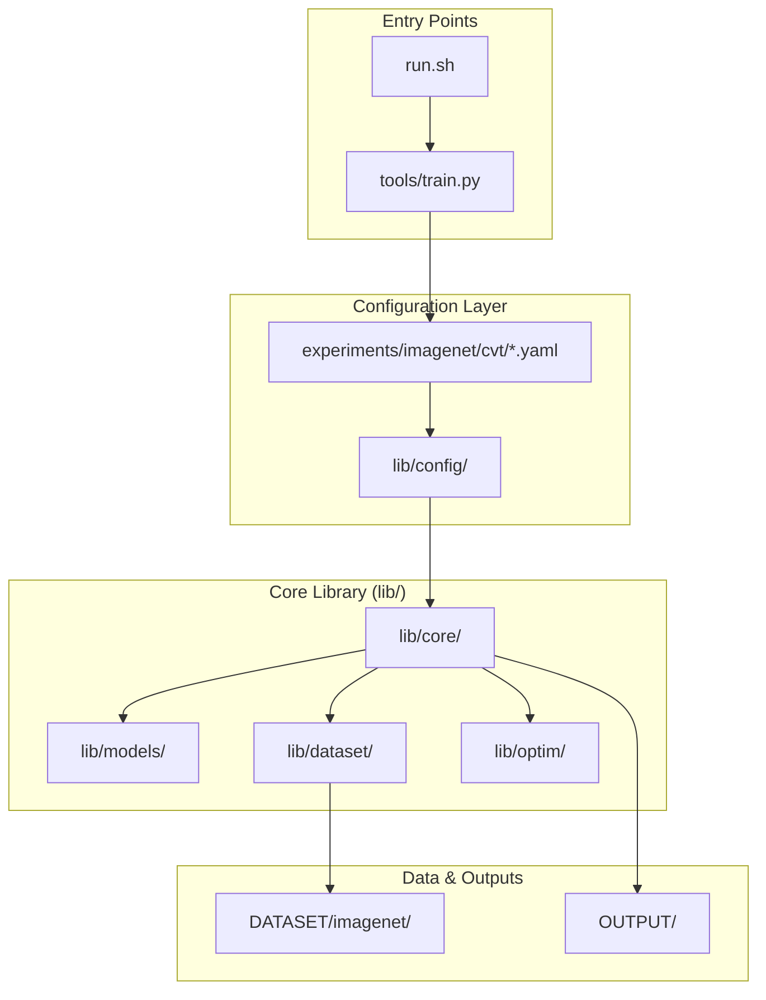
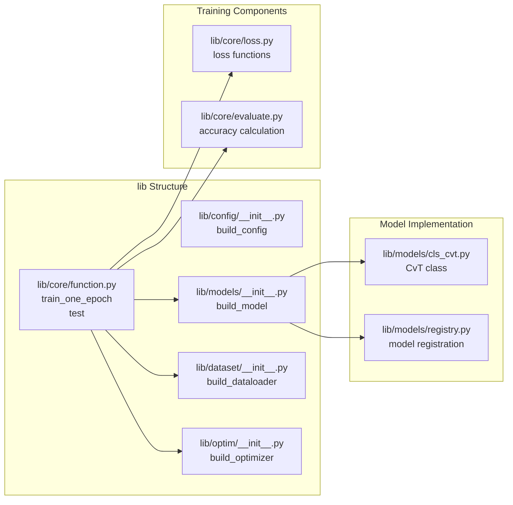

<!-- source: DeepWiki mcp.deepwiki.com · repo microsoft/CvT · page 1 Overview · fetched 2026-10-26 -->

# Overview

Relevant source files

The following files were used as context for generating this wiki page:

- [README.md](README.md)
- [figures/pipeline.svg](figures/pipeline.svg)

## Purpose and Scope

This document provides a comprehensive overview of the CvT (Convolutional vision Transformers) repository, explaining its purpose, architecture, and key components. The CvT repository implements the research paper "CvT: Introducing Convolutions to Vision Transformers" and provides a complete training and evaluation framework for the CvT model architecture.

For detailed information about getting started with training and evaluation, see [Getting Started](#2). For in-depth architectural details, see [Architecture & Design](#3). For practical usage guides, see [Usage Guide](#4).

## What is CvT?

CvT (Convolutional vision Transformers) is a hybrid architecture that combines the strengths of Convolutional Neural Networks (CNNs) and Vision Transformers (ViTs). The key innovation is introducing convolutional operations into the transformer architecture through two primary modifications:

1. **Hierarchical Transformers with Convolutional Token Embedding** - Multi-stage processing with convolutional projections instead of linear projections
2. **Convolutional Transformer Blocks** - Leveraging convolutional projections for attention mechanisms

The architecture achieves state-of-the-art performance on ImageNet classification while requiring fewer parameters and FLOPs compared to traditional Vision Transformers.

**Sources:** [README.md:1-2]()

## Repository Architecture

The CvT repository is organized around a configuration-driven training system with modular components:

**Sources:** [README.md:69-83](), [README.md:85-94](), [README.md:96-114]()

## Core Components and Code Structure

The repository follows a modular design with clear separation of concerns:

| Component | Path | Primary Functions | Key Classes/Modules |
|-----------|------|-------------------|---------------------|
| **Entry Point** | `run.sh` | Job orchestration, GPU management | Shell script with options parsing |
| **Training Controller** | `tools/train.py` | Main training loop coordination | Training orchestration logic |
| **Configuration** | `lib/config/` | Config loading and validation | Configuration management system |
| **Model Architecture** | `lib/models/` | CvT model definitions | `cls_cvt.py`, model registry |
| **Training Engine** | `lib/core/` | Training/evaluation functions | `function.py`, `loss.py`, `evaluate.py` |
| **Data Pipeline** | `lib/dataset/` | Data loading and augmentation | Dataset builders, transforms, samplers |
| **Optimization** | `lib/optim/` | Optimizer construction | Optimizer factory functions |

**Sources:** Based on the system architecture diagrams and typical PyTorch project structure patterns

## CvT Model Architecture Overview

The CvT architecture implements a three-stage hierarchical transformer with convolutional token embeddings:

```mermaid
graph LR
    input["Input Image<br/>224x224 or 384x384"]
    
    subgraph "Stage 1"
        conv1["Convolutional Token Embedding<br/>kernel=7x7, stride=4"]
        trans1["Transformer Blocks<br/>depth=1-2"]
    end
    
    subgraph "Stage 2" 
        conv2["Convolutional Token Embedding<br/>kernel=3x3, stride=2"]
        trans2["Transformer Blocks<br/>depth=2-4"]
    end
    
    subgraph "Stage 3"
        conv3["Convolutional Token Embedding<br/>kernel=3x3, stride=2"]
        trans3["Transformer Blocks<br/>depth=10-20"]
        cls["CLS Token"]
    end
    
    output["Classification Output"]
    
    input --> conv1
    conv1 --> trans1
    trans1 --> conv2
    conv2 --> trans2
    trans2 --> conv3
    conv3 --> trans3
    trans3 --> cls
    cls --> output
```

**Sources:** [README.md:1-2](), architectural understanding from CvT paper description

## Model Variants and Performance

The repository provides several pre-trained CvT model configurations:

| Model | Resolution | Parameters | GFLOPs | Top-1 Accuracy |
|-------|------------|------------|--------|----------------|
| CvT-13 | 224×224 | 20M | 4.5 | 81.6% |
| CvT-21 | 224×224 | 32M | 7.1 | 82.5% |
| CvT-13 | 384×384 | 20M | 16.3 | 83.0% |
| CvT-21 | 384×384 | 32M | 24.9 | 83.3% |
| CvT-W24 | 384×384 | 277M | 193.2 | 87.6% |

Each model variant has a corresponding YAML configuration file in the `experiments/imagenet/cvt/` directory.

**Sources:** [README.md:7-21]()

## Execution Flow

The typical execution flow follows this pattern:

1. **Job Initialization**: `run.sh` parses command-line arguments and sets up the execution environment
2. **Training Launch**: `tools/train.py` is invoked with the specified configuration
3. **Configuration Loading**: YAML configs are loaded and merged with defaults via `lib/config/`
4. **Component Building**: Models, datasets, and optimizers are constructed using factory functions
5. **Training Loop**: `lib/core/function.py` orchestrates the training with `train_one_epoch` and `test` functions
6. **Output Generation**: Checkpoints, logs, and trained models are saved to the `OUTPUT/` directory

**Sources:** [README.md:85-114]()

## Key Innovations

The CvT architecture introduces several key innovations that distinguish it from standard Vision Transformers:

- **No Positional Encoding Required**: Convolutional operations provide implicit spatial relationships
- **Hierarchical Multi-Scale Processing**: Three-stage architecture with progressive downsampling
- **Convolutional Projections**: Replace linear projections in attention mechanisms for better inductive bias
- **Efficiency Gains**: Achieves better performance with fewer parameters and FLOPs compared to ViT

**Sources:** [README.md:1-2]()

---

