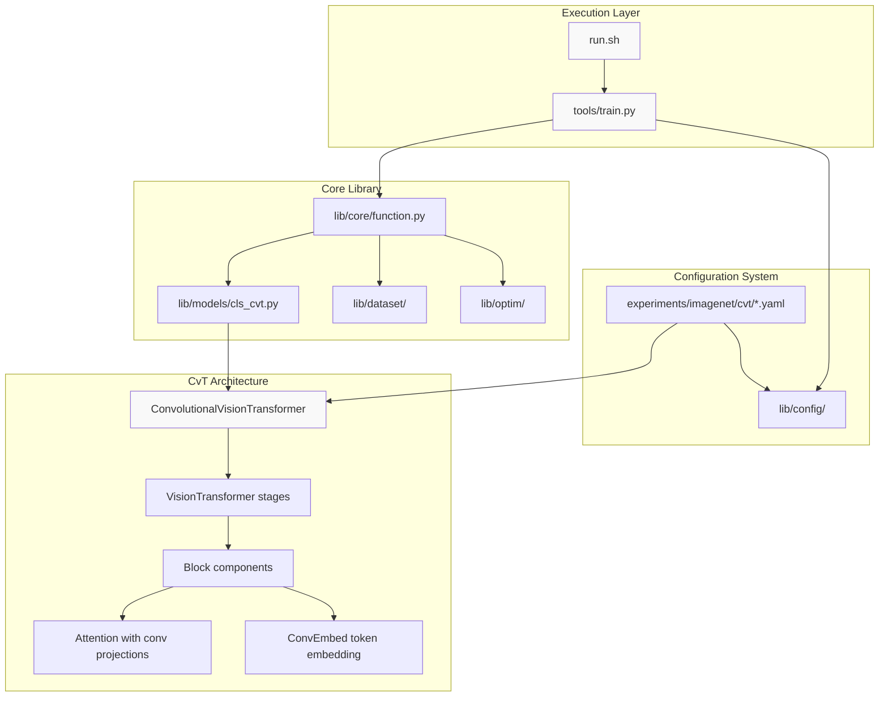
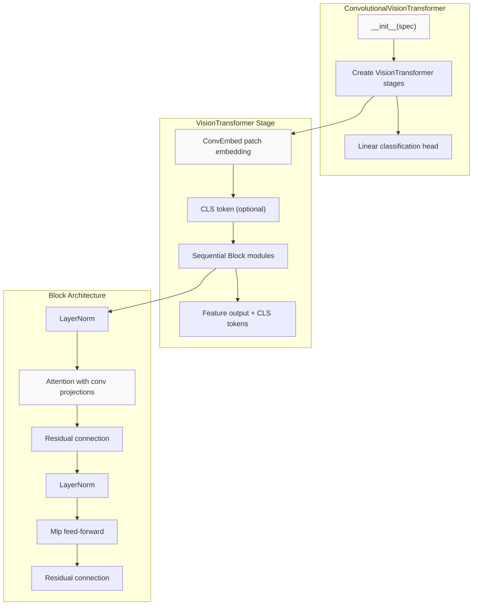
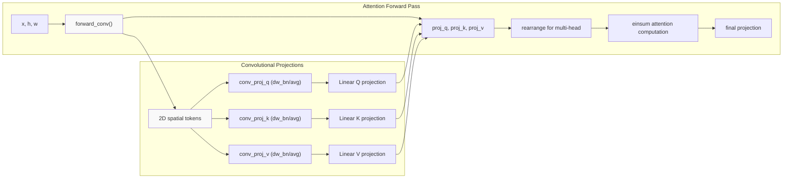
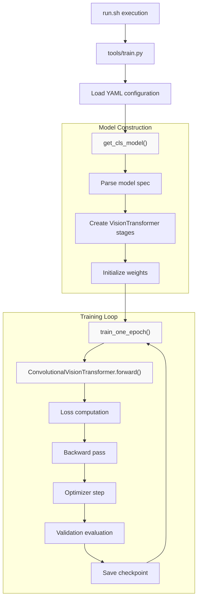
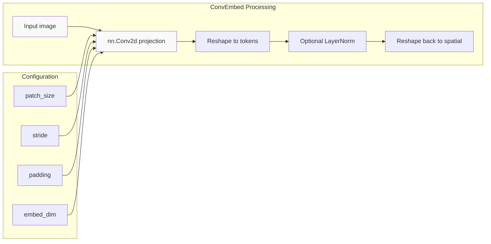

<!-- source: DeepWiki mcp.deepwiki.com · repo microsoft/CvT · page 3 Architecture & Design · fetched 2026-10-26 -->

# Architecture & Design

Relevant source files

The following files were used as context for generating this wiki page:

- [README.md](README.md)
- [lib/models/cls_cvt.py](lib/models/cls_cvt.py)

This document provides a comprehensive overview of the CvT (Convolutional vision Transformers) system architecture and design principles. It covers the core model architecture, training pipeline design, configuration system, and key architectural decisions that enable the integration of convolutional neural networks with vision transformers.

For implementation details of specific model components, see [CvT Model Architecture](#3.1). For training procedures and optimization strategies, see [Training Pipeline](#3.2). For data handling and preprocessing, see [Data Pipeline](#3.3).

## System Overview

The CvT repository implements a hierarchical vision transformer architecture that introduces convolutional operations at key points to improve performance and efficiency. The system is designed around three core principles:

1. **Multi-stage hierarchical processing** - Progressive feature extraction through multiple transformer stages
2. **Convolutional token embeddings** - Replace linear patch embeddings with convolutional projections
3. **Configuration-driven architecture** - YAML-based specification of model variants and training parameters

### High-Level System Architecture

**Sources:** [README.md:1-148](), [lib/models/cls_cvt.py:491-646]()

## Core Architecture Components

### ConvolutionalVisionTransformer Design

The main model architecture follows a stage-wise design where each stage processes features at different scales. The `ConvolutionalVisionTransformer` class orchestrates multiple `VisionTransformer` stages, each configured with specific parameters for patch sizes, embedding dimensions, and attention heads.

**Sources:** [lib/models/cls_cvt.py:491-540](), [lib/models/cls_cvt.py:372-489](), [lib/models/cls_cvt.py:289-334]()

### Convolutional Attention Mechanism

The key innovation in CvT is the `Attention` class that replaces standard linear projections with convolutional projections for Q, K, and V computation. This enables spatial inductive bias while maintaining transformer's global modeling capability.

**Sources:** [lib/models/cls_cvt.py:77-212](), [lib/models/cls_cvt.py:124-160](), [lib/models/cls_cvt.py:162-188]()

## Training System Architecture

### Configuration-Driven Design

The system uses YAML configuration files to specify model architectures and training parameters. The `spec` parameter in `ConvolutionalVisionTransformer` defines all stage-specific settings including patch sizes, embedding dimensions, attention heads, and projection methods.

| Configuration Parameter | Purpose | Code Reference |
|------------------------|---------|----------------|
| `NUM_STAGES` | Number of transformer stages | [lib/models/cls_cvt.py:502]() |
| `PATCH_SIZE` | Convolutional patch sizes per stage | [lib/models/cls_cvt.py:505]() |
| `DIM_EMBED` | Embedding dimensions per stage | [lib/models/cls_cvt.py:508]() |
| `QKV_PROJ_METHOD` | Projection method (dw_bn/avg/linear) | [lib/models/cls_cvt.py:517]() |
| `CLS_TOKEN` | Whether to use CLS token per stage | [lib/models/cls_cvt.py:516]() |

### Training Pipeline Flow

**Sources:** [README.md:85-114](), [lib/models/cls_cvt.py:626-645]()

## Key Architectural Decisions

### Hierarchical Multi-Scale Processing

The CvT architecture processes images through multiple stages with progressively larger receptive fields and embedding dimensions. Each stage uses different patch sizes and strides to capture features at different scales:

- **Stage 1**: Initial feature extraction with larger patches (7x7, stride 4)
- **Stage 2**: Intermediate processing with smaller patches (3x3, stride 2) 
- **Stage 3**: Deep processing with fine-grained features (3x3, stride 2)

### Convolutional Token Embeddings

The `ConvEmbed` class replaces standard linear patch embeddings with convolutional projections, providing translation invariance and better handling of input resolution changes.

**Sources:** [lib/models/cls_cvt.py:336-370](), [lib/models/cls_cvt.py:397-405]()

### No Positional Encoding

Unlike standard vision transformers, CvT eliminates the need for positional encodings by incorporating spatial inductive bias through convolutional operations. This simplifies the architecture and enables better handling of variable input resolutions.

### Model Variants and Scaling

The system supports multiple model variants through configuration:

| Model Variant | Parameters | FLOPs | Key Characteristics |
|---------------|------------|-------|-------------------|
| CvT-13 | 20M | 4.5G | Lightweight, 13-layer configuration |
| CvT-21 | 32M | 7.1G | Medium-scale, 21-layer configuration |
| CvT-W24 | 277M | 193.2G | Large-scale, wide 24-layer configuration |

**Sources:** [README.md:6-21](), [lib/models/cls_cvt.py:502-534]()

---

