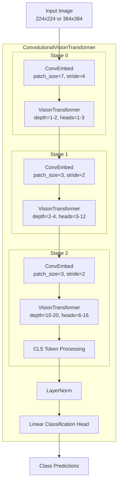
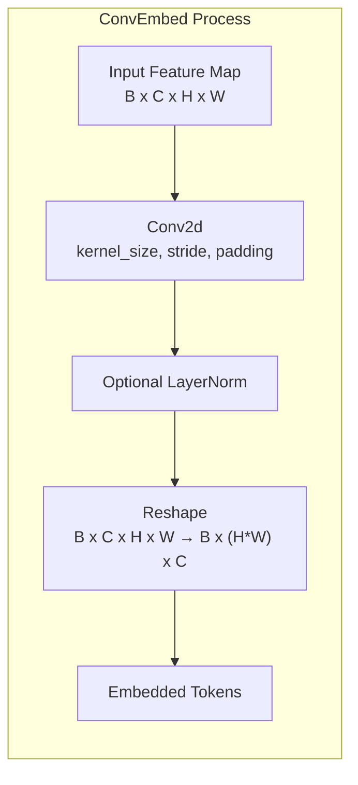
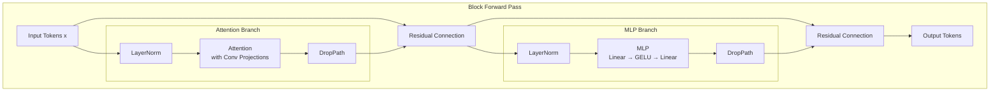
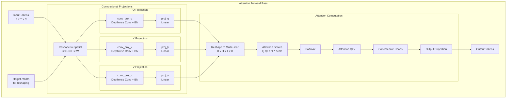
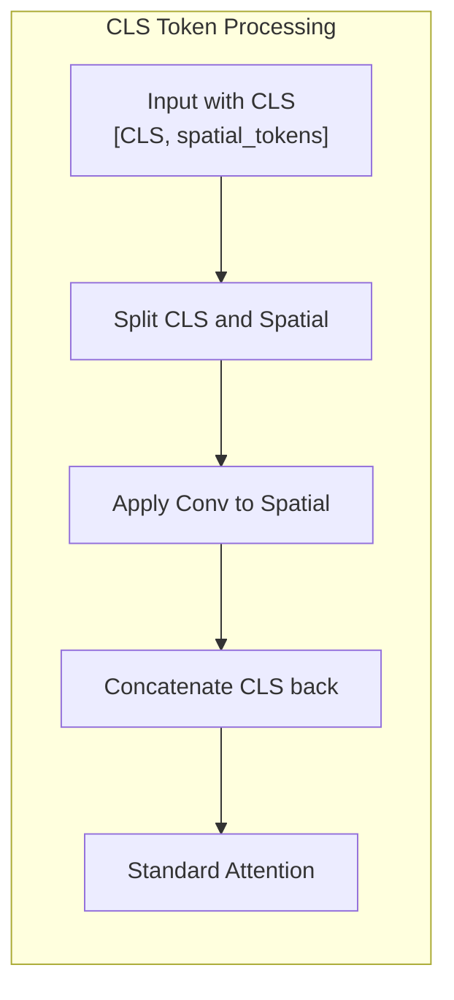
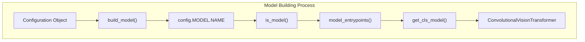

<!-- source: DeepWiki mcp.deepwiki.com · repo microsoft/CvT · page 3.1 CvT Model Architecture · fetched 2026-10-26 -->

# CvT Model Architecture

Relevant source files

The following files were used as context for generating this wiki page:

- [lib/models/__init__.py](lib/models/__init__.py)
- [lib/models/build.py](lib/models/build.py)
- [lib/models/cls_cvt.py](lib/models/cls_cvt.py)
- [lib/models/registry.py](lib/models/registry.py)

This document provides a detailed technical explanation of the Convolutional Vision Transformer (CvT) model architecture implementation. It covers the hierarchical multi-stage design, convolutional token embeddings, and attention mechanisms that distinguish CvT from standard Vision Transformers.

For information about training these models, see [Training Pipeline](#3.2). For data loading and preprocessing, see [Data Pipeline](#3.3). For model configuration parameters, see [Configuration Reference](#4.3).

## Overview

The CvT architecture introduces convolutional operations into the Vision Transformer framework through a hierarchical multi-stage design. Unlike standard ViTs that use linear projections and positional embeddings, CvT employs convolutional token embeddings and convolutional projections in attention mechanisms to better capture local spatial relationships.

## Multi-Stage Architecture

The CvT model consists of multiple stages that progressively reduce spatial resolution while increasing feature dimensions, similar to ConvNets but using transformer blocks for processing.

### Overall CvT Structure

The `ConvolutionalVisionTransformer` class orchestrates this multi-stage processing by creating individual `VisionTransformer` stages with different configurations.

**Sources:** [lib/models/cls_cvt.py:491-623]()

### Stage Configuration

Each stage is configured through the `spec` parameter containing arrays of stage-specific settings:

| Parameter | Stage 0 | Stage 1 | Stage 2 | Purpose |
|-----------|---------|---------|---------|---------|
| `PATCH_SIZE` | 7 | 3 | 3 | Convolutional kernel size |
| `PATCH_STRIDE` | 4 | 2 | 2 | Downsampling factor |
| `DIM_EMBED` | 64-192 | 192-768 | 384-1024 | Feature dimensions |
| `DEPTH` | 1-2 | 2-4 | 10-20 | Number of transformer blocks |
| `NUM_HEADS` | 1-3 | 3-12 | 6-16 | Multi-head attention heads |
| `CLS_TOKEN` | False | False | True | Whether to use CLS token |

**Sources:** [lib/models/cls_cvt.py:502-535]()

## Vision Transformer Stage

Each stage in the CvT hierarchy is implemented as a `VisionTransformer` that processes tokens through convolutional embedding and transformer blocks.

### Single Stage Architecture

```mermaid
graph TB
    subgraph "VisionTransformer Stage"
        input_stage["Input Tokens<br/>from previous stage"]
        
        subgraph "Patch Embedding"
            conv_embed["ConvEmbed<br/>Conv2d + Optional Norm"]
        end
        
        subgraph "Token Processing"
            cls_token_add["Add CLS Token<br/>(if enabled)"]
            pos_drop["Positional Dropout"]
        end
        
        subgraph "Transformer Blocks"
            block0["Block 0<br/>Attention + MLP"]
            block1["Block 1<br/>Attention + MLP"]
            blockN["Block N<br/>Attention + MLP"]
        end
        
        subgraph "Output Processing"
            cls_extract["Extract CLS Token"]
            spatial_reshape["Reshape to Spatial"]
        end
        
        output_tokens["Output Tokens"]
        output_cls["CLS Token"]
    end
    
    input_stage --> conv_embed
    conv_embed --> cls_token_add
    cls_token_add --> pos_drop
    pos_drop --> block0
    block0 --> block1
    block1 --> blockN
    blockN --> cls_extract
    blockN --> spatial_reshape
    cls_extract --> output_cls
    spatial_reshape --> output_tokens
```

**Sources:** [lib/models/cls_cvt.py:372-489]()

### Convolutional Token Embedding

The `ConvEmbed` class replaces traditional patch embedding with convolutional operations:

The embedding parameters are configurable per stage:
- **Stage 0**: Large patches (7x7) with stride 4 for initial tokenization
- **Stages 1-2**: Smaller patches (3x3) with stride 2 for progressive downsampling

**Sources:** [lib/models/cls_cvt.py:336-370]()

## Transformer Block Design

Each `Block` implements the core transformer computation with CvT-specific modifications.

### Block Structure

**Sources:** [lib/models/cls_cvt.py:289-334]()

## Convolutional Attention Mechanism

The key innovation in CvT is the `Attention` class that uses convolutional projections instead of purely linear transformations for Q, K, V computation.

### Attention Architecture

### Convolutional Projection Methods

The attention supports different projection methods via the `_build_projection` function:

| Method | Description | Components |
|--------|-------------|------------|
| `dw_bn` | Depthwise convolution + BatchNorm | `Conv2d(groups=dim_in)` + `BatchNorm2d` |
| `avg` | Average pooling | `AvgPool2d` |
| `linear` | No convolution (standard ViT) | `None` |

**Sources:** [lib/models/cls_cvt.py:77-213](), [lib/models/cls_cvt.py:124-160]()

### CLS Token Handling

The attention mechanism carefully handles CLS tokens when present:

**Sources:** [lib/models/cls_cvt.py:163-188]()

## Model Factory and Registration

The model building process uses a registration system to create models from configuration.

### Model Creation Flow

**Sources:** [lib/models/build.py:5-10](), [lib/models/registry.py:13-18](), [lib/models/cls_cvt.py:626-645]()

## Key Architectural Innovations

1. **Convolutional Token Embeddings**: Replace linear patch embeddings with convolutions that preserve spatial locality
2. **Convolutional Attention Projections**: Use depthwise convolutions in Q, K, V projections to capture local patterns
3. **Hierarchical Multi-Stage Design**: Progressive spatial downsampling and feature expansion across stages
4. **No Positional Encoding**: Spatial relationships captured through convolutional operations
5. **Flexible CLS Token Usage**: CLS tokens only in final stage for classification

**Sources:** [lib/models/cls_cvt.py:1-646]()

---

