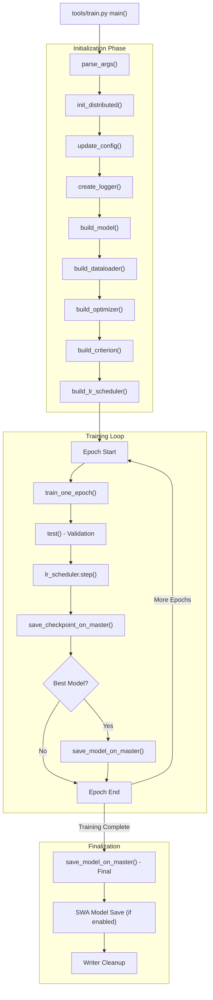
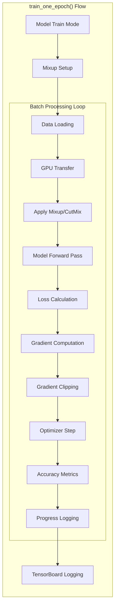
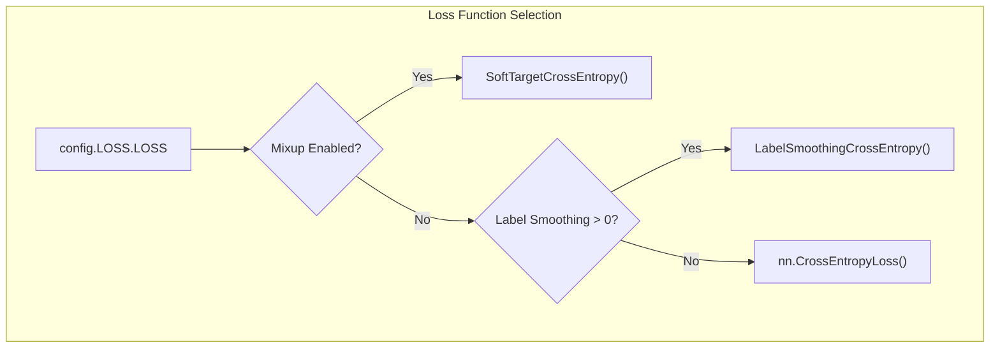
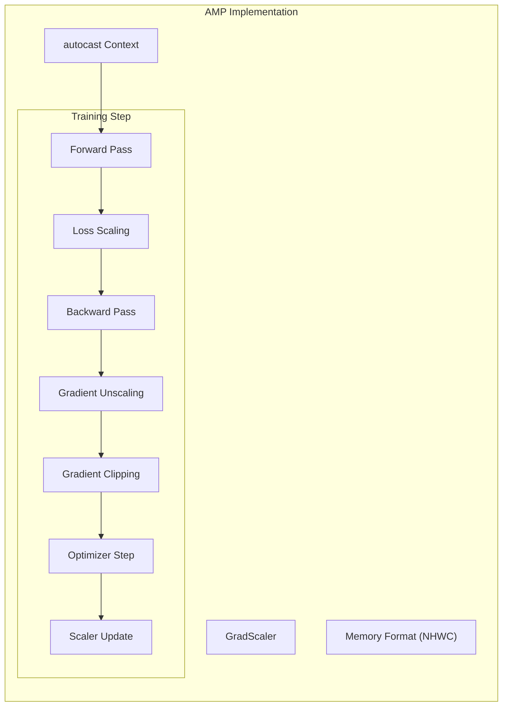
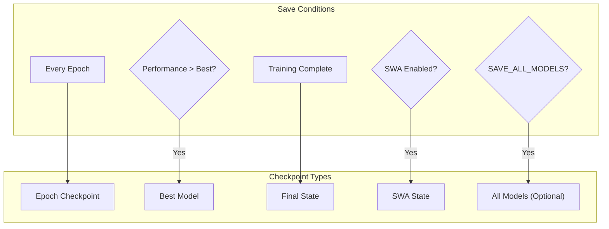

<!-- source: DeepWiki mcp.deepwiki.com · repo microsoft/CvT · page 3.2 Training Pipeline · fetched 2026-10-26 -->

# Training Pipeline

Relevant source files

The following files were used as context for generating this wiki page:

- [lib/core/evaluate.py](lib/core/evaluate.py)
- [lib/core/function.py](lib/core/function.py)
- [lib/core/loss.py](lib/core/loss.py)
- [tools/train.py](tools/train.py)

This document explains the CvT training pipeline, including the training loop implementation, loss functions, evaluation metrics, and training optimizations. The training pipeline orchestrates model training from initialization through final model saving, handling distributed training, mixed precision, and comprehensive logging.

For information about the model architecture being trained, see [CvT Model Architecture](#3.1). For details about data loading and augmentation, see [Data Pipeline](#3.3).

## Training Flow Overview

The training pipeline is controlled by the main training script that coordinates all training components through a structured workflow.

Sources: [tools/train.py:60-211]()

## Training Loop Components

### Main Training Controller

The primary training orchestration happens in `tools/train.py`, which manages the complete training lifecycle:

| Component | Purpose | Implementation |
|-----------|---------|----------------|
| Argument Parsing | Command-line interface | `parse_args()` function |
| Distributed Setup | Multi-GPU training | `init_distributed()` |
| Model Building | Architecture instantiation | `build_model()` |
| Data Loading | Training/validation datasets | `build_dataloader()` |
| Optimization | Optimizer and scheduler setup | `build_optimizer()`, `build_lr_scheduler()` |
| Loss Functions | Training and evaluation criteria | `build_criterion()` |

Sources: [tools/train.py:37-125]()

### Training Epoch Implementation

The core training logic is implemented in `train_one_epoch()` function, which handles single epoch execution with comprehensive monitoring:

Sources: [lib/core/function.py:16-109]()

### Validation and Testing

The evaluation process uses the `test()` function for validation during training and final model assessment:

**Key Features:**
- **Model Evaluation Mode**: Switches to `model.eval()` for inference
- **Batch Processing**: Processes validation data without gradient computation
- **Metrics Calculation**: Computes Top-1 and Top-5 accuracy
- **Distributed Reduction**: Aggregates metrics across multiple GPUs
- **Real Labels Support**: Optional reassessed labels for more accurate evaluation

Sources: [lib/core/function.py:111-195]()

## Loss Functions and Evaluation

### Loss Function Architecture

The training pipeline supports multiple loss function configurations through the `build_criterion()` factory:

**Loss Function Types:**

| Loss Function | Use Case | Implementation |
|---------------|----------|----------------|
| `CrossEntropyLoss` | Standard classification | PyTorch built-in |
| `SoftTargetCrossEntropy` | Mixup/CutMix training | Custom implementation |
| `LabelSmoothingCrossEntropy` | Label smoothing regularization | Custom implementation with epsilon parameter |

Sources: [lib/core/loss.py:38-49]()

### Evaluation Metrics

The accuracy calculation supports both Top-1 and Top-5 metrics with robust handling of different output formats:

**Accuracy Calculation Features:**
- **Multi-output Support**: Handles list outputs (takes last element)
- **Batch Processing**: Efficient computation across batch dimensions
- **Top-K Flexibility**: Configurable for different K values
- **Percentage Conversion**: Returns accuracy as percentage values

Sources: [lib/core/evaluate.py:8-25]()

## Training Optimizations

### Mixed Precision Training

The pipeline includes comprehensive Automatic Mixed Precision (AMP) support:

**AMP Configuration Options:**
- **Enabled**: `config.AMP.ENABLED` controls AMP usage
- **Memory Format**: Optional NHWC memory layout for optimization
- **Gradient Scaling**: Automatic loss scaling for stable training

Sources: [tools/train.py:87-89, 123](), [lib/core/function.py:47-72]()

### Gradient Clipping

Gradient clipping prevents training instability through configurable norm clipping:

- **Threshold**: `config.TRAIN.CLIP_GRAD_NORM` sets maximum gradient norm
- **Implementation**: Uses `torch.nn.utils.clip_grad_norm_` after gradient unscaling
- **Integration**: Works seamlessly with AMP gradient scaling

Sources: [lib/core/function.py:62-69]()

### Data Augmentation Integration

The training loop integrates advanced data augmentation techniques:

**Mixup/CutMix Implementation:**
- **Mixup Factory**: Uses TIMM's `Mixup` class for augmentation
- **Probability Control**: Configurable through `config.AUG.MIXUP_PROB`
- **Label Handling**: Converts mixed labels back to hard labels for accuracy calculation
- **Loss Compatibility**: Works with `SoftTargetCrossEntropy` loss

Sources: [lib/core/function.py:27-34, 44-45, 76-78]()

## Checkpointing and Model Persistence

### Checkpoint Management

The training pipeline implements comprehensive model checkpointing with multiple save strategies:

**Checkpoint Features:**
- **Epoch Checkpoints**: Complete training state including optimizer
- **Best Model Tracking**: Saves best performing model based on validation accuracy
- **Resume Support**: Full checkpoint loading with `resume_checkpoint()`
- **Distributed Safety**: Only master process performs saves

Sources: [tools/train.py:171-204]()

### Logging and Monitoring

The training pipeline provides comprehensive logging through multiple channels:

**Logging Components:**
- **Console Logging**: Progress updates with timing and metrics
- **TensorBoard**: Scalars for loss and accuracy tracking
- **Configuration Saving**: Complete config preservation for reproducibility
- **Environment Info**: System and library version logging

Sources: [tools/train.py:91-95, 103-108](), [lib/core/function.py:103-108, 184-189]()

---

