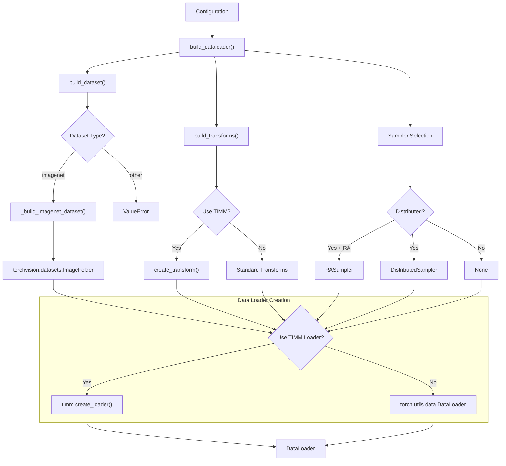
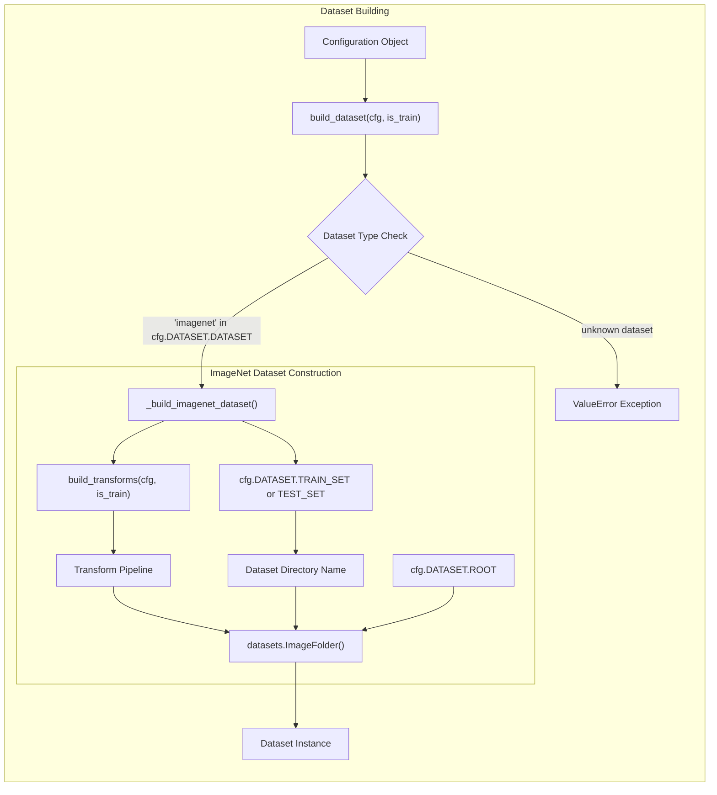
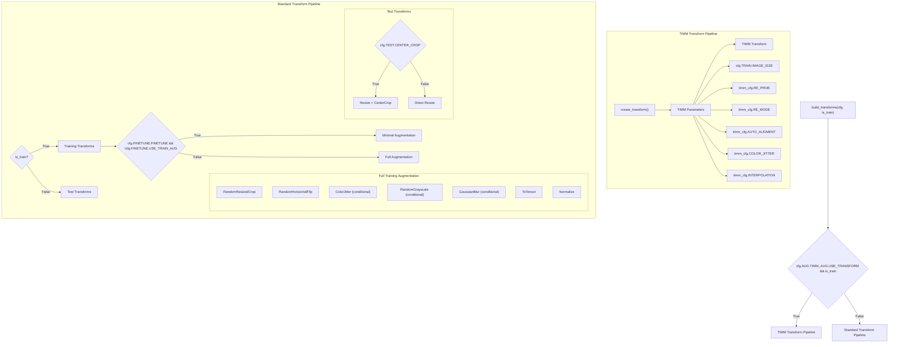
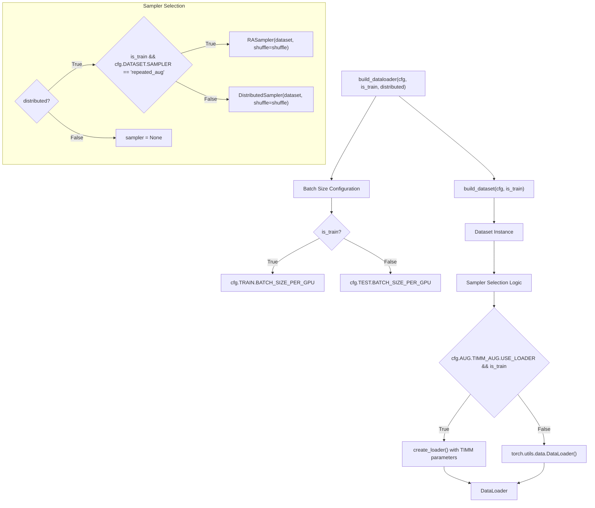
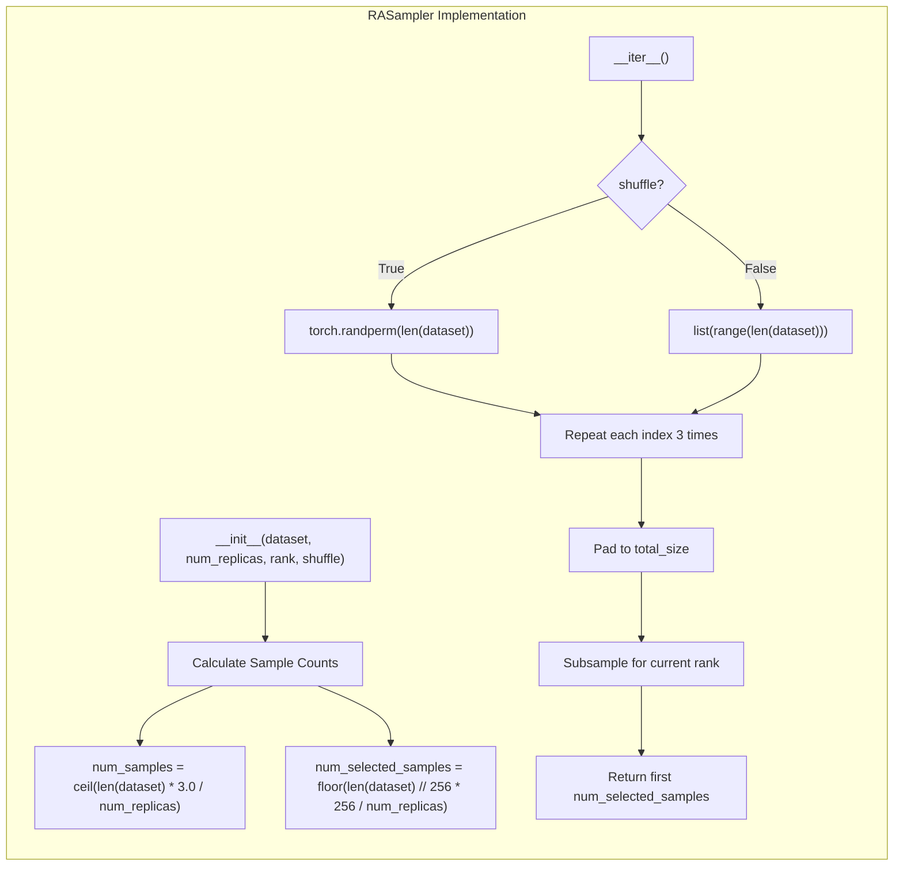

<!-- source: DeepWiki mcp.deepwiki.com · repo microsoft/CvT · page 3.3 Data Pipeline · fetched 2026-10-26 -->

# Data Pipeline

Relevant source files

The following files were used as context for generating this wiki page:

- [lib/dataset/__init__.py](lib/dataset/__init__.py)
- [lib/dataset/build.py](lib/dataset/build.py)
- [lib/dataset/samplers/ra_sampler.py](lib/dataset/samplers/ra_sampler.py)
- [lib/dataset/transformas/build.py](lib/dataset/transformas/build.py)

This page documents the data loading, preprocessing, and augmentation pipeline used in the CvT training system. The data pipeline is responsible for efficiently loading ImageNet datasets, applying data transformations and augmentations, and providing batched data to the training loop.

For information about the training loop that consumes this data, see [Training Pipeline](#3.2). For details about model architecture that processes the data, see [CvT Model Architecture](#3.1).

## Overview

The CvT data pipeline is built around a modular design that supports multiple dataset formats, advanced augmentation strategies, and distributed training scenarios. The pipeline integrates with the TIMM library for state-of-the-art augmentation techniques and provides custom sampling strategies for improved training efficiency.

## Data Pipeline Architecture

Sources: [lib/dataset/build.py:17-115]()

## Dataset Building Process

The dataset building process centers around the `build_dataset` function, which currently supports ImageNet-style datasets through the `ImageFolder` class.

### Dataset Creation Flow

| Component | Purpose | Configuration Key |
|-----------|---------|-------------------|
| `cfg.DATASET.DATASET` | Dataset type identifier | Must contain 'imagenet' |
| `cfg.DATASET.ROOT` | Root directory path | Base path to dataset |
| `cfg.DATASET.TRAIN_SET` | Training set subdirectory | Used when `is_train=True` |
| `cfg.DATASET.TEST_SET` | Test set subdirectory | Used when `is_train=False` |

Sources: [lib/dataset/build.py:17-49]()

## Data Transformations and Augmentations

The transformation pipeline supports two modes: TIMM-based transformations for advanced augmentation and standard PyTorch transformations for basic preprocessing.

### Transform Pipeline Selection

### Augmentation Parameters

| Augmentation | Configuration | Purpose |
|--------------|---------------|---------|
| Scale | `cfg.AUG.SCALE` | Random resize crop scale range |
| Ratio | `cfg.AUG.RATIO` | Random resize crop aspect ratio range |
| Color Jitter | `cfg.AUG.COLOR_JITTER` | Color distortion parameters [brightness, contrast, saturation, hue, probability] |
| Gray Scale | `cfg.AUG.GRAY_SCALE` | Probability of converting to grayscale |
| Gaussian Blur | `cfg.AUG.GAUSSIAN_BLUR` | Probability of applying gaussian blur |
| Interpolation | `cfg.AUG.INTERPOLATION` | Resize interpolation method |

Sources: [lib/dataset/transformas/build.py:31-124]()

## Data Loading and Sampling

The data loading system supports both standard PyTorch DataLoader and TIMM's advanced loader with multiple sampling strategies for distributed training.

### DataLoader Construction

### Repeated Augmentation Sampler

The `RASampler` class implements a specialized sampling strategy for distributed training with repeated augmentation:

Key characteristics of `RASampler`:
- Repeats each sample 3 times to increase augmentation diversity
- Ensures even distribution across distributed training ranks
- Implements deterministic shuffling based on epoch
- Optimizes sample count for batch size alignment (multiple of 256)

Sources: [lib/dataset/samplers/ra_sampler.py:12-64]()

## Integration Points

### Configuration Dependencies

The data pipeline integrates tightly with the configuration system through these key parameters:

| Configuration Section | Key Parameters | Purpose |
|----------------------|----------------|---------|
| `DATASET` | `DATASET`, `ROOT`, `TRAIN_SET`, `TEST_SET`, `SAMPLER` | Dataset identification and paths |
| `TRAIN` | `BATCH_SIZE_PER_GPU`, `IMAGE_SIZE` | Training batch configuration |
| `TEST` | `BATCH_SIZE_PER_GPU`, `IMAGE_SIZE`, `CENTER_CROP`, `INTERPOLATION` | Test configuration |
| `AUG` | `SCALE`, `RATIO`, `COLOR_JITTER`, `GRAY_SCALE`, `GAUSSIAN_BLUR`, `INTERPOLATION` | Augmentation parameters |
| `AUG.TIMM_AUG` | `USE_TRANSFORM`, `USE_LOADER`, `RE_PROB`, `AUTO_AUGMENT`, `HFLIP`, `COLOR_JITTER` | TIMM augmentation settings |
| `INPUT` | `MEAN`, `STD` | Normalization parameters |

### Training Loop Integration

The data pipeline provides `DataLoader` instances that are consumed by the training loop through the `build_dataloader` function. The loader handles:

- Automatic batching according to configuration
- Distributed sampling coordination
- Data prefetching and pin memory optimization
- Integration with mixed precision training (when using TIMM loader)

Sources: [lib/dataset/build.py:52-115](), [lib/dataset/__init__.py:1-3]()

---

