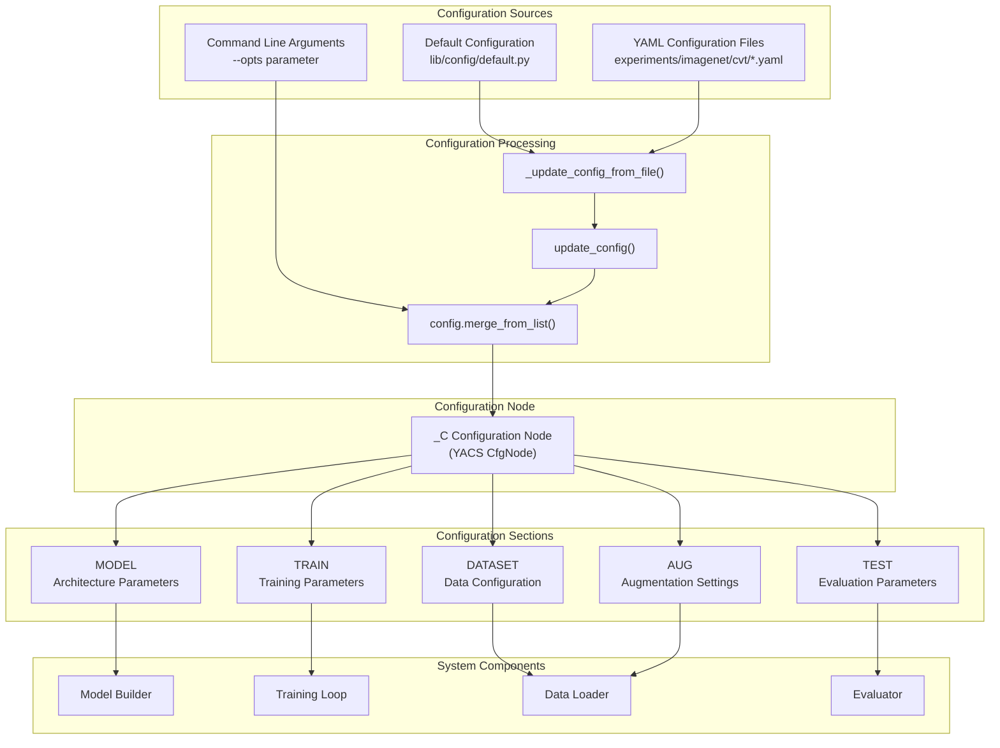
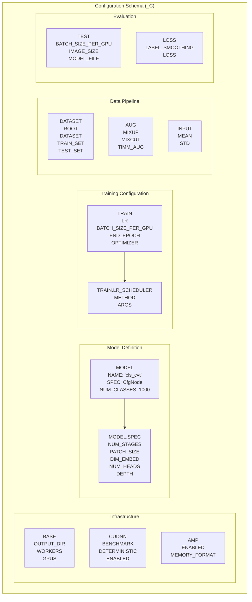
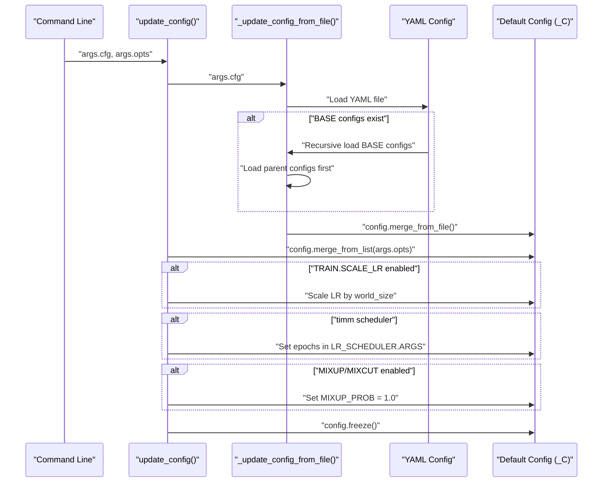
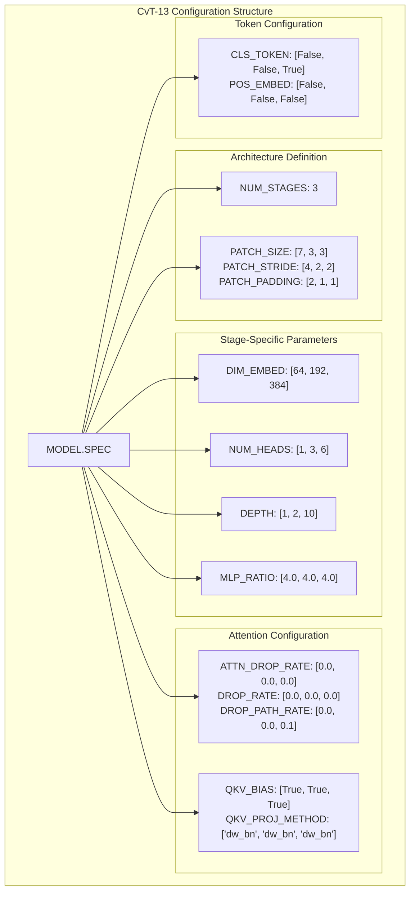

<!-- source: DeepWiki mcp.deepwiki.com · repo microsoft/CvT · page 3.4 Configuration System · fetched 2026-10-26 -->

# Configuration System

Relevant source files

The following files were used as context for generating this wiki page:

- [experiments/imagenet/cvt/cvt-13-224x224.yaml](experiments/imagenet/cvt/cvt-13-224x224.yaml)
- [lib/config/__init__.py](lib/config/__init__.py)
- [lib/config/default.py](lib/config/default.py)

## Purpose and Scope

The Configuration System manages all training, model, and dataset parameters for the CvT repository through a hierarchical YAML-based configuration framework. This system provides a centralized approach to parameter management, allowing users to define model variants, training schedules, and experimental settings through structured configuration files.

For information about specific model configurations and variants, see [Configuration Reference](#4.3). For details about the training pipeline that uses these configurations, see [Training Pipeline](#3.2).

## System Architecture

The Configuration System is built on the YACS (Yet Another Configuration System) library and follows a hierarchical approach with defaults, file-based overrides, and command-line parameter support.

**Sources:** [lib/config/default.py:155-191](), [lib/config/__init__.py:1-4]()

## Configuration Schema Structure

The configuration system defines a comprehensive schema covering all aspects of model training and evaluation. The main configuration node `_C` is structured into logical sections.

### Core Configuration Sections

| Section | Purpose | Key Parameters |
|---------|---------|----------------|
| `MODEL` | Model architecture definition | `NAME`, `SPEC`, `NUM_CLASSES` |
| `TRAIN` | Training parameters | `LR`, `BATCH_SIZE_PER_GPU`, `END_EPOCH` |
| `TEST` | Evaluation settings | `BATCH_SIZE_PER_GPU`, `IMAGE_SIZE` |
| `DATASET` | Dataset configuration | `ROOT`, `DATASET`, `TRAIN_SET` |
| `AUG` | Data augmentation | `MIXUP`, `TIMM_AUG`, `COLOR_JITTER` |
| `LOSS` | Loss function settings | `LABEL_SMOOTHING`, `LOSS` |
| `CUDNN` | Hardware acceleration | `BENCHMARK`, `DETERMINISTIC` |
| `AMP` | Mixed precision training | `ENABLED`, `MEMORY_FORMAT` |

**Sources:** [lib/config/default.py:12-153](), [experiments/imagenet/cvt/cvt-13-224x224.yaml:1-84]()

## Configuration Loading and Merging Process

The configuration system implements a multi-stage loading process that supports inheritance, file-based configuration, and runtime overrides.

### Loading Process Flow

### Key Functions

- **`_update_config_from_file(config, cfg_file)`**: Recursively loads configuration files, supporting inheritance through the `BASE` parameter
- **`update_config(config, args)`**: Main entry point that orchestrates the loading process and applies runtime modifications
- **`save_config(cfg, path)`**: Persists the final configuration to disk for reproducibility

**Sources:** [lib/config/default.py:155-191]()

## Model-Specific Configuration Structure

The `MODEL.SPEC` section contains the detailed architecture parameters for CvT models. This flexible structure allows definition of different model variants.

### CvT Model Configuration Example

**Sources:** [experiments/imagenet/cvt/cvt-13-224x224.yaml:7-30]()

## Training and Augmentation Configuration

The configuration system provides extensive support for training parameter management and data augmentation strategies.

### Training Configuration Components

| Component | Configuration Path | Key Parameters |
|-----------|-------------------|----------------|
| Optimizer | `TRAIN.OPTIMIZER` | `adamW`, `sgd` |
| Learning Rate | `TRAIN.LR_SCHEDULER` | `METHOD: 'timm'`, `ARGS` |
| Batch Size | `TRAIN.BATCH_SIZE_PER_GPU` | Per-GPU batch size |
| Weight Decay | `TRAIN.WD`, `TRAIN.WITHOUT_WD_LIST` | Regularization settings |
| Augmentation | `AUG.TIMM_AUG`, `AUG.MIXUP` | Data augmentation pipeline |

### Augmentation Pipeline Configuration

The system supports both traditional augmentation and advanced techniques like MixUp and CutMix:

- **TIMM Integration**: `AUG.TIMM_AUG.USE_LOADER` enables TIMM-based augmentation
- **MixUp/CutMix**: Controlled through `AUG.MIXUP`, `AUG.MIXCUT`, and `AUG.MIXUP_PROB`
- **AutoAugment**: Configured via `AUG.TIMM_AUG.AUTO_AUGMENT`

**Sources:** [lib/config/default.py:93-153](), [experiments/imagenet/cvt/cvt-13-224x224.yaml:31-45](), [experiments/imagenet/cvt/cvt-13-224x224.yaml:63-84]()

## Configuration Usage Patterns

### Runtime Configuration Updates

The system automatically applies intelligent defaults and modifications during configuration loading:

1. **Learning Rate Scaling**: When `TRAIN.SCALE_LR` is enabled, the learning rate is scaled by the world size for distributed training
2. **Scheduler Integration**: For TIMM schedulers, the total epochs are automatically set from `TRAIN.END_EPOCH`
3. **MixUp Probability**: When MixUp or CutMix is enabled, `MIXUP_PROB` is automatically set to 1.0

### Configuration Validation and Freezing

The YACS framework provides configuration validation through the freeze/defrost mechanism:

- **`config.freeze()`**: Locks the configuration, preventing accidental modifications
- **`config.defrost()`**: Temporarily unlocks configuration for updates
- **`CN(new_allowed=True)`**: Allows dynamic addition of new configuration keys

**Sources:** [lib/config/default.py:170-191]()

---

