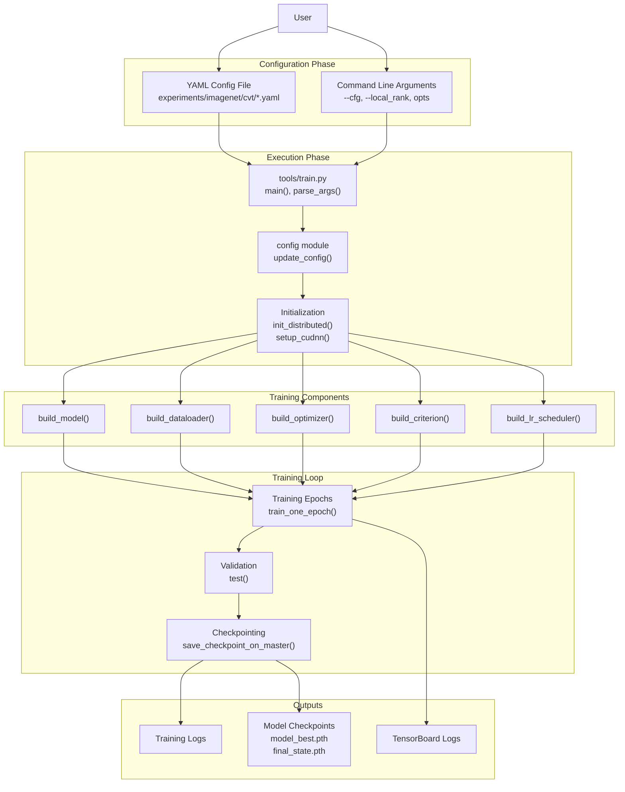
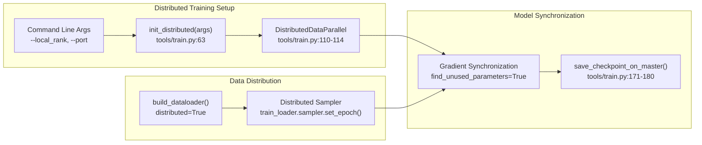
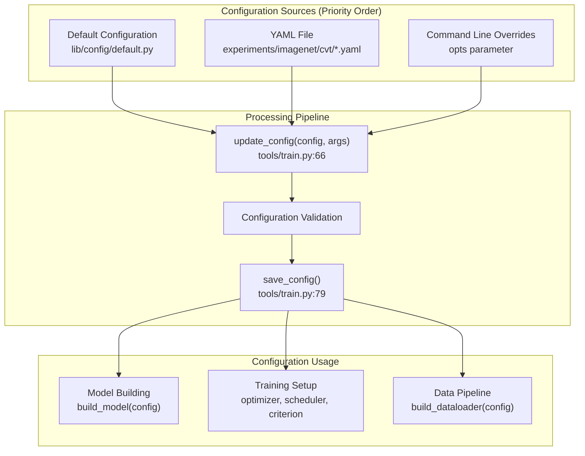
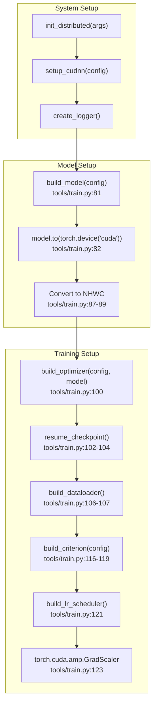
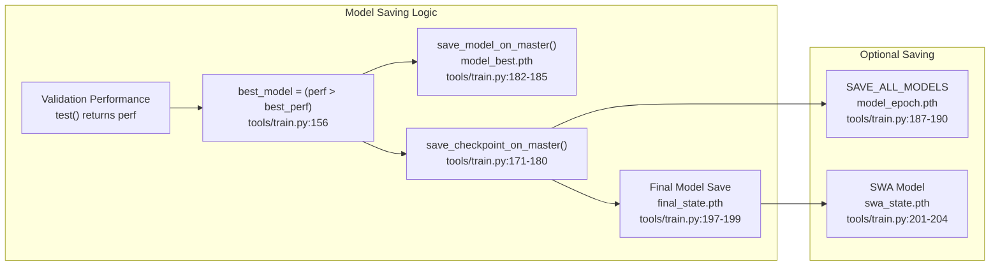

<!-- source: DeepWiki mcp.deepwiki.com · repo microsoft/CvT · page 4 Usage Guide · fetched 2026-10-26 -->

# Usage Guide

<details>
<summary>Relevant source files</summary>

The following files were used as context for generating this wiki page:

- [experiments/imagenet/cvt/cvt-13-224x224.yaml](experiments/imagenet/cvt/cvt-13-224x224.yaml)
- [tools/train.py](tools/train.py)

</details>


This document provides practical guidance for using the CvT (Convolutional vision Transformers) repository to train and evaluate models. It covers the main workflows, entry points, and configuration patterns that users need to understand for effective operation of the CvT training system.

For detailed step-by-step training instructions, see [Training Models](#4.1). For evaluation procedures and metrics, see [Model Evaluation](#4.2). For complete configuration parameter reference, see [Configuration Reference](#4.3).

## System Overview

The CvT repository follows a configuration-driven training workflow where users specify model architecture, training parameters, and data settings through YAML configuration files. The primary entry point is the `tools/train.py` script, which orchestrates the entire training pipeline.

### Core Usage Workflow



**Title: CvT Training Workflow from User Input to Model Output**

Sources: [tools/train.py:1-211](), [experiments/imagenet/cvt/cvt-13-224x224.yaml:1-84]()

## Entry Points and Commands

### Primary Training Command

The main entry point for training CvT models is `tools/train.py`. The basic command structure is:

```bash
python tools/train.py --cfg <config_file> [opts]
```

Key command line arguments defined in `parse_args()`:

| Argument | Purpose | Example |
|----------|---------|---------|
| `--cfg` | Required configuration file path | `experiments/imagenet/cvt/cvt-13-224x224.yaml` |
| `--local_rank` | GPU rank for distributed training | `0` |
| `--port` | Port for distributed communication | `9000` |
| `opts` | Configuration overrides | `TRAIN.LR 0.001 MODEL.SPEC.DEPTH [1,2,12]` |

### Distributed Training Support

The system automatically handles distributed training setup through `init_distributed()` and supports multi-GPU training with `DistributedDataParallel`:



**Title: Distributed Training Component Integration**

Sources: [tools/train.py:46-48](), [tools/train.py:63](), [tools/train.py:109-114](), [tools/train.py:131-132]()

## Configuration Management

### Configuration Loading Process

The configuration system processes multiple sources with a defined precedence order:



**Title: Configuration Processing and Application Pipeline**

### Key Configuration Sections

Based on the provided YAML example, the main configuration categories are:

| Section | Purpose | Key Parameters |
|---------|---------|----------------|
| `MODEL.SPEC` | CvT architecture definition | `NUM_STAGES`, `DIM_EMBED`, `NUM_HEADS`, `DEPTH` |
| `TRAIN` | Training hyperparameters | `LR`, `BATCH_SIZE_PER_GPU`, `END_EPOCH`, `OPTIMIZER` |
| `DATASET` | Data configuration | `ROOT`, `TRAIN_SET`, `TEST_SET` |
| `AUG` | Data augmentation settings | `MIXUP`, `TIMM_AUG`, `AUTO_AUGMENT` |
| `AMP` | Automatic Mixed Precision | `ENABLED`, `MEMORY_FORMAT` |

Sources: [tools/train.py:66](), [tools/train.py:77-79](), [experiments/imagenet/cvt/cvt-13-224x224.yaml:7-84]()

## Training Pipeline Components

### Component Initialization Sequence

The training system initializes components in a specific order to ensure proper dependencies:



**Title: Training Component Initialization Dependencies**

### Training Loop Structure

The main training loop in `tools/train.py` follows this pattern for each epoch:

| Phase | Function | Key Operations |
|-------|----------|----------------|
| Setup | Epoch initialization | Set sampler epoch, logging setup |
| Training | `train_one_epoch()` | Forward pass, loss computation, backpropagation |
| Evaluation | `test()` | Validation accuracy computation |
| Checkpointing | `save_checkpoint_on_master()` | Save model state and optimizer state |
| Scheduling | `lr_scheduler.step()` | Update learning rate |

Sources: [tools/train.py:21-22](), [tools/train.py:81-123](), [tools/train.py:126-195]()

## Output Management

### Generated Artifacts

The training process generates several types of outputs in the specified `OUTPUT_DIR`:

| Artifact Type | File Pattern | Purpose |
|---------------|--------------|---------|
| Configuration | `config.yaml` | Saved configuration used for training |
| Model Checkpoints | `model_best.pth`, `final_state.pth` | Best and final model weights |
| Training State | Checkpoint files with optimizer state | Resume training capability |
| Logs | Training logs and metrics | Performance tracking |
| TensorBoard | TensorBoard log directory | Training visualization |

### Model Saving Strategy



**Title: Model Checkpoint and Artifact Management Strategy**

Sources: [tools/train.py:149-204]()

## Quick Reference

For immediate usage, the most common workflow is:

1. **Select Configuration**: Choose from `experiments/imagenet/cvt/` directory
2. **Run Training**: `python tools/train.py --cfg <config_path>`  
3. **Monitor Progress**: Check logs and TensorBoard output
4. **Access Results**: Find trained models in the specified `OUTPUT_DIR`

For advanced configuration customization, parameter tuning, and evaluation procedures, refer to the detailed sub-pages of this usage guide.

---

