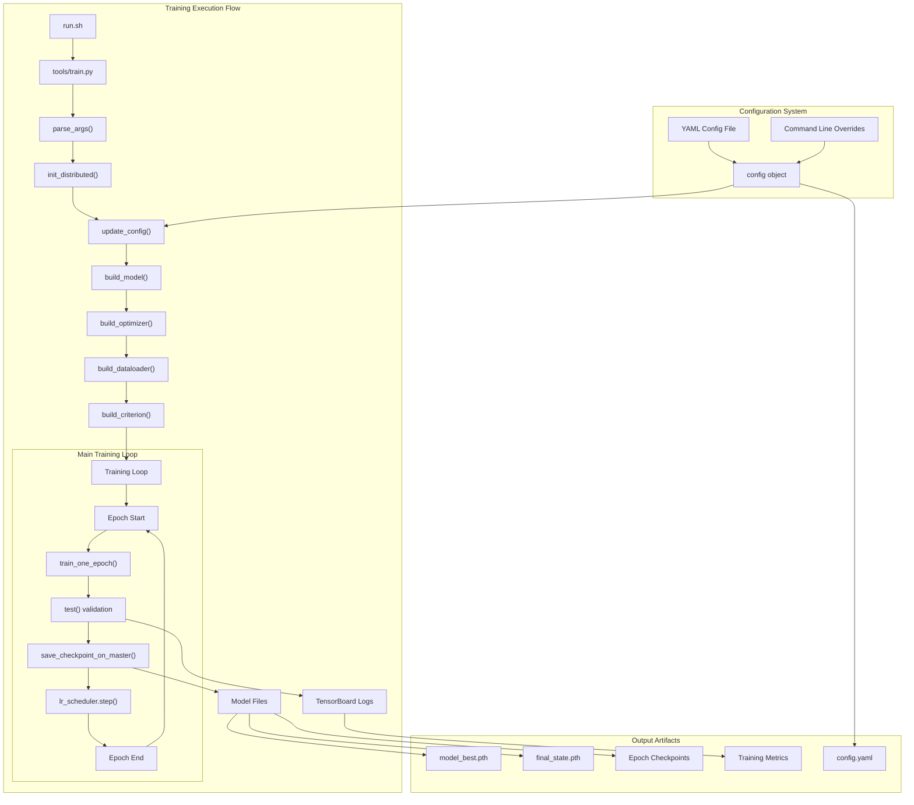
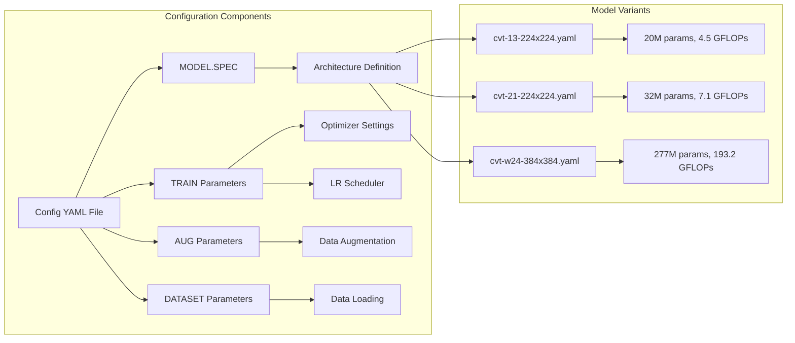
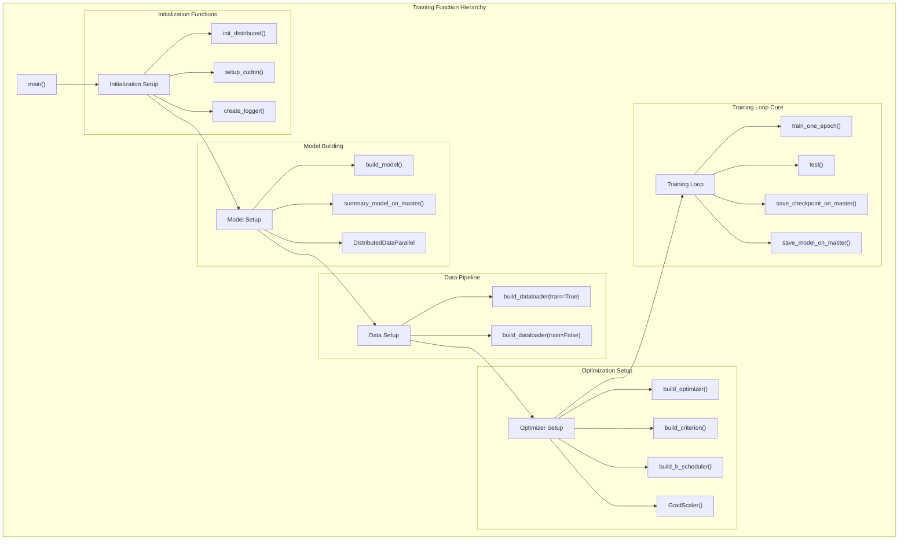
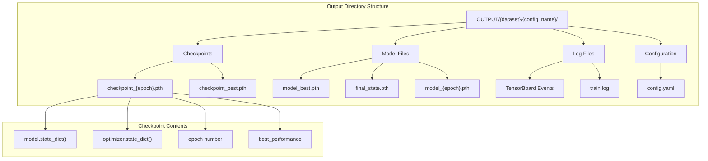

<!-- source: DeepWiki mcp.deepwiki.com · repo microsoft/CvT · page 4.1 Training Models · fetched 2026-10-26 -->

# Training Models

<details>
<summary>Relevant source files</summary>

The following files were used as context for generating this wiki page:

- [README.md](README.md)
- [experiments/imagenet/cvt/cvt-13-224x224.yaml](experiments/imagenet/cvt/cvt-13-224x224.yaml)
- [experiments/imagenet/cvt/cvt-21-224x224.yaml](experiments/imagenet/cvt/cvt-21-224x224.yaml)
- [tools/train.py](tools/train.py)

</details>


This page provides a comprehensive guide for training CvT (Convolutional vision Transformers) models using the provided training infrastructure. It covers the practical aspects of running training jobs, configuring model variants, and managing training outputs.

For information about the CvT model architecture details, see [CvT Model Architecture](#3.1). For evaluation of trained models, see [Model Evaluation](#4.2). For detailed configuration parameter reference, see [Configuration Reference](#4.3).

## Training Entry Points

The CvT training system provides two primary entry points for executing training jobs:

### Main Training Script

The core training functionality is implemented in `tools/train.py`, which serves as the main orchestrator for the training process. This script handles model initialization, data loading, distributed training setup, and the main training loop.

### Run Script Interface

The repository provides a convenient shell script `run.sh` that wraps the training script with common distributed training configurations:

```bash
# Basic training command
bash run.sh -g 8 -t train --cfg experiments/imagenet/cvt/cvt-13-224x224.yaml

# Training with parameter overrides
bash run.sh -g 8 -t train --cfg experiments/imagenet/cvt/cvt-13-224x224.yaml TRAIN.LR 0.1
```

**Run Script Parameters:**
- `-g|--gpus`: Number of GPUs to use (default: 1)
- `-t|--job-type`: Job type (`train` or `test`)
- `-p|--port`: Master port for distributed training (default: 9000)
- `-i|--install-deps`: Whether to install dependencies

Sources: [README.md:85-104](), [tools/train.py:37-57]()

## Training Workflow Architecture



Sources: [tools/train.py:60-211]()

## Configuration-Based Model Training

### Configuration File Structure

Training configurations are defined in YAML files located in the `experiments/{dataset}/{architecture}/` directory structure. Each configuration file specifies the complete training setup including model architecture, training hyperparameters, data augmentation, and optimization settings.



### Key Configuration Sections

| Section | Purpose | Key Parameters |
|---------|---------|----------------|
| `MODEL.SPEC` | Defines CvT architecture | `NUM_STAGES`, `DEPTH`, `DIM_EMBED`, `NUM_HEADS` |
| `TRAIN` | Training hyperparameters | `LR`, `BATCH_SIZE_PER_GPU`, `END_EPOCH`, `OPTIMIZER` |
| `AUG` | Data augmentation | `MIXUP`, `TIMM_AUG`, `AUTO_AUGMENT` |
| `DATASET` | Data configuration | `ROOT`, `TRAIN_SET`, `TEST_SET` |
| `AMP` | Mixed precision training | `ENABLED`, `MEMORY_FORMAT` |

Sources: [experiments/imagenet/cvt/cvt-13-224x224.yaml:1-84](), [experiments/imagenet/cvt/cvt-21-224x224.yaml:1-85]()

## Training Process Implementation

### Core Training Functions

The training process is implemented through several key functions in the core training script:



### Training Loop Details

The main training loop executes the following sequence for each epoch:

1. **Epoch Initialization**: Set distributed sampler epoch, log epoch start
2. **Training Phase**: Call `train_one_epoch()` from `core.function`
3. **Validation Phase**: Call `test()` function for evaluation
4. **Model Saving**: Save checkpoints and best models based on performance
5. **Learning Rate Update**: Step the learning rate scheduler

Sources: [tools/train.py:125-207]()

## Command Line Interface

### Basic Training Commands

```bash
# Train CvT-13 model on ImageNet with 8 GPUs
bash run.sh -g 8 -t train --cfg experiments/imagenet/cvt/cvt-13-224x224.yaml

# Train CvT-21 model with custom learning rate
bash run.sh -g 8 -t train --cfg experiments/imagenet/cvt/cvt-21-224x224.yaml TRAIN.LR 0.0005

# Train with different batch size
bash run.sh -g 4 -t train --cfg experiments/imagenet/cvt/cvt-13-224x224.yaml TRAIN.BATCH_SIZE_PER_GPU 128
```

### Parameter Override System

The training system supports runtime parameter overrides through command line arguments. Parameters are specified using dot notation matching the YAML configuration structure:

```bash
# Override multiple parameters
bash run.sh -g 8 -t train --cfg config.yaml \
    TRAIN.LR 0.001 \
    TRAIN.END_EPOCH 100 \
    MODEL.SPEC.DEPTH [1,2,8] \
    AUG.MIXUP 0.5
```

### Distributed Training Configuration

The training script automatically handles distributed training setup when multiple GPUs are specified:

- **Multi-GPU Training**: Uses `DistributedDataParallel` wrapper
- **Process Communication**: Managed through `--local_rank` and `--port` parameters
- **Data Loading**: Distributed sampler ensures proper data distribution across GPUs

Sources: [tools/train.py:109-114](), [README.md:96-105]()

## Output Management

### Training Artifacts Structure



### Model Saving Strategy

The training system implements a comprehensive model saving strategy:

1. **Checkpoint Saving**: Full training state saved each epoch via `save_checkpoint_on_master()`
2. **Best Model Saving**: Best performing model saved as `model_best.pth`
3. **Final Model Saving**: Final training state saved as `final_state.pth`
4. **Optional All Models**: Save every epoch model if `TRAIN.SAVE_ALL_MODELS` enabled

### Output Location Configuration

Training outputs are saved to directories following the pattern:
```
OUTPUT/{DATASET.DATASET}/{config_filename}/
```

This can be customized by modifying the `OUTPUT_DIR` parameter in the configuration file.

Sources: [tools/train.py:171-199](), [README.md:108]()

## Advanced Training Features

### Mixed Precision Training

The training system supports Automatic Mixed Precision (AMP) through PyTorch's native AMP implementation:

```yaml
AMP:
  ENABLED: true
  MEMORY_FORMAT: 'nhwc'  # Optional memory format optimization
```

The AMP implementation uses `GradScaler` for gradient scaling and `autocast` context during forward passes.

### Resume Training

Training can be resumed from checkpoints automatically. The `resume_checkpoint()` function handles:
- Loading model and optimizer state
- Restoring epoch number and best performance
- Continuing from the last saved state

### Stochastic Weight Averaging (SWA)

Optional SWA support is available when `SWA.ENABLED` is set to true in the configuration. This saves an additional SWA model state for improved generalization.

Sources: [tools/train.py:87-89](), [tools/train.py:102-104](), [tools/train.py:201-205]()

---

