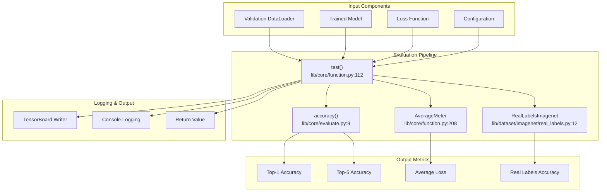
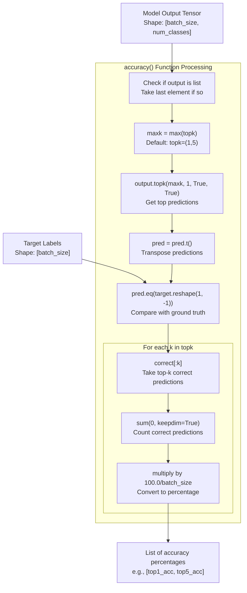
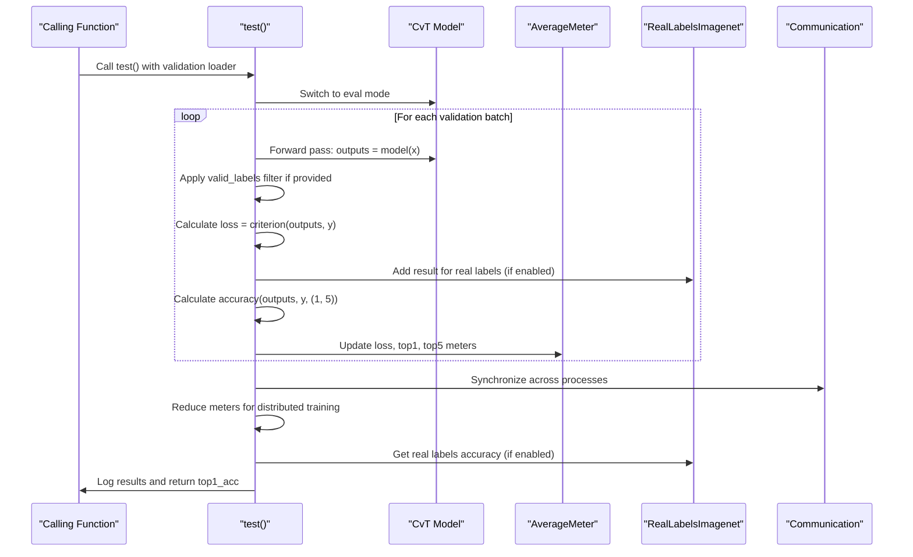
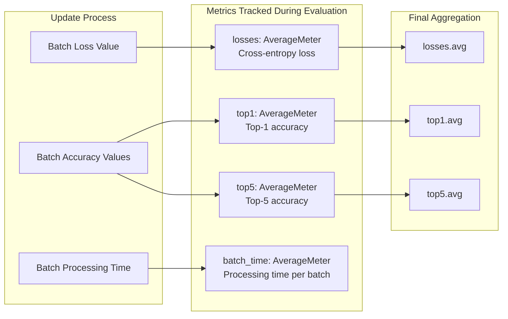
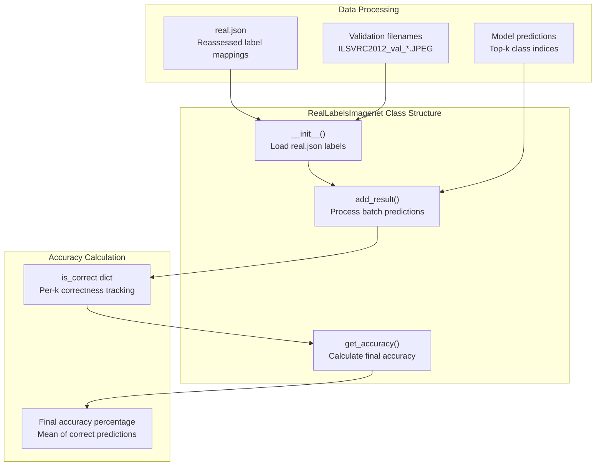
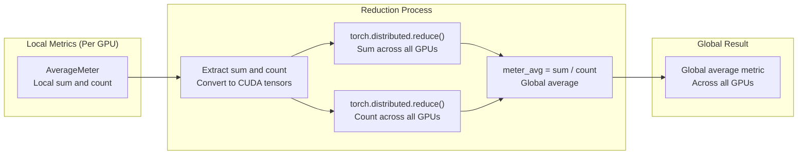

<!-- source: DeepWiki mcp.deepwiki.com · repo microsoft/CvT · page 4.2 Model Evaluation · fetched 2026-10-26 -->

# Model Evaluation

<details>
<summary>Relevant source files</summary>

The following files were used as context for generating this wiki page:

- [lib/core/evaluate.py](lib/core/evaluate.py)
- [lib/core/function.py](lib/core/function.py)
- [lib/dataset/imagenet/real_labels.py](lib/dataset/imagenet/real_labels.py)

</details>


This page covers the model evaluation system in CvT, including accuracy metrics, validation pipelines, and performance assessment tools. The evaluation system supports both standard ImageNet validation and enhanced evaluation using reassessed labels.

For information about training models, see [Training Models](#4.1). For configuration parameters that control evaluation behavior, see [Configuration Reference](#4.3).

## Evaluation Overview

The CvT evaluation system provides comprehensive model assessment capabilities built around the `test` function in [lib/core/function.py:112-194](). The system supports both single-GPU and distributed evaluation scenarios, with specialized handling for ImageNet's reassessed labels.

### Core Evaluation Components



Sources: [lib/core/function.py:112-194](), [lib/core/evaluate.py:9-25](), [lib/dataset/imagenet/real_labels.py:12-46]()

## Accuracy Calculation

The core metric computation is handled by the `accuracy` function, which calculates top-k precision for specified values of k.

### Accuracy Function Implementation

| Component | Function | Purpose |
|-----------|----------|---------|
| **Input Processing** | [lib/core/evaluate.py:11-17]() | Handles list outputs and determines maximum k |
| **Prediction Extraction** | [lib/core/evaluate.py:17-19]() | Extracts top-k predictions using `torch.topk` |
| **Correctness Calculation** | [lib/core/evaluate.py:19-25]() | Computes accuracy percentages for each k value |



Sources: [lib/core/evaluate.py:8-25]()

## Evaluation Pipeline

The main evaluation workflow is orchestrated by the `test` function, which handles model inference, metric calculation, and result aggregation.

### Test Function Flow



Sources: [lib/core/function.py:112-194]()

## Metric Tracking

The evaluation system uses `AverageMeter` objects to track running statistics during validation.

### AverageMeter Implementation

| Attribute | Purpose | Updated By |
|-----------|---------|------------|
| `val` | Current batch value | [lib/core/function.py:220]() |
| `avg` | Running average | [lib/core/function.py:223]() |
| `sum` | Cumulative sum | [lib/core/function.py:222]() |
| `count` | Total sample count | [lib/core/function.py:222]() |



Sources: [lib/core/function.py:115-118](), [lib/core/function.py:208-224]()

## Real Labels Evaluation

The system supports evaluation using reassessed ImageNet labels through the `RealLabelsImagenet` class, which provides more accurate validation metrics by accounting for labeling errors in the original ImageNet validation set.

### Real Labels Implementation



Sources: [lib/dataset/imagenet/real_labels.py:12-46]()

### Real Labels Usage Pattern

| Step | Code Location | Purpose |
|------|---------------|---------|
| **Initialization** | [lib/dataset/imagenet/real_labels.py:14-26]() | Load reassessed labels from JSON file |
| **Batch Processing** | [lib/dataset/imagenet/real_labels.py:28-39]() | Check predictions against real labels |
| **Final Calculation** | [lib/dataset/imagenet/real_labels.py:41-45]() | Compute accuracy statistics |

## Distributed Evaluation

For multi-GPU evaluation, the system includes distributed reduction of metrics using the `_meter_reduce` function.

### Distributed Metric Reduction



Sources: [lib/core/function.py:197-205](), [lib/core/function.py:151-154]()

## Evaluation Output

The evaluation system provides comprehensive logging and result reporting through multiple channels.

### Output Components

| Output Type | Implementation | Content |
|-------------|----------------|---------|
| **Console Logging** | [lib/core/function.py:172-182]() | Loss, top-1/top-5 accuracy, error rates |
| **TensorBoard** | [lib/core/function.py:184-189]() | Scalars for loss and accuracy tracking |
| **Return Value** | [lib/core/function.py:194]() | Top-1 accuracy for programmatic use |
| **Real Labels** | [lib/core/function.py:159-169]() | Reassessed label accuracy (when enabled) |

### Sample Evaluation Output

```
=> TEST:
Loss 0.8234
Error@1 21.456%
Error@5 5.823%
Accuracy@1 78.544%
Accuracy@5 94.177%

=> TEST using Reassessed labels:
Error@1 19.123%
Error@5 4.567%
Accuracy@1 80.877%
Accuracy@5 95.433%
```

Sources: [lib/core/function.py:159-182]()

---

