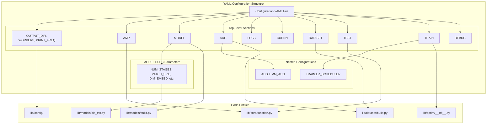
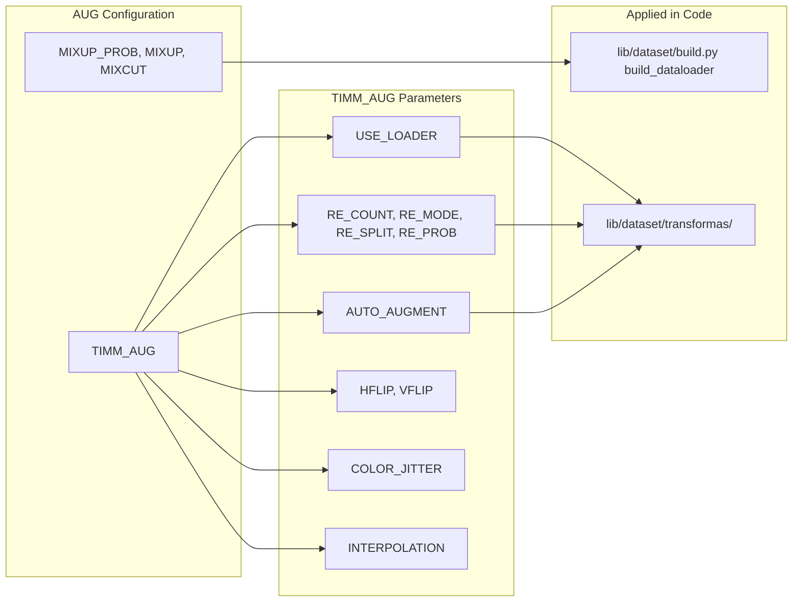

<!-- source: DeepWiki mcp.deepwiki.com · repo microsoft/CvT · page 4.3 Configuration Reference · fetched 2026-10-26 -->

# Configuration Reference

Relevant source files

The following files were used as context for generating this wiki page:

- [experiments/imagenet/cvt/cvt-13-224x224.yaml](experiments/imagenet/cvt/cvt-13-224x224.yaml)
- [experiments/imagenet/cvt/cvt-13-384x384.yaml](experiments/imagenet/cvt/cvt-13-384x384.yaml)
- [experiments/imagenet/cvt/cvt-21-224x224.yaml](experiments/imagenet/cvt/cvt-21-224x224.yaml)
- [experiments/imagenet/cvt/cvt-21-384x384.yaml](experiments/imagenet/cvt/cvt-21-384x384.yaml)
- [experiments/imagenet/cvt/cvt-w24-384x384.yaml](experiments/imagenet/cvt/cvt-w24-384x384.yaml)

This document provides a complete reference for all configuration parameters used in the CvT training and evaluation system. It covers the YAML configuration structure, parameter definitions, and usage examples for all supported model variants.

For information about how the configuration system works internally, see [Configuration System](#3.4). For detailed model variant specifications and performance characteristics, see [Model Variants](#6.1).

## Configuration Structure Overview

The CvT configuration system uses YAML files located in [experiments/imagenet/cvt/]() to define all training and model parameters. Each configuration file follows a standardized structure that maps directly to the codebase's configuration classes and functions.

**Configuration File Structure to Code Entity Mapping**

Sources: [experiments/imagenet/cvt/cvt-13-224x224.yaml:1-84](), [experiments/imagenet/cvt/cvt-21-224x224.yaml:1-85](), [experiments/imagenet/cvt/cvt-w24-384x384.yaml:1-85]()

## Core Configuration Sections

### Global Settings

| Parameter | Type | Description | Example Values |
|-----------|------|-------------|----------------|
| `OUTPUT_DIR` | string | Directory for training outputs and checkpoints | `'OUTPUT/'` |
| `WORKERS` | integer | Number of data loading worker processes | `6` |
| `PRINT_FREQ` | integer | Frequency of training progress logging | `500` |

### AMP (Automatic Mixed Precision)

| Parameter | Type | Description | Default |
|-----------|------|-------------|---------|
| `AMP.ENABLED` | boolean | Enable automatic mixed precision training | `true` |

### MODEL Configuration

The `MODEL` section defines the CvT architecture through the `MODEL.SPEC` subsection:

| Parameter | Type | Description | CvT-13 | CvT-21 | CvT-W24 |
|-----------|------|-------------|---------|---------|---------|
| `MODEL.NAME` | string | Model architecture identifier | `cls_cvt` | `cls_cvt` | `cls_cvt` |
| `MODEL.SPEC.INIT` | string | Weight initialization method | `'trunc_norm'` | `'trunc_norm'` | `'trunc_norm'` |
| `MODEL.SPEC.NUM_STAGES` | integer | Number of transformer stages | `3` | `3` | `3` |
| `MODEL.SPEC.PATCH_SIZE` | list | Convolutional patch sizes per stage | `[7, 3, 3]` | `[7, 3, 3]` | `[7, 3, 3]` |
| `MODEL.SPEC.PATCH_STRIDE` | list | Convolutional patch strides per stage | `[4, 2, 2]` | `[4, 2, 2]` | `[4, 2, 2]` |
| `MODEL.SPEC.PATCH_PADDING` | list | Convolutional patch padding per stage | `[2, 1, 1]` | `[2, 1, 1]` | `[2, 1, 1]` |
| `MODEL.SPEC.DIM_EMBED` | list | Embedding dimensions per stage | `[64, 192, 384]` | `[64, 192, 384]` | `[192, 768, 1024]` |
| `MODEL.SPEC.NUM_HEADS` | list | Attention heads per stage | `[1, 3, 6]` | `[1, 3, 6]` | `[3, 12, 16]` |
| `MODEL.SPEC.DEPTH` | list | Transformer blocks per stage | `[1, 2, 10]` | `[1, 4, 16]` | `[2, 2, 20]` |
| `MODEL.SPEC.MLP_RATIO` | list | MLP expansion ratio per stage | `[4.0, 4.0, 4.0]` | `[4.0, 4.0, 4.0]` | `[4.0, 4.0, 4.0]` |
| `MODEL.SPEC.ATTN_DROP_RATE` | list | Attention dropout rates per stage | `[0.0, 0.0, 0.0]` | `[0.0, 0.0, 0.0]` | `[0.0, 0.0, 0.0]` |
| `MODEL.SPEC.DROP_RATE` | list | General dropout rates per stage | `[0.0, 0.0, 0.0]` | `[0.0, 0.0, 0.0]` | `[0.0, 0.0, 0.0]` |
| `MODEL.SPEC.DROP_PATH_RATE` | list | Stochastic depth rates per stage | `[0.0, 0.0, 0.1]` | `[0.0, 0.0, 0.1]` | `[0.0, 0.0, 0.3]` |
| `MODEL.SPEC.QKV_BIAS` | list | Enable bias in QKV projections per stage | `[True, True, True]` | `[True, True, True]` | `[True, True, True]` |
| `MODEL.SPEC.CLS_TOKEN` | list | Use classification token per stage | `[False, False, True]` | `[False, False, True]` | `[False, False, True]` |
| `MODEL.SPEC.POS_EMBED` | list | Use positional embedding per stage | `[False, False, False]` | `[False, False, False]` | `[False, False, False]` |

### Convolutional Projection Parameters

| Parameter | Type | Description | Values |
|-----------|------|-------------|---------|
| `MODEL.SPEC.QKV_PROJ_METHOD` | list | QKV projection method per stage | `['dw_bn', 'dw_bn', 'dw_bn']` |
| `MODEL.SPEC.KERNEL_QKV` | list | QKV convolution kernel size per stage | `[3, 3, 3]` |
| `MODEL.SPEC.PADDING_KV` | list | KV projection padding per stage | `[1, 1, 1]` |
| `MODEL.SPEC.STRIDE_KV` | list | KV projection stride per stage | `[2, 2, 2]` |
| `MODEL.SPEC.PADDING_Q` | list | Q projection padding per stage | `[1, 1, 1]` |
| `MODEL.SPEC.STRIDE_Q` | list | Q projection stride per stage | `[1, 1, 1]` |

## Data Augmentation Configuration

**Data Augmentation Pipeline Structure**

### AUG Section Parameters

| Parameter | Type | Description | Typical Values |
|-----------|------|-------------|----------------|
| `AUG.MIXUP_PROB` | float | Probability of applying mixup/cutmix | `1.0` |
| `AUG.MIXUP` | float | Mixup alpha parameter | `0.8` |
| `AUG.MIXCUT` | float | CutMix alpha parameter | `1.0` |

### TIMM Augmentation Parameters

| Parameter | Type | Description | Values |
|-----------|------|-------------|---------|
| `AUG.TIMM_AUG.USE_LOADER` | boolean | Use TIMM's data loader augmentations | `true`/`false` |
| `AUG.TIMM_AUG.RE_COUNT` | integer | Random erasing count | `1` |
| `AUG.TIMM_AUG.RE_MODE` | string | Random erasing mode | `'pixel'` |
| `AUG.TIMM_AUG.RE_SPLIT` | boolean | Split random erasing across batches | `false` |
| `AUG.TIMM_AUG.RE_PROB` | float | Random erasing probability | `0.25` |
| `AUG.TIMM_AUG.AUTO_AUGMENT` | string | AutoAugment policy | `'rand-m9-mstd0.5-inc1'` |
| `AUG.TIMM_AUG.HFLIP` | float | Horizontal flip probability | `0.5` |
| `AUG.TIMM_AUG.VFLIP` | float | Vertical flip probability | `0.0` |
| `AUG.TIMM_AUG.COLOR_JITTER` | float | Color jitter strength | `0.4` |
| `AUG.TIMM_AUG.INTERPOLATION` | string | Image interpolation method | `'bicubic'` |

Sources: [experiments/imagenet/cvt/cvt-13-224x224.yaml:31-45](), [experiments/imagenet/cvt/cvt-21-224x224.yaml:31-45]()

## Training Configuration

### TRAIN Section Parameters

| Parameter | Type | Description | CvT-13 | CvT-21/W24 |
|-----------|------|-------------|---------|------------|
| `TRAIN.BATCH_SIZE_PER_GPU` | integer | Training batch size per GPU | `256` | `128` |
| `TRAIN.LR` | float | Base learning rate | `0.00025` | `0.000125` |
| `TRAIN.IMAGE_SIZE` | list | Input image dimensions | `[224, 224]` or `[384, 384]` | `[224, 224]` or `[384, 384]` |
| `TRAIN.BEGIN_EPOCH` | integer | Starting epoch number | `0` | `0` |
| `TRAIN.END_EPOCH` | integer | Total training epochs | `300` | `300` |
| `TRAIN.OPTIMIZER` | string | Optimizer type | `'adamW'` | `'adamW'` |
| `TRAIN.WD` | float | Weight decay coefficient | `0.05` | `0.1` |
| `TRAIN.WITHOUT_WD_LIST` | list | Parameters excluded from weight decay | `['bn', 'bias', 'ln']` | `['bn', 'bias', 'ln']` |
| `TRAIN.SHUFFLE` | boolean | Shuffle training data | `true` | `true` |

### Learning Rate Scheduler Configuration

| Parameter | Type | Description | Values |
|-----------|------|-------------|---------|
| `TRAIN.LR_SCHEDULER.METHOD` | string | Scheduler implementation | `'timm'` |
| `TRAIN.LR_SCHEDULER.ARGS.sched` | string | Scheduler type | `'cosine'` |
| `TRAIN.LR_SCHEDULER.ARGS.warmup_epochs` | integer | Warmup duration in epochs | `5` |
| `TRAIN.LR_SCHEDULER.ARGS.warmup_lr` | float | Warmup starting learning rate | `0.000001` |
| `TRAIN.LR_SCHEDULER.ARGS.min_lr` | float | Minimum learning rate | `0.00001` |
| `TRAIN.LR_SCHEDULER.ARGS.cooldown_epochs` | integer | Cooldown period | `10` |
| `TRAIN.LR_SCHEDULER.ARGS.decay_rate` | float | Learning rate decay rate | `0.1` |

## Test and Dataset Configuration

### TEST Section Parameters

| Parameter | Type | Description | Values |
|-----------|------|-------------|---------|
| `TEST.BATCH_SIZE_PER_GPU` | integer | Evaluation batch size per GPU | `32` |
| `TEST.IMAGE_SIZE` | list | Test image dimensions | `[224, 224]` or `[384, 384]` |
| `TEST.MODEL_FILE` | string | Path to model checkpoint for evaluation | `''` (empty for training) |
| `TEST.INTERPOLATION` | integer | Interpolation method (PIL constants) | `3` (bicubic) |
| `TEST.CENTER_CROP` | boolean | Apply center cropping during test | `False` (for 384x384 models) |

### DATASET Section Parameters

| Parameter | Type | Description | Values |
|-----------|------|-------------|---------|
| `DATASET.DATASET` | string | Dataset identifier | `'imagenet'` |
| `DATASET.DATA_FORMAT` | string | Image file format | `'jpg'` |
| `DATASET.ROOT` | string | Dataset root directory | `'DATASET/imagenet/'` |
| `DATASET.TEST_SET` | string | Test set subdirectory | `'val'` |
| `DATASET.TRAIN_SET` | string | Training set subdirectory | `'train'` |
| `DATASET.SAMPLER` | string | Data sampling strategy | `'repeated_aug'` (CvT-21 only) |

### Additional Configuration Sections

| Section | Parameters | Description |
|---------|------------|-------------|
| `LOSS` | `LABEL_SMOOTHING: 0.1` | Loss function configuration |
| `CUDNN` | `BENCHMARK: true`, `DETERMINISTIC: false`, `ENABLED: true` | CUDNN optimization settings |
| `DEBUG` | `DEBUG: false` | Debugging mode toggle |

Sources: [experiments/imagenet/cvt/cvt-13-224x224.yaml:58-84](), [experiments/imagenet/cvt/cvt-21-224x224.yaml:58-85](), [experiments/imagenet/cvt/cvt-w24-384x384.yaml:58-85]()

## Model Variant Comparison

The following table summarizes the key architectural differences between the provided CvT model variants:

| Model | Input Size | Stage Depths | Embedding Dims | Attention Heads | Drop Path Rate (Stage 3) | Batch Size | Learning Rate |
|-------|------------|--------------|----------------|-----------------|-------------------------|------------|---------------|
| CvT-13-224 | 224×224 | [1, 2, 10] | [64, 192, 384] | [1, 3, 6] | 0.1 | 256 | 0.00025 |
| CvT-13-384 | 384×384 | [1, 2, 10] | [64, 192, 384] | [1, 3, 6] | 0.1 | 256 | 0.00025 |
| CvT-21-224 | 224×224 | [1, 4, 16] | [64, 192, 384] | [1, 3, 6] | 0.1 | 128 | 0.000125 |
| CvT-21-384 | 384×384 | [1, 4, 16] | [64, 192, 384] | [1, 3, 6] | 0.1 | 128 | 0.000125 |
| CvT-W24-384 | 384×384 | [2, 2, 20] | [192, 768, 1024] | [3, 12, 16] | 0.3 | 128 | 0.000125 |

**Key Differences:**
- **CvT-13**: Lighter model with fewer transformer blocks and smaller batch size requirements
- **CvT-21**: Deeper model with more blocks in stages 2 and 3, requires repeated augmentation sampling
- **CvT-W24**: Widest model with larger embedding dimensions and attention heads, highest drop path rate

Sources: [experiments/imagenet/cvt/cvt-13-224x224.yaml:15-28](), [experiments/imagenet/cvt/cvt-21-224x224.yaml:15-28](), [experiments/imagenet/cvt/cvt-w24-384x384.yaml:15-28]()

---

