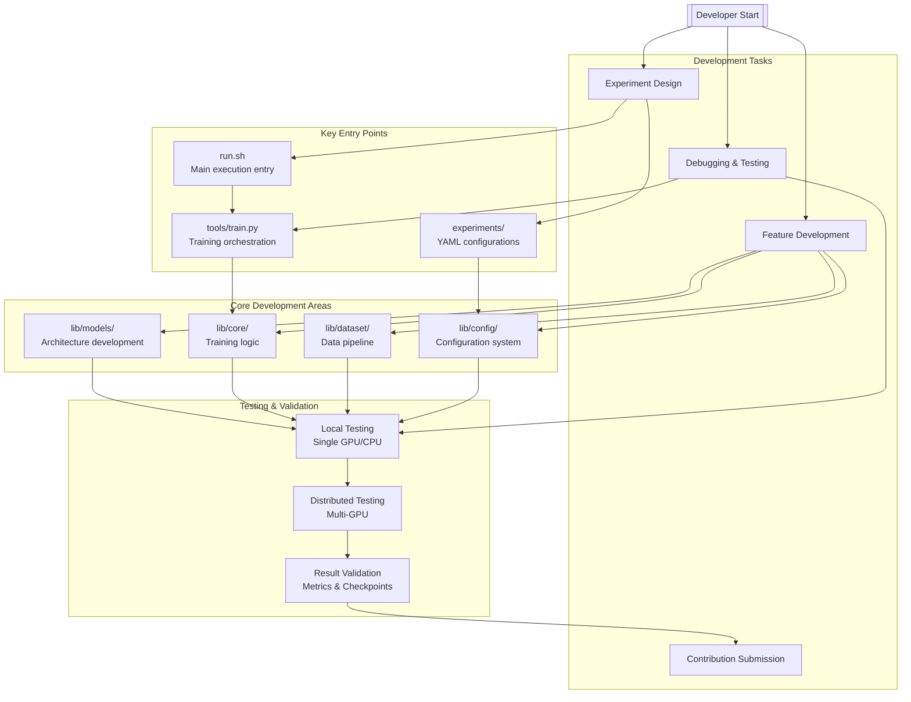
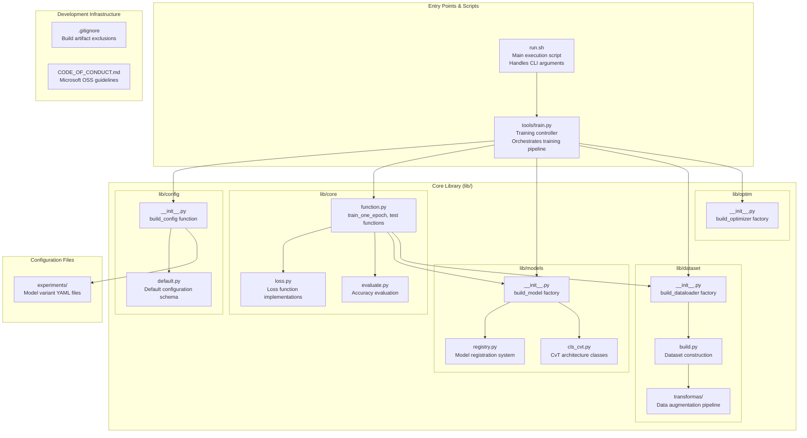
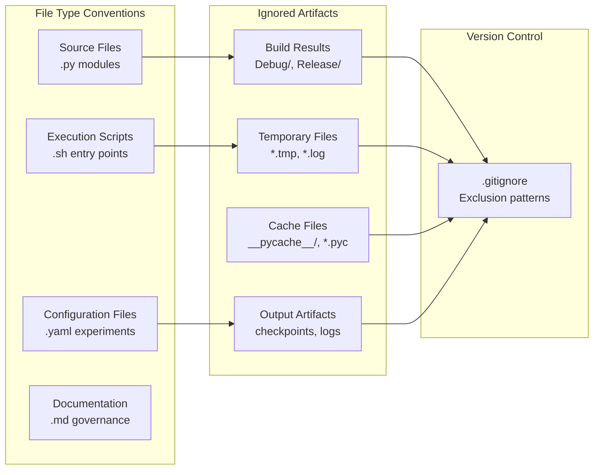

<!-- source: DeepWiki mcp.deepwiki.com · repo microsoft/CvT · page 5 Development · fetched 2026-10-26 -->

# Development

Relevant source files

The following files were used as context for generating this wiki page:

- [.gitignore](.gitignore)
- [CODE_OF_CONDUCT.md](CODE_OF_CONDUCT.md)

This document provides essential information for developers contributing to the CvT (Convolutional vision Transformers) codebase. It covers the development workflow, code organization, and guidelines for contributing to the project.

For detailed code structure documentation, see [Code Structure](#5.1). For specific contributing guidelines and governance, see [Contributing Guidelines](#5.2). For environment setup details, see [Development Environment](#5.3).

## Development Workflow Overview

The CvT repository follows a research-oriented development model where the primary workflow involves configuration-driven experimentation. Understanding this workflow is essential for effective contribution to the project.

*Sources: run.sh, tools/train.py, lib/ directory structure*

## Code Organization and Key Components

The codebase is organized into distinct modules with clear separation of concerns. Understanding this organization is crucial for making targeted contributions.

*Sources: lib/ directory structure, tools/train.py, run.sh, experiments/ directory*

### Key Development Areas

| Component | Purpose | Primary Files | Key Functions/Classes |
|-----------|---------|---------------|----------------------|
| **Model Architecture** | CvT model definitions and variants | `lib/models/cls_cvt.py`, `lib/models/registry.py` | `CvT`, `ConvolutionalVisionTransformer` |
| **Training Engine** | Core training and evaluation logic | `lib/core/function.py`, `lib/core/loss.py` | `train_one_epoch`, `test`, `LabelSmoothingCrossEntropy` |
| **Data Pipeline** | Dataset loading and augmentation | `lib/dataset/build.py`, `lib/dataset/transformas/` | `build_dataloader`, transformation classes |
| **Configuration** | Parameter management and validation | `lib/config/default.py`, `lib/config/__init__.py` | `build_config`, configuration schemas |
| **Optimization** | Optimizer and scheduler construction | `lib/optim/__init__.py` | `build_optimizer` factory function |

## Development Guidelines and Practices

### Code Contribution Standards

The project follows Microsoft's open source guidelines as defined in the code of conduct. Key principles include:

- **Respectful Communication**: All interactions follow the Microsoft Open Source Code of Conduct
- **Modular Design**: New features should integrate with the existing factory pattern architecture
- **Configuration-Driven**: New functionality should be configurable through YAML files
- **Testing**: Changes should be validated through the training pipeline

*Sources: [CODE_OF_CONDUCT.md:1-10]()*

### File and Directory Conventions

The project uses a structured approach to file organization:

*Sources: [.gitignore:1-351]()*

### Factory Pattern Implementation

The codebase extensively uses factory patterns for component creation. When adding new functionality, follow these patterns:

| Factory Function | Location | Purpose | Extension Pattern |
|------------------|----------|---------|-------------------|
| `build_model` | `lib/models/__init__.py` | Model construction | Register in `lib/models/registry.py` |
| `build_config` | `lib/config/__init__.py` | Configuration loading | Extend `lib/config/default.py` schema |
| `build_dataloader` | `lib/dataset/__init__.py` | Dataset construction | Add to `lib/dataset/build.py` |
| `build_optimizer` | `lib/optim/__init__.py` | Optimizer creation | Implement in optim module |

### Testing and Validation Workflow

Development changes should be validated through the standard training pipeline:

1. **Configuration Testing**: Validate new parameters through YAML configuration files
2. **Local Execution**: Test using `run.sh` with minimal configurations
3. **Training Validation**: Ensure `tools/train.py` executes without errors
4. **Integration Testing**: Verify integration with existing `lib/core/function.py` workflows

## Development Environment Considerations

### Build Artifact Management

The project generates various artifacts during development and training. The `.gitignore` configuration excludes standard development artifacts:

- **Python Artifacts**: `__pycache__/`, `*.pyc` files are excluded
- **Build Results**: Debug and Release directories are ignored  
- **Log Files**: Training logs and temporary files are excluded
- **IDE Files**: Visual Studio and development environment files are ignored

*Sources: [.gitignore:306-307](), [.gitignore:88](), [.gitignore:20-32]()*

### Integration Points

Key integration points for development work include:

- **Entry Point Integration**: New functionality should integrate through `run.sh` and `tools/train.py`
- **Configuration Integration**: Parameters should be configurable through the YAML system
- **Model Registry**: New models must be registered in the model registry system
- **Data Pipeline**: Custom datasets should integrate through the dataloader factory

For detailed environment setup procedures, see [Development Environment](#5.3).

*Sources: run.sh, tools/train.py, lib/models/registry.py, lib/dataset/__init__.py*

---

