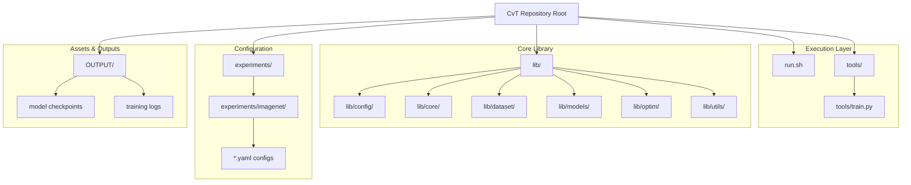
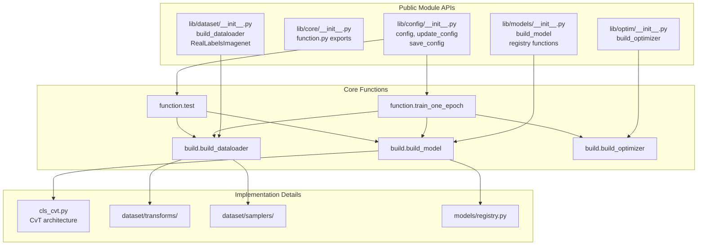
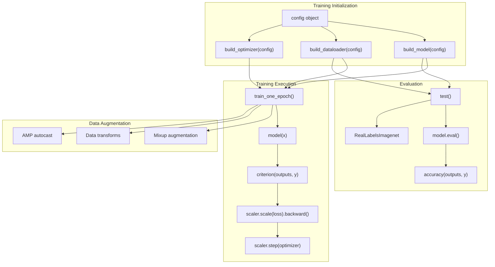

<!-- source: DeepWiki mcp.deepwiki.com · repo microsoft/CvT · page 5.1 Code Structure · fetched 2026-10-26 -->

# Code Structure

<details>
<summary>Relevant source files</summary>

The following files were used as context for generating this wiki page:

- [lib/config/__init__.py](lib/config/__init__.py)
- [lib/core/function.py](lib/core/function.py)
- [lib/dataset/__init__.py](lib/dataset/__init__.py)
- [lib/models/__init__.py](lib/models/__init__.py)
- [lib/optim/__init__.py](lib/optim/__init__.py)

</details>


This document provides an overview of the CvT repository's code organization, module structure, and key components. It serves as a guide for developers to understand how the codebase is organized and how different modules interact with each other.

For information about the CvT model architecture itself, see [CvT Model Architecture](#3.1). For details about the training pipeline execution, see [Training Pipeline](#3.2). For configuration management details, see [Configuration System](#3.4).

## Repository Organization

The CvT repository follows a hierarchical structure with clear separation of concerns between configuration, execution, core functionality, and supporting assets.

### High-Level Directory Structure



Sources: Based on high-level system architecture diagrams and repository structure analysis.

## Core Library Structure

The `lib/` directory contains the main functional modules of the CvT implementation. Each module has a clear responsibility and provides a public API through its `__init__.py` file.

### Module Dependencies and Interfaces



Sources: [lib/config/__init__.py:1-4](), [lib/dataset/__init__.py:1-2](), [lib/models/__init__.py:1-9](), [lib/optim/__init__.py:1-1]()

## Module Responsibilities

### Configuration Module (`lib/config/`)

The configuration module provides centralized parameter management for the entire system.

| Component | Responsibility | Key Exports |
|-----------|---------------|-------------|
| `__init__.py` | Public API | `config`, `update_config`, `save_config` |
| `default.py` | Configuration schema and defaults | `_C` config object, update functions |

**Key Functions:**
- `config`: Global configuration object
- `update_config`: Update configuration from files or arguments  
- `_update_config_from_file`: Load configuration from YAML files
- `save_config`: Persist configuration to disk

Sources: [lib/config/__init__.py:1-4]()

### Core Training Module (`lib/core/`)

The core module contains the main training and evaluation logic.

**Primary Functions:**
- `train_one_epoch()`: Main training loop for a single epoch [lib/core/function.py:16-109]()
- `test()`: Model evaluation and validation [lib/core/function.py:112-194]()

**Key Features:**
- Automatic Mixed Precision (AMP) support [lib/core/function.py:47-50]()
- Mixup data augmentation integration [lib/core/function.py:28-34]()
- Gradient clipping [lib/core/function.py:62-69]()
- Distributed training support [lib/core/function.py:197-205]()
- Real labels evaluation [lib/core/function.py:135-169]()

Sources: [lib/core/function.py:16-224]()

### Dataset Module (`lib/dataset/`)

The dataset module handles data loading, augmentation, and sampling strategies.

| Component | Purpose |
|-----------|---------|
| `build_dataloader` | Factory function for creating data loaders |
| `RealLabelsImagenet` | ImageNet reassessed labels for evaluation |
| `transforms/` | Data augmentation pipelines |
| `samplers/` | Custom sampling strategies |

Sources: [lib/dataset/__init__.py:1-2]()

### Models Module (`lib/models/`)

The models module defines the CvT architecture and provides model construction utilities.

**Key Components:**
- `build_model`: Factory function for model instantiation
- `cls_cvt.py`: CvT architecture implementation
- `registry.py`: Model registration and discovery system

**Public API:**
```python
from lib.models import build_model
model = build_model(config)
```

Sources: [lib/models/__init__.py:1-9]()

### Optimizer Module (`lib/optim/`)

Provides optimizer construction and configuration.

**Main Export:**
- `build_optimizer`: Factory function for creating optimizers based on configuration

Sources: [lib/optim/__init__.py:1-1]()

## Training Pipeline Integration

The modules integrate to form a complete training pipeline through the core functions.

### Training Loop Architecture



Sources: [lib/core/function.py:16-109](), [lib/core/function.py:112-194](), [lib/models/__init__.py:9](), [lib/dataset/__init__.py:1](), [lib/optim/__init__.py:1]()

## Key Abstractions

### Factory Pattern Implementation

The codebase uses factory functions for creating major components:

| Factory Function | Module | Purpose |
|-----------------|---------|---------|
| `build_model()` | `lib.models` | Create CvT model instances |
| `build_dataloader()` | `lib.dataset` | Create training/validation data loaders |
| `build_optimizer()` | `lib.optim` | Create optimizer instances |

### Configuration-Driven Design

All factory functions accept a `config` object that determines their behavior:

```python
# Typical usage pattern
model = build_model(config)
train_loader = build_dataloader(config, is_train=True)
optimizer = build_optimizer(config, model)
```

### Modular Training Components

The training process is decomposed into reusable components:

- **AverageMeter**: Tracks running averages of metrics [lib/core/function.py:208-223]()
- **Mixup Integration**: Data augmentation [lib/core/function.py:28-34]()
- **AMP Support**: Mixed precision training [lib/core/function.py:47-50]()
- **Distributed Training**: Multi-GPU support [lib/core/function.py:197-205]()

Sources: [lib/core/function.py:208-223](), [lib/core/function.py:28-34](), [lib/core/function.py:47-50](), [lib/core/function.py:197-205]()

---

