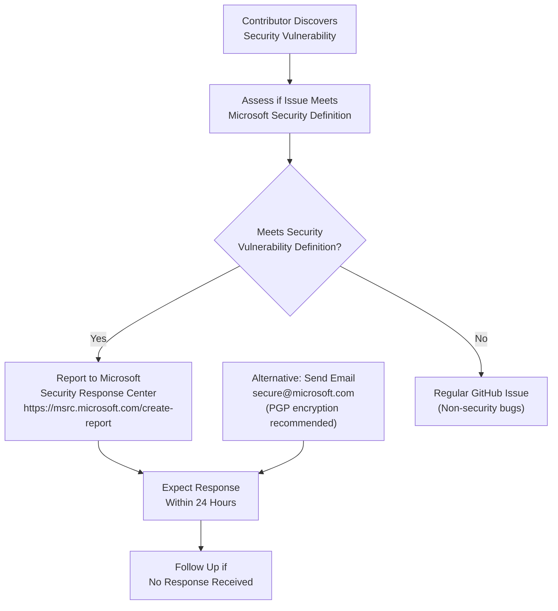
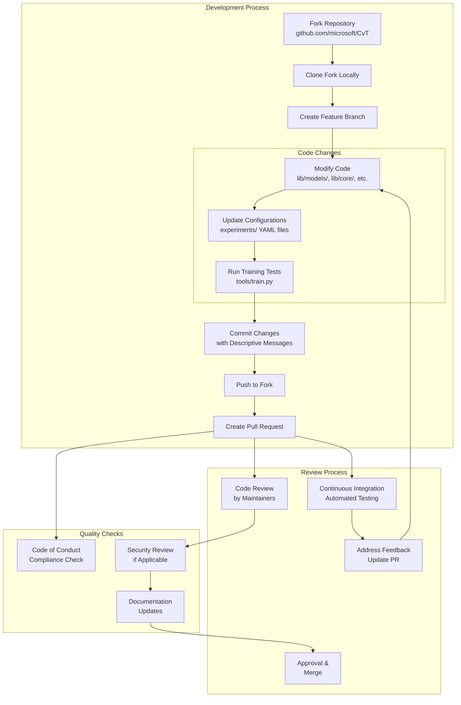

<!-- source: DeepWiki mcp.deepwiki.com · repo microsoft/CvT · page 5.2 Contributing Guidelines · fetched 2026-10-26 -->

# Contributing Guidelines

Relevant source files

The following files were used as context for generating this wiki page:

- [CODE_OF_CONDUCT.md](CODE_OF_CONDUCT.md)
- [SECURITY.md](SECURITY.md)

This document provides guidelines for contributing to the CvT (Convolutional vision Transformers) repository. It covers the project's code of conduct, security reporting procedures, and general contribution workflows. For information about the codebase organization and development setup, see [Code Structure](#5.1) and [Development Environment](#5.3). For complete legal and governance documentation, see [Legal & Governance](#6.3).

## Code of Conduct

The CvT project follows the Microsoft Open Source Code of Conduct to ensure a welcoming and inclusive environment for all contributors.

### Standards and Expectations

All contributors must adhere to the [Microsoft Open Source Code of Conduct](https://opensource.microsoft.com/codeofconduct/). This includes:

- Using welcoming and inclusive language
- Being respectful of differing viewpoints and experiences  
- Gracefully accepting constructive criticism
- Focusing on what is best for the community
- Showing empathy towards other community members

### Reporting Issues

For questions or concerns about conduct violations:
- Email: `opencode@microsoft.com`
- Review the [Microsoft Code of Conduct FAQ](https://opensource.microsoft.com/codeofconduct/faq/) for additional guidance

**Sources:** [CODE_OF_CONDUCT.md:1-10]()

## Security Reporting

Microsoft takes security seriously across all repositories. The CvT project follows established security reporting procedures for responsible disclosure.

### Security Vulnerability Reporting Process

### Required Information for Security Reports

When reporting security vulnerabilities, include:

| Information Type | Description |
|------------------|-------------|
| **Issue Type** | Buffer overflow, SQL injection, cross-site scripting, etc. |
| **Source Files** | Full paths of affected files |
| **Location** | Tag/branch/commit or direct URL |
| **Configuration** | Special setup required to reproduce |
| **Reproduction Steps** | Step-by-step instructions |
| **Proof of Concept** | Exploit code if available |
| **Impact Assessment** | How an attacker might exploit the issue |

### Important Security Guidelines

- **Do not report security vulnerabilities through public GitHub issues**
- Use the Microsoft Security Response Center (MSRC) for all security reports
- Encrypt messages using the [Microsoft Security Response Center PGP Key](https://www.microsoft.com/en-us/msrc/pgp-key-msrc) when possible
- Microsoft follows [Coordinated Vulnerability Disclosure](https://www.microsoft.com/en-us/msrc/cvd) principles

**Sources:** [SECURITY.md:1-41]()

## Contribution Workflow

The following diagram illustrates the typical contribution process for the CvT repository:

### Core Areas for Contributions

| Component | Files | Contribution Focus |
|-----------|-------|-------------------|
| **Model Architecture** | `lib/models/cls_cvt.py`, `lib/models/build.py` | New CvT variants, architecture improvements |
| **Training Pipeline** | `lib/core/function.py`, `tools/train.py` | Training optimizations, evaluation metrics |
| **Data Processing** | `lib/dataset/`, `lib/dataset/transforms/` | Data augmentation, loading efficiency |
| **Configuration** | `experiments/*/`, `lib/config/` | New model configs, parameter validation |
| **Optimization** | `lib/optim/`, `lib/core/loss.py` | Optimizer implementations, loss functions |

**Sources:** Inferred from repository structure and common open source practices

## Communication Guidelines

### Preferred Communication Channels

- **GitHub Issues**: Bug reports, feature requests, general questions
- **Pull Requests**: Code contributions with detailed descriptions
- **Email**: Security issues (`secure@microsoft.com`) or conduct concerns (`opencode@microsoft.com`)

### Language Requirements

All communications should be in English to ensure accessibility for the global contributor community.

### Best Practices

- Provide clear, detailed descriptions in issues and pull requests
- Include relevant file paths and line numbers when reporting bugs
- Reference related issues or pull requests when applicable
- Follow the existing code style and conventions
- Update documentation when making functional changes

**Sources:** [SECURITY.md:33-36](), [CODE_OF_CONDUCT.md:9]()

---

