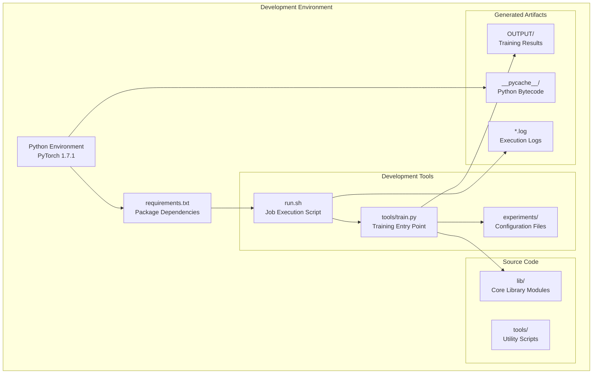
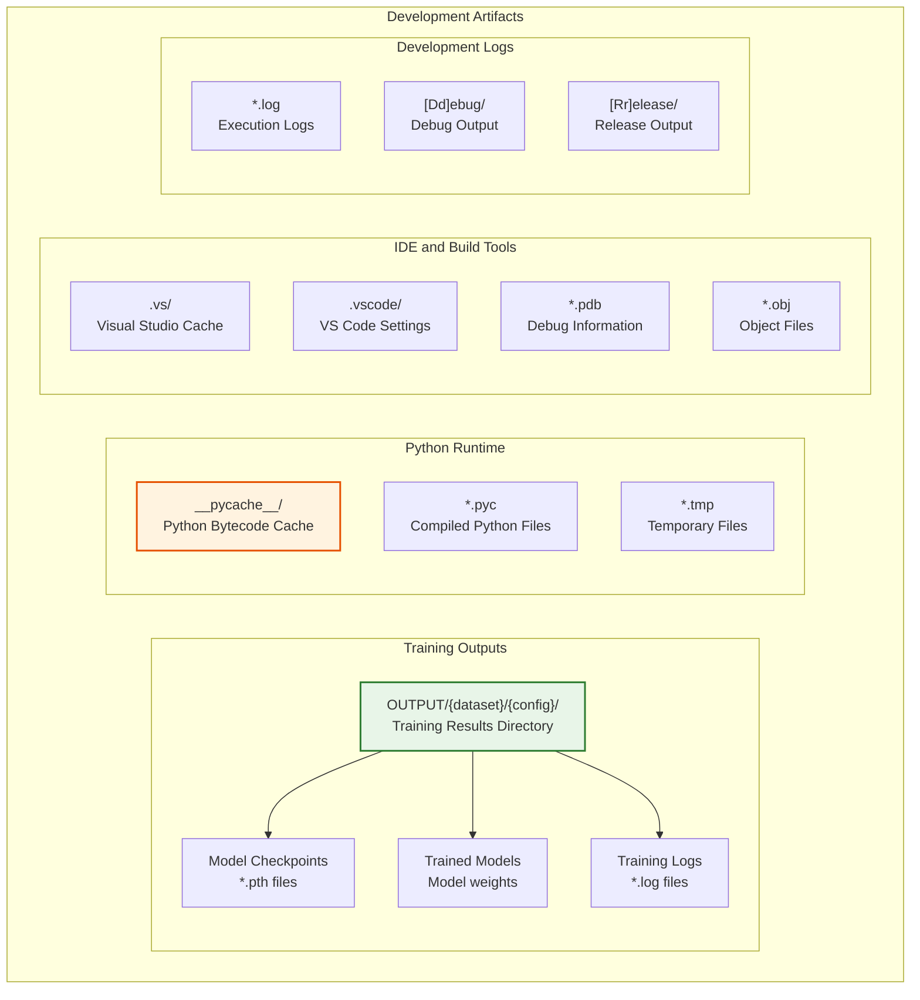
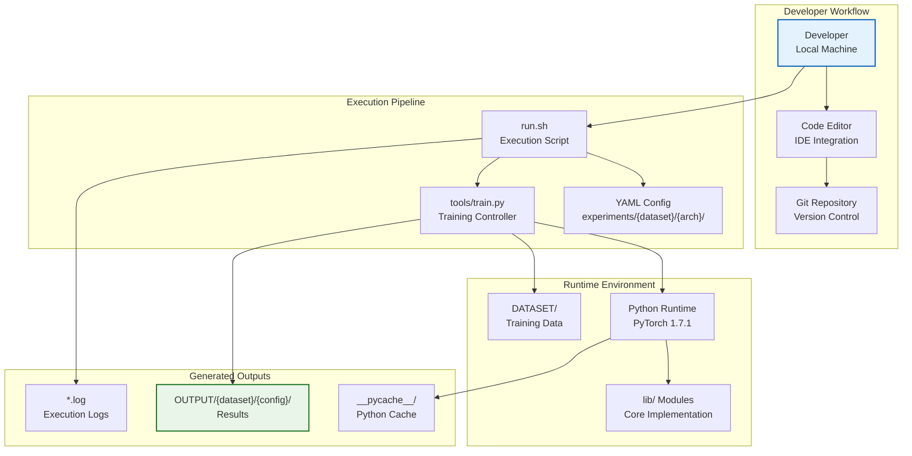

<!-- source: DeepWiki mcp.deepwiki.com · repo microsoft/CvT · page 5.3 Development Environment · fetched 2026-10-26 -->

# Development Environment

<details>
<summary>Relevant source files</summary>

The following files were used as context for generating this wiki page:

- [.gitignore](.gitignore)
- [README.md](README.md)

</details>


This document covers setting up a development environment for the CvT repository, understanding the build artifacts generated during development, and working with the available development tooling. For information about the overall code structure and module organization, see [Code Structure](#5.1). For contributing guidelines and project governance, see [Contributing Guidelines](#5.2).

## Environment Setup

The CvT project requires a Python environment with PyTorch and TorchVision as core dependencies. The development environment setup follows standard Python deep learning practices with specific version requirements.

### Core Dependencies

The project specifies its dependencies through standard Python packaging mechanisms. The main requirements include:

- **PyTorch 1.7.1**: Core deep learning framework (tested version)
- **TorchVision**: Computer vision utilities and datasets
- **Additional packages**: Specified in `requirements.txt`

Installation follows the standard pip workflow as documented in [README.md:27-34]():

```bash
python -m pip install -r requirements.txt --user -q
```

### Development Environment Structure



**Sources:** [README.md:27-34](), [.gitignore:306-307]()

## Development Tooling

The repository provides several tools and scripts to facilitate development and experimentation.

### Primary Execution Script

The `run.sh` script serves as the main entry point for development activities, supporting both training and testing workflows:

| Parameter | Default | Description |
|-----------|---------|-------------|
| `-g/--gpus` | 1 | Number of GPUs to use |
| `-t/--job-type` | aml | Job type (train\|test) |
| `-p/--port` | 9000 | Master port for distributed training |
| `-i/--install-deps` | False | Install dependencies flag |

Usage examples from [README.md:98-105]():
- Training: `bash run.sh -g 8 -t train --cfg experiments/imagenet/cvt/cvt-13-224x224.yaml`
- Testing: `bash run.sh -t test --cfg experiments/imagenet/cvt/cvt-13-224x224.yaml TEST.MODEL_FILE ${PRETRAINED_MODEL_FILE}`

### Configuration Management

Development relies heavily on YAML configuration files organized under the `experiments/` directory. The configuration system allows runtime parameter overrides via command line, enabling rapid experimentation:

```bash
bash run.sh -g 8 -t train --cfg experiments/imagenet/cvt/cvt-13-224x224.yaml TRAIN.LR 0.1
```

**Sources:** [README.md:85-105](), [README.md:69-83]()

## Build Artifacts and Development Outputs

The development environment generates various artifacts during code execution, model training, and general development activities.

### Generated File Categories



**Sources:** [README.md:108](), [.gitignore:20-33](), [.gitignore:306-307](), [.gitignore:88]()

### Output Directory Structure

Training and evaluation outputs follow a structured directory layout as specified in [README.md:108]():

```
OUTPUT/
├── {dataset}/
│   └── {training_config}/
│       ├── checkpoints/
│       ├── models/
│       └── logs/
```

This structure allows multiple experiments to coexist without conflicts and provides clear organization of results.

### Ignored Development Files

The `.gitignore` configuration excludes numerous development artifacts to maintain a clean repository:

| Category | Examples | Purpose |
|----------|----------|---------|
| Python Runtime | `__pycache__/`, `*.pyc` | Compiled bytecode |
| Build Results | `[Dd]ebug/`, `[Rr]elease/` | Compilation outputs |
| IDE Files | `.vs/`, `*.user` | Editor-specific settings |
| Logs | `*.log`, `[Ll]ogs/` | Execution and debug logs |
| Temporary | `*.tmp`, `*.cache` | Transient build files |

**Sources:** [.gitignore:20-33](), [.gitignore:306-307](), [.gitignore:34-35](), [.gitignore:88](), [.gitignore:85-86]()

## Development Workflow Integration

The development environment integrates with the broader CvT system architecture through well-defined interfaces and conventions.

### Development File Flow



**Sources:** [README.md:85-105](), [README.md:36-65](), [.gitignore:306-307]()

The development environment provides a complete toolchain for CvT model development, from dependency management through execution and result collection, while maintaining clean separation between source code and generated artifacts.

---

