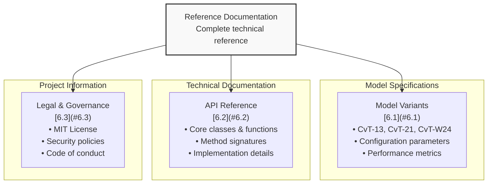
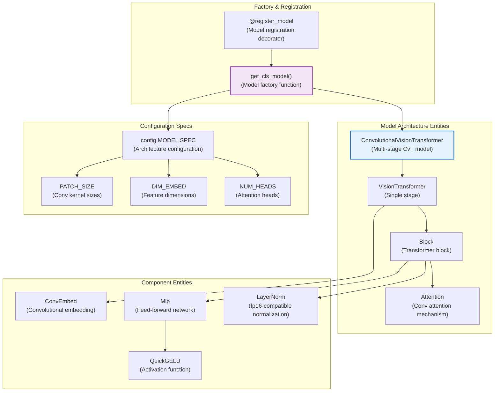
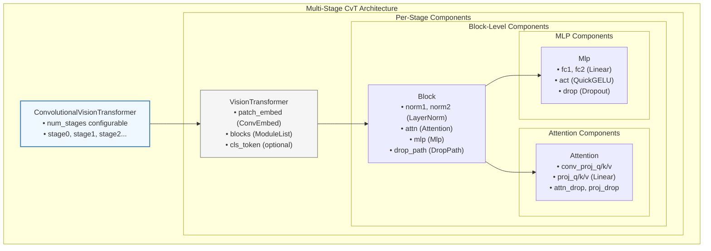

<!-- source: DeepWiki mcp.deepwiki.com · repo microsoft/CvT · page 6 Reference · fetched 2026-10-26 -->

# Reference

Relevant source files

The following files were used as context for generating this wiki page:

- [LICENSE](LICENSE)
- [lib/models/cls_cvt.py](lib/models/cls_cvt.py)

This page serves as the main entry point for comprehensive reference documentation of the CvT (Convolutional vision Transformers) codebase. It provides an overview of model variants, API documentation, and legal information for developers and researchers working with the CvT implementation.

For step-by-step usage instructions, see [Getting Started](#2). For architectural details and design principles, see [Architecture & Design](#3). For practical guides on training and evaluation, see [Usage Guide](#4).

## Reference Documentation Overview

The reference documentation is organized into three main categories, each covering different aspects of the CvT codebase:

Sources: [LICENSE:1-22]()

## Core Code Entity Mapping

The following diagram maps key system concepts to their corresponding code entities, enabling quick navigation from architectural concepts to implementation details:

Sources: [lib/models/cls_cvt.py:491-646]()

## Key Reference Tables

### Core Model Classes

| Class | Purpose | Location | Key Methods |
|-------|---------|----------|-------------|
| `ConvolutionalVisionTransformer` | Multi-stage CvT model | [lib/models/cls_cvt.py:491]() | `forward()`, `forward_features()` |
| `VisionTransformer` | Single stage transformer | [lib/models/cls_cvt.py:372]() | `forward()`, `_init_weights_*()` |
| `Attention` | Convolutional attention mechanism | [lib/models/cls_cvt.py:77]() | `forward()`, `forward_conv()` |
| `Block` | Transformer block with residual connections | [lib/models/cls_cvt.py:289]() | `forward()` |
| `ConvEmbed` | Convolutional token embedding | [lib/models/cls_cvt.py:336]() | `forward()` |

### Configuration Parameters

| Parameter Category | Config Keys | Description | 
|-------------------|-------------|-------------|
| Architecture | `NUM_STAGES`, `DEPTH`, `DIM_EMBED` | Stage count, block depth, feature dimensions |
| Attention | `NUM_HEADS`, `QKV_PROJ_METHOD`, `KERNEL_QKV` | Multi-head setup and conv projections |
| Convolution | `PATCH_SIZE`, `PATCH_STRIDE`, `PADDING_*` | Convolutional embedding parameters |
| Training | `DROP_RATE`, `ATTN_DROP_RATE`, `DROP_PATH_RATE` | Regularization and dropout rates |

### Factory Functions

| Function | Purpose | Location | Returns |
|----------|---------|----------|---------|
| `get_cls_model()` | Create CvT model from config | [lib/models/cls_cvt.py:626]() | `ConvolutionalVisionTransformer` |
| `@register_model` | Register model in factory | [lib/models/cls_cvt.py:626]() | Decorator |

Sources: [lib/models/cls_cvt.py:77-646]()

## Model Architecture Hierarchy

Sources: [lib/models/cls_cvt.py:372-646]()

## Legal and Licensing

The CvT codebase is released under the MIT License by Microsoft Corporation. This provides broad permissions for use, modification, and distribution with minimal restrictions.

**License**: MIT License  
**Copyright**: Microsoft Corporation  
**Key Terms**: Permission granted for use, copy, modify, merge, publish, distribute, sublicense, and sell

For complete license text and additional governance information, see [Legal & Governance](#6.3).

Sources: [LICENSE:1-22]()

## Navigation to Detailed References

- **[Model Variants](#6.1)**: Complete specifications for CvT-13, CvT-21, and CvT-W24 models including configuration parameters and performance benchmarks
- **[API Reference](#6.2)**: Detailed documentation of classes, methods, and functions with parameter descriptions and usage examples  
- **[Legal & Governance](#6.3)**: License information, security policies, contribution guidelines, and project governance documents

---

