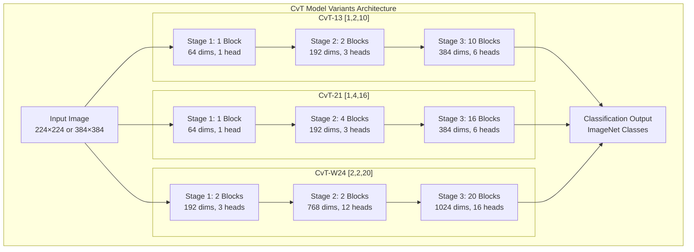
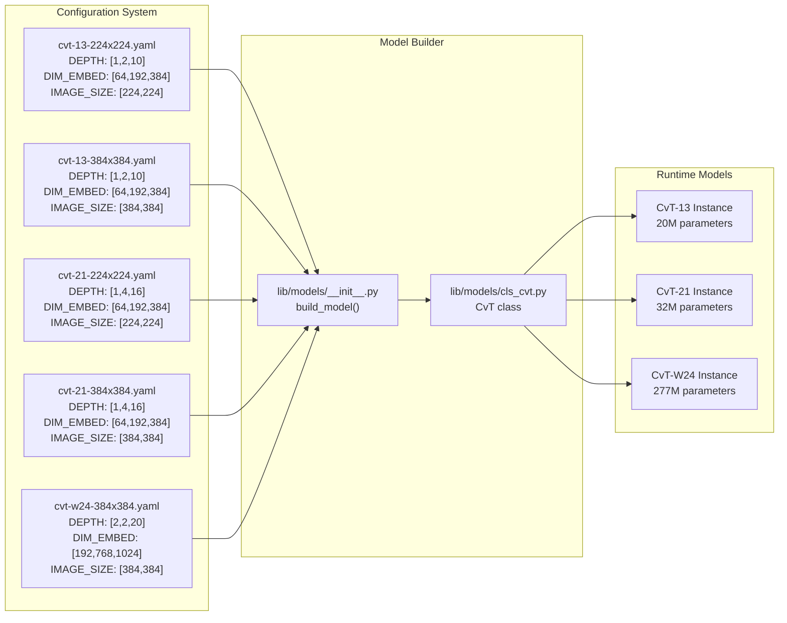

<!-- source: DeepWiki mcp.deepwiki.com · repo microsoft/CvT · page 6.1 Model Variants · fetched 2026-10-26 -->

# Model Variants

<details>
<summary>Relevant source files</summary>

The following files were used as context for generating this wiki page:

- [README.md](README.md)
- [experiments/imagenet/cvt/cvt-13-224x224.yaml](experiments/imagenet/cvt/cvt-13-224x224.yaml)
- [experiments/imagenet/cvt/cvt-13-384x384.yaml](experiments/imagenet/cvt/cvt-13-384x384.yaml)
- [experiments/imagenet/cvt/cvt-21-224x224.yaml](experiments/imagenet/cvt/cvt-21-224x224.yaml)
- [experiments/imagenet/cvt/cvt-21-384x384.yaml](experiments/imagenet/cvt/cvt-21-384x384.yaml)
- [experiments/imagenet/cvt/cvt-w24-384x384.yaml](experiments/imagenet/cvt/cvt-w24-384x384.yaml)

</details>


This page provides a comprehensive reference for all CvT (Convolutional vision Transformers) model variants available in the repository, including their architectural specifications, performance characteristics, and configuration details. For information about the overall CvT architecture design, see [CvT Model Architecture](#3.1). For guidance on training these variants, see [Training Models](#4.1).

## Overview

The CvT repository provides five main model variants with different computational complexities and performance characteristics. These variants follow a consistent three-stage hierarchical architecture but differ in their depth, embedding dimensions, and attention head configurations.

## Model Architecture Variants

### Model Specifications

| Model | Stages | Depth | Embedding Dims | Attention Heads | Parameters | FLOPs (224×224) | FLOPs (384×384) |
|-------|--------|-------|----------------|-----------------|------------|-----------------|-----------------|
| CvT-13 | 3 | [1, 2, 10] | [64, 192, 384] | [1, 3, 6] | 20M | 4.5G | 16.3G |
| CvT-21 | 3 | [1, 4, 16] | [64, 192, 384] | [1, 3, 6] | 32M | 7.1G | 24.9G |
| CvT-W24 | 3 | [2, 2, 20] | [192, 768, 1024] | [3, 12, 16] | 277M | - | 193.2G |



Sources: [README.md:8-21](), [experiments/imagenet/cvt/cvt-13-224x224.yaml:15-17](), [experiments/imagenet/cvt/cvt-21-224x224.yaml:15-17](), [experiments/imagenet/cvt/cvt-w24-384x384.yaml:15-17]()

### Architectural Differences

#### CvT-13: Lightweight Variant
- **Total transformer blocks**: 13 (1 + 2 + 10)
- **Parameters**: 20M
- **Key characteristics**: Minimal computation in early stages, concentrated depth in final stage
- **Use case**: Resource-constrained environments, faster inference

#### CvT-21: Balanced Variant  
- **Total transformer blocks**: 21 (1 + 4 + 16)
- **Parameters**: 32M
- **Key characteristics**: More balanced depth distribution, increased middle-stage processing
- **Use case**: Good balance between accuracy and computational cost

#### CvT-W24: Wide Variant
- **Total transformer blocks**: 24 (2 + 2 + 20)
- **Parameters**: 277M  
- **Key characteristics**: Significantly wider embedding dimensions, more attention heads
- **Use case**: Maximum accuracy when computational resources are available

## Configuration Files Mapping



Sources: [experiments/imagenet/cvt/cvt-13-224x224.yaml:7-30](), [experiments/imagenet/cvt/cvt-21-224x224.yaml:7-30](), [experiments/imagenet/cvt/cvt-w24-384x384.yaml:7-30]()

## Performance Characteristics

### ImageNet-1k Pre-trained Models

| Model | Resolution | Top-1 Accuracy | Parameters | GFLOPs |
|-------|------------|----------------|------------|---------|
| CvT-13 | 224×224 | 81.6% | 20M | 4.5 |
| CvT-21 | 224×224 | 82.5% | 32M | 7.1 |
| CvT-13 | 384×384 | 83.0% | 20M | 16.3 |
| CvT-21 | 384×384 | 83.3% | 32M | 24.9 |

### ImageNet-22k Pre-trained Models

| Model | Resolution | Top-1 Accuracy | Parameters | GFLOPs |
|-------|------------|----------------|------------|---------|
| CvT-13 | 384×384 | 83.3% | 20M | 16.3 |
| CvT-21 | 384×384 | 84.9% | 32M | 24.9 |
| CvT-W24 | 384×384 | 87.6% | 277M | 193.2 |

Sources: [README.md:8-21]()

## Training Configuration Differences

### Optimization Settings

| Variant | Batch Size | Learning Rate | Weight Decay | Sampler |
|---------|------------|---------------|--------------|---------|
| CvT-13 224×224 | 256 | 0.00025 | 0.05 | default |
| CvT-13 384×384 | 256 | 0.00025 | 0.05 | default |
| CvT-21 224×224 | 128 | 0.000125 | 0.1 | repeated_aug |
| CvT-21 384×384 | 128 | 0.000125 | 0.1 | default |
| CvT-W24 384×384 | 128 | 0.000125 | 0.1 | default |

### Augmentation Differences

#### CvT-13 Configurations
- `TIMM_AUG.USE_LOADER: true` for both resolutions
- Standard augmentation pipeline

#### CvT-21 224×224 Configuration  
- `TIMM_AUG.USE_LOADER: false`
- `DATASET.SAMPLER: repeated_aug` - uses repeated augmentation sampling

#### CvT-21 384×384 and CvT-W24 Configurations
- `TIMM_AUG.USE_LOADER: true` 
- `CENTER_CROP: False` for testing

Sources: [experiments/imagenet/cvt/cvt-13-224x224.yaml:64-82](), [experiments/imagenet/cvt/cvt-21-224x224.yaml:36,58,64-82](), [experiments/imagenet/cvt/cvt-21-384x384.yaml:36,63,64-82](), [experiments/imagenet/cvt/cvt-w24-384x384.yaml:64-82]()

## Common Architecture Parameters

All variants share these consistent architectural elements:

### Convolutional Token Embedding
```yaml
PATCH_SIZE: [7, 3, 3]
PATCH_STRIDE: [4, 2, 2] 
PATCH_PADDING: [2, 1, 1]
```

### Convolutional Projection Settings
```yaml
QKV_PROJ_METHOD: ['dw_bn', 'dw_bn', 'dw_bn']
KERNEL_QKV: [3, 3, 3]
PADDING_KV: [1, 1, 1]
STRIDE_KV: [2, 2, 2]
PADDING_Q: [1, 1, 1] 
STRIDE_Q: [1, 1, 1]
```

### Regularization
```yaml
MLP_RATIO: [4.0, 4.0, 4.0]
QKV_BIAS: [True, True, True]
CLS_TOKEN: [False, False, True]  # Only final stage uses CLS token
POS_EMBED: [False, False, False]  # No positional encoding
```

Sources: [experiments/imagenet/cvt/cvt-13-224x224.yaml:12-30]()

## Usage Guidelines

### Model Selection Criteria

**Choose CvT-13 when**:
- Limited computational resources
- Fast inference required
- Acceptable accuracy drop for efficiency gains

**Choose CvT-21 when**:
- Balanced accuracy and efficiency needs
- Standard training setups
- Good baseline performance required

**Choose CvT-W24 when**:
- Maximum accuracy is priority
- Sufficient computational resources available
- Large-scale pre-training from ImageNet-22k

### Resolution Selection

**224×224 Resolution**:
- Faster training and inference
- Lower memory requirements
- Suitable for deployment scenarios

**384×384 Resolution**:
- Higher accuracy (+1-2% typical improvement)
- Increased computational cost
- Better for fine-grained recognition tasks

Sources: [README.md:8-21](), [experiments/imagenet/cvt/cvt-13-224x224.yaml:60,67](), [experiments/imagenet/cvt/cvt-13-384x384.yaml:60,67]()

---

