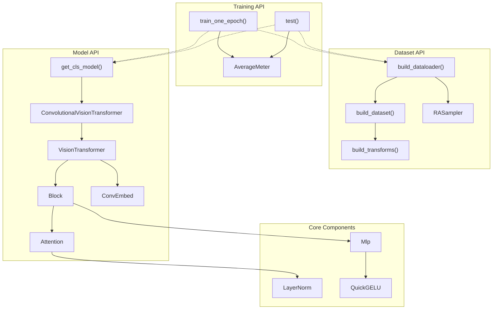
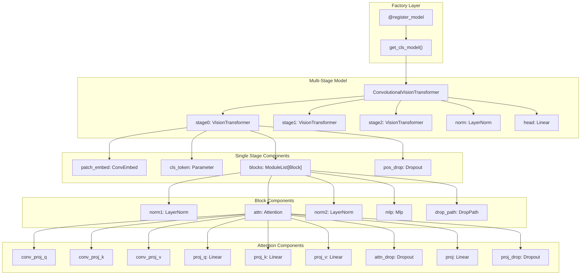

<!-- source: DeepWiki mcp.deepwiki.com · repo microsoft/CvT · page 6.2 API Reference · fetched 2026-10-26 -->

# API Reference

<details>
<summary>Relevant source files</summary>

The following files were used as context for generating this wiki page:

- [lib/core/function.py](lib/core/function.py)
- [lib/dataset/build.py](lib/dataset/build.py)
- [lib/dataset/transformas/build.py](lib/dataset/transformas/build.py)
- [lib/models/cls_cvt.py](lib/models/cls_cvt.py)

</details>


This document provides detailed API documentation for the core modules, functions, and classes in the CvT (Convolutional Vision Transformers) codebase. It covers the public interfaces for training, dataset handling, model architecture, and evaluation components.

For high-level system architecture information, see [Architecture & Design](#3). For practical usage examples, see [Usage Guide](#4).

## Core Training API

The training API provides the main functions for model training and evaluation loops.

### Training Functions

#### `train_one_epoch()`

Primary training loop function that handles one epoch of model training.

```python
def train_one_epoch(config, train_loader, model, criterion, optimizer, epoch,
                    output_dir, tb_log_dir, writer_dict, scaler=None)
```

**Parameters:**
- `config`: Configuration object containing training parameters
- `train_loader`: DataLoader for training data
- `model`: Neural network model to train
- `criterion`: Loss function
- `optimizer`: Optimizer for parameter updates
- `epoch`: Current epoch number
- `output_dir`: Directory for output files
- `tb_log_dir`: TensorBoard logging directory
- `writer_dict`: Dictionary containing TensorBoard writer and global steps
- `scaler`: Optional gradient scaler for mixed precision training

**Key Features:**
- Automatic mixed precision (AMP) support via `autocast`
- Mixup/CutMix data augmentation integration
- Gradient clipping with configurable threshold
- Real-time metrics logging (loss, top-1/top-5 accuracy)
- Progress tracking with timing information

#### `test()`

Evaluation function for model testing and validation.

```python
def test(config, val_loader, model, criterion, output_dir, tb_log_dir,
         writer_dict=None, distributed=False, real_labels=None,
         valid_labels=None)
```

**Parameters:**
- `config`: Configuration object
- `val_loader`: DataLoader for validation/test data
- `model`: Model to evaluate
- `criterion`: Loss function for evaluation
- `output_dir`: Output directory
- `tb_log_dir`: TensorBoard logging directory
- `writer_dict`: Optional TensorBoard writer dictionary
- `distributed`: Boolean flag for distributed evaluation
- `real_labels`: Optional real label validator for ImageNet-ReaL
- `valid_labels`: Optional subset of valid label indices

**Returns:**
- `float`: Top-1 accuracy percentage

### Utility Classes

#### `AverageMeter`

Utility class for computing and storing running averages of metrics.

```python
class AverageMeter(object):
    def __init__(self)
    def reset(self)
    def update(self, val, n=1)
```

**Attributes:**
- `val`: Current value
- `avg`: Running average
- `sum`: Cumulative sum
- `count`: Total count of updates

Sources: [lib/core/function.py:1-224]()

## Dataset API

The dataset API provides functions for building datasets, data loaders, and data transformations.

### Dataset Building Functions

#### `build_dataset()`

Factory function for creating dataset instances based on configuration.

```python
def build_dataset(cfg, is_train)
```

**Parameters:**
- `cfg`: Configuration object with dataset settings
- `is_train`: Boolean indicating training vs. validation dataset

**Returns:**
- Dataset instance (currently supports ImageNet via `ImageFolder`)

**Supported Datasets:**
- ImageNet and variants (identified by 'imagenet' in `cfg.DATASET.DATASET`)

#### `build_dataloader()`

Creates configured data loaders with appropriate sampling and augmentation.

```python
def build_dataloader(cfg, is_train=True, distributed=False)
```

**Parameters:**
- `cfg`: Configuration object
- `is_train`: Boolean for training vs. validation mode
- `distributed`: Boolean for distributed training setup

**Returns:**
- `DataLoader`: Configured PyTorch DataLoader

**Key Features:**
- Automatic batch size selection based on training/validation mode
- Distributed sampler support with `DistributedSampler`
- Repeated augmentation sampler (`RASampler`) option
- TIMM library integration for advanced data loading
- Configurable worker processes and memory pinning

### Data Transformation API

#### `build_transforms()`

Constructs data transformation pipelines for training and validation.

```python
def build_transforms(cfg, is_train=True)
```

**Parameters:**
- `cfg`: Configuration object with augmentation settings
- `is_train`: Boolean for training vs. validation transforms

**Returns:**
- `transforms.Compose`: Composed transformation pipeline

**Training Augmentations:**
- `RandomResizedCrop` with configurable scale and aspect ratio
- `RandomHorizontalFlip`
- `ColorJitter` with configurable probability
- `RandomGrayscale` 
- `GaussianBlur` (custom implementation)
- TIMM augmentation integration (`create_transform`)

**Validation Transforms:**
- `Resize` with optional center cropping
- `CenterCrop` or direct resize based on configuration
- Normalization with ImageNet statistics

Sources: [lib/dataset/build.py:1-116](), [lib/dataset/transformas/build.py:1-125]()

## Model Architecture API

The model API defines the CvT architecture and its components.

### Core Model Classes

#### `ConvolutionalVisionTransformer`

Main CvT model class implementing the multi-stage hierarchical architecture.

```python
class ConvolutionalVisionTransformer(nn.Module):
    def __init__(self, in_chans=3, num_classes=1000, act_layer=nn.GELU, 
                 norm_layer=nn.LayerNorm, init='trunc_norm', spec=None)
```

**Parameters:**
- `in_chans`: Input channel count (default: 3)
- `num_classes`: Number of output classes (default: 1000)
- `act_layer`: Activation layer class (default: `nn.GELU`)
- `norm_layer`: Normalization layer class (default: `nn.LayerNorm`)
- `init`: Weight initialization method ('trunc_norm' or 'xavier')
- `spec`: Model specification dictionary defining architecture

**Key Methods:**
- `forward_features(x)`: Extract features before classification head
- `forward(x)`: Full forward pass including classification
- `init_weights()`: Load pretrained weights with layer filtering
- `no_weight_decay()`: Return parameters that should not have weight decay

#### `VisionTransformer`

Single-stage Vision Transformer implementation used within CvT stages.

```python
class VisionTransformer(nn.Module):
    def __init__(self, patch_size=16, patch_stride=16, patch_padding=0, 
                 in_chans=3, embed_dim=768, depth=12, num_heads=12, ...)
```

**Key Components:**
- `patch_embed`: `ConvEmbed` for tokenization
- `cls_token`: Optional classification token
- `blocks`: List of `Block` modules
- `pos_drop`: Positional dropout

#### `Attention`

Convolutional attention mechanism with spatial-aware projections.

```python
class Attention(nn.Module):
    def __init__(self, dim_in, dim_out, num_heads, qkv_bias=False, 
                 method='dw_bn', kernel_size=3, stride_kv=1, stride_q=1, ...)
```

**Key Features:**
- Convolutional projections for Q, K, V (`conv_proj_q`, `conv_proj_k`, `conv_proj_v`)
- Configurable projection methods: 'dw_bn', 'avg', 'linear'
- Multi-head self-attention with spatial downsampling
- FLOPs computation for efficiency analysis

#### `Block`

Transformer block combining attention and MLP with residual connections.

```python
class Block(nn.Module):
    def __init__(self, dim_in, dim_out, num_heads, mlp_ratio=4., 
                 drop_path=0., ...)
```

**Architecture:**
- Pre-norm design with `LayerNorm`
- `Attention` module with convolutional projections  
- `Mlp` feed-forward network
- `DropPath` stochastic depth regularization

#### `ConvEmbed`

Convolutional token embedding for patch tokenization.

```python
class ConvEmbed(nn.Module):
    def __init__(self, patch_size=7, in_chans=3, embed_dim=64, 
                 stride=4, padding=2, norm_layer=None)
```

**Purpose:**
- Convert image patches to token embeddings using convolution
- Configurable patch size, stride, and padding
- Optional normalization layer

### Model Factory Function

#### `get_cls_model()`

Factory function registered in the model registry for creating CvT models.

```python
def get_cls_model(config, **kwargs)
```

**Parameters:**
- `config`: Configuration object with model specifications
- `**kwargs`: Additional keyword arguments

**Returns:**
- `ConvolutionalVisionTransformer`: Configured CvT model instance

**Configuration Requirements:**
- `config.MODEL.SPEC`: Model architecture specification
- `config.MODEL.NUM_CLASSES`: Number of output classes  
- `config.MODEL.INIT_WEIGHTS`: Whether to load pretrained weights
- `config.MODEL.PRETRAINED`: Path to pretrained model file

Sources: [lib/models/cls_cvt.py:1-646]()

## API Architecture Overview

The following diagram shows the relationship between major API components:

### Core API Structure



### Model Architecture API Hierarchy



Sources: [lib/core/function.py:1-224](), [lib/dataset/build.py:1-116](), [lib/models/cls_cvt.py:1-646]()

## Configuration-Driven APIs

Most API functions are configured through the configuration system. Key configuration sections that drive API behavior:

| Configuration Section | API Impact | Key Parameters |
|----------------------|------------|----------------|
| `TRAIN.*` | Training loop behavior | `BATCH_SIZE_PER_GPU`, `CLIP_GRAD_NORM` |
| `TEST.*` | Evaluation behavior | `BATCH_SIZE_PER_GPU`, `CENTER_CROP` |
| `DATASET.*` | Dataset construction | `DATASET`, `ROOT`, `TRAIN_SET`, `TEST_SET` |
| `AUG.*` | Data augmentation | `MIXUP`, `SCALE`, `RATIO`, `COLOR_JITTER` |
| `MODEL.SPEC.*` | Model architecture | `NUM_STAGES`, `DIM_EMBED`, `NUM_HEADS` |
| `AMP.*` | Mixed precision | `ENABLED`, `MEMORY_FORMAT` |

For complete configuration reference, see [Configuration Reference](#4.3).

Sources: [lib/core/function.py:16-194](), [lib/dataset/build.py:52-115](), [lib/models/cls_cvt.py:627-645]()

---

