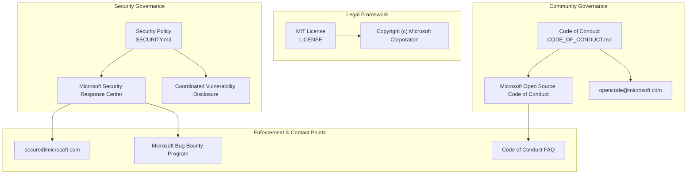
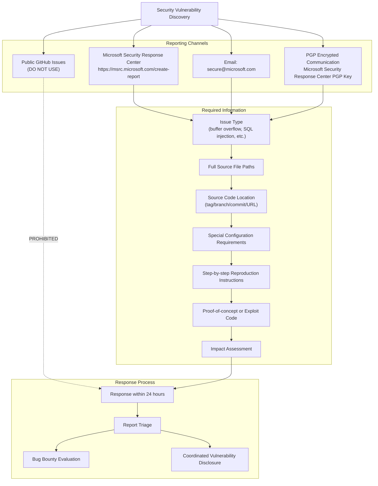
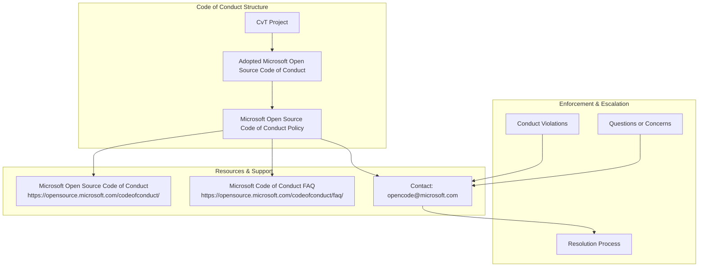
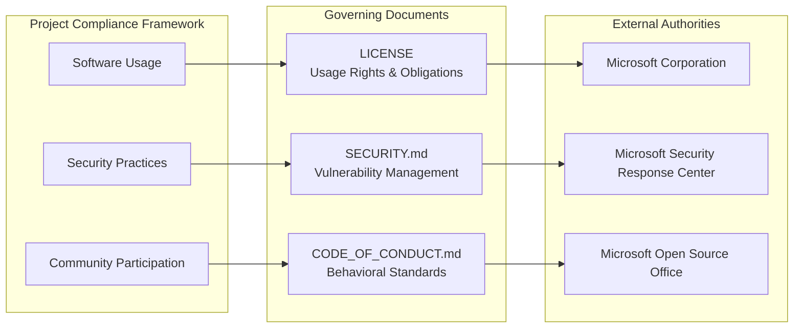

<!-- source: DeepWiki mcp.deepwiki.com · repo microsoft/CvT · page 6.3 Legal & Governance · fetched 2026-10-26 -->

# Legal & Governance

Relevant source files

The following files were used as context for generating this wiki page:

- [CODE_OF_CONDUCT.md](CODE_OF_CONDUCT.md)
- [LICENSE](LICENSE)
- [SECURITY.md](SECURITY.md)

This document covers the legal framework, governance policies, and compliance requirements for the CvT (Convolutional vision Transformers) project. It provides comprehensive information about licensing terms, security reporting procedures, contributor conduct guidelines, and project governance structure.

For information about contributing to the codebase itself, see [Contributing Guidelines](#5.2). For development environment setup and tooling, see [Development Environment](#5.3).

## Project Governance Framework

The CvT project operates under Microsoft's open source governance model, which establishes clear policies for licensing, security, and community conduct.

### Governance Structure Overview

**Sources:** [LICENSE:1-22](), [SECURITY.md:1-41](), [CODE_OF_CONDUCT.md:1-10]()

## Licensing

The CvT project is licensed under the MIT License, providing broad permissions for use, modification, and distribution.

### License Terms

| Aspect | Details |
|--------|---------|
| **License Type** | MIT License |
| **Copyright Holder** | Microsoft Corporation |
| **Permissions** | Use, modify, publish, distribute, sublicense, sell |
| **Conditions** | Include copyright notice and license text |
| **Limitations** | No warranty, no liability |

The complete license text is available in [LICENSE:1-22](). Key permissions include:

- **Commercial Use**: Software can be used for commercial purposes
- **Modification**: Source code can be modified
- **Distribution**: Software can be distributed
- **Sublicensing**: Software can be sublicensed under different terms
- **Private Use**: Software can be used privately

### License Requirements

The license requires that the copyright notice and license text from [LICENSE:12-13]() be included in all copies or substantial portions of the software.

**Sources:** [LICENSE:1-22]()

## Security Policy

The project follows Microsoft's comprehensive security policies for vulnerability reporting and coordinated disclosure.

### Security Vulnerability Reporting

**Sources:** [SECURITY.md:9-32]()

### Security Reporting Guidelines

Security vulnerabilities should **never** be reported through public GitHub issues as stated in [SECURITY.md:11](). Instead, use the designated reporting channels:

| Channel | URL/Contact | Use Case |
|---------|-------------|----------|
| **Primary** | `https://msrc.microsoft.com/create-report` | Standard reporting |
| **Email** | `secure@microsoft.com` | Alternative reporting |
| **PGP Encrypted** | Microsoft Security Response Center PGP Key | Sensitive disclosures |

### Required Vulnerability Information

When reporting security issues, include the information specified in [SECURITY.md:19-27]():

- Type of issue (e.g., buffer overflow, SQL injection, cross-site scripting)
- Full paths of source file(s) related to the issue manifestation
- Location of affected source code (tag/branch/commit or direct URL)
- Special configuration required to reproduce the issue
- Step-by-step instructions to reproduce the issue
- Proof-of-concept or exploit code (if possible)
- Impact assessment, including potential exploitation scenarios

### Response and Disclosure

The project follows the **Coordinated Vulnerability Disclosure** principle as specified in [SECURITY.md:39](). Response expectations:

- **Initial Response**: Within 24 hours ([SECURITY.md:17]())
- **Communication Language**: English preferred ([SECURITY.md:35]())
- **Bug Bounty**: Eligible for Microsoft Bug Bounty Program ([SECURITY.md:31]())

**Sources:** [SECURITY.md:1-41]()

## Code of Conduct

The project has adopted the Microsoft Open Source Code of Conduct to ensure a welcoming and inclusive environment for all contributors.

### Conduct Framework

**Sources:** [CODE_OF_CONDUCT.md:1-10]()

### Conduct Resources

The code of conduct provides several resources for community members:

| Resource | Purpose | URL/Contact |
|----------|---------|-------------|
| **Main Policy** | Full code of conduct text | `https://opensource.microsoft.com/codeofconduct/` |
| **FAQ** | Frequently asked questions | `https://opensource.microsoft.com/codeofconduct/faq/` |
| **Contact** | Questions and concerns | `opencode@microsoft.com` |

### Conduct Enforcement

Questions, concerns, or violations should be directed to `opencode@microsoft.com` as specified in [CODE_OF_CONDUCT.md:9](). The enforcement process follows Microsoft's established procedures for open source community management.

**Sources:** [CODE_OF_CONDUCT.md:1-10]()

## Governance Document Relationships

The three governance documents work together to establish the complete legal and operational framework for the project:

### Document Hierarchy and Scope

| Document | Primary Purpose | Scope | Authority |
|----------|----------------|-------|-----------|
| **LICENSE** | Legal permissions and limitations | Software usage rights | Legal requirement |
| **SECURITY.md** | Vulnerability reporting and response | Security incident management | Microsoft Security Response Center |
| **CODE_OF_CONDUCT.md** | Community behavior standards | Contributor interactions | Microsoft Open Source Office |

### Compliance Integration

These documents ensure comprehensive coverage of legal, security, and social aspects of project governance, providing clear guidance for users, contributors, and maintainers.

**Sources:** [LICENSE:1-22](), [SECURITY.md:1-41](), [CODE_OF_CONDUCT.md:1-10]()