# Page: Overview

# Overview

<details>
<summary>Relevant source files</summary>

The following files were used as context for generating this wiki page:

- [README.md](README.md)
- [figures/pipeline.svg](figures/pipeline.svg)

</details>


## Purpose and Scope

This document provides a comprehensive overview of the CvT (Convolutional vision Transformers) repository, explaining its purpose, architecture, and key components. The CvT repository implements the research paper "CvT: Introducing Convolutions to Vision Transformers" and provides a complete training and evaluation framework for the CvT model architecture.

For detailed information about getting started with training and evaluation, see [Getting Started](#2). For in-depth architectural details, see [Architecture & Design](#3). For practical usage guides, see [Usage Guide](#4).

## What is CvT?

CvT (Convolutional vision Transformers) is a hybrid architecture that combines the strengths of Convolutional Neural Networks (CNNs) and Vision Transformers (ViTs). The key innovation is introducing convolutional operations into the transformer architecture through two primary modifications:

1. **Hierarchical Transformers with Convolutional Token Embedding** - Multi-stage processing with convolutional projections instead of linear projections
2. **Convolutional Transformer Blocks** - Leveraging convolutional projections for attention mechanisms

The architecture achieves state-of-the-art performance on ImageNet classification while requiring fewer parameters and FLOPs compared to traditional Vision Transformers.

**Sources:** [README.md:1-2]()

## Repository Architecture

The CvT repository is organized around a configuration-driven training system with modular components:

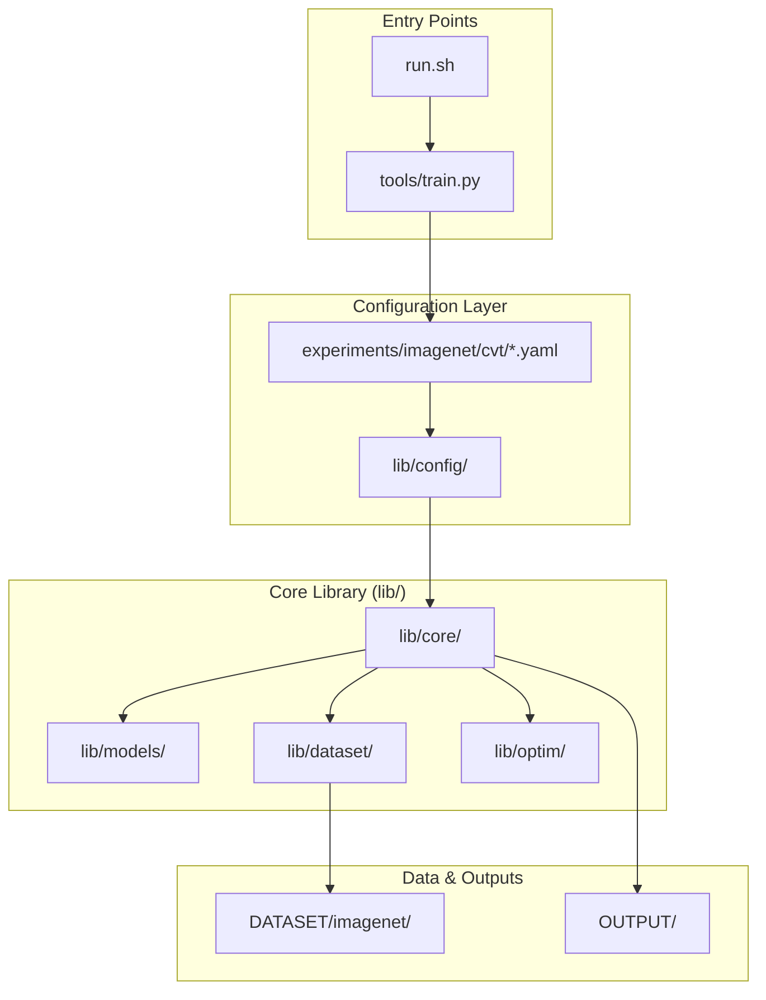

**Sources:** [README.md:69-83](), [README.md:85-94](), [README.md:96-114]()

## Core Components and Code Structure

The repository follows a modular design with clear separation of concerns:

| Component | Path | Primary Functions | Key Classes/Modules |
|-----------|------|-------------------|---------------------|
| **Entry Point** | `run.sh` | Job orchestration, GPU management | Shell script with options parsing |
| **Training Controller** | `tools/train.py` | Main training loop coordination | Training orchestration logic |
| **Configuration** | `lib/config/` | Config loading and validation | Configuration management system |
| **Model Architecture** | `lib/models/` | CvT model definitions | `cls_cvt.py`, model registry |
| **Training Engine** | `lib/core/` | Training/evaluation functions | `function.py`, `loss.py`, `evaluate.py` |
| **Data Pipeline** | `lib/dataset/` | Data loading and augmentation | Dataset builders, transforms, samplers |
| **Optimization** | `lib/optim/` | Optimizer construction | Optimizer factory functions |

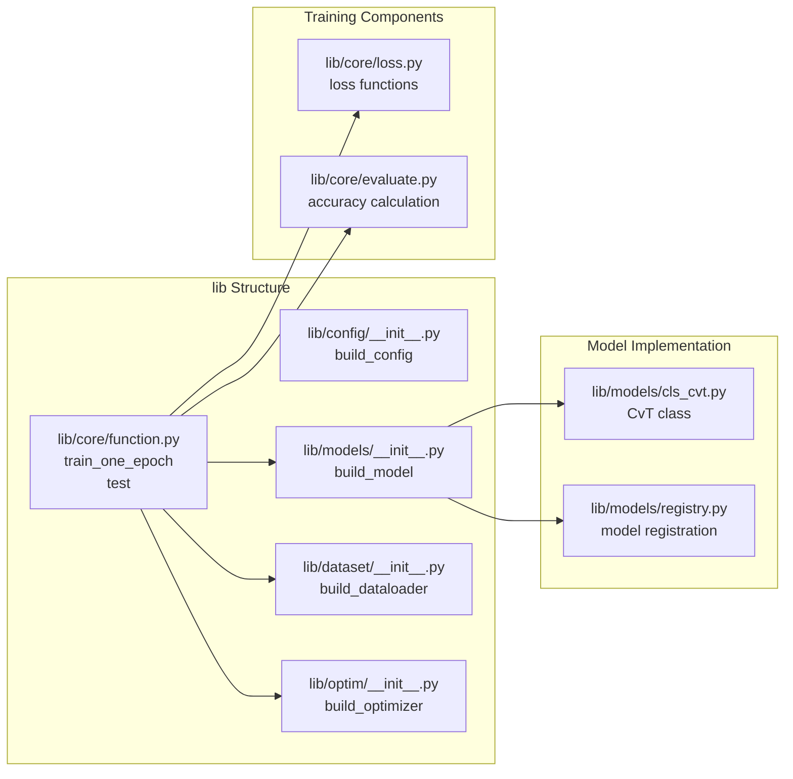

**Sources:** Based on the system architecture diagrams and typical PyTorch project structure patterns

## CvT Model Architecture Overview

The CvT architecture implements a three-stage hierarchical transformer with convolutional token embeddings:

```mermaid
graph LR
    input["Input Image<br/>224x224 or 384x384"]
    
    subgraph "Stage 1"
        conv1["Convolutional Token Embedding<br/>kernel=7x7, stride=4"]
        trans1["Transformer Blocks<br/>depth=1-2"]
    end
    
    subgraph "Stage 2" 
        conv2["Convolutional Token Embedding<br/>kernel=3x3, stride=2"]
        trans2["Transformer Blocks<br/>depth=2-4"]
    end
    
    subgraph "Stage 3"
        conv3["Convolutional Token Embedding<br/>kernel=3x3, stride=2"]
        trans3["Transformer Blocks<br/>depth=10-20"]
        cls["CLS Token"]
    end
    
    output["Classification Output"]
    
    input --> conv1
    conv1 --> trans1
    trans1 --> conv2
    conv2 --> trans2
    trans2 --> conv3
    conv3 --> trans3
    trans3 --> cls
    cls --> output
```

**Sources:** [README.md:1-2](), architectural understanding from CvT paper description

## Model Variants and Performance

The repository provides several pre-trained CvT model configurations:

| Model | Resolution | Parameters | GFLOPs | Top-1 Accuracy |
|-------|------------|------------|--------|----------------|
| CvT-13 | 224×224 | 20M | 4.5 | 81.6% |
| CvT-21 | 224×224 | 32M | 7.1 | 82.5% |
| CvT-13 | 384×384 | 20M | 16.3 | 83.0% |
| CvT-21 | 384×384 | 32M | 24.9 | 83.3% |
| CvT-W24 | 384×384 | 277M | 193.2 | 87.6% |

Each model variant has a corresponding YAML configuration file in the `experiments/imagenet/cvt/` directory.

**Sources:** [README.md:7-21]()

## Execution Flow

The typical execution flow follows this pattern:

1. **Job Initialization**: `run.sh` parses command-line arguments and sets up the execution environment
2. **Training Launch**: `tools/train.py` is invoked with the specified configuration
3. **Configuration Loading**: YAML configs are loaded and merged with defaults via `lib/config/`
4. **Component Building**: Models, datasets, and optimizers are constructed using factory functions
5. **Training Loop**: `lib/core/function.py` orchestrates the training with `train_one_epoch` and `test` functions
6. **Output Generation**: Checkpoints, logs, and trained models are saved to the `OUTPUT/` directory

**Sources:** [README.md:85-114]()

## Key Innovations

The CvT architecture introduces several key innovations that distinguish it from standard Vision Transformers:

- **No Positional Encoding Required**: Convolutional operations provide implicit spatial relationships
- **Hierarchical Multi-Scale Processing**: Three-stage architecture with progressive downsampling
- **Convolutional Projections**: Replace linear projections in attention mechanisms for better inductive bias
- **Efficiency Gains**: Achieves better performance with fewer parameters and FLOPs compared to ViT

**Sources:** [README.md:1-2]()

---

# Page: Getting Started

# Getting Started

<details>
<summary>Relevant source files</summary>

The following files were used as context for generating this wiki page:

- [README.md](README.md)
- [tools/train.py](tools/train.py)

</details>


This page provides a quick start guide for training and evaluating CvT (Convolutional Vision Transformers) models. It covers installation requirements, data preparation, and basic usage for running training and evaluation experiments.

For detailed architecture information, see [Architecture & Design](#3). For comprehensive training guides, see [Training Models](#4.1). For configuration details, see [Configuration Reference](#4.3).

## Prerequisites and Installation

### System Requirements

CvT requires PyTorch and TorchVision as core dependencies. The codebase is developed and tested with PyTorch 1.7.1, though other versions may work but are not fully tested.

### Installation Steps

1. **Install PyTorch and TorchVision** following the [official PyTorch installation guide](https://pytorch.org/)

2. **Install project dependencies**:
   ```bash
   python -m pip install -r requirements.txt --user -q
   ```

The main dependencies include standard deep learning packages for data loading, augmentation, and training utilities.

Sources: [README.md:27-34]()

## Data Preparation

### ImageNet Dataset Structure

CvT expects ImageNet data organized in the standard torchvision format with separate train and validation directories:

```
DATASET/
└── imagenet/
    ├── train/
    │   ├── class1/
    │   │   ├── img1.jpg
    │   │   ├── img2.jpg
    │   │   └── ...
    │   ├── class2/
    │   │   └── ...
    │   └── ...
    └── val/
        ├── class1/
        │   └── ...
        ├── class2/
        │   └── ...
        └── ...
```

This structure allows the dataset builders in [lib/dataset/]() to automatically discover and load class labels from directory names.

Sources: [README.md:36-65]()

## Basic Usage

### Quick Start Workflow

The following diagram shows the complete workflow from configuration to model outputs:

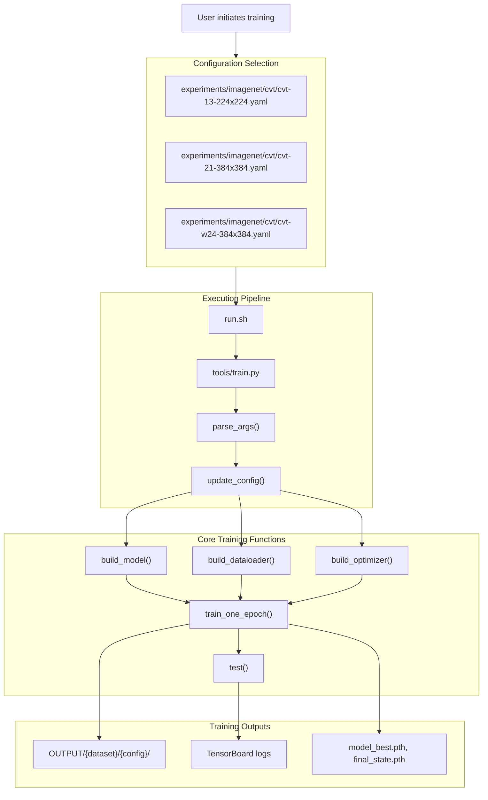

Sources: [README.md:85-114](), [tools/train.py:37-57](), [tools/train.py:60-211]()

### Training a Model

Use the `run.sh` script to launch training with the desired configuration:

```bash
bash run.sh -g 8 -t train --cfg experiments/imagenet/cvt/cvt-13-224x224.yaml
```

#### Script Parameters

| Parameter | Description | Default |
|-----------|-------------|---------|
| `-g\|--gpus` | Number of GPUs to use | 1 |
| `-t\|--job-type` | Job type: `train` or `test` | `aml` |
| `-p\|--port` | Master port for distributed training | 9000 |
| `-i\|--install-deps` | Install dependencies flag | False |

#### Configuration Override

You can override any configuration parameter from the command line:

```bash
bash run.sh -g 8 -t train --cfg experiments/imagenet/cvt/cvt-13-224x224.yaml TRAIN.LR 0.1
```

This modifies the learning rate to 0.1 while keeping all other configuration parameters from the YAML file.

Sources: [README.md:85-105]()

### Evaluating Pre-trained Models

To test a pre-trained model, use the test job type and specify the model file:

```bash
bash run.sh -t test --cfg experiments/imagenet/cvt/cvt-13-224x224.yaml TEST.MODEL_FILE ${PRETRAINED_MODEL_FILE}
```

The evaluation runs the `test()` function from [core/function.py]() which computes accuracy metrics on the validation dataset.

Sources: [README.md:110-114]()

## Training Pipeline Components

The following diagram shows how the main training components interact with specific code entities:

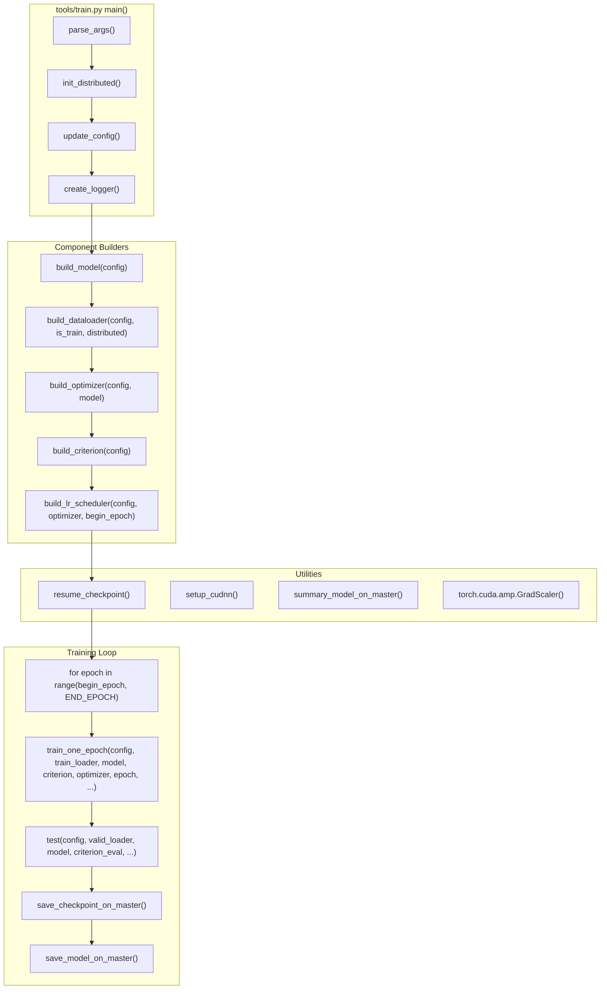

Sources: [tools/train.py:60-211]()

## Configuration Structure

### Experiment Organization

Configurations are organized in a hierarchical directory structure:

```
experiments/
├── {DATASET}/
│   ├── {ARCHITECTURE}/
│   │   ├── config1.yaml
│   │   ├── config2.yaml
│   │   └── ...
│   └── ...
└── ...
```

For CvT models on ImageNet, configurations are located at:
- `experiments/imagenet/cvt/cvt-13-224x224.yaml`
- `experiments/imagenet/cvt/cvt-21-224x224.yaml` 
- `experiments/imagenet/cvt/cvt-13-384x384.yaml`
- `experiments/imagenet/cvt/cvt-21-384x384.yaml`
- `experiments/imagenet/cvt/cvt-w24-384x384.yaml`

### Available Model Variants

| Model | Resolution | Parameters | GFLOPs | ImageNet-1k Top-1 |
|-------|------------|------------|--------|-------------------|
| CvT-13 | 224×224 | 20M | 4.5 | 81.6% |
| CvT-21 | 224×224 | 32M | 7.1 | 82.5% |
| CvT-13 | 384×384 | 20M | 16.3 | 83.0% |
| CvT-21 | 384×384 | 32M | 24.9 | 83.3% |

Sources: [README.md:69-83](), [README.md:7-14]()

## Output Structure

### Training Outputs

By default, all training outputs are saved to `OUTPUT/{dataset}/{training_config}/`:

```
OUTPUT/
└── imagenet/
    └── cvt-13-224x224/
        ├── config.yaml           # Final merged configuration
        ├── model_best.pth         # Best performing model
        ├── final_state.pth        # Final training state
        ├── checkpoint_*.pth       # Periodic checkpoints
        ├── log.txt               # Training logs
        └── tensorboard_logs/     # TensorBoard event files
```

The `save_checkpoint_on_master()` and `save_model_on_master()` functions handle saving checkpoints and models respectively.

Sources: [README.md:108](), [tools/train.py:171-199]()

## Next Steps

- **Model Training**: For detailed training procedures and advanced options, see [Training Models](#4.1)
- **Model Evaluation**: For comprehensive evaluation procedures, see [Model Evaluation](#4.2)
- **Architecture Details**: To understand the CvT model architecture, see [CvT Model Architecture](#3.1)
- **Configuration Options**: For complete configuration reference, see [Configuration Reference](#4.3)
- **Development**: To contribute or modify the codebase, see [Development](#5)

---

# Page: Architecture & Design

# Architecture & Design

<details>
<summary>Relevant source files</summary>

The following files were used as context for generating this wiki page:

- [README.md](README.md)
- [lib/models/cls_cvt.py](lib/models/cls_cvt.py)

</details>


This document provides a comprehensive overview of the CvT (Convolutional vision Transformers) system architecture and design principles. It covers the core model architecture, training pipeline design, configuration system, and key architectural decisions that enable the integration of convolutional neural networks with vision transformers.

For implementation details of specific model components, see [CvT Model Architecture](#3.1). For training procedures and optimization strategies, see [Training Pipeline](#3.2). For data handling and preprocessing, see [Data Pipeline](#3.3).

## System Overview

The CvT repository implements a hierarchical vision transformer architecture that introduces convolutional operations at key points to improve performance and efficiency. The system is designed around three core principles:

1. **Multi-stage hierarchical processing** - Progressive feature extraction through multiple transformer stages
2. **Convolutional token embeddings** - Replace linear patch embeddings with convolutional projections
3. **Configuration-driven architecture** - YAML-based specification of model variants and training parameters

### High-Level System Architecture

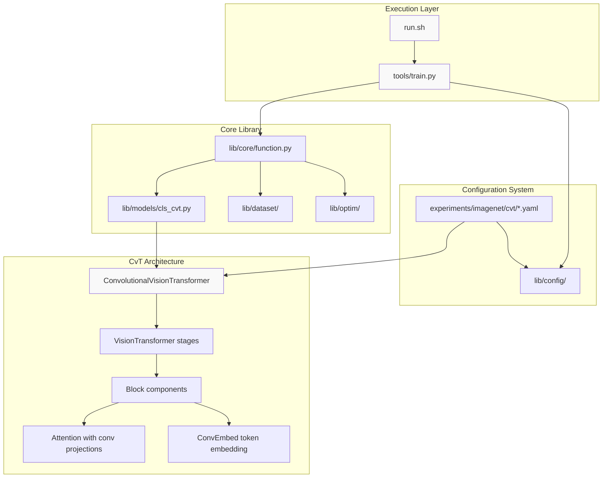

**Sources:** [README.md:1-148](), [lib/models/cls_cvt.py:491-646]()

## Core Architecture Components

### ConvolutionalVisionTransformer Design

The main model architecture follows a stage-wise design where each stage processes features at different scales. The `ConvolutionalVisionTransformer` class orchestrates multiple `VisionTransformer` stages, each configured with specific parameters for patch sizes, embedding dimensions, and attention heads.

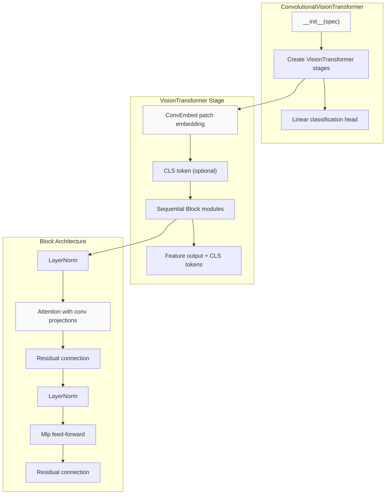

**Sources:** [lib/models/cls_cvt.py:491-540](), [lib/models/cls_cvt.py:372-489](), [lib/models/cls_cvt.py:289-334]()

### Convolutional Attention Mechanism

The key innovation in CvT is the `Attention` class that replaces standard linear projections with convolutional projections for Q, K, and V computation. This enables spatial inductive bias while maintaining transformer's global modeling capability.

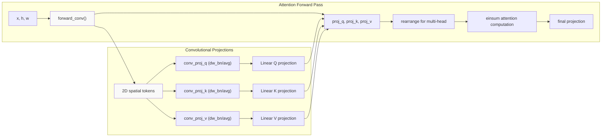

**Sources:** [lib/models/cls_cvt.py:77-212](), [lib/models/cls_cvt.py:124-160](), [lib/models/cls_cvt.py:162-188]()

## Training System Architecture

### Configuration-Driven Design

The system uses YAML configuration files to specify model architectures and training parameters. The `spec` parameter in `ConvolutionalVisionTransformer` defines all stage-specific settings including patch sizes, embedding dimensions, attention heads, and projection methods.

| Configuration Parameter | Purpose | Code Reference |
|------------------------|---------|----------------|
| `NUM_STAGES` | Number of transformer stages | [lib/models/cls_cvt.py:502]() |
| `PATCH_SIZE` | Convolutional patch sizes per stage | [lib/models/cls_cvt.py:505]() |
| `DIM_EMBED` | Embedding dimensions per stage | [lib/models/cls_cvt.py:508]() |
| `QKV_PROJ_METHOD` | Projection method (dw_bn/avg/linear) | [lib/models/cls_cvt.py:517]() |
| `CLS_TOKEN` | Whether to use CLS token per stage | [lib/models/cls_cvt.py:516]() |

### Training Pipeline Flow

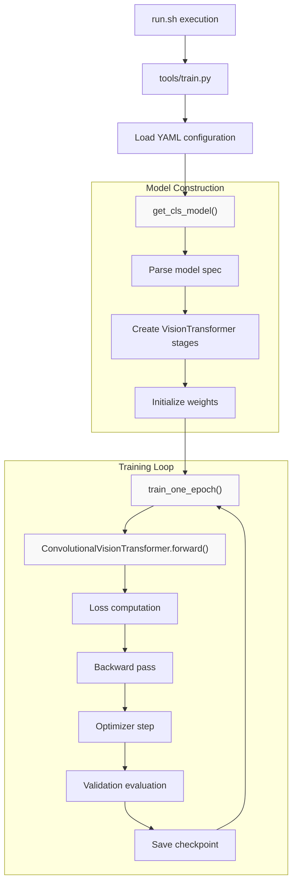

**Sources:** [README.md:85-114](), [lib/models/cls_cvt.py:626-645]()

## Key Architectural Decisions

### Hierarchical Multi-Scale Processing

The CvT architecture processes images through multiple stages with progressively larger receptive fields and embedding dimensions. Each stage uses different patch sizes and strides to capture features at different scales:

- **Stage 1**: Initial feature extraction with larger patches (7x7, stride 4)
- **Stage 2**: Intermediate processing with smaller patches (3x3, stride 2) 
- **Stage 3**: Deep processing with fine-grained features (3x3, stride 2)

### Convolutional Token Embeddings

The `ConvEmbed` class replaces standard linear patch embeddings with convolutional projections, providing translation invariance and better handling of input resolution changes.

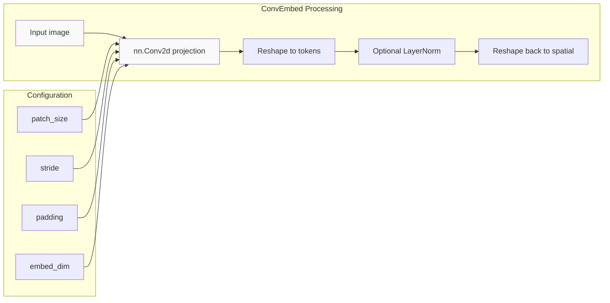

**Sources:** [lib/models/cls_cvt.py:336-370](), [lib/models/cls_cvt.py:397-405]()

### No Positional Encoding

Unlike standard vision transformers, CvT eliminates the need for positional encodings by incorporating spatial inductive bias through convolutional operations. This simplifies the architecture and enables better handling of variable input resolutions.

### Model Variants and Scaling

The system supports multiple model variants through configuration:

| Model Variant | Parameters | FLOPs | Key Characteristics |
|---------------|------------|-------|-------------------|
| CvT-13 | 20M | 4.5G | Lightweight, 13-layer configuration |
| CvT-21 | 32M | 7.1G | Medium-scale, 21-layer configuration |
| CvT-W24 | 277M | 193.2G | Large-scale, wide 24-layer configuration |

**Sources:** [README.md:6-21](), [lib/models/cls_cvt.py:502-534]()

---

# Page: CvT Model Architecture

# CvT Model Architecture

<details>
<summary>Relevant source files</summary>

The following files were used as context for generating this wiki page:

- [lib/models/__init__.py](lib/models/__init__.py)
- [lib/models/build.py](lib/models/build.py)
- [lib/models/cls_cvt.py](lib/models/cls_cvt.py)
- [lib/models/registry.py](lib/models/registry.py)

</details>


This document provides a detailed technical explanation of the Convolutional Vision Transformer (CvT) model architecture implementation. It covers the hierarchical multi-stage design, convolutional token embeddings, and attention mechanisms that distinguish CvT from standard Vision Transformers.

For information about training these models, see [Training Pipeline](#3.2). For data loading and preprocessing, see [Data Pipeline](#3.3). For model configuration parameters, see [Configuration Reference](#4.3).

## Overview

The CvT architecture introduces convolutional operations into the Vision Transformer framework through a hierarchical multi-stage design. Unlike standard ViTs that use linear projections and positional embeddings, CvT employs convolutional token embeddings and convolutional projections in attention mechanisms to better capture local spatial relationships.

## Multi-Stage Architecture

The CvT model consists of multiple stages that progressively reduce spatial resolution while increasing feature dimensions, similar to ConvNets but using transformer blocks for processing.

### Overall CvT Structure

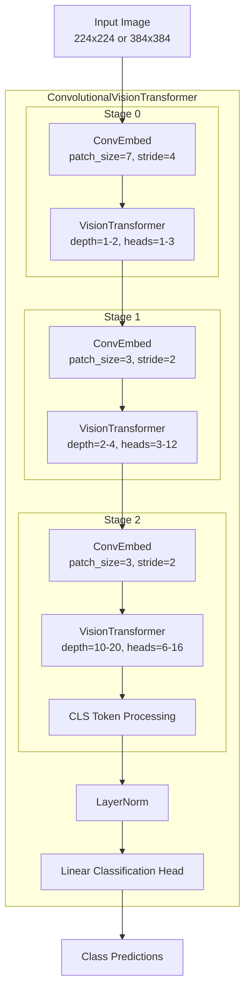

The `ConvolutionalVisionTransformer` class orchestrates this multi-stage processing by creating individual `VisionTransformer` stages with different configurations.

**Sources:** [lib/models/cls_cvt.py:491-623]()

### Stage Configuration

Each stage is configured through the `spec` parameter containing arrays of stage-specific settings:

| Parameter | Stage 0 | Stage 1 | Stage 2 | Purpose |
|-----------|---------|---------|---------|---------|
| `PATCH_SIZE` | 7 | 3 | 3 | Convolutional kernel size |
| `PATCH_STRIDE` | 4 | 2 | 2 | Downsampling factor |
| `DIM_EMBED` | 64-192 | 192-768 | 384-1024 | Feature dimensions |
| `DEPTH` | 1-2 | 2-4 | 10-20 | Number of transformer blocks |
| `NUM_HEADS` | 1-3 | 3-12 | 6-16 | Multi-head attention heads |
| `CLS_TOKEN` | False | False | True | Whether to use CLS token |

**Sources:** [lib/models/cls_cvt.py:502-535]()

## Vision Transformer Stage

Each stage in the CvT hierarchy is implemented as a `VisionTransformer` that processes tokens through convolutional embedding and transformer blocks.

### Single Stage Architecture

```mermaid
graph TB
    subgraph "VisionTransformer Stage"
        input_stage["Input Tokens<br/>from previous stage"]
        
        subgraph "Patch Embedding"
            conv_embed["ConvEmbed<br/>Conv2d + Optional Norm"]
        end
        
        subgraph "Token Processing"
            cls_token_add["Add CLS Token<br/>(if enabled)"]
            pos_drop["Positional Dropout"]
        end
        
        subgraph "Transformer Blocks"
            block0["Block 0<br/>Attention + MLP"]
            block1["Block 1<br/>Attention + MLP"]
            blockN["Block N<br/>Attention + MLP"]
        end
        
        subgraph "Output Processing"
            cls_extract["Extract CLS Token"]
            spatial_reshape["Reshape to Spatial"]
        end
        
        output_tokens["Output Tokens"]
        output_cls["CLS Token"]
    end
    
    input_stage --> conv_embed
    conv_embed --> cls_token_add
    cls_token_add --> pos_drop
    pos_drop --> block0
    block0 --> block1
    block1 --> blockN
    blockN --> cls_extract
    blockN --> spatial_reshape
    cls_extract --> output_cls
    spatial_reshape --> output_tokens
```

**Sources:** [lib/models/cls_cvt.py:372-489]()

### Convolutional Token Embedding

The `ConvEmbed` class replaces traditional patch embedding with convolutional operations:

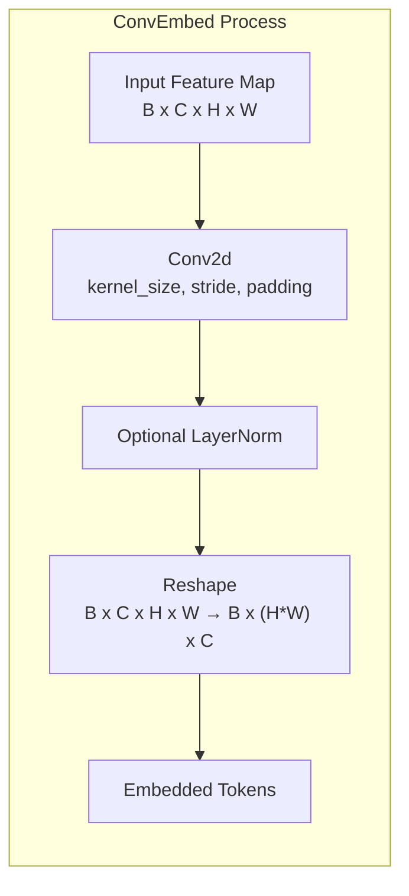

The embedding parameters are configurable per stage:
- **Stage 0**: Large patches (7x7) with stride 4 for initial tokenization
- **Stages 1-2**: Smaller patches (3x3) with stride 2 for progressive downsampling

**Sources:** [lib/models/cls_cvt.py:336-370]()

## Transformer Block Design

Each `Block` implements the core transformer computation with CvT-specific modifications.

### Block Structure

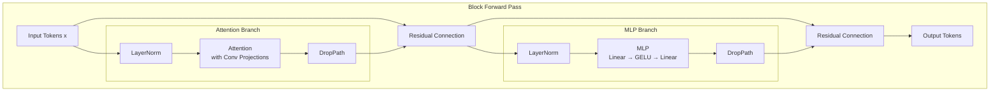

**Sources:** [lib/models/cls_cvt.py:289-334]()

## Convolutional Attention Mechanism

The key innovation in CvT is the `Attention` class that uses convolutional projections instead of purely linear transformations for Q, K, V computation.

### Attention Architecture

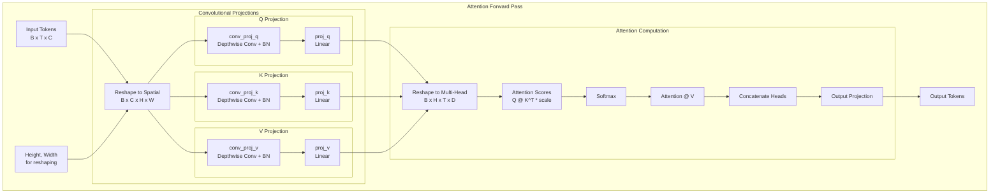

### Convolutional Projection Methods

The attention supports different projection methods via the `_build_projection` function:

| Method | Description | Components |
|--------|-------------|------------|
| `dw_bn` | Depthwise convolution + BatchNorm | `Conv2d(groups=dim_in)` + `BatchNorm2d` |
| `avg` | Average pooling | `AvgPool2d` |
| `linear` | No convolution (standard ViT) | `None` |

**Sources:** [lib/models/cls_cvt.py:77-213](), [lib/models/cls_cvt.py:124-160]()

### CLS Token Handling

The attention mechanism carefully handles CLS tokens when present:

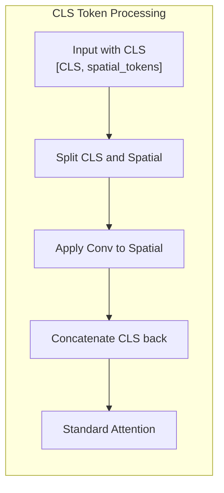

**Sources:** [lib/models/cls_cvt.py:163-188]()

## Model Factory and Registration

The model building process uses a registration system to create models from configuration.

### Model Creation Flow

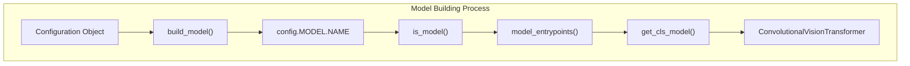

**Sources:** [lib/models/build.py:5-10](), [lib/models/registry.py:13-18](), [lib/models/cls_cvt.py:626-645]()

## Key Architectural Innovations

1. **Convolutional Token Embeddings**: Replace linear patch embeddings with convolutions that preserve spatial locality
2. **Convolutional Attention Projections**: Use depthwise convolutions in Q, K, V projections to capture local patterns
3. **Hierarchical Multi-Stage Design**: Progressive spatial downsampling and feature expansion across stages
4. **No Positional Encoding**: Spatial relationships captured through convolutional operations
5. **Flexible CLS Token Usage**: CLS tokens only in final stage for classification

**Sources:** [lib/models/cls_cvt.py:1-646]()

---

# Page: Training Pipeline

# Training Pipeline

<details>
<summary>Relevant source files</summary>

The following files were used as context for generating this wiki page:

- [lib/core/evaluate.py](lib/core/evaluate.py)
- [lib/core/function.py](lib/core/function.py)
- [lib/core/loss.py](lib/core/loss.py)
- [tools/train.py](tools/train.py)

</details>


This document explains the CvT training pipeline, including the training loop implementation, loss functions, evaluation metrics, and training optimizations. The training pipeline orchestrates model training from initialization through final model saving, handling distributed training, mixed precision, and comprehensive logging.

For information about the model architecture being trained, see [CvT Model Architecture](#3.1). For details about data loading and augmentation, see [Data Pipeline](#3.3).

## Training Flow Overview

The training pipeline is controlled by the main training script that coordinates all training components through a structured workflow.

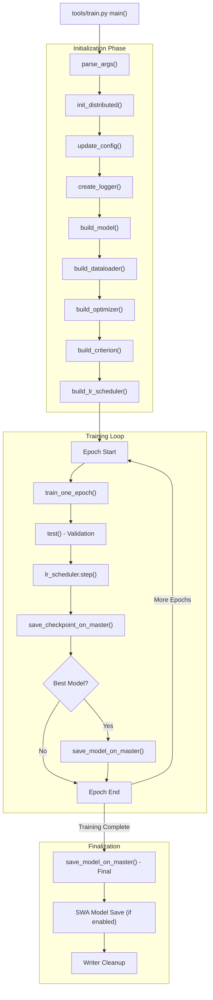

Sources: [tools/train.py:60-211]()

## Training Loop Components

### Main Training Controller

The primary training orchestration happens in `tools/train.py`, which manages the complete training lifecycle:

| Component | Purpose | Implementation |
|-----------|---------|----------------|
| Argument Parsing | Command-line interface | `parse_args()` function |
| Distributed Setup | Multi-GPU training | `init_distributed()` |
| Model Building | Architecture instantiation | `build_model()` |
| Data Loading | Training/validation datasets | `build_dataloader()` |
| Optimization | Optimizer and scheduler setup | `build_optimizer()`, `build_lr_scheduler()` |
| Loss Functions | Training and evaluation criteria | `build_criterion()` |

Sources: [tools/train.py:37-125]()

### Training Epoch Implementation

The core training logic is implemented in `train_one_epoch()` function, which handles single epoch execution with comprehensive monitoring:

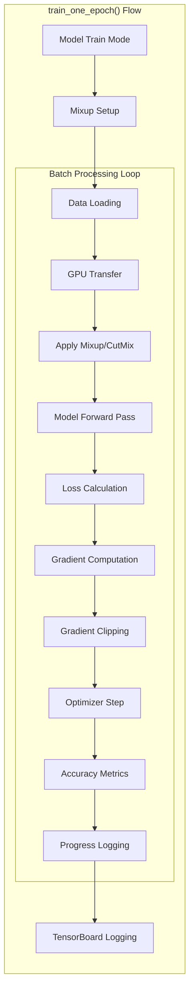

Sources: [lib/core/function.py:16-109]()

### Validation and Testing

The evaluation process uses the `test()` function for validation during training and final model assessment:

**Key Features:**
- **Model Evaluation Mode**: Switches to `model.eval()` for inference
- **Batch Processing**: Processes validation data without gradient computation
- **Metrics Calculation**: Computes Top-1 and Top-5 accuracy
- **Distributed Reduction**: Aggregates metrics across multiple GPUs
- **Real Labels Support**: Optional reassessed labels for more accurate evaluation

Sources: [lib/core/function.py:111-195]()

## Loss Functions and Evaluation

### Loss Function Architecture

The training pipeline supports multiple loss function configurations through the `build_criterion()` factory:

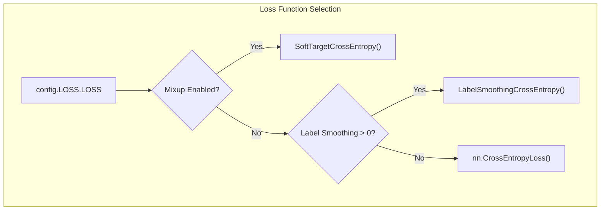

**Loss Function Types:**

| Loss Function | Use Case | Implementation |
|---------------|----------|----------------|
| `CrossEntropyLoss` | Standard classification | PyTorch built-in |
| `SoftTargetCrossEntropy` | Mixup/CutMix training | Custom implementation |
| `LabelSmoothingCrossEntropy` | Label smoothing regularization | Custom implementation with epsilon parameter |

Sources: [lib/core/loss.py:38-49]()

### Evaluation Metrics

The accuracy calculation supports both Top-1 and Top-5 metrics with robust handling of different output formats:

**Accuracy Calculation Features:**
- **Multi-output Support**: Handles list outputs (takes last element)
- **Batch Processing**: Efficient computation across batch dimensions
- **Top-K Flexibility**: Configurable for different K values
- **Percentage Conversion**: Returns accuracy as percentage values

Sources: [lib/core/evaluate.py:8-25]()

## Training Optimizations

### Mixed Precision Training

The pipeline includes comprehensive Automatic Mixed Precision (AMP) support:

```mermaid
graph LR
    subgraph "AMP Implementation"
        scaler["GradScaler"]
        autocast["autocast Context"]
        memory_format["Memory Format (NHWC)"]
        
        subgraph "Training Step"
            forward["Forward Pass"]
            loss_scale["Loss Scaling"]
            backward["Backward Pass"]
            unscale["Gradient Unscaling"]
            clip["Gradient Clipping"]
            step["Optimizer Step"]
            update["Scaler Update"]
        end
    end
    
    autocast --> forward
    forward --> loss_scale
    loss_scale --> backward
    backward --> unscale
    unscale --> clip
    clip --> step
    step --> update
```

**AMP Configuration Options:**
- **Enabled**: `config.AMP.ENABLED` controls AMP usage
- **Memory Format**: Optional NHWC memory layout for optimization
- **Gradient Scaling**: Automatic loss scaling for stable training

Sources: [tools/train.py:87-89, 123](), [lib/core/function.py:47-72]()

### Gradient Clipping

Gradient clipping prevents training instability through configurable norm clipping:

- **Threshold**: `config.TRAIN.CLIP_GRAD_NORM` sets maximum gradient norm
- **Implementation**: Uses `torch.nn.utils.clip_grad_norm_` after gradient unscaling
- **Integration**: Works seamlessly with AMP gradient scaling

Sources: [lib/core/function.py:62-69]()

### Data Augmentation Integration

The training loop integrates advanced data augmentation techniques:

**Mixup/CutMix Implementation:**
- **Mixup Factory**: Uses TIMM's `Mixup` class for augmentation
- **Probability Control**: Configurable through `config.AUG.MIXUP_PROB`
- **Label Handling**: Converts mixed labels back to hard labels for accuracy calculation
- **Loss Compatibility**: Works with `SoftTargetCrossEntropy` loss

Sources: [lib/core/function.py:27-34, 44-45, 76-78]()

## Checkpointing and Model Persistence

### Checkpoint Management

The training pipeline implements comprehensive model checkpointing with multiple save strategies:

```mermaid
graph TB
    subgraph "Checkpoint Types"
        epoch_checkpoint["Epoch Checkpoint"]
        best_model["Best Model"]
        final_state["Final State"]
        swa_state["SWA State"]
        all_models["All Models (Optional)"]
    end
    
    subgraph "Save Conditions"
        every_epoch["Every Epoch"]
        performance_check{"Performance > Best?"}
        training_end["Training Complete"]
        swa_enabled{"SWA Enabled?"}
        save_all_config{"SAVE_ALL_MODELS?"}
    end
    
    every_epoch --> epoch_checkpoint
    performance_check -->|Yes| best_model
    training_end --> final_state
    swa_enabled -->|Yes| swa_state
    save_all_config -->|Yes| all_models
```

**Checkpoint Features:**
- **Epoch Checkpoints**: Complete training state including optimizer
- **Best Model Tracking**: Saves best performing model based on validation accuracy
- **Resume Support**: Full checkpoint loading with `resume_checkpoint()`
- **Distributed Safety**: Only master process performs saves

Sources: [tools/train.py:171-204]()

### Logging and Monitoring

The training pipeline provides comprehensive logging through multiple channels:

**Logging Components:**
- **Console Logging**: Progress updates with timing and metrics
- **TensorBoard**: Scalars for loss and accuracy tracking
- **Configuration Saving**: Complete config preservation for reproducibility
- **Environment Info**: System and library version logging

Sources: [tools/train.py:91-95, 103-108](), [lib/core/function.py:103-108, 184-189]()

---

# Page: Data Pipeline

# Data Pipeline

<details>
<summary>Relevant source files</summary>

The following files were used as context for generating this wiki page:

- [lib/dataset/__init__.py](lib/dataset/__init__.py)
- [lib/dataset/build.py](lib/dataset/build.py)
- [lib/dataset/samplers/ra_sampler.py](lib/dataset/samplers/ra_sampler.py)
- [lib/dataset/transformas/build.py](lib/dataset/transformas/build.py)

</details>


This page documents the data loading, preprocessing, and augmentation pipeline used in the CvT training system. The data pipeline is responsible for efficiently loading ImageNet datasets, applying data transformations and augmentations, and providing batched data to the training loop.

For information about the training loop that consumes this data, see [Training Pipeline](#3.2). For details about model architecture that processes the data, see [CvT Model Architecture](#3.1).

## Overview

The CvT data pipeline is built around a modular design that supports multiple dataset formats, advanced augmentation strategies, and distributed training scenarios. The pipeline integrates with the TIMM library for state-of-the-art augmentation techniques and provides custom sampling strategies for improved training efficiency.

## Data Pipeline Architecture

```mermaid
flowchart TD
    config["Configuration"] --> build_dataloader["build_dataloader()"]
    
    build_dataloader --> build_dataset["build_dataset()"]
    build_dataloader --> build_transforms["build_transforms()"]
    build_dataloader --> sampler_selection["Sampler Selection"]
    
    build_dataset --> imagenet_check{"Dataset Type?"}
    imagenet_check -->|"imagenet"| _build_imagenet_dataset["_build_imagenet_dataset()"]
    imagenet_check -->|"other"| error["ValueError"]
    
    _build_imagenet_dataset --> ImageFolder["torchvision.datasets.ImageFolder"]
    
    build_transforms --> timm_check{"Use TIMM?"}
    timm_check -->|"Yes"| timm_transforms["create_transform()"]
    timm_check -->|"No"| standard_transforms["Standard Transforms"]
    
    sampler_selection --> distributed_check{"Distributed?"}
    distributed_check -->|"Yes + RA"| RASampler["RASampler"]
    distributed_check -->|"Yes"| DistributedSampler["DistributedSampler"]
    distributed_check -->|"No"| no_sampler["None"]
    
    subgraph "Data Loader Creation"
        loader_choice{"Use TIMM Loader?"}
        loader_choice -->|"Yes"| create_loader["timm.create_loader()"]
        loader_choice -->|"No"| torch_loader["torch.utils.data.DataLoader"]
    end
    
    ImageFolder --> loader_choice
    timm_transforms --> loader_choice
    standard_transforms --> loader_choice
    RASampler --> loader_choice
    DistributedSampler --> loader_choice
    no_sampler --> loader_choice
    
    create_loader --> final_loader["DataLoader"]
    torch_loader --> final_loader
```

Sources: [lib/dataset/build.py:17-115]()

## Dataset Building Process

The dataset building process centers around the `build_dataset` function, which currently supports ImageNet-style datasets through the `ImageFolder` class.

### Dataset Creation Flow

```mermaid
flowchart LR
    subgraph "Dataset Building"
        cfg["Configuration Object"] --> build_dataset["build_dataset(cfg, is_train)"]
        build_dataset --> dataset_type_check{"Dataset Type Check"}
        
        dataset_type_check -->|"'imagenet' in cfg.DATASET.DATASET"| _build_imagenet_dataset["_build_imagenet_dataset()"]
        dataset_type_check -->|"unknown dataset"| ValueError["ValueError Exception"]
        
        subgraph "ImageNet Dataset Construction"
            _build_imagenet_dataset --> get_transforms["build_transforms(cfg, is_train)"]
            _build_imagenet_dataset --> get_dataset_path["cfg.DATASET.TRAIN_SET or TEST_SET"]
            
            get_transforms --> transforms["Transform Pipeline"]
            get_dataset_path --> dataset_name["Dataset Directory Name"]
            
            transforms --> ImageFolder["datasets.ImageFolder()"]
            dataset_name --> ImageFolder
            cfg_root["cfg.DATASET.ROOT"] --> ImageFolder
        end
        
        ImageFolder --> dataset_instance["Dataset Instance"]
    end
```

| Component | Purpose | Configuration Key |
|-----------|---------|-------------------|
| `cfg.DATASET.DATASET` | Dataset type identifier | Must contain 'imagenet' |
| `cfg.DATASET.ROOT` | Root directory path | Base path to dataset |
| `cfg.DATASET.TRAIN_SET` | Training set subdirectory | Used when `is_train=True` |
| `cfg.DATASET.TEST_SET` | Test set subdirectory | Used when `is_train=False` |

Sources: [lib/dataset/build.py:17-49]()

## Data Transformations and Augmentations

The transformation pipeline supports two modes: TIMM-based transformations for advanced augmentation and standard PyTorch transformations for basic preprocessing.

### Transform Pipeline Selection

```mermaid
flowchart TD
    build_transforms["build_transforms(cfg, is_train)"] --> timm_check{"cfg.AUG.TIMM_AUG.USE_TRANSFORM && is_train"}
    
    timm_check -->|"True"| timm_branch["TIMM Transform Pipeline"]
    timm_check -->|"False"| standard_branch["Standard Transform Pipeline"]
    
    subgraph "TIMM Transform Pipeline"
        timm_create["create_transform()"] --> timm_params["TIMM Parameters"]
        timm_params --> timm_result["TIMM Transform"]
        
        timm_params --> input_size["cfg.TRAIN.IMAGE_SIZE"]
        timm_params --> re_prob["timm_cfg.RE_PROB"]
        timm_params --> re_mode["timm_cfg.RE_MODE"]
        timm_params --> auto_aug["timm_cfg.AUTO_AUGMENT"]
        timm_params --> color_jitter["timm_cfg.COLOR_JITTER"]
        timm_params --> interpolation["timm_cfg.INTERPOLATION"]
    end
    
    subgraph "Standard Transform Pipeline"
        train_check{"is_train?"}
        train_check -->|"True"| train_transforms["Training Transforms"]
        train_check -->|"False"| test_transforms["Test Transforms"]
        
        train_transforms --> finetune_check{"cfg.FINETUNE.FINETUNE && !cfg.FINETUNE.USE_TRAIN_AUG"}
        finetune_check -->|"True"| finetune_aug["Minimal Augmentation"]
        finetune_check -->|"False"| full_aug["Full Augmentation"]
        
        subgraph "Full Training Augmentation"
            RandomResizedCrop["RandomResizedCrop"]
            RandomHorizontalFlip["RandomHorizontalFlip"]
            ColorJitter["ColorJitter (conditional)"]
            GrayScale["RandomGrayscale (conditional)"]
            GaussianBlur["GaussianBlur (conditional)"]
            ToTensor["ToTensor"]
            Normalize["Normalize"]
        end
        
        subgraph "Test Transforms"
            test_center_check{"cfg.TEST.CENTER_CROP"}
            test_center_check -->|"True"| center_crop_pipeline["Resize + CenterCrop"]
            test_center_check -->|"False"| direct_resize["Direct Resize"]
        end
    end
```

### Augmentation Parameters

| Augmentation | Configuration | Purpose |
|--------------|---------------|---------|
| Scale | `cfg.AUG.SCALE` | Random resize crop scale range |
| Ratio | `cfg.AUG.RATIO` | Random resize crop aspect ratio range |
| Color Jitter | `cfg.AUG.COLOR_JITTER` | Color distortion parameters [brightness, contrast, saturation, hue, probability] |
| Gray Scale | `cfg.AUG.GRAY_SCALE` | Probability of converting to grayscale |
| Gaussian Blur | `cfg.AUG.GAUSSIAN_BLUR` | Probability of applying gaussian blur |
| Interpolation | `cfg.AUG.INTERPOLATION` | Resize interpolation method |

Sources: [lib/dataset/transformas/build.py:31-124]()

## Data Loading and Sampling

The data loading system supports both standard PyTorch DataLoader and TIMM's advanced loader with multiple sampling strategies for distributed training.

### DataLoader Construction

```mermaid
flowchart TD
    build_dataloader["build_dataloader(cfg, is_train, distributed)"] --> batch_config["Batch Size Configuration"]
    build_dataloader --> dataset_creation["build_dataset(cfg, is_train)"]
    
    batch_config --> train_batch_check{"is_train?"}
    train_batch_check -->|"True"| train_batch["cfg.TRAIN.BATCH_SIZE_PER_GPU"]
    train_batch_check -->|"False"| test_batch["cfg.TEST.BATCH_SIZE_PER_GPU"]
    
    dataset_creation --> dataset["Dataset Instance"]
    
    dataset --> sampler_logic["Sampler Selection Logic"]
    
    subgraph "Sampler Selection"
        distributed_check{"distributed?"}
        distributed_check -->|"True"| dist_sampler_choice{"is_train && cfg.DATASET.SAMPLER == 'repeated_aug'"}
        distributed_check -->|"False"| no_sampler["sampler = None"]
        
        dist_sampler_choice -->|"True"| ra_sampler["RASampler(dataset, shuffle=shuffle)"]
        dist_sampler_choice -->|"False"| dist_sampler["DistributedSampler(dataset, shuffle=shuffle)"]
    end
    
    sampler_logic --> loader_choice{"cfg.AUG.TIMM_AUG.USE_LOADER && is_train"}
    
    loader_choice -->|"True"| timm_loader["create_loader() with TIMM parameters"]
    loader_choice -->|"False"| torch_loader["torch.utils.data.DataLoader()"]
    
    timm_loader --> final_dataloader["DataLoader"]
    torch_loader --> final_dataloader
```

### Repeated Augmentation Sampler

The `RASampler` class implements a specialized sampling strategy for distributed training with repeated augmentation:

```mermaid
flowchart LR
    subgraph "RASampler Implementation"
        init["__init__(dataset, num_replicas, rank, shuffle)"] --> calculate_samples["Calculate Sample Counts"]
        
        calculate_samples --> num_samples["num_samples = ceil(len(dataset) * 3.0 / num_replicas)"]
        calculate_samples --> selected_samples["num_selected_samples = floor(len(dataset) // 256 * 256 / num_replicas)"]
        
        iter_method["__iter__()"] --> shuffle_check{"shuffle?"}
        shuffle_check -->|"True"| randperm["torch.randperm(len(dataset))"]
        shuffle_check -->|"False"| range_indices["list(range(len(dataset)))"]
        
        randperm --> triple_repeat["Repeat each index 3 times"]
        range_indices --> triple_repeat
        
        triple_repeat --> pad_indices["Pad to total_size"]
        pad_indices --> subsample["Subsample for current rank"]
        subsample --> return_selected["Return first num_selected_samples"]
    end
```

Key characteristics of `RASampler`:
- Repeats each sample 3 times to increase augmentation diversity
- Ensures even distribution across distributed training ranks
- Implements deterministic shuffling based on epoch
- Optimizes sample count for batch size alignment (multiple of 256)

Sources: [lib/dataset/samplers/ra_sampler.py:12-64]()

## Integration Points

### Configuration Dependencies

The data pipeline integrates tightly with the configuration system through these key parameters:

| Configuration Section | Key Parameters | Purpose |
|----------------------|----------------|---------|
| `DATASET` | `DATASET`, `ROOT`, `TRAIN_SET`, `TEST_SET`, `SAMPLER` | Dataset identification and paths |
| `TRAIN` | `BATCH_SIZE_PER_GPU`, `IMAGE_SIZE` | Training batch configuration |
| `TEST` | `BATCH_SIZE_PER_GPU`, `IMAGE_SIZE`, `CENTER_CROP`, `INTERPOLATION` | Test configuration |
| `AUG` | `SCALE`, `RATIO`, `COLOR_JITTER`, `GRAY_SCALE`, `GAUSSIAN_BLUR`, `INTERPOLATION` | Augmentation parameters |
| `AUG.TIMM_AUG` | `USE_TRANSFORM`, `USE_LOADER`, `RE_PROB`, `AUTO_AUGMENT`, `HFLIP`, `COLOR_JITTER` | TIMM augmentation settings |
| `INPUT` | `MEAN`, `STD` | Normalization parameters |

### Training Loop Integration

The data pipeline provides `DataLoader` instances that are consumed by the training loop through the `build_dataloader` function. The loader handles:

- Automatic batching according to configuration
- Distributed sampling coordination
- Data prefetching and pin memory optimization
- Integration with mixed precision training (when using TIMM loader)

Sources: [lib/dataset/build.py:52-115](), [lib/dataset/__init__.py:1-3]()

---

# Page: Configuration System

# Configuration System

<details>
<summary>Relevant source files</summary>

The following files were used as context for generating this wiki page:

- [experiments/imagenet/cvt/cvt-13-224x224.yaml](experiments/imagenet/cvt/cvt-13-224x224.yaml)
- [lib/config/__init__.py](lib/config/__init__.py)
- [lib/config/default.py](lib/config/default.py)

</details>


## Purpose and Scope

The Configuration System manages all training, model, and dataset parameters for the CvT repository through a hierarchical YAML-based configuration framework. This system provides a centralized approach to parameter management, allowing users to define model variants, training schedules, and experimental settings through structured configuration files.

For information about specific model configurations and variants, see [Configuration Reference](#4.3). For details about the training pipeline that uses these configurations, see [Training Pipeline](#3.2).

## System Architecture

The Configuration System is built on the YACS (Yet Another Configuration System) library and follows a hierarchical approach with defaults, file-based overrides, and command-line parameter support.

```mermaid
graph TB
    subgraph "Configuration Sources"
        yaml_files["YAML Configuration Files<br/>experiments/imagenet/cvt/*.yaml"]
        defaults["Default Configuration<br/>lib/config/default.py"]
        cmdline["Command Line Arguments<br/>--opts parameter"]
    end
    
    subgraph "Configuration Processing"
        config_loader["_update_config_from_file()"]
        config_updater["update_config()"]
        merger["config.merge_from_list()"]
    end
    
    subgraph "Configuration Node"
        main_config["_C Configuration Node<br/>(YACS CfgNode)"]
    end
    
    subgraph "Configuration Sections"
        model_config["MODEL<br/>Architecture Parameters"]
        train_config["TRAIN<br/>Training Parameters"]
        dataset_config["DATASET<br/>Data Configuration"]
        aug_config["AUG<br/>Augmentation Settings"]
        test_config["TEST<br/>Evaluation Parameters"]
    end
    
    subgraph "System Components"
        model_builder["Model Builder"]
        training_loop["Training Loop"]
        data_loader["Data Loader"]
        evaluator["Evaluator"]
    end
    
    defaults --> config_loader
    yaml_files --> config_loader
    config_loader --> config_updater
    cmdline --> merger
    config_updater --> merger
    merger --> main_config
    
    main_config --> model_config
    main_config --> train_config
    main_config --> dataset_config
    main_config --> aug_config
    main_config --> test_config
    
    model_config --> model_builder
    train_config --> training_loop
    dataset_config --> data_loader
    aug_config --> data_loader
    test_config --> evaluator
```

**Sources:** [lib/config/default.py:155-191](), [lib/config/__init__.py:1-4]()

## Configuration Schema Structure

The configuration system defines a comprehensive schema covering all aspects of model training and evaluation. The main configuration node `_C` is structured into logical sections.

### Core Configuration Sections

| Section | Purpose | Key Parameters |
|---------|---------|----------------|
| `MODEL` | Model architecture definition | `NAME`, `SPEC`, `NUM_CLASSES` |
| `TRAIN` | Training parameters | `LR`, `BATCH_SIZE_PER_GPU`, `END_EPOCH` |
| `TEST` | Evaluation settings | `BATCH_SIZE_PER_GPU`, `IMAGE_SIZE` |
| `DATASET` | Dataset configuration | `ROOT`, `DATASET`, `TRAIN_SET` |
| `AUG` | Data augmentation | `MIXUP`, `TIMM_AUG`, `COLOR_JITTER` |
| `LOSS` | Loss function settings | `LABEL_SMOOTHING`, `LOSS` |
| `CUDNN` | Hardware acceleration | `BENCHMARK`, `DETERMINISTIC` |
| `AMP` | Mixed precision training | `ENABLED`, `MEMORY_FORMAT` |

```mermaid
graph TB
    subgraph "Configuration Schema (_C)"
        subgraph "Infrastructure"
            base_config["BASE<br/>OUTPUT_DIR<br/>WORKERS<br/>GPUS"]
            cudnn_config["CUDNN<br/>BENCHMARK<br/>DETERMINISTIC<br/>ENABLED"]
            amp_config["AMP<br/>ENABLED<br/>MEMORY_FORMAT"]
        end
        
        subgraph "Model Definition"
            model_config["MODEL<br/>NAME: 'cls_cvt'<br/>SPEC: CfgNode<br/>NUM_CLASSES: 1000"]
            model_spec["MODEL.SPEC<br/>NUM_STAGES<br/>PATCH_SIZE<br/>DIM_EMBED<br/>NUM_HEADS<br/>DEPTH"]
        end
        
        subgraph "Training Configuration"
            train_config["TRAIN<br/>LR<br/>BATCH_SIZE_PER_GPU<br/>END_EPOCH<br/>OPTIMIZER"]
            train_scheduler["TRAIN.LR_SCHEDULER<br/>METHOD<br/>ARGS"]
        end
        
        subgraph "Data Pipeline"
            dataset_config["DATASET<br/>ROOT<br/>DATASET<br/>TRAIN_SET<br/>TEST_SET"]
            aug_config["AUG<br/>MIXUP<br/>MIXCUT<br/>TIMM_AUG"]
            input_config["INPUT<br/>MEAN<br/>STD"]
        end
        
        subgraph "Evaluation"
            test_config["TEST<br/>BATCH_SIZE_PER_GPU<br/>IMAGE_SIZE<br/>MODEL_FILE"]
            loss_config["LOSS<br/>LABEL_SMOOTHING<br/>LOSS"]
        end
    end
    
    model_config --> model_spec
    train_config --> train_scheduler
```

**Sources:** [lib/config/default.py:12-153](), [experiments/imagenet/cvt/cvt-13-224x224.yaml:1-84]()

## Configuration Loading and Merging Process

The configuration system implements a multi-stage loading process that supports inheritance, file-based configuration, and runtime overrides.

### Loading Process Flow

```mermaid
sequenceDiagram
    participant CLI as "Command Line"
    participant UC as "update_config()"
    participant UFCF as "_update_config_from_file()"
    participant YC as "YAML Config"
    participant DC as "Default Config (_C)"
    
    CLI->>UC: "args.cfg, args.opts"
    UC->>UFCF: "args.cfg"
    UFCF->>YC: "Load YAML file"
    
    alt "BASE configs exist"
        YC->>UFCF: "Recursive load BASE configs"
        UFCF->>UFCF: "Load parent configs first"
    end
    
    UFCF->>DC: "config.merge_from_file()"
    UC->>DC: "config.merge_from_list(args.opts)"
    
    alt "TRAIN.SCALE_LR enabled"
        UC->>DC: "Scale LR by world_size"
    end
    
    alt "timm scheduler"
        UC->>DC: "Set epochs in LR_SCHEDULER.ARGS"
    end
    
    alt "MIXUP/MIXCUT enabled"
        UC->>DC: "Set MIXUP_PROB = 1.0"
    end
    
    UC->>DC: "config.freeze()"
```

### Key Functions

- **`_update_config_from_file(config, cfg_file)`**: Recursively loads configuration files, supporting inheritance through the `BASE` parameter
- **`update_config(config, args)`**: Main entry point that orchestrates the loading process and applies runtime modifications
- **`save_config(cfg, path)`**: Persists the final configuration to disk for reproducibility

**Sources:** [lib/config/default.py:155-191]()

## Model-Specific Configuration Structure

The `MODEL.SPEC` section contains the detailed architecture parameters for CvT models. This flexible structure allows definition of different model variants.

### CvT Model Configuration Example

```mermaid
graph TB
    subgraph "CvT-13 Configuration Structure"
        model_spec["MODEL.SPEC"]
        
        subgraph "Architecture Definition"
            stages["NUM_STAGES: 3"]
            patch_config["PATCH_SIZE: [7, 3, 3]<br/>PATCH_STRIDE: [4, 2, 2]<br/>PATCH_PADDING: [2, 1, 1]"]
        end
        
        subgraph "Stage-Specific Parameters"
            dims["DIM_EMBED: [64, 192, 384]"]
            heads["NUM_HEADS: [1, 3, 6]"]
            depths["DEPTH: [1, 2, 10]"]
            ratios["MLP_RATIO: [4.0, 4.0, 4.0]"]
        end
        
        subgraph "Attention Configuration"
            dropout["ATTN_DROP_RATE: [0.0, 0.0, 0.0]<br/>DROP_RATE: [0.0, 0.0, 0.0]<br/>DROP_PATH_RATE: [0.0, 0.0, 0.1]"]
            qkv_config["QKV_BIAS: [True, True, True]<br/>QKV_PROJ_METHOD: ['dw_bn', 'dw_bn', 'dw_bn']"]
        end
        
        subgraph "Token Configuration"
            tokens["CLS_TOKEN: [False, False, True]<br/>POS_EMBED: [False, False, False]"]
        end
    end
    
    model_spec --> stages
    model_spec --> patch_config
    model_spec --> dims
    model_spec --> heads
    model_spec --> depths
    model_spec --> ratios
    model_spec --> dropout
    model_spec --> qkv_config
    model_spec --> tokens
```

**Sources:** [experiments/imagenet/cvt/cvt-13-224x224.yaml:7-30]()

## Training and Augmentation Configuration

The configuration system provides extensive support for training parameter management and data augmentation strategies.

### Training Configuration Components

| Component | Configuration Path | Key Parameters |
|-----------|-------------------|----------------|
| Optimizer | `TRAIN.OPTIMIZER` | `adamW`, `sgd` |
| Learning Rate | `TRAIN.LR_SCHEDULER` | `METHOD: 'timm'`, `ARGS` |
| Batch Size | `TRAIN.BATCH_SIZE_PER_GPU` | Per-GPU batch size |
| Weight Decay | `TRAIN.WD`, `TRAIN.WITHOUT_WD_LIST` | Regularization settings |
| Augmentation | `AUG.TIMM_AUG`, `AUG.MIXUP` | Data augmentation pipeline |

### Augmentation Pipeline Configuration

The system supports both traditional augmentation and advanced techniques like MixUp and CutMix:

- **TIMM Integration**: `AUG.TIMM_AUG.USE_LOADER` enables TIMM-based augmentation
- **MixUp/CutMix**: Controlled through `AUG.MIXUP`, `AUG.MIXCUT`, and `AUG.MIXUP_PROB`
- **AutoAugment**: Configured via `AUG.TIMM_AUG.AUTO_AUGMENT`

**Sources:** [lib/config/default.py:93-153](), [experiments/imagenet/cvt/cvt-13-224x224.yaml:31-45](), [experiments/imagenet/cvt/cvt-13-224x224.yaml:63-84]()

## Configuration Usage Patterns

### Runtime Configuration Updates

The system automatically applies intelligent defaults and modifications during configuration loading:

1. **Learning Rate Scaling**: When `TRAIN.SCALE_LR` is enabled, the learning rate is scaled by the world size for distributed training
2. **Scheduler Integration**: For TIMM schedulers, the total epochs are automatically set from `TRAIN.END_EPOCH`
3. **MixUp Probability**: When MixUp or CutMix is enabled, `MIXUP_PROB` is automatically set to 1.0

### Configuration Validation and Freezing

The YACS framework provides configuration validation through the freeze/defrost mechanism:

- **`config.freeze()`**: Locks the configuration, preventing accidental modifications
- **`config.defrost()`**: Temporarily unlocks configuration for updates
- **`CN(new_allowed=True)`**: Allows dynamic addition of new configuration keys

**Sources:** [lib/config/default.py:170-191]()

---

# Page: Usage Guide

# Usage Guide

<details>
<summary>Relevant source files</summary>

The following files were used as context for generating this wiki page:

- [experiments/imagenet/cvt/cvt-13-224x224.yaml](experiments/imagenet/cvt/cvt-13-224x224.yaml)
- [tools/train.py](tools/train.py)

</details>


This document provides practical guidance for using the CvT (Convolutional vision Transformers) repository to train and evaluate models. It covers the main workflows, entry points, and configuration patterns that users need to understand for effective operation of the CvT training system.

For detailed step-by-step training instructions, see [Training Models](#4.1). For evaluation procedures and metrics, see [Model Evaluation](#4.2). For complete configuration parameter reference, see [Configuration Reference](#4.3).

## System Overview

The CvT repository follows a configuration-driven training workflow where users specify model architecture, training parameters, and data settings through YAML configuration files. The primary entry point is the `tools/train.py` script, which orchestrates the entire training pipeline.

### Core Usage Workflow

```mermaid
flowchart TD
    user["User"]
    
    subgraph "Configuration Phase"
        yaml["YAML Config File<br/>experiments/imagenet/cvt/*.yaml"]
        args["Command Line Arguments<br/>--cfg, --local_rank, opts"]
    end
    
    subgraph "Execution Phase"
        trainpy["tools/train.py<br/>main(), parse_args()"]
        config["config module<br/>update_config()"]
        init["Initialization<br/>init_distributed()<br/>setup_cudnn()"]
    end
    
    subgraph "Training Components"
        model["build_model()"]
        data["build_dataloader()"]
        optim["build_optimizer()"]
        criterion["build_criterion()"]
        scheduler["build_lr_scheduler()"]
    end
    
    subgraph "Training Loop"
        epoch["Training Epochs<br/>train_one_epoch()"]
        eval["Validation<br/>test()"]
        checkpoint["Checkpointing<br/>save_checkpoint_on_master()"]
    end
    
    subgraph "Outputs"
        logs["Training Logs"]
        models["Model Checkpoints<br/>model_best.pth<br/>final_state.pth"]
        tensorboard["TensorBoard Logs"]
    end
    
    user --> yaml
    user --> args
    yaml --> trainpy
    args --> trainpy
    trainpy --> config
    config --> init
    
    init --> model
    init --> data
    init --> optim
    init --> criterion
    init --> scheduler
    
    model --> epoch
    data --> epoch
    optim --> epoch
    criterion --> epoch
    epoch --> eval
    eval --> checkpoint
    scheduler --> epoch
    
    checkpoint --> logs
    checkpoint --> models
    epoch --> tensorboard
```

**Title: CvT Training Workflow from User Input to Model Output**

Sources: [tools/train.py:1-211](), [experiments/imagenet/cvt/cvt-13-224x224.yaml:1-84]()

## Entry Points and Commands

### Primary Training Command

The main entry point for training CvT models is `tools/train.py`. The basic command structure is:

```bash
python tools/train.py --cfg <config_file> [opts]
```

Key command line arguments defined in `parse_args()`:

| Argument | Purpose | Example |
|----------|---------|---------|
| `--cfg` | Required configuration file path | `experiments/imagenet/cvt/cvt-13-224x224.yaml` |
| `--local_rank` | GPU rank for distributed training | `0` |
| `--port` | Port for distributed communication | `9000` |
| `opts` | Configuration overrides | `TRAIN.LR 0.001 MODEL.SPEC.DEPTH [1,2,12]` |

### Distributed Training Support

The system automatically handles distributed training setup through `init_distributed()` and supports multi-GPU training with `DistributedDataParallel`:

```mermaid
graph LR
    subgraph "Distributed Training Setup"
        args["Command Line Args<br/>--local_rank, --port"]
        init["init_distributed(args)<br/>tools/train.py:63"]
        ddp["DistributedDataParallel<br/>tools/train.py:110-114"]
    end
    
    subgraph "Data Distribution"
        sampler["Distributed Sampler<br/>train_loader.sampler.set_epoch()"]
        loader["build_dataloader()<br/>distributed=True"]
    end
    
    subgraph "Model Synchronization"
        sync["Gradient Synchronization<br/>find_unused_parameters=True"]
        save["save_checkpoint_on_master()<br/>tools/train.py:171-180"]
    end
    
    args --> init
    init --> ddp
    ddp --> sync
    loader --> sampler
    sampler --> sync
    sync --> save
```

**Title: Distributed Training Component Integration**

Sources: [tools/train.py:46-48](), [tools/train.py:63](), [tools/train.py:109-114](), [tools/train.py:131-132]()

## Configuration Management

### Configuration Loading Process

The configuration system processes multiple sources with a defined precedence order:

```mermaid
graph TD
    subgraph "Configuration Sources (Priority Order)"
        default["Default Configuration<br/>lib/config/default.py"]
        yaml["YAML File<br/>experiments/imagenet/cvt/*.yaml"]
        cmdline["Command Line Overrides<br/>opts parameter"]
    end
    
    subgraph "Processing Pipeline"
        update["update_config(config, args)<br/>tools/train.py:66"]
        validate["Configuration Validation"]
        save["save_config()<br/>tools/train.py:79"]
    end
    
    subgraph "Configuration Usage"
        model["Model Building<br/>build_model(config)"]
        training["Training Setup<br/>optimizer, scheduler, criterion"]
        data["Data Pipeline<br/>build_dataloader(config)"]
    end
    
    default --> update
    yaml --> update  
    cmdline --> update
    update --> validate
    validate --> save
    
    save --> model
    save --> training
    save --> data
```

**Title: Configuration Processing and Application Pipeline**

### Key Configuration Sections

Based on the provided YAML example, the main configuration categories are:

| Section | Purpose | Key Parameters |
|---------|---------|----------------|
| `MODEL.SPEC` | CvT architecture definition | `NUM_STAGES`, `DIM_EMBED`, `NUM_HEADS`, `DEPTH` |
| `TRAIN` | Training hyperparameters | `LR`, `BATCH_SIZE_PER_GPU`, `END_EPOCH`, `OPTIMIZER` |
| `DATASET` | Data configuration | `ROOT`, `TRAIN_SET`, `TEST_SET` |
| `AUG` | Data augmentation settings | `MIXUP`, `TIMM_AUG`, `AUTO_AUGMENT` |
| `AMP` | Automatic Mixed Precision | `ENABLED`, `MEMORY_FORMAT` |

Sources: [tools/train.py:66](), [tools/train.py:77-79](), [experiments/imagenet/cvt/cvt-13-224x224.yaml:7-84]()

## Training Pipeline Components

### Component Initialization Sequence

The training system initializes components in a specific order to ensure proper dependencies:

```mermaid
graph TD
    subgraph "System Setup"
        distributed["init_distributed(args)"]
        cudnn["setup_cudnn(config)"]
        logger["create_logger()"]
    end
    
    subgraph "Model Setup"
        model["build_model(config)<br/>tools/train.py:81"]
        cuda["model.to(torch.device('cuda'))<br/>tools/train.py:82"]
        amp["Convert to NHWC<br/>tools/train.py:87-89"]
    end
    
    subgraph "Training Setup"
        optimizer["build_optimizer(config, model)<br/>tools/train.py:100"]
        resume["resume_checkpoint()<br/>tools/train.py:102-104"]
        dataloader["build_dataloader()<br/>tools/train.py:106-107"]
        criterion["build_criterion(config)<br/>tools/train.py:116-119"]
        scheduler["build_lr_scheduler()<br/>tools/train.py:121"]
        scaler["torch.cuda.amp.GradScaler<br/>tools/train.py:123"]
    end
    
    distributed --> cudnn
    cudnn --> logger
    logger --> model
    model --> cuda
    cuda --> amp
    amp --> optimizer
    optimizer --> resume
    resume --> dataloader
    dataloader --> criterion
    criterion --> scheduler
    scheduler --> scaler
```

**Title: Training Component Initialization Dependencies**

### Training Loop Structure

The main training loop in `tools/train.py` follows this pattern for each epoch:

| Phase | Function | Key Operations |
|-------|----------|----------------|
| Setup | Epoch initialization | Set sampler epoch, logging setup |
| Training | `train_one_epoch()` | Forward pass, loss computation, backpropagation |
| Evaluation | `test()` | Validation accuracy computation |
| Checkpointing | `save_checkpoint_on_master()` | Save model state and optimizer state |
| Scheduling | `lr_scheduler.step()` | Update learning rate |

Sources: [tools/train.py:21-22](), [tools/train.py:81-123](), [tools/train.py:126-195]()

## Output Management

### Generated Artifacts

The training process generates several types of outputs in the specified `OUTPUT_DIR`:

| Artifact Type | File Pattern | Purpose |
|---------------|--------------|---------|
| Configuration | `config.yaml` | Saved configuration used for training |
| Model Checkpoints | `model_best.pth`, `final_state.pth` | Best and final model weights |
| Training State | Checkpoint files with optimizer state | Resume training capability |
| Logs | Training logs and metrics | Performance tracking |
| TensorBoard | TensorBoard log directory | Training visualization |

### Model Saving Strategy

```mermaid
graph LR
    subgraph "Model Saving Logic"
        eval["Validation Performance<br/>test() returns perf"]
        compare["best_model = (perf > best_perf)<br/>tools/train.py:156"]
        best["save_model_on_master()<br/>model_best.pth<br/>tools/train.py:182-185"]
        checkpoint["save_checkpoint_on_master()<br/>tools/train.py:171-180"]
        final["Final Model Save<br/>final_state.pth<br/>tools/train.py:197-199"]
    end
    
    subgraph "Optional Saving"
        all_models["SAVE_ALL_MODELS<br/>model_epoch.pth<br/>tools/train.py:187-190"]
        swa["SWA Model<br/>swa_state.pth<br/>tools/train.py:201-204"]
    end
    
    eval --> compare
    compare --> best
    compare --> checkpoint
    checkpoint --> final
    checkpoint --> all_models
    final --> swa
```

**Title: Model Checkpoint and Artifact Management Strategy**

Sources: [tools/train.py:149-204]()

## Quick Reference

For immediate usage, the most common workflow is:

1. **Select Configuration**: Choose from `experiments/imagenet/cvt/` directory
2. **Run Training**: `python tools/train.py --cfg <config_path>`  
3. **Monitor Progress**: Check logs and TensorBoard output
4. **Access Results**: Find trained models in the specified `OUTPUT_DIR`

For advanced configuration customization, parameter tuning, and evaluation procedures, refer to the detailed sub-pages of this usage guide.

---

# Page: Training Models

# Training Models

<details>
<summary>Relevant source files</summary>

The following files were used as context for generating this wiki page:

- [README.md](README.md)
- [experiments/imagenet/cvt/cvt-13-224x224.yaml](experiments/imagenet/cvt/cvt-13-224x224.yaml)
- [experiments/imagenet/cvt/cvt-21-224x224.yaml](experiments/imagenet/cvt/cvt-21-224x224.yaml)
- [tools/train.py](tools/train.py)

</details>


This page provides a comprehensive guide for training CvT (Convolutional vision Transformers) models using the provided training infrastructure. It covers the practical aspects of running training jobs, configuring model variants, and managing training outputs.

For information about the CvT model architecture details, see [CvT Model Architecture](#3.1). For evaluation of trained models, see [Model Evaluation](#4.2). For detailed configuration parameter reference, see [Configuration Reference](#4.3).

## Training Entry Points

The CvT training system provides two primary entry points for executing training jobs:

### Main Training Script

The core training functionality is implemented in `tools/train.py`, which serves as the main orchestrator for the training process. This script handles model initialization, data loading, distributed training setup, and the main training loop.

### Run Script Interface

The repository provides a convenient shell script `run.sh` that wraps the training script with common distributed training configurations:

```bash
# Basic training command
bash run.sh -g 8 -t train --cfg experiments/imagenet/cvt/cvt-13-224x224.yaml

# Training with parameter overrides
bash run.sh -g 8 -t train --cfg experiments/imagenet/cvt/cvt-13-224x224.yaml TRAIN.LR 0.1
```

**Run Script Parameters:**
- `-g|--gpus`: Number of GPUs to use (default: 1)
- `-t|--job-type`: Job type (`train` or `test`)
- `-p|--port`: Master port for distributed training (default: 9000)
- `-i|--install-deps`: Whether to install dependencies

Sources: [README.md:85-104](), [tools/train.py:37-57]()

## Training Workflow Architecture

```mermaid
graph TB
    subgraph "Training Execution Flow"
        runsh["run.sh"] --> trainpy["tools/train.py"]
        trainpy --> parseargs["parse_args()"]
        parseargs --> initdist["init_distributed()"]
        initdist --> updateconfig["update_config()"]
        updateconfig --> buildmodel["build_model()"]
        buildmodel --> buildopt["build_optimizer()"]
        buildopt --> builddata["build_dataloader()"]
        builddata --> buildcriterion["build_criterion()"]
        buildcriterion --> trainloop["Training Loop"]
        
        subgraph "Main Training Loop"
            trainloop --> epochstart["Epoch Start"]
            epochstart --> trainepoch["train_one_epoch()"]
            trainepoch --> validate["test() validation"]
            validate --> saveckpt["save_checkpoint_on_master()"]
            saveckpt --> lrscheduler["lr_scheduler.step()"]
            lrscheduler --> epochend["Epoch End"]
            epochend --> epochstart
        end
        
        saveckpt --> modelfiles["Model Files"]
        validate --> tensorboard["TensorBoard Logs"]
    end
    
    subgraph "Configuration System"
        yamlconfig["YAML Config File"] --> configobj["config object"]
        cmdoverrides["Command Line Overrides"] --> configobj
        configobj --> updateconfig
    end
    
    subgraph "Output Artifacts"
        modelfiles --> bestmodel["model_best.pth"]
        modelfiles --> finalmodel["final_state.pth"]
        modelfiles --> checkpoints["Epoch Checkpoints"]
        tensorboard --> tblogs["Training Metrics"]
        configobj --> savedconfig["config.yaml"]
    end
```

Sources: [tools/train.py:60-211]()

## Configuration-Based Model Training

### Configuration File Structure

Training configurations are defined in YAML files located in the `experiments/{dataset}/{architecture}/` directory structure. Each configuration file specifies the complete training setup including model architecture, training hyperparameters, data augmentation, and optimization settings.

```mermaid
graph LR
    subgraph "Configuration Components"
        yamlfile["Config YAML File"] --> modelspec["MODEL.SPEC"]
        yamlfile --> trainparams["TRAIN Parameters"]
        yamlfile --> augparams["AUG Parameters"]
        yamlfile --> datasetparams["DATASET Parameters"]
        
        modelspec --> architecture["Architecture Definition"]
        trainparams --> optimizer["Optimizer Settings"]
        trainparams --> scheduler["LR Scheduler"]
        augparams --> augmentation["Data Augmentation"]
        datasetparams --> dataloader["Data Loading"]
    end
    
    subgraph "Model Variants"
        cvt13["cvt-13-224x224.yaml"] --> spec13["20M params, 4.5 GFLOPs"]
        cvt21["cvt-21-224x224.yaml"] --> spec21["32M params, 7.1 GFLOPs"]
        cvtw24["cvt-w24-384x384.yaml"] --> specw24["277M params, 193.2 GFLOPs"]
    end
    
    architecture --> cvt13
    architecture --> cvt21
    architecture --> cvtw24
```

### Key Configuration Sections

| Section | Purpose | Key Parameters |
|---------|---------|----------------|
| `MODEL.SPEC` | Defines CvT architecture | `NUM_STAGES`, `DEPTH`, `DIM_EMBED`, `NUM_HEADS` |
| `TRAIN` | Training hyperparameters | `LR`, `BATCH_SIZE_PER_GPU`, `END_EPOCH`, `OPTIMIZER` |
| `AUG` | Data augmentation | `MIXUP`, `TIMM_AUG`, `AUTO_AUGMENT` |
| `DATASET` | Data configuration | `ROOT`, `TRAIN_SET`, `TEST_SET` |
| `AMP` | Mixed precision training | `ENABLED`, `MEMORY_FORMAT` |

Sources: [experiments/imagenet/cvt/cvt-13-224x224.yaml:1-84](), [experiments/imagenet/cvt/cvt-21-224x224.yaml:1-85]()

## Training Process Implementation

### Core Training Functions

The training process is implemented through several key functions in the core training script:

```mermaid
graph TB
    subgraph "Training Function Hierarchy"
        main["main()"] --> initsetup["Initialization Setup"]
        initsetup --> modelsetup["Model Setup"]
        modelsetup --> datasetup["Data Setup"]
        datasetup --> optimsetup["Optimizer Setup"]
        optimsetup --> trainingloop["Training Loop"]
        
        subgraph "Initialization Functions"
            initsetup --> initdist["init_distributed()"]
            initsetup --> setupcudnn["setup_cudnn()"]
            initsetup --> createlogger["create_logger()"]
        end
        
        subgraph "Model Building"
            modelsetup --> buildmodel["build_model()"]
            modelsetup --> summarymodel["summary_model_on_master()"]
            modelsetup --> distributemodel["DistributedDataParallel"]
        end
        
        subgraph "Data Pipeline"
            datasetup --> trainloader["build_dataloader(train=True)"]
            datasetup --> validloader["build_dataloader(train=False)"]
        end
        
        subgraph "Optimization Setup"
            optimsetup --> buildoptim["build_optimizer()"]
            optimsetup --> buildcriterion["build_criterion()"]
            optimsetup --> buildscheduler["build_lr_scheduler()"]
            optimsetup --> gradscaler["GradScaler()"]
        end
        
        subgraph "Training Loop Core"
            trainingloop --> trainoneepoch["train_one_epoch()"]
            trainingloop --> testvalidation["test()"]
            trainingloop --> savecheckpoint["save_checkpoint_on_master()"]
            trainingloop --> savebestmodel["save_model_on_master()"]
        end
    end
```

### Training Loop Details

The main training loop executes the following sequence for each epoch:

1. **Epoch Initialization**: Set distributed sampler epoch, log epoch start
2. **Training Phase**: Call `train_one_epoch()` from `core.function`
3. **Validation Phase**: Call `test()` function for evaluation
4. **Model Saving**: Save checkpoints and best models based on performance
5. **Learning Rate Update**: Step the learning rate scheduler

Sources: [tools/train.py:125-207]()

## Command Line Interface

### Basic Training Commands

```bash
# Train CvT-13 model on ImageNet with 8 GPUs
bash run.sh -g 8 -t train --cfg experiments/imagenet/cvt/cvt-13-224x224.yaml

# Train CvT-21 model with custom learning rate
bash run.sh -g 8 -t train --cfg experiments/imagenet/cvt/cvt-21-224x224.yaml TRAIN.LR 0.0005

# Train with different batch size
bash run.sh -g 4 -t train --cfg experiments/imagenet/cvt/cvt-13-224x224.yaml TRAIN.BATCH_SIZE_PER_GPU 128
```

### Parameter Override System

The training system supports runtime parameter overrides through command line arguments. Parameters are specified using dot notation matching the YAML configuration structure:

```bash
# Override multiple parameters
bash run.sh -g 8 -t train --cfg config.yaml \
    TRAIN.LR 0.001 \
    TRAIN.END_EPOCH 100 \
    MODEL.SPEC.DEPTH [1,2,8] \
    AUG.MIXUP 0.5
```

### Distributed Training Configuration

The training script automatically handles distributed training setup when multiple GPUs are specified:

- **Multi-GPU Training**: Uses `DistributedDataParallel` wrapper
- **Process Communication**: Managed through `--local_rank` and `--port` parameters
- **Data Loading**: Distributed sampler ensures proper data distribution across GPUs

Sources: [tools/train.py:109-114](), [README.md:96-105]()

## Output Management

### Training Artifacts Structure

```mermaid
graph TB
    subgraph "Output Directory Structure"
        outputdir["OUTPUT/{dataset}/{config_name}/"] --> checkpoints["Checkpoints"]
        outputdir --> models["Model Files"]
        outputdir --> logs["Log Files"]
        outputdir --> config["Configuration"]
        
        checkpoints --> epochckpt["checkpoint_{epoch}.pth"]
        checkpoints --> bestckpt["checkpoint_best.pth"]
        
        models --> bestmodel["model_best.pth"]
        models --> finalmodel["final_state.pth"]
        models --> epochmodels["model_{epoch}.pth"]
        
        logs --> tensorboard["TensorBoard Events"]
        logs --> textlogs["train.log"]
        
        config --> savedconfig["config.yaml"]
    end
    
    subgraph "Checkpoint Contents"
        epochckpt --> modelstate["model.state_dict()"]
        epochckpt --> optimstate["optimizer.state_dict()"]
        epochckpt --> epochnum["epoch number"]
        epochckpt --> bestperf["best_performance"]
    end
```

### Model Saving Strategy

The training system implements a comprehensive model saving strategy:

1. **Checkpoint Saving**: Full training state saved each epoch via `save_checkpoint_on_master()`
2. **Best Model Saving**: Best performing model saved as `model_best.pth`
3. **Final Model Saving**: Final training state saved as `final_state.pth`
4. **Optional All Models**: Save every epoch model if `TRAIN.SAVE_ALL_MODELS` enabled

### Output Location Configuration

Training outputs are saved to directories following the pattern:
```
OUTPUT/{DATASET.DATASET}/{config_filename}/
```

This can be customized by modifying the `OUTPUT_DIR` parameter in the configuration file.

Sources: [tools/train.py:171-199](), [README.md:108]()

## Advanced Training Features

### Mixed Precision Training

The training system supports Automatic Mixed Precision (AMP) through PyTorch's native AMP implementation:

```yaml
AMP:
  ENABLED: true
  MEMORY_FORMAT: 'nhwc'  # Optional memory format optimization
```

The AMP implementation uses `GradScaler` for gradient scaling and `autocast` context during forward passes.

### Resume Training

Training can be resumed from checkpoints automatically. The `resume_checkpoint()` function handles:
- Loading model and optimizer state
- Restoring epoch number and best performance
- Continuing from the last saved state

### Stochastic Weight Averaging (SWA)

Optional SWA support is available when `SWA.ENABLED` is set to true in the configuration. This saves an additional SWA model state for improved generalization.

Sources: [tools/train.py:87-89](), [tools/train.py:102-104](), [tools/train.py:201-205]()

---

# Page: Model Evaluation

# Model Evaluation

<details>
<summary>Relevant source files</summary>

The following files were used as context for generating this wiki page:

- [lib/core/evaluate.py](lib/core/evaluate.py)
- [lib/core/function.py](lib/core/function.py)
- [lib/dataset/imagenet/real_labels.py](lib/dataset/imagenet/real_labels.py)

</details>


This page covers the model evaluation system in CvT, including accuracy metrics, validation pipelines, and performance assessment tools. The evaluation system supports both standard ImageNet validation and enhanced evaluation using reassessed labels.

For information about training models, see [Training Models](#4.1). For configuration parameters that control evaluation behavior, see [Configuration Reference](#4.3).

## Evaluation Overview

The CvT evaluation system provides comprehensive model assessment capabilities built around the `test` function in [lib/core/function.py:112-194](). The system supports both single-GPU and distributed evaluation scenarios, with specialized handling for ImageNet's reassessed labels.

### Core Evaluation Components

```mermaid
graph TB
    subgraph "Evaluation Pipeline"
        test_func["test()<br/>lib/core/function.py:112"]
        accuracy_func["accuracy()<br/>lib/core/evaluate.py:9"]
        avg_meter["AverageMeter<br/>lib/core/function.py:208"]
        real_labels["RealLabelsImagenet<br/>lib/dataset/imagenet/real_labels.py:12"]
    end
    
    subgraph "Input Components"
        val_loader["Validation DataLoader"]
        model["Trained Model"]
        criterion["Loss Function"]
        config["Configuration"]
    end
    
    subgraph "Output Metrics"
        top1_acc["Top-1 Accuracy"]
        top5_acc["Top-5 Accuracy"]
        loss_avg["Average Loss"]
        real_acc["Real Labels Accuracy"]
    end
    
    subgraph "Logging & Output"
        tensorboard["TensorBoard Writer"]
        console_log["Console Logging"]
        return_val["Return Value"]
    end
    
    val_loader --> test_func
    model --> test_func
    criterion --> test_func
    config --> test_func
    
    test_func --> accuracy_func
    test_func --> avg_meter
    test_func --> real_labels
    
    accuracy_func --> top1_acc
    accuracy_func --> top5_acc
    avg_meter --> loss_avg
    real_labels --> real_acc
    
    test_func --> tensorboard
    test_func --> console_log
    test_func --> return_val
```

Sources: [lib/core/function.py:112-194](), [lib/core/evaluate.py:9-25](), [lib/dataset/imagenet/real_labels.py:12-46]()

## Accuracy Calculation

The core metric computation is handled by the `accuracy` function, which calculates top-k precision for specified values of k.

### Accuracy Function Implementation

| Component | Function | Purpose |
|-----------|----------|---------|
| **Input Processing** | [lib/core/evaluate.py:11-17]() | Handles list outputs and determines maximum k |
| **Prediction Extraction** | [lib/core/evaluate.py:17-19]() | Extracts top-k predictions using `torch.topk` |
| **Correctness Calculation** | [lib/core/evaluate.py:19-25]() | Computes accuracy percentages for each k value |

```mermaid
flowchart TD
    input["Model Output Tensor<br/>Shape: [batch_size, num_classes]"]
    target["Target Labels<br/>Shape: [batch_size]"]
    
    subgraph "accuracy() Function Processing"
        check_list["Check if output is list<br/>Take last element if so"]
        get_maxk["maxk = max(topk)<br/>Default: topk=(1,5)"]
        extract_pred["output.topk(maxk, 1, True, True)<br/>Get top predictions"]
        transpose["pred = pred.t()<br/>Transpose predictions"]
        compare["pred.eq(target.reshape(1, -1))<br/>Compare with ground truth"]
        
        subgraph "For each k in topk"
            slice_correct["correct[:k]<br/>Take top-k correct predictions"]
            sum_correct["sum(0, keepdim=True)<br/>Count correct predictions"]
            calc_percent["multiply by 100.0/batch_size<br/>Convert to percentage"]
        end
    end
    
    result["List of accuracy percentages<br/>e.g., [top1_acc, top5_acc]"]
    
    input --> check_list
    target --> compare
    check_list --> get_maxk
    get_maxk --> extract_pred
    extract_pred --> transpose
    transpose --> compare
    compare --> slice_correct
    slice_correct --> sum_correct
    sum_correct --> calc_percent
    calc_percent --> result
```

Sources: [lib/core/evaluate.py:8-25]()

## Evaluation Pipeline

The main evaluation workflow is orchestrated by the `test` function, which handles model inference, metric calculation, and result aggregation.

### Test Function Flow

```mermaid
sequenceDiagram
    participant Main as "Calling Function"
    participant Test as "test()"
    participant Model as "CvT Model"
    participant Meters as "AverageMeter"
    participant RealLbl as "RealLabelsImagenet"
    participant Comm as "Communication"
    
    Main->>Test: Call test() with validation loader
    Test->>Model: Switch to eval mode
    
    loop For each validation batch
        Test->>Model: Forward pass: outputs = model(x)
        Test->>Test: Apply valid_labels filter if provided
        Test->>Test: Calculate loss = criterion(outputs, y)
        Test->>RealLbl: Add result for real labels (if enabled)
        Test->>Test: Calculate accuracy(outputs, y, (1, 5))
        Test->>Meters: Update loss, top1, top5 meters
    end
    
    Test->>Comm: Synchronize across processes
    Test->>Test: Reduce meters for distributed training
    Test->>RealLbl: Get real labels accuracy (if enabled)
    Test->>Main: Log results and return top1_acc
```

Sources: [lib/core/function.py:112-194]()

## Metric Tracking

The evaluation system uses `AverageMeter` objects to track running statistics during validation.

### AverageMeter Implementation

| Attribute | Purpose | Updated By |
|-----------|---------|------------|
| `val` | Current batch value | [lib/core/function.py:220]() |
| `avg` | Running average | [lib/core/function.py:223]() |
| `sum` | Cumulative sum | [lib/core/function.py:222]() |
| `count` | Total sample count | [lib/core/function.py:222]() |

```mermaid
graph LR
    subgraph "Metrics Tracked During Evaluation"
        losses["losses: AverageMeter<br/>Cross-entropy loss"]
        top1["top1: AverageMeter<br/>Top-1 accuracy"]
        top5["top5: AverageMeter<br/>Top-5 accuracy"]
        batch_time["batch_time: AverageMeter<br/>Processing time per batch"]
    end
    
    subgraph "Update Process"
        batch_loss["Batch Loss Value"]
        batch_acc["Batch Accuracy Values"]
        batch_timing["Batch Processing Time"]
    end
    
    subgraph "Final Aggregation"
        avg_loss["losses.avg"]
        avg_top1["top1.avg"]
        avg_top5["top5.avg"]
    end
    
    batch_loss --> losses
    batch_acc --> top1
    batch_acc --> top5
    batch_timing --> batch_time
    
    losses --> avg_loss
    top1 --> avg_top1
    top5 --> avg_top5
```

Sources: [lib/core/function.py:115-118](), [lib/core/function.py:208-224]()

## Real Labels Evaluation

The system supports evaluation using reassessed ImageNet labels through the `RealLabelsImagenet` class, which provides more accurate validation metrics by accounting for labeling errors in the original ImageNet validation set.

### Real Labels Implementation

```mermaid
graph TB
    subgraph "RealLabelsImagenet Class Structure"
        init["__init__()<br/>Load real.json labels"]
        add_result["add_result()<br/>Process batch predictions"]
        get_accuracy["get_accuracy()<br/>Calculate final accuracy"]
    end
    
    subgraph "Data Processing"
        real_json["real.json<br/>Reassessed label mappings"]
        filenames["Validation filenames<br/>ILSVRC2012_val_*.JPEG"]
        predictions["Model predictions<br/>Top-k class indices"]
    end
    
    subgraph "Accuracy Calculation"
        is_correct["is_correct dict<br/>Per-k correctness tracking"]
        final_acc["Final accuracy percentage<br/>Mean of correct predictions"]
    end
    
    real_json --> init
    filenames --> init
    init --> add_result
    predictions --> add_result
    add_result --> is_correct
    is_correct --> get_accuracy
    get_accuracy --> final_acc
```

Sources: [lib/dataset/imagenet/real_labels.py:12-46]()

### Real Labels Usage Pattern

| Step | Code Location | Purpose |
|------|---------------|---------|
| **Initialization** | [lib/dataset/imagenet/real_labels.py:14-26]() | Load reassessed labels from JSON file |
| **Batch Processing** | [lib/dataset/imagenet/real_labels.py:28-39]() | Check predictions against real labels |
| **Final Calculation** | [lib/dataset/imagenet/real_labels.py:41-45]() | Compute accuracy statistics |

## Distributed Evaluation

For multi-GPU evaluation, the system includes distributed reduction of metrics using the `_meter_reduce` function.

### Distributed Metric Reduction

```mermaid
graph LR
    subgraph "Local Metrics (Per GPU)"
        local_meter["AverageMeter<br/>Local sum and count"]
    end
    
    subgraph "Reduction Process"
        extract["Extract sum and count<br/>Convert to CUDA tensors"]
        reduce_sum["torch.distributed.reduce()<br/>Sum across all GPUs"]
        reduce_count["torch.distributed.reduce()<br/>Count across all GPUs"]
        calculate["meter_avg = sum / count<br/>Global average"]
    end
    
    subgraph "Global Result"
        global_avg["Global average metric<br/>Across all GPUs"]
    end
    
    local_meter --> extract
    extract --> reduce_sum
    extract --> reduce_count
    reduce_sum --> calculate
    reduce_count --> calculate
    calculate --> global_avg
```

Sources: [lib/core/function.py:197-205](), [lib/core/function.py:151-154]()

## Evaluation Output

The evaluation system provides comprehensive logging and result reporting through multiple channels.

### Output Components

| Output Type | Implementation | Content |
|-------------|----------------|---------|
| **Console Logging** | [lib/core/function.py:172-182]() | Loss, top-1/top-5 accuracy, error rates |
| **TensorBoard** | [lib/core/function.py:184-189]() | Scalars for loss and accuracy tracking |
| **Return Value** | [lib/core/function.py:194]() | Top-1 accuracy for programmatic use |
| **Real Labels** | [lib/core/function.py:159-169]() | Reassessed label accuracy (when enabled) |

### Sample Evaluation Output

```
=> TEST:
Loss 0.8234
Error@1 21.456%
Error@5 5.823%
Accuracy@1 78.544%
Accuracy@5 94.177%

=> TEST using Reassessed labels:
Error@1 19.123%
Error@5 4.567%
Accuracy@1 80.877%
Accuracy@5 95.433%
```

Sources: [lib/core/function.py:159-182]()

---

# Page: Configuration Reference

# Configuration Reference

<details>
<summary>Relevant source files</summary>

The following files were used as context for generating this wiki page:

- [experiments/imagenet/cvt/cvt-13-224x224.yaml](experiments/imagenet/cvt/cvt-13-224x224.yaml)
- [experiments/imagenet/cvt/cvt-13-384x384.yaml](experiments/imagenet/cvt/cvt-13-384x384.yaml)
- [experiments/imagenet/cvt/cvt-21-224x224.yaml](experiments/imagenet/cvt/cvt-21-224x224.yaml)
- [experiments/imagenet/cvt/cvt-21-384x384.yaml](experiments/imagenet/cvt/cvt-21-384x384.yaml)
- [experiments/imagenet/cvt/cvt-w24-384x384.yaml](experiments/imagenet/cvt/cvt-w24-384x384.yaml)

</details>


This document provides a complete reference for all configuration parameters used in the CvT training and evaluation system. It covers the YAML configuration structure, parameter definitions, and usage examples for all supported model variants.

For information about how the configuration system works internally, see [Configuration System](#3.4). For detailed model variant specifications and performance characteristics, see [Model Variants](#6.1).

## Configuration Structure Overview

The CvT configuration system uses YAML files located in [experiments/imagenet/cvt/]() to define all training and model parameters. Each configuration file follows a standardized structure that maps directly to the codebase's configuration classes and functions.

**Configuration File Structure to Code Entity Mapping**

```mermaid
graph TB
    subgraph "YAML Configuration Structure"
        yaml["Configuration YAML File"]
        
        subgraph "Top-Level Sections"
            output["OUTPUT_DIR, WORKERS, PRINT_FREQ"]
            amp["AMP"]
            model["MODEL"]
            aug["AUG"] 
            loss["LOSS"]
            cudnn["CUDNN"]
            dataset["DATASET"]
            test["TEST"]
            train["TRAIN"]
            debug["DEBUG"]
        end
        
        subgraph "MODEL.SPEC Parameters"
            modelspec["NUM_STAGES, PATCH_SIZE, DIM_EMBED, etc."]
        end
        
        subgraph "Nested Configurations"
            timmaug["AUG.TIMM_AUG"]
            lrscheduler["TRAIN.LR_SCHEDULER"]
        end
    end
    
    subgraph "Code Entities"
        configlib["lib/config/"]
        modelsbuild["lib/models/build.py"]
        clscvt["lib/models/cls_cvt.py"]
        datasetbuild["lib/dataset/build.py"] 
        optimbuild["lib/optim/__init__.py"]
        corefunc["lib/core/function.py"]
    end
    
    yaml --> output
    yaml --> amp
    yaml --> model
    yaml --> aug
    yaml --> loss
    yaml --> cudnn
    yaml --> dataset
    yaml --> test
    yaml --> train
    yaml --> debug
    
    model --> modelspec
    aug --> timmaug
    train --> lrscheduler
    
    output --> configlib
    amp --> corefunc
    model --> modelsbuild
    modelspec --> clscvt
    aug --> datasetbuild
    dataset --> datasetbuild
    train --> optimbuild
    test --> corefunc
```

Sources: [experiments/imagenet/cvt/cvt-13-224x224.yaml:1-84](), [experiments/imagenet/cvt/cvt-21-224x224.yaml:1-85](), [experiments/imagenet/cvt/cvt-w24-384x384.yaml:1-85]()

## Core Configuration Sections

### Global Settings

| Parameter | Type | Description | Example Values |
|-----------|------|-------------|----------------|
| `OUTPUT_DIR` | string | Directory for training outputs and checkpoints | `'OUTPUT/'` |
| `WORKERS` | integer | Number of data loading worker processes | `6` |
| `PRINT_FREQ` | integer | Frequency of training progress logging | `500` |

### AMP (Automatic Mixed Precision)

| Parameter | Type | Description | Default |
|-----------|------|-------------|---------|
| `AMP.ENABLED` | boolean | Enable automatic mixed precision training | `true` |

### MODEL Configuration

The `MODEL` section defines the CvT architecture through the `MODEL.SPEC` subsection:

| Parameter | Type | Description | CvT-13 | CvT-21 | CvT-W24 |
|-----------|------|-------------|---------|---------|---------|
| `MODEL.NAME` | string | Model architecture identifier | `cls_cvt` | `cls_cvt` | `cls_cvt` |
| `MODEL.SPEC.INIT` | string | Weight initialization method | `'trunc_norm'` | `'trunc_norm'` | `'trunc_norm'` |
| `MODEL.SPEC.NUM_STAGES` | integer | Number of transformer stages | `3` | `3` | `3` |
| `MODEL.SPEC.PATCH_SIZE` | list | Convolutional patch sizes per stage | `[7, 3, 3]` | `[7, 3, 3]` | `[7, 3, 3]` |
| `MODEL.SPEC.PATCH_STRIDE` | list | Convolutional patch strides per stage | `[4, 2, 2]` | `[4, 2, 2]` | `[4, 2, 2]` |
| `MODEL.SPEC.PATCH_PADDING` | list | Convolutional patch padding per stage | `[2, 1, 1]` | `[2, 1, 1]` | `[2, 1, 1]` |
| `MODEL.SPEC.DIM_EMBED` | list | Embedding dimensions per stage | `[64, 192, 384]` | `[64, 192, 384]` | `[192, 768, 1024]` |
| `MODEL.SPEC.NUM_HEADS` | list | Attention heads per stage | `[1, 3, 6]` | `[1, 3, 6]` | `[3, 12, 16]` |
| `MODEL.SPEC.DEPTH` | list | Transformer blocks per stage | `[1, 2, 10]` | `[1, 4, 16]` | `[2, 2, 20]` |
| `MODEL.SPEC.MLP_RATIO` | list | MLP expansion ratio per stage | `[4.0, 4.0, 4.0]` | `[4.0, 4.0, 4.0]` | `[4.0, 4.0, 4.0]` |
| `MODEL.SPEC.ATTN_DROP_RATE` | list | Attention dropout rates per stage | `[0.0, 0.0, 0.0]` | `[0.0, 0.0, 0.0]` | `[0.0, 0.0, 0.0]` |
| `MODEL.SPEC.DROP_RATE` | list | General dropout rates per stage | `[0.0, 0.0, 0.0]` | `[0.0, 0.0, 0.0]` | `[0.0, 0.0, 0.0]` |
| `MODEL.SPEC.DROP_PATH_RATE` | list | Stochastic depth rates per stage | `[0.0, 0.0, 0.1]` | `[0.0, 0.0, 0.1]` | `[0.0, 0.0, 0.3]` |
| `MODEL.SPEC.QKV_BIAS` | list | Enable bias in QKV projections per stage | `[True, True, True]` | `[True, True, True]` | `[True, True, True]` |
| `MODEL.SPEC.CLS_TOKEN` | list | Use classification token per stage | `[False, False, True]` | `[False, False, True]` | `[False, False, True]` |
| `MODEL.SPEC.POS_EMBED` | list | Use positional embedding per stage | `[False, False, False]` | `[False, False, False]` | `[False, False, False]` |

### Convolutional Projection Parameters

| Parameter | Type | Description | Values |
|-----------|------|-------------|---------|
| `MODEL.SPEC.QKV_PROJ_METHOD` | list | QKV projection method per stage | `['dw_bn', 'dw_bn', 'dw_bn']` |
| `MODEL.SPEC.KERNEL_QKV` | list | QKV convolution kernel size per stage | `[3, 3, 3]` |
| `MODEL.SPEC.PADDING_KV` | list | KV projection padding per stage | `[1, 1, 1]` |
| `MODEL.SPEC.STRIDE_KV` | list | KV projection stride per stage | `[2, 2, 2]` |
| `MODEL.SPEC.PADDING_Q` | list | Q projection padding per stage | `[1, 1, 1]` |
| `MODEL.SPEC.STRIDE_Q` | list | Q projection stride per stage | `[1, 1, 1]` |

## Data Augmentation Configuration

**Data Augmentation Pipeline Structure**

```mermaid
graph LR
    subgraph "AUG Configuration"
        mixup["MIXUP_PROB, MIXUP, MIXCUT"]
        timmaug["TIMM_AUG"]
    end
    
    subgraph "TIMM_AUG Parameters"
        useloader["USE_LOADER"]
        randerase["RE_COUNT, RE_MODE, RE_SPLIT, RE_PROB"]
        autoaug["AUTO_AUGMENT"]
        flips["HFLIP, VFLIP"]
        colorjitter["COLOR_JITTER"]
        interpolation["INTERPOLATION"]
    end
    
    subgraph "Applied in Code"
        buildloader["lib/dataset/build.py build_dataloader"]
        transforms["lib/dataset/transformas/"]
    end
    
    mixup --> buildloader
    timmaug --> useloader
    timmaug --> randerase
    timmaug --> autoaug
    timmaug --> flips
    timmaug --> colorjitter
    timmaug --> interpolation
    
    useloader --> transforms
    randerase --> transforms
    autoaug --> transforms
```

### AUG Section Parameters

| Parameter | Type | Description | Typical Values |
|-----------|------|-------------|----------------|
| `AUG.MIXUP_PROB` | float | Probability of applying mixup/cutmix | `1.0` |
| `AUG.MIXUP` | float | Mixup alpha parameter | `0.8` |
| `AUG.MIXCUT` | float | CutMix alpha parameter | `1.0` |

### TIMM Augmentation Parameters

| Parameter | Type | Description | Values |
|-----------|------|-------------|---------|
| `AUG.TIMM_AUG.USE_LOADER` | boolean | Use TIMM's data loader augmentations | `true`/`false` |
| `AUG.TIMM_AUG.RE_COUNT` | integer | Random erasing count | `1` |
| `AUG.TIMM_AUG.RE_MODE` | string | Random erasing mode | `'pixel'` |
| `AUG.TIMM_AUG.RE_SPLIT` | boolean | Split random erasing across batches | `false` |
| `AUG.TIMM_AUG.RE_PROB` | float | Random erasing probability | `0.25` |
| `AUG.TIMM_AUG.AUTO_AUGMENT` | string | AutoAugment policy | `'rand-m9-mstd0.5-inc1'` |
| `AUG.TIMM_AUG.HFLIP` | float | Horizontal flip probability | `0.5` |
| `AUG.TIMM_AUG.VFLIP` | float | Vertical flip probability | `0.0` |
| `AUG.TIMM_AUG.COLOR_JITTER` | float | Color jitter strength | `0.4` |
| `AUG.TIMM_AUG.INTERPOLATION` | string | Image interpolation method | `'bicubic'` |

Sources: [experiments/imagenet/cvt/cvt-13-224x224.yaml:31-45](), [experiments/imagenet/cvt/cvt-21-224x224.yaml:31-45]()

## Training Configuration

### TRAIN Section Parameters

| Parameter | Type | Description | CvT-13 | CvT-21/W24 |
|-----------|------|-------------|---------|------------|
| `TRAIN.BATCH_SIZE_PER_GPU` | integer | Training batch size per GPU | `256` | `128` |
| `TRAIN.LR` | float | Base learning rate | `0.00025` | `0.000125` |
| `TRAIN.IMAGE_SIZE` | list | Input image dimensions | `[224, 224]` or `[384, 384]` | `[224, 224]` or `[384, 384]` |
| `TRAIN.BEGIN_EPOCH` | integer | Starting epoch number | `0` | `0` |
| `TRAIN.END_EPOCH` | integer | Total training epochs | `300` | `300` |
| `TRAIN.OPTIMIZER` | string | Optimizer type | `'adamW'` | `'adamW'` |
| `TRAIN.WD` | float | Weight decay coefficient | `0.05` | `0.1` |
| `TRAIN.WITHOUT_WD_LIST` | list | Parameters excluded from weight decay | `['bn', 'bias', 'ln']` | `['bn', 'bias', 'ln']` |
| `TRAIN.SHUFFLE` | boolean | Shuffle training data | `true` | `true` |

### Learning Rate Scheduler Configuration

| Parameter | Type | Description | Values |
|-----------|------|-------------|---------|
| `TRAIN.LR_SCHEDULER.METHOD` | string | Scheduler implementation | `'timm'` |
| `TRAIN.LR_SCHEDULER.ARGS.sched` | string | Scheduler type | `'cosine'` |
| `TRAIN.LR_SCHEDULER.ARGS.warmup_epochs` | integer | Warmup duration in epochs | `5` |
| `TRAIN.LR_SCHEDULER.ARGS.warmup_lr` | float | Warmup starting learning rate | `0.000001` |
| `TRAIN.LR_SCHEDULER.ARGS.min_lr` | float | Minimum learning rate | `0.00001` |
| `TRAIN.LR_SCHEDULER.ARGS.cooldown_epochs` | integer | Cooldown period | `10` |
| `TRAIN.LR_SCHEDULER.ARGS.decay_rate` | float | Learning rate decay rate | `0.1` |

## Test and Dataset Configuration

### TEST Section Parameters

| Parameter | Type | Description | Values |
|-----------|------|-------------|---------|
| `TEST.BATCH_SIZE_PER_GPU` | integer | Evaluation batch size per GPU | `32` |
| `TEST.IMAGE_SIZE` | list | Test image dimensions | `[224, 224]` or `[384, 384]` |
| `TEST.MODEL_FILE` | string | Path to model checkpoint for evaluation | `''` (empty for training) |
| `TEST.INTERPOLATION` | integer | Interpolation method (PIL constants) | `3` (bicubic) |
| `TEST.CENTER_CROP` | boolean | Apply center cropping during test | `False` (for 384x384 models) |

### DATASET Section Parameters

| Parameter | Type | Description | Values |
|-----------|------|-------------|---------|
| `DATASET.DATASET` | string | Dataset identifier | `'imagenet'` |
| `DATASET.DATA_FORMAT` | string | Image file format | `'jpg'` |
| `DATASET.ROOT` | string | Dataset root directory | `'DATASET/imagenet/'` |
| `DATASET.TEST_SET` | string | Test set subdirectory | `'val'` |
| `DATASET.TRAIN_SET` | string | Training set subdirectory | `'train'` |
| `DATASET.SAMPLER` | string | Data sampling strategy | `'repeated_aug'` (CvT-21 only) |

### Additional Configuration Sections

| Section | Parameters | Description |
|---------|------------|-------------|
| `LOSS` | `LABEL_SMOOTHING: 0.1` | Loss function configuration |
| `CUDNN` | `BENCHMARK: true`, `DETERMINISTIC: false`, `ENABLED: true` | CUDNN optimization settings |
| `DEBUG` | `DEBUG: false` | Debugging mode toggle |

Sources: [experiments/imagenet/cvt/cvt-13-224x224.yaml:58-84](), [experiments/imagenet/cvt/cvt-21-224x224.yaml:58-85](), [experiments/imagenet/cvt/cvt-w24-384x384.yaml:58-85]()

## Model Variant Comparison

The following table summarizes the key architectural differences between the provided CvT model variants:

| Model | Input Size | Stage Depths | Embedding Dims | Attention Heads | Drop Path Rate (Stage 3) | Batch Size | Learning Rate |
|-------|------------|--------------|----------------|-----------------|-------------------------|------------|---------------|
| CvT-13-224 | 224×224 | [1, 2, 10] | [64, 192, 384] | [1, 3, 6] | 0.1 | 256 | 0.00025 |
| CvT-13-384 | 384×384 | [1, 2, 10] | [64, 192, 384] | [1, 3, 6] | 0.1 | 256 | 0.00025 |
| CvT-21-224 | 224×224 | [1, 4, 16] | [64, 192, 384] | [1, 3, 6] | 0.1 | 128 | 0.000125 |
| CvT-21-384 | 384×384 | [1, 4, 16] | [64, 192, 384] | [1, 3, 6] | 0.1 | 128 | 0.000125 |
| CvT-W24-384 | 384×384 | [2, 2, 20] | [192, 768, 1024] | [3, 12, 16] | 0.3 | 128 | 0.000125 |

**Key Differences:**
- **CvT-13**: Lighter model with fewer transformer blocks and smaller batch size requirements
- **CvT-21**: Deeper model with more blocks in stages 2 and 3, requires repeated augmentation sampling
- **CvT-W24**: Widest model with larger embedding dimensions and attention heads, highest drop path rate

Sources: [experiments/imagenet/cvt/cvt-13-224x224.yaml:15-28](), [experiments/imagenet/cvt/cvt-21-224x224.yaml:15-28](), [experiments/imagenet/cvt/cvt-w24-384x384.yaml:15-28]()

---

# Page: Development

# Development

<details>
<summary>Relevant source files</summary>

The following files were used as context for generating this wiki page:

- [.gitignore](.gitignore)
- [CODE_OF_CONDUCT.md](CODE_OF_CONDUCT.md)

</details>


This document provides essential information for developers contributing to the CvT (Convolutional vision Transformers) codebase. It covers the development workflow, code organization, and guidelines for contributing to the project.

For detailed code structure documentation, see [Code Structure](#5.1). For specific contributing guidelines and governance, see [Contributing Guidelines](#5.2). For environment setup details, see [Development Environment](#5.3).

## Development Workflow Overview

The CvT repository follows a research-oriented development model where the primary workflow involves configuration-driven experimentation. Understanding this workflow is essential for effective contribution to the project.

```mermaid
flowchart TD
    start[["Developer Start"]]
    
    subgraph "Development Tasks"
        feature["Feature Development"]
        experiment["Experiment Design"]
        debug["Debugging & Testing"]
        contribute["Contribution Submission"]
    end
    
    subgraph "Key Entry Points"
        runsh["run.sh<br/>Main execution entry"]
        trainpy["tools/train.py<br/>Training orchestration"]
        configs["experiments/<br/>YAML configurations"]
    end
    
    subgraph "Core Development Areas"
        libmodels["lib/models/<br/>Architecture development"]
        libcore["lib/core/<br/>Training logic"]
        libdataset["lib/dataset/<br/>Data pipeline"]
        libconfig["lib/config/<br/>Configuration system"]
    end
    
    subgraph "Testing & Validation"
        localtest["Local Testing<br/>Single GPU/CPU"]
        distributed["Distributed Testing<br/>Multi-GPU"]
        validation["Result Validation<br/>Metrics & Checkpoints"]
    end
    
    start --> feature
    start --> experiment
    start --> debug
    
    feature --> libmodels
    feature --> libcore
    feature --> libdataset
    feature --> libconfig
    
    experiment --> configs
    experiment --> runsh
    
    debug --> trainpy
    debug --> localtest
    
    libmodels --> localtest
    libcore --> localtest
    libdataset --> localtest
    libconfig --> localtest
    
    localtest --> distributed
    distributed --> validation
    validation --> contribute
    
    runsh --> trainpy
    trainpy --> libcore
    configs --> libconfig
```

*Sources: run.sh, tools/train.py, lib/ directory structure*

## Code Organization and Key Components

The codebase is organized into distinct modules with clear separation of concerns. Understanding this organization is crucial for making targeted contributions.

```mermaid
graph TB
    subgraph "Entry Points & Scripts"
        runsh["run.sh<br/>Main execution script<br/>Handles CLI arguments"]
        trainpy["tools/train.py<br/>Training controller<br/>Orchestrates training pipeline"]
    end
    
    subgraph "Core Library (lib/)"
        subgraph "lib/config"
            configinit["__init__.py<br/>build_config function"]
            configdefault["default.py<br/>Default configuration schema"]
        end
        
        subgraph "lib/core" 
            corefunc["function.py<br/>train_one_epoch, test functions"]
            coreloss["loss.py<br/>Loss function implementations"]
            coreeval["evaluate.py<br/>Accuracy evaluation"]
        end
        
        subgraph "lib/models"
            modelsinit["__init__.py<br/>build_model factory"]
            modelsreg["registry.py<br/>Model registration system"]
            modelscvt["cls_cvt.py<br/>CvT architecture classes"]
        end
        
        subgraph "lib/dataset"
            datasetinit["__init__.py<br/>build_dataloader factory"]
            datasetbuild["build.py<br/>Dataset construction"]
            datasettrans["transformas/<br/>Data augmentation pipeline"]
        end
        
        subgraph "lib/optim"
            optiminit["__init__.py<br/>build_optimizer factory"]
        end
    end
    
    subgraph "Configuration Files"
        expconfigs["experiments/<br/>Model variant YAML files"]
    end
    
    subgraph "Development Infrastructure"
        gitignore[".gitignore<br/>Build artifact exclusions"]
        conduct["CODE_OF_CONDUCT.md<br/>Microsoft OSS guidelines"]
    end
    
    runsh --> trainpy
    trainpy --> configinit
    trainpy --> corefunc
    trainpy --> modelsinit
    trainpy --> datasetinit
    trainpy --> optiminit
    
    configinit --> configdefault
    configinit --> expconfigs
    
    corefunc --> coreloss
    corefunc --> coreeval
    corefunc --> modelsinit
    corefunc --> datasetinit
    
    modelsinit --> modelsreg
    modelsinit --> modelscvt
    
    datasetinit --> datasetbuild
    datasetbuild --> datasettrans
```

*Sources: lib/ directory structure, tools/train.py, run.sh, experiments/ directory*

### Key Development Areas

| Component | Purpose | Primary Files | Key Functions/Classes |
|-----------|---------|---------------|----------------------|
| **Model Architecture** | CvT model definitions and variants | `lib/models/cls_cvt.py`, `lib/models/registry.py` | `CvT`, `ConvolutionalVisionTransformer` |
| **Training Engine** | Core training and evaluation logic | `lib/core/function.py`, `lib/core/loss.py` | `train_one_epoch`, `test`, `LabelSmoothingCrossEntropy` |
| **Data Pipeline** | Dataset loading and augmentation | `lib/dataset/build.py`, `lib/dataset/transformas/` | `build_dataloader`, transformation classes |
| **Configuration** | Parameter management and validation | `lib/config/default.py`, `lib/config/__init__.py` | `build_config`, configuration schemas |
| **Optimization** | Optimizer and scheduler construction | `lib/optim/__init__.py` | `build_optimizer` factory function |

## Development Guidelines and Practices

### Code Contribution Standards

The project follows Microsoft's open source guidelines as defined in the code of conduct. Key principles include:

- **Respectful Communication**: All interactions follow the Microsoft Open Source Code of Conduct
- **Modular Design**: New features should integrate with the existing factory pattern architecture
- **Configuration-Driven**: New functionality should be configurable through YAML files
- **Testing**: Changes should be validated through the training pipeline

*Sources: [CODE_OF_CONDUCT.md:1-10]()*

### File and Directory Conventions

The project uses a structured approach to file organization:

```mermaid
graph LR
    subgraph "File Type Conventions"
        source["Source Files<br/>.py modules"]
        configs["Configuration Files<br/>.yaml experiments"]
        scripts["Execution Scripts<br/>.sh entry points"]
        docs["Documentation<br/>.md governance"]
    end
    
    subgraph "Ignored Artifacts"
        build["Build Results<br/>Debug/, Release/"]
        temp["Temporary Files<br/>*.tmp, *.log"]
        cache["Cache Files<br/>__pycache__/, *.pyc"]
        output["Output Artifacts<br/>checkpoints, logs"]
    end
    
    source --> build
    configs --> output
    scripts --> temp
    
    subgraph "Version Control"
        gitignore[".gitignore<br/>Exclusion patterns"]
    end
    
    build --> gitignore
    temp --> gitignore
    cache --> gitignore
    output --> gitignore
```

*Sources: [.gitignore:1-351]()*

### Factory Pattern Implementation

The codebase extensively uses factory patterns for component creation. When adding new functionality, follow these patterns:

| Factory Function | Location | Purpose | Extension Pattern |
|------------------|----------|---------|-------------------|
| `build_model` | `lib/models/__init__.py` | Model construction | Register in `lib/models/registry.py` |
| `build_config` | `lib/config/__init__.py` | Configuration loading | Extend `lib/config/default.py` schema |
| `build_dataloader` | `lib/dataset/__init__.py` | Dataset construction | Add to `lib/dataset/build.py` |
| `build_optimizer` | `lib/optim/__init__.py` | Optimizer creation | Implement in optim module |

### Testing and Validation Workflow

Development changes should be validated through the standard training pipeline:

1. **Configuration Testing**: Validate new parameters through YAML configuration files
2. **Local Execution**: Test using `run.sh` with minimal configurations
3. **Training Validation**: Ensure `tools/train.py` executes without errors
4. **Integration Testing**: Verify integration with existing `lib/core/function.py` workflows

## Development Environment Considerations

### Build Artifact Management

The project generates various artifacts during development and training. The `.gitignore` configuration excludes standard development artifacts:

- **Python Artifacts**: `__pycache__/`, `*.pyc` files are excluded
- **Build Results**: Debug and Release directories are ignored  
- **Log Files**: Training logs and temporary files are excluded
- **IDE Files**: Visual Studio and development environment files are ignored

*Sources: [.gitignore:306-307](), [.gitignore:88](), [.gitignore:20-32]()*

### Integration Points

Key integration points for development work include:

- **Entry Point Integration**: New functionality should integrate through `run.sh` and `tools/train.py`
- **Configuration Integration**: Parameters should be configurable through the YAML system
- **Model Registry**: New models must be registered in the model registry system
- **Data Pipeline**: Custom datasets should integrate through the dataloader factory

For detailed environment setup procedures, see [Development Environment](#5.3).

*Sources: run.sh, tools/train.py, lib/models/registry.py, lib/dataset/__init__.py*

---

# Page: Code Structure

# Code Structure

<details>
<summary>Relevant source files</summary>

The following files were used as context for generating this wiki page:

- [lib/config/__init__.py](lib/config/__init__.py)
- [lib/core/function.py](lib/core/function.py)
- [lib/dataset/__init__.py](lib/dataset/__init__.py)
- [lib/models/__init__.py](lib/models/__init__.py)
- [lib/optim/__init__.py](lib/optim/__init__.py)

</details>


This document provides an overview of the CvT repository's code organization, module structure, and key components. It serves as a guide for developers to understand how the codebase is organized and how different modules interact with each other.

For information about the CvT model architecture itself, see [CvT Model Architecture](#3.1). For details about the training pipeline execution, see [Training Pipeline](#3.2). For configuration management details, see [Configuration System](#3.4).

## Repository Organization

The CvT repository follows a hierarchical structure with clear separation of concerns between configuration, execution, core functionality, and supporting assets.

### High-Level Directory Structure

```mermaid
graph TB
    root["CvT Repository Root"]
    
    subgraph "Execution Layer"
        runsh["run.sh"]
        tools["tools/"]
        trainpy["tools/train.py"]
    end
    
    subgraph "Core Library"
        lib["lib/"]
        libconfig["lib/config/"]
        libcore["lib/core/"]
        libdataset["lib/dataset/"]
        libmodels["lib/models/"]
        liboptim["lib/optim/"]
        libutils["lib/utils/"]
    end
    
    subgraph "Configuration"
        experiments["experiments/"]
        imagenet["experiments/imagenet/"]
        configs["*.yaml configs"]
    end
    
    subgraph "Assets & Outputs"
        output["OUTPUT/"]
        checkpoints["model checkpoints"]
        logs["training logs"]
    end
    
    root --> runsh
    root --> tools
    tools --> trainpy
    root --> lib
    lib --> libconfig
    lib --> libcore
    lib --> libdataset
    lib --> libmodels
    lib --> liboptim
    lib --> libutils
    root --> experiments
    experiments --> imagenet
    imagenet --> configs
    root --> output
    output --> checkpoints
    output --> logs
```

Sources: Based on high-level system architecture diagrams and repository structure analysis.

## Core Library Structure

The `lib/` directory contains the main functional modules of the CvT implementation. Each module has a clear responsibility and provides a public API through its `__init__.py` file.

### Module Dependencies and Interfaces

```mermaid
graph TB
    subgraph "Public Module APIs"
        configapi["lib/config/__init__.py<br/>config, update_config<br/>save_config"]
        coreapi["lib/core/__init__.py<br/>function.py exports"]
        datasetapi["lib/dataset/__init__.py<br/>build_dataloader<br/>RealLabelsImagenet"]
        modelsapi["lib/models/__init__.py<br/>build_model<br/>registry functions"]
        optimapi["lib/optim/__init__.py<br/>build_optimizer"]
    end
    
    subgraph "Core Functions"
        trainepoch["function.train_one_epoch"]
        testfunc["function.test"]
        buildmodel["build.build_model"]
        buildloader["build.build_dataloader"]
        buildoptim["build.build_optimizer"]
    end
    
    subgraph "Implementation Details"
        cvtmodel["cls_cvt.py<br/>CvT architecture"]
        transforms["dataset/transforms/"]
        samplers["dataset/samplers/"]
        registry["models/registry.py"]
    end
    
    configapi --> trainepoch
    configapi --> testfunc
    modelsapi --> buildmodel
    buildmodel --> cvtmodel
    buildmodel --> registry
    datasetapi --> buildloader
    buildloader --> transforms
    buildloader --> samplers
    optimapi --> buildoptim
    
    trainepoch --> buildmodel
    trainepoch --> buildloader
    trainepoch --> buildoptim
    testfunc --> buildmodel
    testfunc --> buildloader
```

Sources: [lib/config/__init__.py:1-4](), [lib/dataset/__init__.py:1-2](), [lib/models/__init__.py:1-9](), [lib/optim/__init__.py:1-1]()

## Module Responsibilities

### Configuration Module (`lib/config/`)

The configuration module provides centralized parameter management for the entire system.

| Component | Responsibility | Key Exports |
|-----------|---------------|-------------|
| `__init__.py` | Public API | `config`, `update_config`, `save_config` |
| `default.py` | Configuration schema and defaults | `_C` config object, update functions |

**Key Functions:**
- `config`: Global configuration object
- `update_config`: Update configuration from files or arguments  
- `_update_config_from_file`: Load configuration from YAML files
- `save_config`: Persist configuration to disk

Sources: [lib/config/__init__.py:1-4]()

### Core Training Module (`lib/core/`)

The core module contains the main training and evaluation logic.

**Primary Functions:**
- `train_one_epoch()`: Main training loop for a single epoch [lib/core/function.py:16-109]()
- `test()`: Model evaluation and validation [lib/core/function.py:112-194]()

**Key Features:**
- Automatic Mixed Precision (AMP) support [lib/core/function.py:47-50]()
- Mixup data augmentation integration [lib/core/function.py:28-34]()
- Gradient clipping [lib/core/function.py:62-69]()
- Distributed training support [lib/core/function.py:197-205]()
- Real labels evaluation [lib/core/function.py:135-169]()

Sources: [lib/core/function.py:16-224]()

### Dataset Module (`lib/dataset/`)

The dataset module handles data loading, augmentation, and sampling strategies.

| Component | Purpose |
|-----------|---------|
| `build_dataloader` | Factory function for creating data loaders |
| `RealLabelsImagenet` | ImageNet reassessed labels for evaluation |
| `transforms/` | Data augmentation pipelines |
| `samplers/` | Custom sampling strategies |

Sources: [lib/dataset/__init__.py:1-2]()

### Models Module (`lib/models/`)

The models module defines the CvT architecture and provides model construction utilities.

**Key Components:**
- `build_model`: Factory function for model instantiation
- `cls_cvt.py`: CvT architecture implementation
- `registry.py`: Model registration and discovery system

**Public API:**
```python
from lib.models import build_model
model = build_model(config)
```

Sources: [lib/models/__init__.py:1-9]()

### Optimizer Module (`lib/optim/`)

Provides optimizer construction and configuration.

**Main Export:**
- `build_optimizer`: Factory function for creating optimizers based on configuration

Sources: [lib/optim/__init__.py:1-1]()

## Training Pipeline Integration

The modules integrate to form a complete training pipeline through the core functions.

### Training Loop Architecture

```mermaid
flowchart TB
    subgraph "Training Initialization"
        config["config object"]
        buildmodel["build_model(config)"]
        buildloader["build_dataloader(config)"]
        buildoptim["build_optimizer(config)"]
    end
    
    subgraph "Training Execution"
        trainloop["train_one_epoch()"]
        forwardpass["model(x)"]
        losscomp["criterion(outputs, y)"]
        backward["scaler.scale(loss).backward()"]
        optimstep["scaler.step(optimizer)"]
    end
    
    subgraph "Evaluation"
        testloop["test()"]
        evalmode["model.eval()"]
        accuracy["accuracy(outputs, y)"]
        reallabels["RealLabelsImagenet"]
    end
    
    subgraph "Data Augmentation"
        mixup["Mixup augmentation"]
        transforms["Data transforms"]
        amp["AMP autocast"]
    end
    
    config --> buildmodel
    config --> buildloader  
    config --> buildoptim
    buildmodel --> trainloop
    buildloader --> trainloop
    buildoptim --> trainloop
    
    trainloop --> forwardpass
    forwardpass --> losscomp
    losscomp --> backward
    backward --> optimstep
    
    buildmodel --> testloop
    buildloader --> testloop
    testloop --> evalmode
    evalmode --> accuracy
    testloop --> reallabels
    
    trainloop --> mixup
    trainloop --> transforms
    trainloop --> amp
```

Sources: [lib/core/function.py:16-109](), [lib/core/function.py:112-194](), [lib/models/__init__.py:9](), [lib/dataset/__init__.py:1](), [lib/optim/__init__.py:1]()

## Key Abstractions

### Factory Pattern Implementation

The codebase uses factory functions for creating major components:

| Factory Function | Module | Purpose |
|-----------------|---------|---------|
| `build_model()` | `lib.models` | Create CvT model instances |
| `build_dataloader()` | `lib.dataset` | Create training/validation data loaders |
| `build_optimizer()` | `lib.optim` | Create optimizer instances |

### Configuration-Driven Design

All factory functions accept a `config` object that determines their behavior:

```python
# Typical usage pattern
model = build_model(config)
train_loader = build_dataloader(config, is_train=True)
optimizer = build_optimizer(config, model)
```

### Modular Training Components

The training process is decomposed into reusable components:

- **AverageMeter**: Tracks running averages of metrics [lib/core/function.py:208-223]()
- **Mixup Integration**: Data augmentation [lib/core/function.py:28-34]()
- **AMP Support**: Mixed precision training [lib/core/function.py:47-50]()
- **Distributed Training**: Multi-GPU support [lib/core/function.py:197-205]()

Sources: [lib/core/function.py:208-223](), [lib/core/function.py:28-34](), [lib/core/function.py:47-50](), [lib/core/function.py:197-205]()

---

# Page: Contributing Guidelines

# Contributing Guidelines

<details>
<summary>Relevant source files</summary>

The following files were used as context for generating this wiki page:

- [CODE_OF_CONDUCT.md](CODE_OF_CONDUCT.md)
- [SECURITY.md](SECURITY.md)

</details>


This document provides guidelines for contributing to the CvT (Convolutional vision Transformers) repository. It covers the project's code of conduct, security reporting procedures, and general contribution workflows. For information about the codebase organization and development setup, see [Code Structure](#5.1) and [Development Environment](#5.3). For complete legal and governance documentation, see [Legal & Governance](#6.3).

## Code of Conduct

The CvT project follows the Microsoft Open Source Code of Conduct to ensure a welcoming and inclusive environment for all contributors.

### Standards and Expectations

All contributors must adhere to the [Microsoft Open Source Code of Conduct](https://opensource.microsoft.com/codeofconduct/). This includes:

- Using welcoming and inclusive language
- Being respectful of differing viewpoints and experiences  
- Gracefully accepting constructive criticism
- Focusing on what is best for the community
- Showing empathy towards other community members

### Reporting Issues

For questions or concerns about conduct violations:
- Email: `opencode@microsoft.com`
- Review the [Microsoft Code of Conduct FAQ](https://opensource.microsoft.com/codeofconduct/faq/) for additional guidance

**Sources:** [CODE_OF_CONDUCT.md:1-10]()

## Security Reporting

Microsoft takes security seriously across all repositories. The CvT project follows established security reporting procedures for responsible disclosure.

### Security Vulnerability Reporting Process

```mermaid
flowchart TD
    discover["Contributor Discovers<br/>Security Vulnerability"]
    
    assess["Assess if Issue Meets<br/>Microsoft Security Definition"]
    
    decision{"Meets Security<br/>Vulnerability Definition?"}
    
    msrc["Report to Microsoft<br/>Security Response Center<br/>https://msrc.microsoft.com/create-report"]
    
    email["Alternative: Send Email<br/>secure@microsoft.com<br/>(PGP encryption recommended)"]
    
    response["Expect Response<br/>Within 24 Hours"]
    
    followup["Follow Up if<br/>No Response Received"]
    
    regular["Regular GitHub Issue<br/>(Non-security bugs)"]
    
    discover --> assess
    assess --> decision
    decision -->|Yes| msrc
    decision -->|No| regular
    msrc --> response
    email --> response
    response --> followup
```

### Required Information for Security Reports

When reporting security vulnerabilities, include:

| Information Type | Description |
|------------------|-------------|
| **Issue Type** | Buffer overflow, SQL injection, cross-site scripting, etc. |
| **Source Files** | Full paths of affected files |
| **Location** | Tag/branch/commit or direct URL |
| **Configuration** | Special setup required to reproduce |
| **Reproduction Steps** | Step-by-step instructions |
| **Proof of Concept** | Exploit code if available |
| **Impact Assessment** | How an attacker might exploit the issue |

### Important Security Guidelines

- **Do not report security vulnerabilities through public GitHub issues**
- Use the Microsoft Security Response Center (MSRC) for all security reports
- Encrypt messages using the [Microsoft Security Response Center PGP Key](https://www.microsoft.com/en-us/msrc/pgp-key-msrc) when possible
- Microsoft follows [Coordinated Vulnerability Disclosure](https://www.microsoft.com/en-us/msrc/cvd) principles

**Sources:** [SECURITY.md:1-41]()

## Contribution Workflow

The following diagram illustrates the typical contribution process for the CvT repository:

```mermaid
flowchart TD
    subgraph "Development Process"
        fork["Fork Repository<br/>github.com/microsoft/CvT"]
        clone["Clone Fork Locally"]
        branch["Create Feature Branch"]
        
        subgraph "Code Changes"
            modify["Modify Code<br/>lib/models/, lib/core/, etc."]
            config["Update Configurations<br/>experiments/ YAML files"]
            test["Run Training Tests<br/>tools/train.py"]
        end
        
        commit["Commit Changes<br/>with Descriptive Messages"]
        push["Push to Fork"]
        pr["Create Pull Request"]
    end
    
    subgraph "Review Process"
        review["Code Review<br/>by Maintainers"]
        ci["Continuous Integration<br/>Automated Testing"]
        feedback["Address Feedback<br/>Update PR"]
        approve["Approval &<br/>Merge"]
    end
    
    subgraph "Quality Checks"
        conduct["Code of Conduct<br/>Compliance Check"]
        security["Security Review<br/>if Applicable"]
        docs["Documentation<br/>Updates"]
    end
    
    fork --> clone
    clone --> branch
    branch --> modify
    modify --> config
    config --> test
    test --> commit
    commit --> push
    push --> pr
    
    pr --> review
    pr --> ci
    pr --> conduct
    review --> security
    ci --> feedback
    feedback --> modify
    security --> docs
    docs --> approve
```

### Core Areas for Contributions

| Component | Files | Contribution Focus |
|-----------|-------|-------------------|
| **Model Architecture** | `lib/models/cls_cvt.py`, `lib/models/build.py` | New CvT variants, architecture improvements |
| **Training Pipeline** | `lib/core/function.py`, `tools/train.py` | Training optimizations, evaluation metrics |
| **Data Processing** | `lib/dataset/`, `lib/dataset/transforms/` | Data augmentation, loading efficiency |
| **Configuration** | `experiments/*/`, `lib/config/` | New model configs, parameter validation |
| **Optimization** | `lib/optim/`, `lib/core/loss.py` | Optimizer implementations, loss functions |

**Sources:** Inferred from repository structure and common open source practices

## Communication Guidelines

### Preferred Communication Channels

- **GitHub Issues**: Bug reports, feature requests, general questions
- **Pull Requests**: Code contributions with detailed descriptions
- **Email**: Security issues (`secure@microsoft.com`) or conduct concerns (`opencode@microsoft.com`)

### Language Requirements

All communications should be in English to ensure accessibility for the global contributor community.

### Best Practices

- Provide clear, detailed descriptions in issues and pull requests
- Include relevant file paths and line numbers when reporting bugs
- Reference related issues or pull requests when applicable
- Follow the existing code style and conventions
- Update documentation when making functional changes

**Sources:** [SECURITY.md:33-36](), [CODE_OF_CONDUCT.md:9]()

---

# Page: Development Environment

# Development Environment

<details>
<summary>Relevant source files</summary>

The following files were used as context for generating this wiki page:

- [.gitignore](.gitignore)
- [README.md](README.md)

</details>


This document covers setting up a development environment for the CvT repository, understanding the build artifacts generated during development, and working with the available development tooling. For information about the overall code structure and module organization, see [Code Structure](#5.1). For contributing guidelines and project governance, see [Contributing Guidelines](#5.2).

## Environment Setup

The CvT project requires a Python environment with PyTorch and TorchVision as core dependencies. The development environment setup follows standard Python deep learning practices with specific version requirements.

### Core Dependencies

The project specifies its dependencies through standard Python packaging mechanisms. The main requirements include:

- **PyTorch 1.7.1**: Core deep learning framework (tested version)
- **TorchVision**: Computer vision utilities and datasets
- **Additional packages**: Specified in `requirements.txt`

Installation follows the standard pip workflow as documented in [README.md:27-34]():

```bash
python -m pip install -r requirements.txt --user -q
```

### Development Environment Structure

```mermaid
graph TB
    subgraph "Development Environment"
        python["Python Environment<br/>PyTorch 1.7.1"]
        deps["requirements.txt<br/>Package Dependencies"]
        
        subgraph "Development Tools"
            runsh["run.sh<br/>Job Execution Script"]
            configs["experiments/<br/>Configuration Files"]
            trainpy["tools/train.py<br/>Training Entry Point"]
        end
        
        subgraph "Source Code"
            lib["lib/<br/>Core Library Modules"]
            tools["tools/<br/>Utility Scripts"]
        end
        
        subgraph "Generated Artifacts"
            output["OUTPUT/<br/>Training Results"]
            cache["__pycache__/<br/>Python Bytecode"]
            logs["*.log<br/>Execution Logs"]
        end
    end
    
    python --> deps
    deps --> runsh
    runsh --> trainpy
    trainpy --> lib
    trainpy --> configs
    
    trainpy --> output
    python --> cache
    runsh --> logs
```

**Sources:** [README.md:27-34](), [.gitignore:306-307]()

## Development Tooling

The repository provides several tools and scripts to facilitate development and experimentation.

### Primary Execution Script

The `run.sh` script serves as the main entry point for development activities, supporting both training and testing workflows:

| Parameter | Default | Description |
|-----------|---------|-------------|
| `-g/--gpus` | 1 | Number of GPUs to use |
| `-t/--job-type` | aml | Job type (train\|test) |
| `-p/--port` | 9000 | Master port for distributed training |
| `-i/--install-deps` | False | Install dependencies flag |

Usage examples from [README.md:98-105]():
- Training: `bash run.sh -g 8 -t train --cfg experiments/imagenet/cvt/cvt-13-224x224.yaml`
- Testing: `bash run.sh -t test --cfg experiments/imagenet/cvt/cvt-13-224x224.yaml TEST.MODEL_FILE ${PRETRAINED_MODEL_FILE}`

### Configuration Management

Development relies heavily on YAML configuration files organized under the `experiments/` directory. The configuration system allows runtime parameter overrides via command line, enabling rapid experimentation:

```bash
bash run.sh -g 8 -t train --cfg experiments/imagenet/cvt/cvt-13-224x224.yaml TRAIN.LR 0.1
```

**Sources:** [README.md:85-105](), [README.md:69-83]()

## Build Artifacts and Development Outputs

The development environment generates various artifacts during code execution, model training, and general development activities.

### Generated File Categories

```mermaid
graph TB
    subgraph "Development Artifacts"
        subgraph "Training Outputs"
            outputdir["OUTPUT/{dataset}/{config}/<br/>Training Results Directory"]
            checkpoints["Model Checkpoints<br/>*.pth files"]
            modelfiles["Trained Models<br/>Model weights"]
            logfiles["Training Logs<br/>*.log files"]
        end
        
        subgraph "Python Runtime"
            pycache["__pycache__/<br/>Python Bytecode Cache"]
            pyc["*.pyc<br/>Compiled Python Files"]
            tempfiles["*.tmp<br/>Temporary Files"]
        end
        
        subgraph "IDE and Build Tools"
            vs[".vs/<br/>Visual Studio Cache"]
            vscode[".vscode/<br/>VS Code Settings"]
            debugfiles["*.pdb<br/>Debug Information"]
            objfiles["*.obj<br/>Object Files"]
        end
        
        subgraph "Development Logs"
            gitignored["*.log<br/>Execution Logs"]
            debuglogs["[Dd]ebug/<br/>Debug Output"]
            releaselogs["[Rr]elease/<br/>Release Output"]
        end
    end
    
    outputdir --> checkpoints
    outputdir --> modelfiles
    outputdir --> logfiles
    
    style outputdir fill:#e8f5e8,stroke:#2e7d32,stroke-width:2px
    style pycache fill:#fff3e0,stroke:#e65100,stroke-width:2px
```

**Sources:** [README.md:108](), [.gitignore:20-33](), [.gitignore:306-307](), [.gitignore:88]()

### Output Directory Structure

Training and evaluation outputs follow a structured directory layout as specified in [README.md:108]():

```
OUTPUT/
├── {dataset}/
│   └── {training_config}/
│       ├── checkpoints/
│       ├── models/
│       └── logs/
```

This structure allows multiple experiments to coexist without conflicts and provides clear organization of results.

### Ignored Development Files

The `.gitignore` configuration excludes numerous development artifacts to maintain a clean repository:

| Category | Examples | Purpose |
|----------|----------|---------|
| Python Runtime | `__pycache__/`, `*.pyc` | Compiled bytecode |
| Build Results | `[Dd]ebug/`, `[Rr]elease/` | Compilation outputs |
| IDE Files | `.vs/`, `*.user` | Editor-specific settings |
| Logs | `*.log`, `[Ll]ogs/` | Execution and debug logs |
| Temporary | `*.tmp`, `*.cache` | Transient build files |

**Sources:** [.gitignore:20-33](), [.gitignore:306-307](), [.gitignore:34-35](), [.gitignore:88](), [.gitignore:85-86]()

## Development Workflow Integration

The development environment integrates with the broader CvT system architecture through well-defined interfaces and conventions.

### Development File Flow

```mermaid
flowchart TD
    subgraph "Developer Workflow"
        dev["Developer<br/>Local Machine"]
        editor["Code Editor<br/>IDE Integration"]
        git["Git Repository<br/>Version Control"]
    end
    
    subgraph "Execution Pipeline"
        runsh["run.sh<br/>Execution Script"]
        config["YAML Config<br/>experiments/{dataset}/{arch}/"]
        trainpy["tools/train.py<br/>Training Controller"]
    end
    
    subgraph "Runtime Environment"
        python["Python Runtime<br/>PyTorch 1.7.1"]
        lib["lib/ Modules<br/>Core Implementation"]
        data["DATASET/<br/>Training Data"]
    end
    
    subgraph "Generated Outputs"
        output["OUTPUT/{dataset}/{config}/<br/>Results"]
        cache["__pycache__/<br/>Python Cache"]
        logs["*.log<br/>Execution Logs"]
    end
    
    dev --> editor
    editor --> git
    dev --> runsh
    runsh --> config
    runsh --> trainpy
    
    trainpy --> python
    python --> lib
    trainpy --> data
    
    trainpy --> output
    python --> cache
    runsh --> logs
    
    style dev fill:#e3f2fd,stroke:#1565c0,stroke-width:2px
    style output fill:#e8f5e8,stroke:#2e7d32,stroke-width:2px
```

**Sources:** [README.md:85-105](), [README.md:36-65](), [.gitignore:306-307]()

The development environment provides a complete toolchain for CvT model development, from dependency management through execution and result collection, while maintaining clean separation between source code and generated artifacts.

---

# Page: Reference

# Reference

<details>
<summary>Relevant source files</summary>

The following files were used as context for generating this wiki page:

- [LICENSE](LICENSE)
- [lib/models/cls_cvt.py](lib/models/cls_cvt.py)

</details>


This page serves as the main entry point for comprehensive reference documentation of the CvT (Convolutional vision Transformers) codebase. It provides an overview of model variants, API documentation, and legal information for developers and researchers working with the CvT implementation.

For step-by-step usage instructions, see [Getting Started](#2). For architectural details and design principles, see [Architecture & Design](#3). For practical guides on training and evaluation, see [Usage Guide](#4).

## Reference Documentation Overview

The reference documentation is organized into three main categories, each covering different aspects of the CvT codebase:

```mermaid
graph TB
    ref["Reference Documentation<br/>Complete technical reference"]
    
    subgraph "Model Specifications"
        variants["Model Variants<br/>[6.1](#6.1)<br/>• CvT-13, CvT-21, CvT-W24<br/>• Configuration parameters<br/>• Performance metrics"]
    end
    
    subgraph "Technical Documentation" 
        api["API Reference<br/>[6.2](#6.2)<br/>• Core classes & functions<br/>• Method signatures<br/>• Implementation details"]
    end
    
    subgraph "Project Information"
        legal["Legal & Governance<br/>[6.3](#6.3)<br/>• MIT License<br/>• Security policies<br/>• Code of conduct"]
    end
    
    ref --> variants
    ref --> api  
    ref --> legal
    
    style ref fill:#f9f9f9,stroke:#333,stroke-width:2px
```

Sources: [LICENSE:1-22]()

## Core Code Entity Mapping

The following diagram maps key system concepts to their corresponding code entities, enabling quick navigation from architectural concepts to implementation details:

```mermaid
graph TB
    subgraph "Model Architecture Entities"
        cvt_model["ConvolutionalVisionTransformer<br/>(Multi-stage CvT model)"]
        vit_stage["VisionTransformer<br/>(Single stage)"] 
        block["Block<br/>(Transformer block)"]
        attention["Attention<br/>(Conv attention mechanism)"]
    end
    
    subgraph "Component Entities"
        conv_embed["ConvEmbed<br/>(Convolutional embedding)"]
        mlp["Mlp<br/>(Feed-forward network)"]
        layer_norm["LayerNorm<br/>(fp16-compatible normalization)"]
        quick_gelu["QuickGELU<br/>(Activation function)"]
    end
    
    subgraph "Factory & Registration"
        get_cls_model["get_cls_model()<br/>(Model factory function)"]
        register_model["@register_model<br/>(Model registration decorator)"]
    end
    
    subgraph "Configuration Specs"
        model_spec["config.MODEL.SPEC<br/>(Architecture configuration)"]
        patch_size["PATCH_SIZE<br/>(Conv kernel sizes)"]
        dim_embed["DIM_EMBED<br/>(Feature dimensions)"]
        num_heads["NUM_HEADS<br/>(Attention heads)"]
    end
    
    cvt_model --> vit_stage
    vit_stage --> block
    block --> attention
    block --> mlp
    
    vit_stage --> conv_embed
    block --> layer_norm
    mlp --> quick_gelu
    
    get_cls_model --> cvt_model
    get_cls_model --> model_spec
    register_model --> get_cls_model
    
    model_spec --> patch_size
    model_spec --> dim_embed  
    model_spec --> num_heads
    
    style cvt_model fill:#e3f2fd,stroke:#1565c0,stroke-width:2px
    style get_cls_model fill:#f3e5f5,stroke:#7b1fa2,stroke-width:2px
```

Sources: [lib/models/cls_cvt.py:491-646]()

## Key Reference Tables

### Core Model Classes

| Class | Purpose | Location | Key Methods |
|-------|---------|----------|-------------|
| `ConvolutionalVisionTransformer` | Multi-stage CvT model | [lib/models/cls_cvt.py:491]() | `forward()`, `forward_features()` |
| `VisionTransformer` | Single stage transformer | [lib/models/cls_cvt.py:372]() | `forward()`, `_init_weights_*()` |
| `Attention` | Convolutional attention mechanism | [lib/models/cls_cvt.py:77]() | `forward()`, `forward_conv()` |
| `Block` | Transformer block with residual connections | [lib/models/cls_cvt.py:289]() | `forward()` |
| `ConvEmbed` | Convolutional token embedding | [lib/models/cls_cvt.py:336]() | `forward()` |

### Configuration Parameters

| Parameter Category | Config Keys | Description | 
|-------------------|-------------|-------------|
| Architecture | `NUM_STAGES`, `DEPTH`, `DIM_EMBED` | Stage count, block depth, feature dimensions |
| Attention | `NUM_HEADS`, `QKV_PROJ_METHOD`, `KERNEL_QKV` | Multi-head setup and conv projections |
| Convolution | `PATCH_SIZE`, `PATCH_STRIDE`, `PADDING_*` | Convolutional embedding parameters |
| Training | `DROP_RATE`, `ATTN_DROP_RATE`, `DROP_PATH_RATE` | Regularization and dropout rates |

### Factory Functions

| Function | Purpose | Location | Returns |
|----------|---------|----------|---------|
| `get_cls_model()` | Create CvT model from config | [lib/models/cls_cvt.py:626]() | `ConvolutionalVisionTransformer` |
| `@register_model` | Register model in factory | [lib/models/cls_cvt.py:626]() | Decorator |

Sources: [lib/models/cls_cvt.py:77-646]()

## Model Architecture Hierarchy

```mermaid
graph TB
    subgraph "Multi-Stage CvT Architecture"
        cvt["ConvolutionalVisionTransformer<br/>• num_stages configurable<br/>• stage0, stage1, stage2..."]
        
        subgraph "Per-Stage Components"
            stage["VisionTransformer<br/>• patch_embed (ConvEmbed)<br/>• blocks (ModuleList)<br/>• cls_token (optional)"]
            
            subgraph "Block-Level Components"
                block_comp["Block<br/>• norm1, norm2 (LayerNorm)<br/>• attn (Attention)<br/>• mlp (Mlp)<br/>• drop_path (DropPath)"]
                
                subgraph "Attention Components"
                    attn_comp["Attention<br/>• conv_proj_q/k/v<br/>• proj_q/k/v (Linear)<br/>• attn_drop, proj_drop"]
                end
                
                subgraph "MLP Components" 
                    mlp_comp["Mlp<br/>• fc1, fc2 (Linear)<br/>• act (QuickGELU)<br/>• drop (Dropout)"]
                end
            end
        end
    end
    
    cvt --> stage
    stage --> block_comp
    block_comp --> attn_comp
    block_comp --> mlp_comp
    
    style cvt fill:#f0f8ff,stroke:#4682b4,stroke-width:2px
    style stage fill:#f5f5f5,stroke:#696969,stroke-width:1px
```

Sources: [lib/models/cls_cvt.py:372-646]()

## Legal and Licensing

The CvT codebase is released under the MIT License by Microsoft Corporation. This provides broad permissions for use, modification, and distribution with minimal restrictions.

**License**: MIT License  
**Copyright**: Microsoft Corporation  
**Key Terms**: Permission granted for use, copy, modify, merge, publish, distribute, sublicense, and sell

For complete license text and additional governance information, see [Legal & Governance](#6.3).

Sources: [LICENSE:1-22]()

## Navigation to Detailed References

- **[Model Variants](#6.1)**: Complete specifications for CvT-13, CvT-21, and CvT-W24 models including configuration parameters and performance benchmarks
- **[API Reference](#6.2)**: Detailed documentation of classes, methods, and functions with parameter descriptions and usage examples  
- **[Legal & Governance](#6.3)**: License information, security policies, contribution guidelines, and project governance documents

---

# Page: Model Variants

# Model Variants

<details>
<summary>Relevant source files</summary>

The following files were used as context for generating this wiki page:

- [README.md](README.md)
- [experiments/imagenet/cvt/cvt-13-224x224.yaml](experiments/imagenet/cvt/cvt-13-224x224.yaml)
- [experiments/imagenet/cvt/cvt-13-384x384.yaml](experiments/imagenet/cvt/cvt-13-384x384.yaml)
- [experiments/imagenet/cvt/cvt-21-224x224.yaml](experiments/imagenet/cvt/cvt-21-224x224.yaml)
- [experiments/imagenet/cvt/cvt-21-384x384.yaml](experiments/imagenet/cvt/cvt-21-384x384.yaml)
- [experiments/imagenet/cvt/cvt-w24-384x384.yaml](experiments/imagenet/cvt/cvt-w24-384x384.yaml)

</details>


This page provides a comprehensive reference for all CvT (Convolutional vision Transformers) model variants available in the repository, including their architectural specifications, performance characteristics, and configuration details. For information about the overall CvT architecture design, see [CvT Model Architecture](#3.1). For guidance on training these variants, see [Training Models](#4.1).

## Overview

The CvT repository provides five main model variants with different computational complexities and performance characteristics. These variants follow a consistent three-stage hierarchical architecture but differ in their depth, embedding dimensions, and attention head configurations.

## Model Architecture Variants

### Model Specifications

| Model | Stages | Depth | Embedding Dims | Attention Heads | Parameters | FLOPs (224×224) | FLOPs (384×384) |
|-------|--------|-------|----------------|-----------------|------------|-----------------|-----------------|
| CvT-13 | 3 | [1, 2, 10] | [64, 192, 384] | [1, 3, 6] | 20M | 4.5G | 16.3G |
| CvT-21 | 3 | [1, 4, 16] | [64, 192, 384] | [1, 3, 6] | 32M | 7.1G | 24.9G |
| CvT-W24 | 3 | [2, 2, 20] | [192, 768, 1024] | [3, 12, 16] | 277M | - | 193.2G |

```mermaid
graph TB
    subgraph "CvT Model Variants Architecture"
        input["Input Image<br/>224×224 or 384×384"]
        
        subgraph "CvT-13 [1,2,10]"
            cvt13_s1["Stage 1: 1 Block<br/>64 dims, 1 head"]
            cvt13_s2["Stage 2: 2 Blocks<br/>192 dims, 3 heads"]
            cvt13_s3["Stage 3: 10 Blocks<br/>384 dims, 6 heads"]
        end
        
        subgraph "CvT-21 [1,4,16]"
            cvt21_s1["Stage 1: 1 Block<br/>64 dims, 1 head"]
            cvt21_s2["Stage 2: 4 Blocks<br/>192 dims, 3 heads"]
            cvt21_s3["Stage 3: 16 Blocks<br/>384 dims, 6 heads"]
        end
        
        subgraph "CvT-W24 [2,2,20]"
            cvtw24_s1["Stage 1: 2 Blocks<br/>192 dims, 3 heads"]
            cvtw24_s2["Stage 2: 2 Blocks<br/>768 dims, 12 heads"]
            cvtw24_s3["Stage 3: 20 Blocks<br/>1024 dims, 16 heads"]
        end
        
        output["Classification Output<br/>ImageNet Classes"]
    end
    
    input --> cvt13_s1
    input --> cvt21_s1  
    input --> cvtw24_s1
    
    cvt13_s1 --> cvt13_s2 --> cvt13_s3
    cvt21_s1 --> cvt21_s2 --> cvt21_s3
    cvtw24_s1 --> cvtw24_s2 --> cvtw24_s3
    
    cvt13_s3 --> output
    cvt21_s3 --> output
    cvtw24_s3 --> output
```

Sources: [README.md:8-21](), [experiments/imagenet/cvt/cvt-13-224x224.yaml:15-17](), [experiments/imagenet/cvt/cvt-21-224x224.yaml:15-17](), [experiments/imagenet/cvt/cvt-w24-384x384.yaml:15-17]()

### Architectural Differences

#### CvT-13: Lightweight Variant
- **Total transformer blocks**: 13 (1 + 2 + 10)
- **Parameters**: 20M
- **Key characteristics**: Minimal computation in early stages, concentrated depth in final stage
- **Use case**: Resource-constrained environments, faster inference

#### CvT-21: Balanced Variant  
- **Total transformer blocks**: 21 (1 + 4 + 16)
- **Parameters**: 32M
- **Key characteristics**: More balanced depth distribution, increased middle-stage processing
- **Use case**: Good balance between accuracy and computational cost

#### CvT-W24: Wide Variant
- **Total transformer blocks**: 24 (2 + 2 + 20)
- **Parameters**: 277M  
- **Key characteristics**: Significantly wider embedding dimensions, more attention heads
- **Use case**: Maximum accuracy when computational resources are available

## Configuration Files Mapping

```mermaid
graph LR
    subgraph "Configuration System"
        cvt13_224["cvt-13-224x224.yaml<br/>DEPTH: [1,2,10]<br/>DIM_EMBED: [64,192,384]<br/>IMAGE_SIZE: [224,224]"]
        cvt13_384["cvt-13-384x384.yaml<br/>DEPTH: [1,2,10]<br/>DIM_EMBED: [64,192,384]<br/>IMAGE_SIZE: [384,384]"]
        cvt21_224["cvt-21-224x224.yaml<br/>DEPTH: [1,4,16]<br/>DIM_EMBED: [64,192,384]<br/>IMAGE_SIZE: [224,224]"]
        cvt21_384["cvt-21-384x384.yaml<br/>DEPTH: [1,4,16]<br/>DIM_EMBED: [64,192,384]<br/>IMAGE_SIZE: [384,384]"]
        cvtw24_384["cvt-w24-384x384.yaml<br/>DEPTH: [2,2,20]<br/>DIM_EMBED: [192,768,1024]<br/>IMAGE_SIZE: [384,384]"]
    end
    
    subgraph "Model Builder"
        build_model["lib/models/__init__.py<br/>build_model()"]
        cls_cvt["lib/models/cls_cvt.py<br/>CvT class"]
    end
    
    subgraph "Runtime Models"
        model_13["CvT-13 Instance<br/>20M parameters"]
        model_21["CvT-21 Instance<br/>32M parameters"] 
        model_w24["CvT-W24 Instance<br/>277M parameters"]
    end
    
    cvt13_224 --> build_model
    cvt13_384 --> build_model
    cvt21_224 --> build_model
    cvt21_384 --> build_model
    cvtw24_384 --> build_model
    
    build_model --> cls_cvt
    
    cls_cvt --> model_13
    cls_cvt --> model_21
    cls_cvt --> model_w24
```

Sources: [experiments/imagenet/cvt/cvt-13-224x224.yaml:7-30](), [experiments/imagenet/cvt/cvt-21-224x224.yaml:7-30](), [experiments/imagenet/cvt/cvt-w24-384x384.yaml:7-30]()

## Performance Characteristics

### ImageNet-1k Pre-trained Models

| Model | Resolution | Top-1 Accuracy | Parameters | GFLOPs |
|-------|------------|----------------|------------|---------|
| CvT-13 | 224×224 | 81.6% | 20M | 4.5 |
| CvT-21 | 224×224 | 82.5% | 32M | 7.1 |
| CvT-13 | 384×384 | 83.0% | 20M | 16.3 |
| CvT-21 | 384×384 | 83.3% | 32M | 24.9 |

### ImageNet-22k Pre-trained Models

| Model | Resolution | Top-1 Accuracy | Parameters | GFLOPs |
|-------|------------|----------------|------------|---------|
| CvT-13 | 384×384 | 83.3% | 20M | 16.3 |
| CvT-21 | 384×384 | 84.9% | 32M | 24.9 |
| CvT-W24 | 384×384 | 87.6% | 277M | 193.2 |

Sources: [README.md:8-21]()

## Training Configuration Differences

### Optimization Settings

| Variant | Batch Size | Learning Rate | Weight Decay | Sampler |
|---------|------------|---------------|--------------|---------|
| CvT-13 224×224 | 256 | 0.00025 | 0.05 | default |
| CvT-13 384×384 | 256 | 0.00025 | 0.05 | default |
| CvT-21 224×224 | 128 | 0.000125 | 0.1 | repeated_aug |
| CvT-21 384×384 | 128 | 0.000125 | 0.1 | default |
| CvT-W24 384×384 | 128 | 0.000125 | 0.1 | default |

### Augmentation Differences

#### CvT-13 Configurations
- `TIMM_AUG.USE_LOADER: true` for both resolutions
- Standard augmentation pipeline

#### CvT-21 224×224 Configuration  
- `TIMM_AUG.USE_LOADER: false`
- `DATASET.SAMPLER: repeated_aug` - uses repeated augmentation sampling

#### CvT-21 384×384 and CvT-W24 Configurations
- `TIMM_AUG.USE_LOADER: true` 
- `CENTER_CROP: False` for testing

Sources: [experiments/imagenet/cvt/cvt-13-224x224.yaml:64-82](), [experiments/imagenet/cvt/cvt-21-224x224.yaml:36,58,64-82](), [experiments/imagenet/cvt/cvt-21-384x384.yaml:36,63,64-82](), [experiments/imagenet/cvt/cvt-w24-384x384.yaml:64-82]()

## Common Architecture Parameters

All variants share these consistent architectural elements:

### Convolutional Token Embedding
```yaml
PATCH_SIZE: [7, 3, 3]
PATCH_STRIDE: [4, 2, 2] 
PATCH_PADDING: [2, 1, 1]
```

### Convolutional Projection Settings
```yaml
QKV_PROJ_METHOD: ['dw_bn', 'dw_bn', 'dw_bn']
KERNEL_QKV: [3, 3, 3]
PADDING_KV: [1, 1, 1]
STRIDE_KV: [2, 2, 2]
PADDING_Q: [1, 1, 1] 
STRIDE_Q: [1, 1, 1]
```

### Regularization
```yaml
MLP_RATIO: [4.0, 4.0, 4.0]
QKV_BIAS: [True, True, True]
CLS_TOKEN: [False, False, True]  # Only final stage uses CLS token
POS_EMBED: [False, False, False]  # No positional encoding
```

Sources: [experiments/imagenet/cvt/cvt-13-224x224.yaml:12-30]()

## Usage Guidelines

### Model Selection Criteria

**Choose CvT-13 when**:
- Limited computational resources
- Fast inference required
- Acceptable accuracy drop for efficiency gains

**Choose CvT-21 when**:
- Balanced accuracy and efficiency needs
- Standard training setups
- Good baseline performance required

**Choose CvT-W24 when**:
- Maximum accuracy is priority
- Sufficient computational resources available
- Large-scale pre-training from ImageNet-22k

### Resolution Selection

**224×224 Resolution**:
- Faster training and inference
- Lower memory requirements
- Suitable for deployment scenarios

**384×384 Resolution**:
- Higher accuracy (+1-2% typical improvement)
- Increased computational cost
- Better for fine-grained recognition tasks

Sources: [README.md:8-21](), [experiments/imagenet/cvt/cvt-13-224x224.yaml:60,67](), [experiments/imagenet/cvt/cvt-13-384x384.yaml:60,67]()

---

# Page: API Reference

# API Reference

<details>
<summary>Relevant source files</summary>

The following files were used as context for generating this wiki page:

- [lib/core/function.py](lib/core/function.py)
- [lib/dataset/build.py](lib/dataset/build.py)
- [lib/dataset/transformas/build.py](lib/dataset/transformas/build.py)
- [lib/models/cls_cvt.py](lib/models/cls_cvt.py)

</details>


This document provides detailed API documentation for the core modules, functions, and classes in the CvT (Convolutional Vision Transformers) codebase. It covers the public interfaces for training, dataset handling, model architecture, and evaluation components.

For high-level system architecture information, see [Architecture & Design](#3). For practical usage examples, see [Usage Guide](#4).

## Core Training API

The training API provides the main functions for model training and evaluation loops.

### Training Functions

#### `train_one_epoch()`

Primary training loop function that handles one epoch of model training.

```python
def train_one_epoch(config, train_loader, model, criterion, optimizer, epoch,
                    output_dir, tb_log_dir, writer_dict, scaler=None)
```

**Parameters:**
- `config`: Configuration object containing training parameters
- `train_loader`: DataLoader for training data
- `model`: Neural network model to train
- `criterion`: Loss function
- `optimizer`: Optimizer for parameter updates
- `epoch`: Current epoch number
- `output_dir`: Directory for output files
- `tb_log_dir`: TensorBoard logging directory
- `writer_dict`: Dictionary containing TensorBoard writer and global steps
- `scaler`: Optional gradient scaler for mixed precision training

**Key Features:**
- Automatic mixed precision (AMP) support via `autocast`
- Mixup/CutMix data augmentation integration
- Gradient clipping with configurable threshold
- Real-time metrics logging (loss, top-1/top-5 accuracy)
- Progress tracking with timing information

#### `test()`

Evaluation function for model testing and validation.

```python
def test(config, val_loader, model, criterion, output_dir, tb_log_dir,
         writer_dict=None, distributed=False, real_labels=None,
         valid_labels=None)
```

**Parameters:**
- `config`: Configuration object
- `val_loader`: DataLoader for validation/test data
- `model`: Model to evaluate
- `criterion`: Loss function for evaluation
- `output_dir`: Output directory
- `tb_log_dir`: TensorBoard logging directory
- `writer_dict`: Optional TensorBoard writer dictionary
- `distributed`: Boolean flag for distributed evaluation
- `real_labels`: Optional real label validator for ImageNet-ReaL
- `valid_labels`: Optional subset of valid label indices

**Returns:**
- `float`: Top-1 accuracy percentage

### Utility Classes

#### `AverageMeter`

Utility class for computing and storing running averages of metrics.

```python
class AverageMeter(object):
    def __init__(self)
    def reset(self)
    def update(self, val, n=1)
```

**Attributes:**
- `val`: Current value
- `avg`: Running average
- `sum`: Cumulative sum
- `count`: Total count of updates

Sources: [lib/core/function.py:1-224]()

## Dataset API

The dataset API provides functions for building datasets, data loaders, and data transformations.

### Dataset Building Functions

#### `build_dataset()`

Factory function for creating dataset instances based on configuration.

```python
def build_dataset(cfg, is_train)
```

**Parameters:**
- `cfg`: Configuration object with dataset settings
- `is_train`: Boolean indicating training vs. validation dataset

**Returns:**
- Dataset instance (currently supports ImageNet via `ImageFolder`)

**Supported Datasets:**
- ImageNet and variants (identified by 'imagenet' in `cfg.DATASET.DATASET`)

#### `build_dataloader()`

Creates configured data loaders with appropriate sampling and augmentation.

```python
def build_dataloader(cfg, is_train=True, distributed=False)
```

**Parameters:**
- `cfg`: Configuration object
- `is_train`: Boolean for training vs. validation mode
- `distributed`: Boolean for distributed training setup

**Returns:**
- `DataLoader`: Configured PyTorch DataLoader

**Key Features:**
- Automatic batch size selection based on training/validation mode
- Distributed sampler support with `DistributedSampler`
- Repeated augmentation sampler (`RASampler`) option
- TIMM library integration for advanced data loading
- Configurable worker processes and memory pinning

### Data Transformation API

#### `build_transforms()`

Constructs data transformation pipelines for training and validation.

```python
def build_transforms(cfg, is_train=True)
```

**Parameters:**
- `cfg`: Configuration object with augmentation settings
- `is_train`: Boolean for training vs. validation transforms

**Returns:**
- `transforms.Compose`: Composed transformation pipeline

**Training Augmentations:**
- `RandomResizedCrop` with configurable scale and aspect ratio
- `RandomHorizontalFlip`
- `ColorJitter` with configurable probability
- `RandomGrayscale` 
- `GaussianBlur` (custom implementation)
- TIMM augmentation integration (`create_transform`)

**Validation Transforms:**
- `Resize` with optional center cropping
- `CenterCrop` or direct resize based on configuration
- Normalization with ImageNet statistics

Sources: [lib/dataset/build.py:1-116](), [lib/dataset/transformas/build.py:1-125]()

## Model Architecture API

The model API defines the CvT architecture and its components.

### Core Model Classes

#### `ConvolutionalVisionTransformer`

Main CvT model class implementing the multi-stage hierarchical architecture.

```python
class ConvolutionalVisionTransformer(nn.Module):
    def __init__(self, in_chans=3, num_classes=1000, act_layer=nn.GELU, 
                 norm_layer=nn.LayerNorm, init='trunc_norm', spec=None)
```

**Parameters:**
- `in_chans`: Input channel count (default: 3)
- `num_classes`: Number of output classes (default: 1000)
- `act_layer`: Activation layer class (default: `nn.GELU`)
- `norm_layer`: Normalization layer class (default: `nn.LayerNorm`)
- `init`: Weight initialization method ('trunc_norm' or 'xavier')
- `spec`: Model specification dictionary defining architecture

**Key Methods:**
- `forward_features(x)`: Extract features before classification head
- `forward(x)`: Full forward pass including classification
- `init_weights()`: Load pretrained weights with layer filtering
- `no_weight_decay()`: Return parameters that should not have weight decay

#### `VisionTransformer`

Single-stage Vision Transformer implementation used within CvT stages.

```python
class VisionTransformer(nn.Module):
    def __init__(self, patch_size=16, patch_stride=16, patch_padding=0, 
                 in_chans=3, embed_dim=768, depth=12, num_heads=12, ...)
```

**Key Components:**
- `patch_embed`: `ConvEmbed` for tokenization
- `cls_token`: Optional classification token
- `blocks`: List of `Block` modules
- `pos_drop`: Positional dropout

#### `Attention`

Convolutional attention mechanism with spatial-aware projections.

```python
class Attention(nn.Module):
    def __init__(self, dim_in, dim_out, num_heads, qkv_bias=False, 
                 method='dw_bn', kernel_size=3, stride_kv=1, stride_q=1, ...)
```

**Key Features:**
- Convolutional projections for Q, K, V (`conv_proj_q`, `conv_proj_k`, `conv_proj_v`)
- Configurable projection methods: 'dw_bn', 'avg', 'linear'
- Multi-head self-attention with spatial downsampling
- FLOPs computation for efficiency analysis

#### `Block`

Transformer block combining attention and MLP with residual connections.

```python
class Block(nn.Module):
    def __init__(self, dim_in, dim_out, num_heads, mlp_ratio=4., 
                 drop_path=0., ...)
```

**Architecture:**
- Pre-norm design with `LayerNorm`
- `Attention` module with convolutional projections  
- `Mlp` feed-forward network
- `DropPath` stochastic depth regularization

#### `ConvEmbed`

Convolutional token embedding for patch tokenization.

```python
class ConvEmbed(nn.Module):
    def __init__(self, patch_size=7, in_chans=3, embed_dim=64, 
                 stride=4, padding=2, norm_layer=None)
```

**Purpose:**
- Convert image patches to token embeddings using convolution
- Configurable patch size, stride, and padding
- Optional normalization layer

### Model Factory Function

#### `get_cls_model()`

Factory function registered in the model registry for creating CvT models.

```python
def get_cls_model(config, **kwargs)
```

**Parameters:**
- `config`: Configuration object with model specifications
- `**kwargs`: Additional keyword arguments

**Returns:**
- `ConvolutionalVisionTransformer`: Configured CvT model instance

**Configuration Requirements:**
- `config.MODEL.SPEC`: Model architecture specification
- `config.MODEL.NUM_CLASSES`: Number of output classes  
- `config.MODEL.INIT_WEIGHTS`: Whether to load pretrained weights
- `config.MODEL.PRETRAINED`: Path to pretrained model file

Sources: [lib/models/cls_cvt.py:1-646]()

## API Architecture Overview

The following diagram shows the relationship between major API components:

### Core API Structure

```mermaid
graph TB
    subgraph "Training API"
        train_one_epoch["train_one_epoch()"]
        test_func["test()"]
        avg_meter["AverageMeter"]
    end
    
    subgraph "Dataset API"
        build_dataset["build_dataset()"]
        build_dataloader["build_dataloader()"]
        build_transforms["build_transforms()"]
        rasample["RASampler"]
    end
    
    subgraph "Model API"
        get_cls_model["get_cls_model()"]
        cvt_model["ConvolutionalVisionTransformer"]
        vit_stage["VisionTransformer"]
        attention["Attention"]
        block["Block"]
        conv_embed["ConvEmbed"]
    end
    
    subgraph "Core Components"
        mlp["Mlp"]
        layer_norm["LayerNorm"]
        quick_gelu["QuickGELU"]
    end
    
    train_one_epoch --> avg_meter
    test_func --> avg_meter
    
    build_dataloader --> build_dataset
    build_dataloader --> rasample
    build_dataset --> build_transforms
    
    get_cls_model --> cvt_model
    cvt_model --> vit_stage
    vit_stage --> block
    vit_stage --> conv_embed
    block --> attention
    block --> mlp
    
    attention --> layer_norm
    mlp --> quick_gelu
    
    train_one_epoch -.-> build_dataloader
    train_one_epoch -.-> get_cls_model
    test_func -.-> build_dataloader
    test_func -.-> get_cls_model
```

### Model Architecture API Hierarchy

```mermaid
graph TB
    subgraph "Factory Layer"
        factory["get_cls_model()"]
        registry["@register_model"]
    end
    
    subgraph "Multi-Stage Model"
        cvt["ConvolutionalVisionTransformer"]
        stage0["stage0: VisionTransformer"]
        stage1["stage1: VisionTransformer"] 
        stage2["stage2: VisionTransformer"]
        norm["norm: LayerNorm"]
        head["head: Linear"]
    end
    
    subgraph "Single Stage Components"
        patch_embed["patch_embed: ConvEmbed"]
        cls_token["cls_token: Parameter"]
        blocks["blocks: ModuleList[Block]"]
        pos_drop["pos_drop: Dropout"]
    end
    
    subgraph "Block Components"
        norm1["norm1: LayerNorm"]
        attn["attn: Attention"]
        norm2["norm2: LayerNorm"]
        mlp_block["mlp: Mlp"]
        drop_path["drop_path: DropPath"]
    end
    
    subgraph "Attention Components"
        conv_proj_q["conv_proj_q"]
        conv_proj_k["conv_proj_k"] 
        conv_proj_v["conv_proj_v"]
        proj_q["proj_q: Linear"]
        proj_k["proj_k: Linear"]
        proj_v["proj_v: Linear"]
        attn_drop["attn_drop: Dropout"]
        proj["proj: Linear"]
        proj_drop["proj_drop: Dropout"]
    end
    
    registry --> factory
    factory --> cvt
    
    cvt --> stage0
    cvt --> stage1  
    cvt --> stage2
    cvt --> norm
    cvt --> head
    
    stage0 --> patch_embed
    stage0 --> cls_token
    stage0 --> blocks
    stage0 --> pos_drop
    
    blocks --> norm1
    blocks --> attn
    blocks --> norm2
    blocks --> mlp_block
    blocks --> drop_path
    
    attn --> conv_proj_q
    attn --> conv_proj_k
    attn --> conv_proj_v
    attn --> proj_q
    attn --> proj_k
    attn --> proj_v
    attn --> attn_drop
    attn --> proj
    attn --> proj_drop
```

Sources: [lib/core/function.py:1-224](), [lib/dataset/build.py:1-116](), [lib/models/cls_cvt.py:1-646]()

## Configuration-Driven APIs

Most API functions are configured through the configuration system. Key configuration sections that drive API behavior:

| Configuration Section | API Impact | Key Parameters |
|----------------------|------------|----------------|
| `TRAIN.*` | Training loop behavior | `BATCH_SIZE_PER_GPU`, `CLIP_GRAD_NORM` |
| `TEST.*` | Evaluation behavior | `BATCH_SIZE_PER_GPU`, `CENTER_CROP` |
| `DATASET.*` | Dataset construction | `DATASET`, `ROOT`, `TRAIN_SET`, `TEST_SET` |
| `AUG.*` | Data augmentation | `MIXUP`, `SCALE`, `RATIO`, `COLOR_JITTER` |
| `MODEL.SPEC.*` | Model architecture | `NUM_STAGES`, `DIM_EMBED`, `NUM_HEADS` |
| `AMP.*` | Mixed precision | `ENABLED`, `MEMORY_FORMAT` |

For complete configuration reference, see [Configuration Reference](#4.3).

Sources: [lib/core/function.py:16-194](), [lib/dataset/build.py:52-115](), [lib/models/cls_cvt.py:627-645]()

---

# Page: Legal & Governance

# Legal & Governance

<details>
<summary>Relevant source files</summary>

The following files were used as context for generating this wiki page:

- [CODE_OF_CONDUCT.md](CODE_OF_CONDUCT.md)
- [LICENSE](LICENSE)
- [SECURITY.md](SECURITY.md)

</details>


This document covers the legal framework, governance policies, and compliance requirements for the CvT (Convolutional vision Transformers) project. It provides comprehensive information about licensing terms, security reporting procedures, contributor conduct guidelines, and project governance structure.

For information about contributing to the codebase itself, see [Contributing Guidelines](#5.2). For development environment setup and tooling, see [Development Environment](#5.3).

## Project Governance Framework

The CvT project operates under Microsoft's open source governance model, which establishes clear policies for licensing, security, and community conduct.

### Governance Structure Overview

```mermaid
graph TB
    subgraph "Legal Framework"
        license["MIT License<br/>LICENSE"]
        copyright["Copyright (c) Microsoft Corporation"]
    end
    
    subgraph "Security Governance"
        security["Security Policy<br/>SECURITY.md"]
        msrc["Microsoft Security Response Center"]
        disclosure["Coordinated Vulnerability Disclosure"]
    end
    
    subgraph "Community Governance"
        conduct["Code of Conduct<br/>CODE_OF_CONDUCT.md"]
        opensource["Microsoft Open Source Code of Conduct"]
        contact["opencode@microsoft.com"]
    end
    
    subgraph "Enforcement & Contact Points"
        securemail["secure@microsoft.com"]
        bounty["Microsoft Bug Bounty Program"]
        faq["Code of Conduct FAQ"]
    end
    
    license --> copyright
    security --> msrc
    security --> disclosure
    conduct --> opensource
    conduct --> contact
    
    msrc --> securemail
    msrc --> bounty
    opensource --> faq
```

**Sources:** [LICENSE:1-22](), [SECURITY.md:1-41](), [CODE_OF_CONDUCT.md:1-10]()

## Licensing

The CvT project is licensed under the MIT License, providing broad permissions for use, modification, and distribution.

### License Terms

| Aspect | Details |
|--------|---------|
| **License Type** | MIT License |
| **Copyright Holder** | Microsoft Corporation |
| **Permissions** | Use, modify, publish, distribute, sublicense, sell |
| **Conditions** | Include copyright notice and license text |
| **Limitations** | No warranty, no liability |

The complete license text is available in [LICENSE:1-22](). Key permissions include:

- **Commercial Use**: Software can be used for commercial purposes
- **Modification**: Source code can be modified
- **Distribution**: Software can be distributed
- **Sublicensing**: Software can be sublicensed under different terms
- **Private Use**: Software can be used privately

### License Requirements

The license requires that the copyright notice and license text from [LICENSE:12-13]() be included in all copies or substantial portions of the software.

**Sources:** [LICENSE:1-22]()

## Security Policy

The project follows Microsoft's comprehensive security policies for vulnerability reporting and coordinated disclosure.

### Security Vulnerability Reporting

```mermaid
flowchart TD
    discovery["Security Vulnerability Discovery"]
    
    subgraph "Reporting Channels"
        public["Public GitHub Issues<br/>(DO NOT USE)"]
        msrc["Microsoft Security Response Center<br/>https://msrc.microsoft.com/create-report"]
        email["Email: secure@microsoft.com"]
        pgp["PGP Encrypted Communication<br/>Microsoft Security Response Center PGP Key"]
    end
    
    subgraph "Required Information"
        issuetype["Issue Type<br/>(buffer overflow, SQL injection, etc.)"]
        filepath["Full Source File Paths"]
        location["Source Code Location<br/>(tag/branch/commit/URL)"]
        config["Special Configuration Requirements"]
        reproduction["Step-by-step Reproduction Instructions"]
        poc["Proof-of-concept or Exploit Code"]
        impact["Impact Assessment"]
    end
    
    subgraph "Response Process"
        response24["Response within 24 hours"]
        triage["Report Triage"]
        bounty["Bug Bounty Evaluation"]
        disclosure["Coordinated Vulnerability Disclosure"]
    end
    
    discovery --> public
    discovery --> msrc
    discovery --> email
    discovery --> pgp
    
    public -.->|"PROHIBITED"| response24
    msrc --> issuetype
    email --> issuetype
    pgp --> issuetype
    
    issuetype --> filepath
    filepath --> location
    location --> config
    config --> reproduction
    reproduction --> poc
    poc --> impact
    
    impact --> response24
    response24 --> triage
    triage --> bounty
    triage --> disclosure
```

**Sources:** [SECURITY.md:9-32]()

### Security Reporting Guidelines

Security vulnerabilities should **never** be reported through public GitHub issues as stated in [SECURITY.md:11](). Instead, use the designated reporting channels:

| Channel | URL/Contact | Use Case |
|---------|-------------|----------|
| **Primary** | `https://msrc.microsoft.com/create-report` | Standard reporting |
| **Email** | `secure@microsoft.com` | Alternative reporting |
| **PGP Encrypted** | Microsoft Security Response Center PGP Key | Sensitive disclosures |

### Required Vulnerability Information

When reporting security issues, include the information specified in [SECURITY.md:19-27]():

- Type of issue (e.g., buffer overflow, SQL injection, cross-site scripting)
- Full paths of source file(s) related to the issue manifestation
- Location of affected source code (tag/branch/commit or direct URL)
- Special configuration required to reproduce the issue
- Step-by-step instructions to reproduce the issue
- Proof-of-concept or exploit code (if possible)
- Impact assessment, including potential exploitation scenarios

### Response and Disclosure

The project follows the **Coordinated Vulnerability Disclosure** principle as specified in [SECURITY.md:39](). Response expectations:

- **Initial Response**: Within 24 hours ([SECURITY.md:17]())
- **Communication Language**: English preferred ([SECURITY.md:35]())
- **Bug Bounty**: Eligible for Microsoft Bug Bounty Program ([SECURITY.md:31]())

**Sources:** [SECURITY.md:1-41]()

## Code of Conduct

The project has adopted the Microsoft Open Source Code of Conduct to ensure a welcoming and inclusive environment for all contributors.

### Conduct Framework

```mermaid
graph TB
    subgraph "Code of Conduct Structure"
        project["CvT Project"]
        adopted["Adopted Microsoft Open Source Code of Conduct"]
        policy["Microsoft Open Source Code of Conduct Policy"]
    end
    
    subgraph "Resources & Support"
        maincoc["Microsoft Open Source Code of Conduct<br/>https://opensource.microsoft.com/codeofconduct/"]
        faq["Microsoft Code of Conduct FAQ<br/>https://opensource.microsoft.com/codeofconduct/faq/"]
        contact["Contact: opencode@microsoft.com"]
    end
    
    subgraph "Enforcement & Escalation"
        questions["Questions or Concerns"]
        violations["Conduct Violations"]
        resolution["Resolution Process"]
    end
    
    project --> adopted
    adopted --> policy
    policy --> maincoc
    policy --> faq
    policy --> contact
    
    questions --> contact
    violations --> contact
    contact --> resolution
```

**Sources:** [CODE_OF_CONDUCT.md:1-10]()

### Conduct Resources

The code of conduct provides several resources for community members:

| Resource | Purpose | URL/Contact |
|----------|---------|-------------|
| **Main Policy** | Full code of conduct text | `https://opensource.microsoft.com/codeofconduct/` |
| **FAQ** | Frequently asked questions | `https://opensource.microsoft.com/codeofconduct/faq/` |
| **Contact** | Questions and concerns | `opencode@microsoft.com` |

### Conduct Enforcement

Questions, concerns, or violations should be directed to `opencode@microsoft.com` as specified in [CODE_OF_CONDUCT.md:9](). The enforcement process follows Microsoft's established procedures for open source community management.

**Sources:** [CODE_OF_CONDUCT.md:1-10]()

## Governance Document Relationships

The three governance documents work together to establish the complete legal and operational framework for the project:

### Document Hierarchy and Scope

| Document | Primary Purpose | Scope | Authority |
|----------|----------------|-------|-----------|
| **LICENSE** | Legal permissions and limitations | Software usage rights | Legal requirement |
| **SECURITY.md** | Vulnerability reporting and response | Security incident management | Microsoft Security Response Center |
| **CODE_OF_CONDUCT.md** | Community behavior standards | Contributor interactions | Microsoft Open Source Office |

### Compliance Integration

```mermaid
graph LR
    subgraph "Project Compliance Framework"
        usage["Software Usage"]
        security["Security Practices"]
        community["Community Participation"]
    end
    
    subgraph "Governing Documents"
        license["LICENSE<br/>Usage Rights & Obligations"]
        secpolicy["SECURITY.md<br/>Vulnerability Management"]
        conduct["CODE_OF_CONDUCT.md<br/>Behavioral Standards"]
    end
    
    subgraph "External Authorities"
        microsoft["Microsoft Corporation"]
        msrc["Microsoft Security Response Center"]
        osoffice["Microsoft Open Source Office"]
    end
    
    usage --> license
    security --> secpolicy
    community --> conduct
    
    license --> microsoft
    secpolicy --> msrc
    conduct --> osoffice
```

These documents ensure comprehensive coverage of legal, security, and social aspects of project governance, providing clear guidance for users, contributors, and maintainers.

**Sources:** [LICENSE:1-22](), [SECURITY.md:1-41](), [CODE_OF_CONDUCT.md:1-10]()