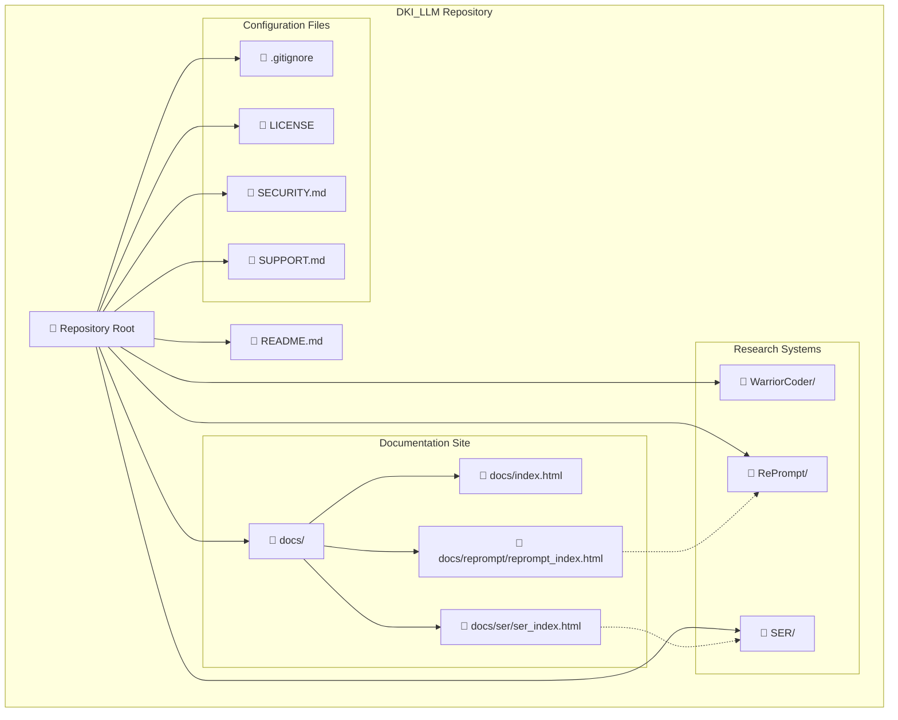
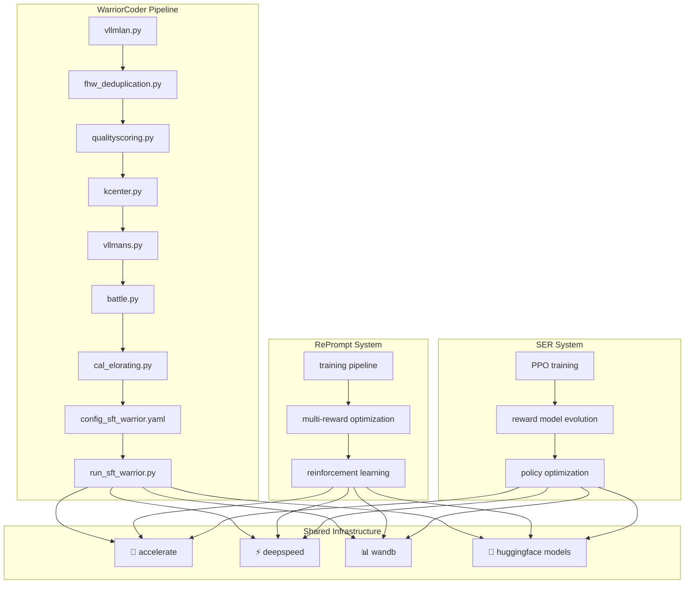
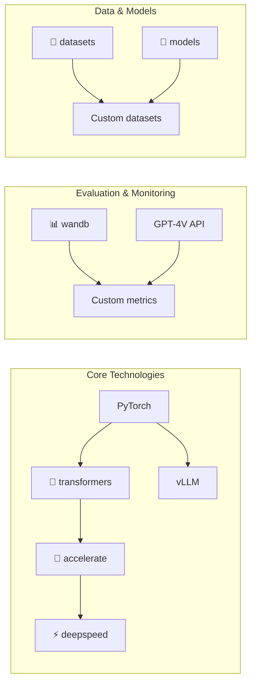
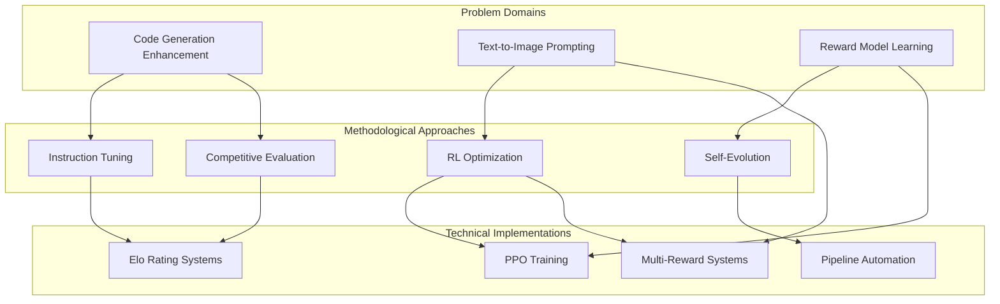

<!-- source: DeepWiki mcp.deepwiki.com · repo microsoft/DKI_LLM · page 1 Overview · fetched 2026-10-26 -->

# Overview

Relevant source files

The following files were used as context for generating this wiki page:

- [README.md](README.md)

## Purpose and Scope

This document provides a comprehensive overview of the Microsoft DKI LLM Paper Code Collection repository, which hosts three distinct research systems for large language model enhancement and optimization. The repository contains production-ready implementations of reinforcement learning pipelines, instruction tuning systems, and reward learning frameworks developed by Microsoft's Data Knowledge Intelligence (DKI) group.

This overview covers the high-level architecture, system relationships, and research domains. For detailed implementation guides, see the individual system pages: [WarriorCoder System](#2), [RePrompt System](#3), and [SER System](#4). For development setup and contribution guidelines, see [Contributing Guidelines](#5).

## Repository Architecture

The repository is organized into three primary research systems, each with dedicated documentation and implementation directories:

### Repository Structure Diagram

Sources: [README.md:1-42]()

### System Integration Overview

Sources: [README.md:12-21]()

## Research Systems Overview

The repository implements three complementary research directions in large language model enhancement:

### System Comparison Matrix

| System | Domain | Primary Method | Key Innovation | Training Framework |
|--------|---------|----------------|----------------|-------------------|
| **WarriorCoder** | Code Generation | Multi-stage Pipeline + Elo Rating | Challenging instruction synthesis | Supervised Fine-tuning |
| **RePrompt** | Text-to-Image | Reinforcement Learning | Reasoning-augmented prompting | Multi-reward RL |
| **SER** | Reward Learning | Self-evolution | Reduced human annotation dependency | PPO + Iterative RM |

### WarriorCoder System

WarriorCoder implements a comprehensive 7-stage pipeline for generating challenging coding instructions and training specialized coding language models. The system uses competitive evaluation through model battles and Elo rating systems to identify optimal training data.

**Core Components:**
- `vllmlan.py` - Instruction generation using vLLM
- `fhw_deduplication.py` - MinHash-based deduplication
- `qualityscoring.py` - LLM-based quality assessment
- `battle.py` - Pairwise model evaluation system
- `run_sft_warrior.py` - Supervised fine-tuning execution

### RePrompt System  

RePrompt focuses on improving text-to-image generation through reinforcement learning-based prompt optimization. The system integrates reasoning capabilities into prompt generation and uses multiple reward models for optimization.

**Core Features:**
- Reinforcement learning for prompt optimization
- Multi-reward system integration
- Support for multiple T2I backends (FLUX, SD3, PixArt)
- GPT-4V-based evaluation metrics

### SER System

SER (Self-Evolved Reward Learning) implements an iterative approach to reward model improvement that reduces dependency on human-annotated data for RLHF. The system uses self-evolution techniques to progressively improve reward models.

**Core Components:**
- PPO-based policy optimization
- Iterative reward model training
- Self-evolution mechanisms
- Reduced human annotation requirements

Sources: [README.md:14-21]()

## Technical Architecture

### Shared Technology Stack

All three systems leverage a common technology foundation:

### Research Domain Relationships

Sources: [README.md:6-21]()

## Getting Started

### System Selection Guide

Choose the appropriate system based on your research objectives:

- **WarriorCoder**: For improving code generation capabilities through challenging instruction synthesis and competitive evaluation
- **RePrompt**: For enhancing text-to-image generation through reinforcement learning-based prompt optimization  
- **SER**: For developing self-evolving reward models with reduced human annotation requirements

### Next Steps

1. **Environment Setup**: Each system has specific dependencies and setup requirements detailed in their respective sections
2. **System Deep-Dive**: Navigate to individual system pages for comprehensive implementation details:
   - [WarriorCoder System](#2) - Complete instruction generation and training pipeline
   - [RePrompt System](#3) - Text-to-image prompt optimization framework
   - [SER System](#4) - Self-evolved reward learning implementation
3. **Development**: See [Contributing Guidelines](#5) for development environment setup and contribution processes

### Repository Statistics

- **Primary Language**: Python
- **Framework Dependencies**: PyTorch, Hugging Face ecosystem, vLLM
- **Training Infrastructure**: Accelerate, DeepSpeed
- **Documentation**: GitHub Pages with comprehensive system guides
- **License**: MIT License

Sources: [README.md:1-42]()

---

