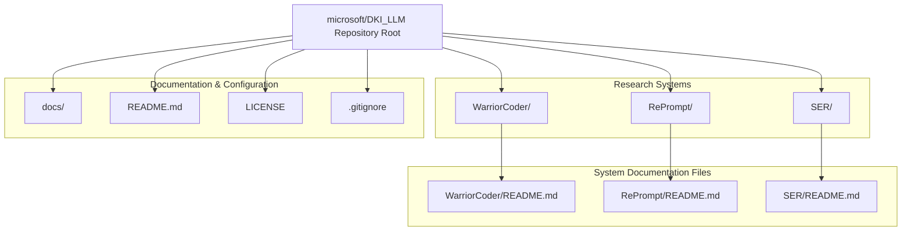
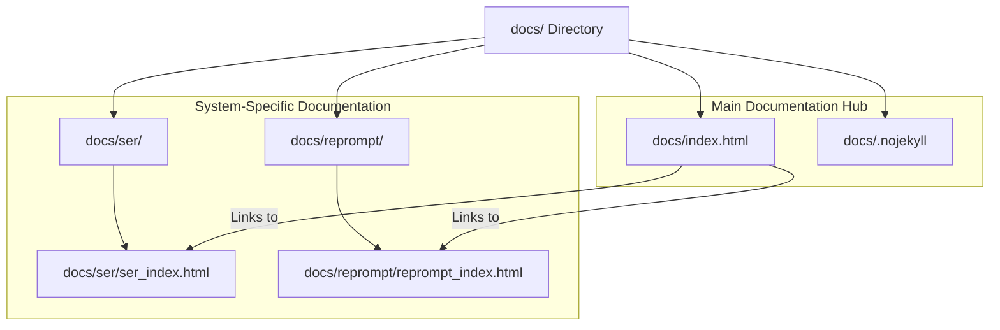
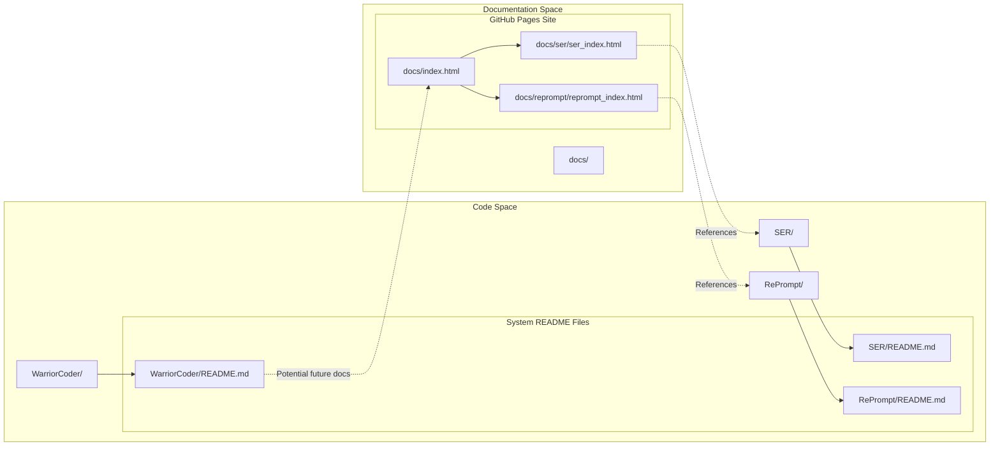

<!-- source: DeepWiki mcp.deepwiki.com · repo microsoft/DKI_LLM · page 1.1 Repository Structure · fetched 2026-10-26 -->

# Repository Structure

Relevant source files

The following files were used as context for generating this wiki page:

- [docs/.nojekyll](docs/.nojekyll)
- [docs/index.html](docs/index.html)

## Purpose and Scope

This document describes the organizational structure of the Microsoft DKI LLM Paper Code Collection repository, explaining how the three main research systems (WarriorCoder, RePrompt, and SER) are organized and how the documentation site relates to the codebase. For detailed information about each individual system's internal structure and components, see [WarriorCoder System](#2), [RePrompt System](#3), and [SER System](#4).

## Top-Level Repository Organization

The repository follows a multi-system architecture where each research paper's implementation is contained within its own top-level directory, accompanied by a centralized documentation site.

Sources: Based on repository structure analysis from high-level system diagrams

## Documentation Site Architecture

The repository uses GitHub Pages to host a centralized documentation site that provides navigation and detailed information for each research system.

Sources: [docs/index.html:1-135](), [docs/.nojekyll:1-2]()

### Main Documentation Index

The primary documentation entry point is located at [docs/index.html:102-106]() and serves as a "Paper Code Collection" hub. The page uses a card-based layout to provide navigation to individual system documentation:

| System | Documentation Link | Description |
|--------|-------------------|-------------|
| SER | `docs/ser/ser_index.html` | ICLR2025: Self-evolved reward learning for LLMs |
| RePrompt | `docs/reprompt/reprompt_index.html` | Arxiv: RePrompt: Reasoning-Augmented Reprompting for Text-to-Image Generation via Reinforcement Learning |

The main index implements a responsive design with hover effects and uses the Open Sans font family for consistent typography [docs/index.html:13-17](). The `.nojekyll` file [docs/.nojekyll:1-2]() ensures GitHub Pages processes the site without Jekyll transformation.

Sources: [docs/index.html:114-119](), [docs/index.html:13-17](), [docs/.nojekyll:1-2]()

## System Integration Patterns

Each research system follows a consistent organizational pattern that separates code implementation from documentation while maintaining clear relationships between them.

Sources: Based on repository structure analysis and [docs/index.html:114-119]()

## Directory Naming and Organization Conventions

The repository follows specific naming conventions that reflect the research publication timeline and system purposes:

### System Directory Structure

| Directory | Purpose | Associated Paper | Status |
|-----------|---------|------------------|--------|
| `WarriorCoder/` | Instruction generation and model training pipeline | Coding LLM enhancement research | Active development |
| `RePrompt/` | Text-to-image prompt optimization via RL | Arxiv paper implementation | Documented |
| `SER/` | Self-evolved reward learning system | ICLR2025 submission | Documented |

### Documentation Organization

The documentation follows a hierarchical structure where:
- `docs/index.html` serves as the main navigation hub
- Each system has its own subdirectory under `docs/` (e.g., `docs/ser/`, `docs/reprompt/`)
- System-specific documentation files use descriptive naming patterns (e.g., `ser_index.html`, `reprompt_index.html`)

The main index page [docs/index.html:104-106]() welcomes users with the message: "Welcome to DKI LLM GitHub Pages site where each link leads to an introduction of a paper and its related code."

Sources: [docs/index.html:104-106](), [docs/index.html:114-119]()

## Configuration and Meta Files

The repository includes standard configuration files that support both development and documentation hosting:

- `.gitignore` - Version control exclusions for development artifacts
- `LICENSE` - Repository licensing information  
- `README.md` - Main repository documentation
- `docs/.nojekyll` - Disables Jekyll processing for GitHub Pages [docs/.nojekyll:1-2]()

The `.nojekyll` file is particularly important as it allows the custom HTML documentation site to function properly without Jekyll's automatic processing interfering with the custom styling and structure.

Sources: [docs/.nojekyll:1-2]()

---

