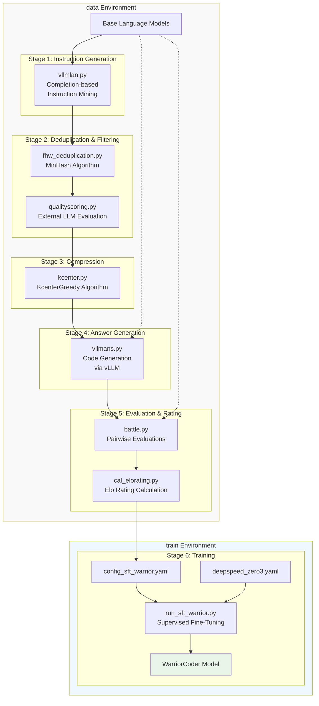
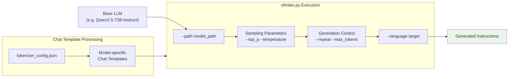
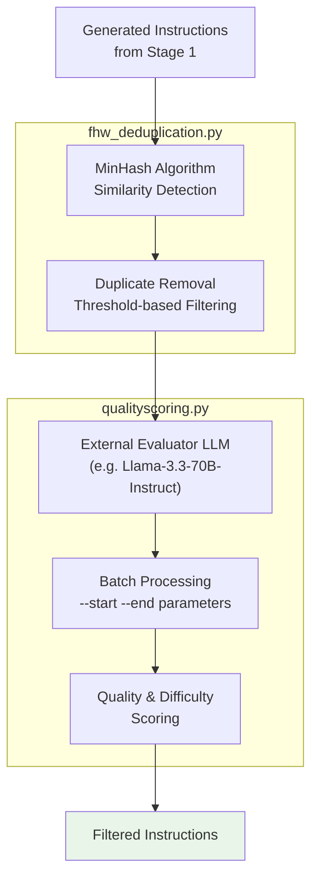
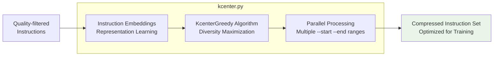
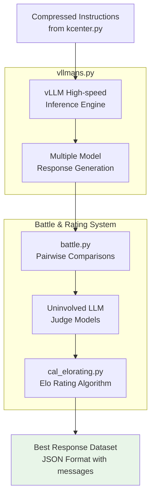
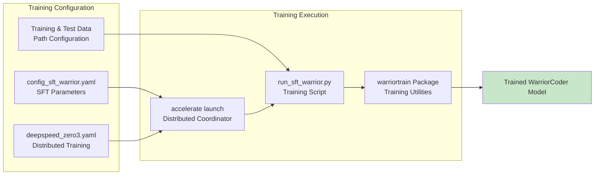

<!-- source: DeepWiki mcp.deepwiki.com · repo microsoft/DKI_LLM · page 2 WarriorCoder System · fetched 2026-10-26 -->

# WarriorCoder System

<details>
<summary>Relevant source files</summary>

The following files were used as context for generating this wiki page:

- [WarriorCoder/README.md](WarriorCoder/README.md)

</details>


The WarriorCoder System is a comprehensive instruction generation and training pipeline designed to create challenging coding instructions and train specialized code language models. The system implements a multi-stage data processing approach that generates instructions, filters them for quality and difficulty, evaluates model responses through competitive battles, and trains models using the highest-quality response data.

This document covers the complete WarriorCoder pipeline from instruction generation through model training. For information about other research systems in this repository, see [RePrompt System](#3) and [SER System](#4).

## System Architecture Overview

The WarriorCoder system operates as a sequential 6-stage pipeline with two distinct computational environments: a data processing environment for instruction generation and evaluation, and a training environment for model fine-tuning.

### Complete Pipeline Flow



Sources: [WarriorCoder/README.md:1-101]()

## Environment Configuration

WarriorCoder requires two separate conda environments optimized for different computational workloads:

### Data Processing Environment (`data`)

The `data` environment handles instruction generation, filtering, and evaluation tasks requiring high-performance inference:

| Component | Purpose | Key Dependencies |
|-----------|---------|------------------|
| vllm | High-speed LLM inference | Core inference engine |
| datasketch | MinHash deduplication | Similarity detection |
| scikit-learn | Embedding operations | K-center algorithm |

### Training Environment (`train`)

The `train` environment provides distributed training capabilities with advanced optimization:

| Component | Version | Purpose |
|-----------|---------|---------|
| PyTorch | 2.2.0 (CUDA 12.1) | Core ML framework |
| TRL | 0.12.0 | Transformer Reinforcement Learning |
| Flash Attention | 2.7.4.post1 | Memory-efficient attention |
| warriortrain | Custom package | Training scripts and utilities |

Sources: [WarriorCoder/README.md:9-26]()

## Data Processing Pipeline

### Stage 1: Instruction Generation with vllmlan.py

The instruction generation stage uses completion-based mining to extract capabilities from existing code LLMs. The `vllmlan.py` script implements high-throughput instruction generation using vLLM inference optimization.



**Key Parameters:**
- `--path`: Hugging Face model identifier or local path
- `--top_p`: Nucleus sampling parameter (e.g., 0.99)
- `--temperature`: Sampling temperature (e.g., 1.2)
- `--repeat`: Number of instruction generations
- `--max_tokens`: Maximum context length (e.g., 2048)
- `--language`: Target programming language

Sources: [WarriorCoder/README.md:29-41]()

### Stage 2: Deduplication and Quality Assessment

#### MinHash Deduplication with fhw_deduplication.py

The deduplication stage implements MinHash algorithm to identify and remove near-duplicate instructions from the generated dataset.

#### Quality Scoring with qualityscoring.py

External LLM evaluation assesses instruction quality and difficulty through structured evaluation prompts.



Sources: [WarriorCoder/README.md:42-56]()

### Stage 3: Embedding-based Compression with kcenter.py

The compression stage uses the KcenterGreedy algorithm to reduce dataset size while preserving instruction diversity through embedding space analysis.



Sources: [WarriorCoder/README.md:57-66]()

## Model Evaluation and Training System

### Stage 4: Answer Generation with vllmans.py

Code generation uses vLLM-accelerated inference to generate multiple candidate answers for each instruction in the compressed dataset.

### Stage 5: Battle System and Elo Rating

#### Pairwise Evaluation with battle.py

The battle system conducts pairwise comparisons between model responses using uninvolved LLM evaluators to determine response quality rankings.

#### Elo Rating Calculation with cal_elorating.py

Elo rating system quantifies model performance and identifies the highest-quality responses for training data.



Sources: [WarriorCoder/README.md:67-88]()

### Stage 6: Training Configuration and Execution

#### Training Data Format

The final training dataset uses a structured JSON format optimized for chat-based fine-tuning:

```json
{
  "messages": [
    {
      "content": "instructions_in_natural_language", 
      "role": "user"
    }, 
    {
      "content": "best_response", 
      "role": "assistant"
    }
  ]
}
```

#### Configuration Files

| File | Purpose | Key Components |
|------|---------|----------------|
| `config_sft_warrior.yaml` | SFT training parameters | Learning rate, batch size, model config |
| `deepspeed_zero3.yaml` | Distributed training | ZeRO-3 optimization, memory management |

#### Training Execution with run_sft_warrior.py

The supervised fine-tuning process uses Accelerate and DeepSpeed for distributed training:

```bash
accelerate launch --config_file recipes/accelerate_configs/deepspeed_zero3.yaml scripts/run_sft_warrior.py recipes/config_sft_warrior.yaml
```



Sources: [WarriorCoder/README.md:84-101]()

## Implementation Notes

### Chat Template Compatibility

The system requires model-specific chat template configuration based on `tokenizer_config.json` files. Different base models implement varying conversation formats that must be properly configured for instruction generation.

### Parallel Processing Optimization

Both `kcenter.py` and `qualityscoring.py` support batch processing with `--start` and `--end` parameters, enabling parallel execution across multiple processes or machines for large-scale datasets.

### Memory and Performance Considerations

- **vLLM Integration**: High-throughput inference for both instruction generation (`vllmlan.py`) and answer generation (`vllmans.py`)
- **Flash Attention**: Memory-efficient attention mechanism for training large models
- **DeepSpeed ZeRO-3**: Advanced memory optimization for distributed training

Sources: [WarriorCoder/README.md:40-41](), [WarriorCoder/README.md:65](), [WarriorCoder/README.md:19-25]()

---

