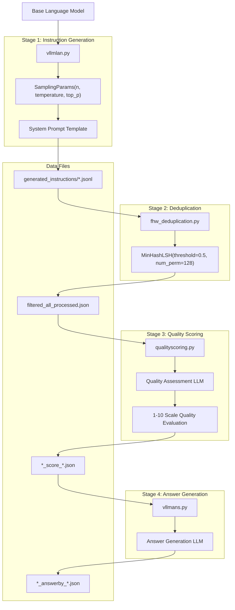
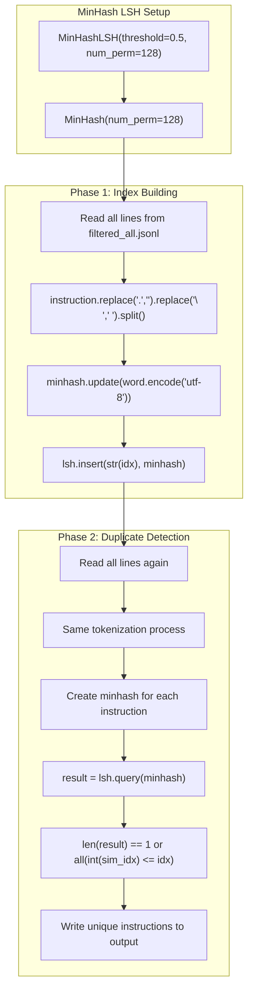

<!-- source: DeepWiki mcp.deepwiki.com · repo microsoft/DKI_LLM · page 2.1 Data Generation Pipeline · fetched 2026-10-26 -->

# Data Generation Pipeline

<details>
<summary>Relevant source files</summary>

The following files were used as context for generating this wiki page:

- [WarriorCoder/fhw_deduplication.py](WarriorCoder/fhw_deduplication.py)
- [WarriorCoder/qualityscoring.py](WarriorCoder/qualityscoring.py)
- [WarriorCoder/vllmans.py](WarriorCoder/vllmans.py)
- [WarriorCoder/vllmlan.py](WarriorCoder/vllmlan.py)

</details>


## Purpose and Scope

The Data Generation Pipeline is the first stage of the WarriorCoder system responsible for creating, filtering, and scoring high-quality coding instructions. This pipeline transforms base language models into instruction generators and processes the output through multiple quality control stages before generating corresponding answers.

This document covers instruction generation, deduplication, quality assessment, and answer generation stages. For information about the subsequent model evaluation and training phases, see [Model Evaluation System](#2.2) and [Training Configuration](#2.3).

## Pipeline Overview

The data generation pipeline consists of four main stages that process coding instructions from generation to final dataset preparation:

### Data Generation Pipeline Flow



Sources: [WarriorCoder/vllmlan.py:1-42](), [WarriorCoder/fhw_deduplication.py:1-38](), [WarriorCoder/qualityscoring.py:1-43](), [WarriorCoder/vllmans.py:1-45]()

## Instruction Generation Stage

The instruction generation stage uses `vllmlan.py` to create diverse coding instructions using vLLM for high-throughput inference. The process is highly configurable and supports multiple programming languages.

### vllmlan.py Configuration

| Parameter | Purpose | Default | Code Reference |
|-----------|---------|---------|----------------|
| `--path` | Model path for instruction generation | Required | [WarriorCoder/vllmlan.py:7]() |
| `--n` | Number of samples per generation batch | 200 | [WarriorCoder/vllmlan.py:8]() |
| `--top_p` | Nucleus sampling parameter | 1.0 | [WarriorCoder/vllmlan.py:9]() |
| `--temperature` | Sampling temperature | 1.0 | [WarriorCoder/vllmlan.py:10]() |
| `--repeat` | Number of generation iterations | None | [WarriorCoder/vllmlan.py:11]() |
| `--max_tokens` | Maximum tokens per instruction | 2048 | [WarriorCoder/vllmlan.py:12]() |
| `--language` | Target programming language | Required | [WarriorCoder/vllmlan.py:13]() |

### Instruction Generation Architecture

```mermaid
flowchart LR
    subgraph "vllmlan.py Components"
        ARGS["ArgumentParser"] 
        TOKENIZER["AutoTokenizer.from_pretrained()"]
        LLM_ENGINE["LLM(tensor_parallel_size=8)"]
        SAMPLING["SamplingParams()"]
        TEMPLATE["System Prompt Template"]
    end
    
    subgraph "Generation Process"
        SYSMSG["system message: AI assistant for {language} coding"]
        USERMSG["user message: empty (prompt completion)"]
        STOPS["stop_tokens: ['<|eot_id|>', '<|end_of_text|>']"]
        GENERATE["llm.generate(prompts, sampling_params)"]
    end
    
    subgraph "Output Processing"
        EXTRACT["output.outputs[0].text"]
        JSONL["{'instruction': text} -> .jsonl"]
        FILENAME["generated_instructions/{name}_t_{temp}_p_{top_p}_{lang}_output.jsonl"]
    end
    
    ARGS --> TOKENIZER
    TOKENIZER --> LLM_ENGINE
    LLM_ENGINE --> SAMPLING
    SAMPLING --> TEMPLATE
    
    TEMPLATE --> SYSMSG
    SYSMSG --> USERMSG
    USERMSG --> STOPS
    STOPS --> GENERATE
    
    GENERATE --> EXTRACT
    EXTRACT --> JSONL
    JSONL --> FILENAME
```



The system prompt template is dynamically constructed based on the target language: [WarriorCoder/vllmlan.py:33]()

```
<|begin_of_text|><|start_header_id|>system<|end_header_id|>

You are an AI assistant designed to provide helpful, step-by-step guidance on {language} coding problems. The user will ask you a wide range of {language} coding questions.
Your purpose is to assist users in understanding {language} coding concepts, working through {language} code, and arriving at the correct {language} solutions.<|eot_id|><|start_header_id|>user<|end_header_id|>
```

Sources: [WarriorCoder/vllmlan.py:1-42]()

## Deduplication Process

The deduplication stage implements MinHash LSH (Locality Sensitive Hashing) via `fhw_deduplication.py` to remove near-duplicate instructions while preserving instruction diversity.

### MinHash LSH Configuration

The deduplication process uses the `datasketch` library with specific parameters optimized for instruction similarity detection:

- **Threshold**: 0.5 (instructions with >50% similarity are considered duplicates)
- **Permutations**: 128 (number of hash functions for MinHash signature)
- **Input**: `filtered_all.jsonl` 
- **Output**: `filtered_all_processed.json`

### Deduplication Algorithm Flow



The deduplication logic ensures that only the first occurrence of similar instructions is retained: [WarriorCoder/fhw_deduplication.py:28]()

```python
if len(result) == 1 or all(int(sim_idx)<= idx for sim_idx in result):
```

Sources: [WarriorCoder/fhw_deduplication.py:1-38]()

## Quality Scoring Stage

The quality scoring stage uses `qualityscoring.py` to evaluate instruction quality using a separate LLM with structured assessment criteria. This stage processes instructions in configurable batches for distributed processing.

### Quality Assessment Parameters

| Component | Implementation | Code Reference |
|-----------|---------------|----------------|
| **Scoring Model** | `LLM(tensor_parallel_size=8, max_model_len=8192)` | [WarriorCoder/qualityscoring.py:22]() |
| **Batch Processing** | `--start` and `--end` arguments for slice processing | [WarriorCoder/qualityscoring.py:9-10]() |
| **Input Path** | `/blob/huawen/traindata/filtered_all_processed_instructions.json` | [WarriorCoder/qualityscoring.py:15]() |
| **Output Pattern** | `filtered_all_processed_instructions_score_{model_name}.json` | [WarriorCoder/qualityscoring.py:16]() |

### Quality Evaluation Criteria

The system prompt defines a comprehensive quality assessment framework: [WarriorCoder/qualityscoring.py:25]()

```
We are interested in understanding the quality of the following user query. Your task is to assess each prompt based on its clarity, specificity, coherence and difficulty.
```

### Quality Scoring Scale

| Score Range | Classification | Criteria |
|-------------|----------------|----------|
| **9-10** | Excellent | Very clear, specific, well-articulated, particularly challenging |
| **5-8** | Good | Clear and specific instructions, moderately assess AI capabilities |  
| **3-4** | Average | Fairly clear and specific, easy to answer |
| **1-2** | Poor | Ambiguous or include final response within instruction |

### Quality Assessment Workflow

```mermaid
flowchart TD
    subgraph "qualityscoring.py Process"
        INPUT_FILE["filtered_all_processed_instructions.json"]
        SLICE["lines[start:end] batch processing"]
        
        subgraph "Per Instruction Processing"
            PARSE["json.loads(line)"] 
            EXTRACT_INST["d['instruction']"]
            BUILD_PROMPT["system + user_prompt with assessment criteria"]
            CHAT_TEMPLATE["tokenizer.apply_chat_template()"]
            LLM_GENERATE["llm.generate(prompts=[text])"]
            EXTRACT_JUDGMENT["outputs[0].outputs[0].text"]
            ADD_FIELD["d['quality_judgement'] = judgment"]
            WRITE_JSON["json.dumps(d) to output file"]
        end
        
        OUTPUT_FILE["*_score_{model_name}.json"]
    end
    
    INPUT_FILE --> SLICE
    SLICE --> PARSE
    PARSE --> EXTRACT_INST
    EXTRACT_INST --> BUILD_PROMPT
    BUILD_PROMPT --> CHAT_TEMPLATE
    CHAT_TEMPLATE --> LLM_GENERATE
    LLM_GENERATE --> EXTRACT_JUDGMENT
    EXTRACT_JUDGMENT --> ADD_FIELD
    ADD_FIELD --> WRITE_JSON
    WRITE_JSON --> OUTPUT_FILE
```



The user prompt template requests structured output with double square bracket notation for scores: [WarriorCoder/qualityscoring.py:30]()

```
[Output Format]
Use double square brackets to format your scores, like so: [[5]].
```

Sources: [WarriorCoder/qualityscoring.py:1-43]()

## Answer Generation Stage

The answer generation stage uses `vllmans.py` to create responses for filtered and scored instructions, completing the instruction-response pairs needed for supervised fine-tuning.

### Answer Generation Configuration

```mermaid
flowchart LR
    subgraph "vllmans.py Components"
        ARGS_PARSE["--path (model), --datapath (input data)"]
        NAME_EXTRACT["Extract model and data names from paths"]
        TOKENIZER_INIT["AutoTokenizer.from_pretrained()"]
        LLM_INIT["LLM(tensor_parallel_size=8, max_model_len=8192)"]
        SAMPLING_PARAMS["SamplingParams(temperature=1.0, top_p=0.95)"]
    end
    
    subgraph "System Prompt"
        SYS_TEMPLATE["Python coding assistant system prompt"]
        HARDCODED["Currently hardcoded to Python language"]
    end
    
    subgraph "Batch Processing"
        READ_INPUT["Read all lines from input datapath"]
        BUILD_PROMPTS["Create chat templates for all instructions"] 
        BATCH_GENERATE["llm.generate(prompts=all_prompts)"]
        PAIR_RESPONSES["Zip lines with generated outputs"]
        WRITE_OUTPUT["Write instruction-response pairs"]
    end
    
    ARGS_PARSE --> NAME_EXTRACT
    NAME_EXTRACT --> TOKENIZER_INIT
    TOKENIZER_INIT --> LLM_INIT
    LLM_INIT --> SAMPLING_PARAMS
    SAMPLING_PARAMS --> SYS_TEMPLATE
    
    SYS_TEMPLATE --> HARDCODED
    HARDCODED --> READ_INPUT
    READ_INPUT --> BUILD_PROMPTS
    BUILD_PROMPTS --> BATCH_GENERATE
    BATCH_GENERATE --> PAIR_RESPONSES
    PAIR_RESPONSES --> WRITE_OUTPUT
```



### Answer Generation Process

The system processes all instructions in a single batch for efficiency: [WarriorCoder/vllmans.py:31-39]()

1. **Prompt Construction**: Each instruction is wrapped in a chat template with the system prompt
2. **Batch Generation**: All prompts are processed simultaneously via `llm.generate()`
3. **Response Pairing**: Generated responses are paired with their corresponding instructions
4. **Output Format**: Results are saved with the `response` field added to each instruction record

The output filename follows the pattern: [WarriorCoder/vllmans.py:29]()
```
/cosmos/fhw/zsw/filterans_answerby/{dataname}_answerby_{modelname}.json
```

### Data Format Transformation

| Stage | Input Format | Output Format | Key Fields |
|-------|--------------|---------------|------------|
| **Instruction Generation** | N/A | `{"instruction": "text"}` | `instruction` |
| **Deduplication** | Same | Same | `instruction` |
| **Quality Scoring** | Same | `{"instruction": "text", "quality_judgement": "assessment"}` | `instruction`, `quality_judgement` |
| **Answer Generation** | `{"prompt": "text"}` | `{"prompt": "text", "response": "answer"}` | `prompt`, `response` |

Sources: [WarriorCoder/vllmans.py:1-45]()

## Pipeline Integration

The complete data generation pipeline transforms base language models into instruction-response datasets through systematic quality control and processing stages. Each component is designed for distributed processing and handles large-scale data generation efficiently using vLLM's optimized inference capabilities.

The pipeline outputs structured datasets ready for the subsequent evaluation and training phases covered in [Model Evaluation System](#2.2) and [Training Configuration](#2.3).

Sources: [WarriorCoder/vllmlan.py:1-42](), [WarriorCoder/fhw_deduplication.py:1-38](), [WarriorCoder/qualityscoring.py:1-43](), [WarriorCoder/vllmans.py:1-45]()

---

