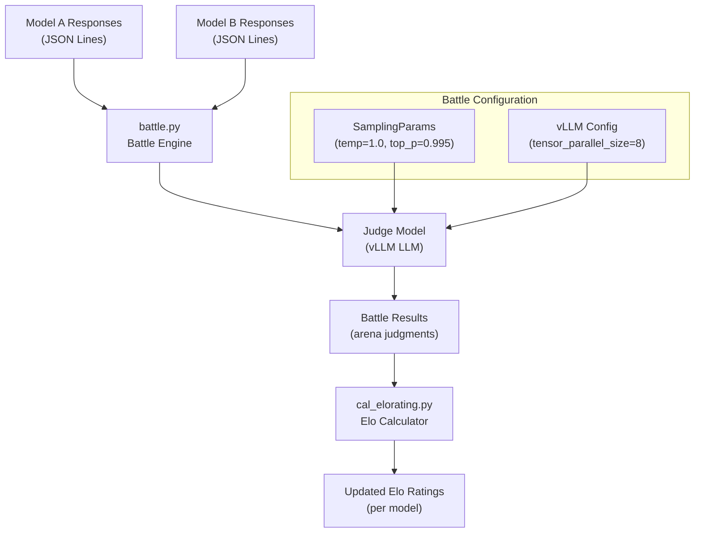
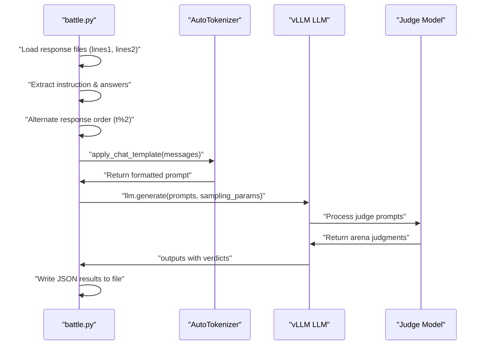
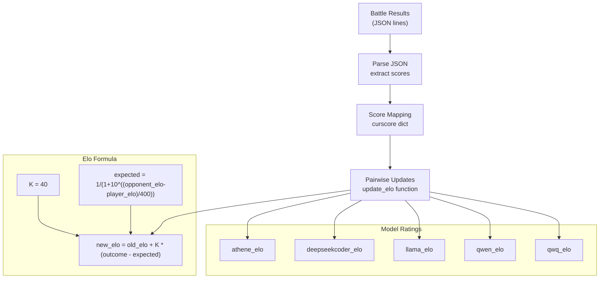

<!-- source: DeepWiki mcp.deepwiki.com · repo microsoft/DKI_LLM · page 2.2 Model Evaluation System · fetched 2026-10-26 -->

# Model Evaluation System

<details>
<summary>Relevant source files</summary>

The following files were used as context for generating this wiki page:

- [WarriorCoder/battle.py](WarriorCoder/battle.py)
- [WarriorCoder/cal_elorating.py](WarriorCoder/cal_elorating.py)

</details>


The Model Evaluation System is a core component of the WarriorCoder pipeline that conducts automated pairwise battles between different language models to determine their relative performance on coding tasks. This system implements a tournament-style evaluation using judge models and Elo rating calculations to rank model capabilities objectively.

This document covers the battle execution framework and Elo rating computation. For information about the data generation that feeds into this evaluation system, see [Data Generation Pipeline](#2.1). For training configuration that uses these evaluation results, see [Training Configuration](#2.3).

## System Architecture

The Model Evaluation System consists of two primary components: the battle execution engine and the Elo rating calculator. The system processes model responses through automated judging and maintains dynamic rankings.

### Battle System Pipeline



Sources: [WarriorCoder/battle.py:1-56](), [WarriorCoder/cal_elorating.py:1-49]()

## Battle Execution System

The `battle.py` script orchestrates pairwise model comparisons using a judge model to evaluate response quality. The system processes instruction-response pairs and generates comparative judgments.

### Battle Process Flow



Sources: [WarriorCoder/battle.py:20-56]()

### Judge Prompt Structure

The battle system uses structured prompts to ensure consistent evaluation criteria. The judge model receives detailed instructions emphasizing objectivity and specific evaluation factors.

| Component | Purpose | Implementation |
|-----------|---------|----------------|
| Position Alternation | Avoid order bias | `t%2 == 0` alternates response positions |
| Evaluation Criteria | Standardized judging | Helpfulness, relevance, accuracy |
| Length Preference | Quality over quantity | "choose the SHORTER answer" for ties |
| Output Format | Structured verdicts | `[[A]]`, `[[B]]`, or `[[Tie]]` |

The system generates prompts with this structure at [WarriorCoder/battle.py:36-38](), alternating the order of Assistant A and B responses to eliminate position bias.

Sources: [WarriorCoder/battle.py:35-44]()

## Elo Rating System

The `cal_elorating.py` module implements a traditional Elo rating system adapted for multi-model tournaments. Each model maintains a dynamic rating that updates based on battle outcomes.

### Elo Calculation Process



Sources: [WarriorCoder/cal_elorating.py:14-26](), [WarriorCoder/cal_elorating.py:28-43]()

### Elo Update Function

The `update_elo` function implements the standard Elo rating algorithm with a K-factor of 40, processing win/loss/tie outcomes between model pairs:

```python
def update_elo(A_elo, B_elo, A_score, B_score):
    # Win: A_score > B_score
    # Tie: A_score == B_score  
    # Loss: A_score < B_score
```

The function handles three outcome scenarios at [WarriorCoder/cal_elorating.py:14-26](), calculating expected performance using the standard Elo formula and updating both models' ratings accordingly.

Sources: [WarriorCoder/cal_elorating.py:14-26]()

## Model Comparison Matrix

The system evaluates all pairwise combinations of the supported models. The current implementation tracks five models with comprehensive cross-comparisons:

### Supported Models and Battle Matrix

| Model A | Model B | Update Line |
|---------|---------|-------------|
| athene | deepseekcoder | Line 34 |
| athene | llama | Line 35 |
| athene | qwen | Line 36 |
| athene | qwq | Line 37 |
| deepseekcoder | llama | Line 38 |
| deepseekcoder | qwen | Line 39 |
| deepseekcoder | qwq | Line 40 |
| llama | qwen | Line 41 |
| llama | qwq | Line 42 |
| qwen | qwq | Line 43 |

The system processes each battle result and updates all relevant model pair ratings within a single iteration, ensuring consistent and comprehensive ranking updates.

Sources: [WarriorCoder/cal_elorating.py:34-43]()

## Technical Configuration

### vLLM Parameters

The battle system uses specific vLLM configurations optimized for judge model inference:

| Parameter | Value | Purpose |
|-----------|-------|---------|
| `tensor_parallel_size` | 8 | Distributed inference |
| `dtype` | "float16" | Memory efficiency |
| `max_model_len` | 8192 | Context window |
| `enforce_eager` | True | Execution mode |

### Sampling Parameters

Judge model generation uses controlled sampling for consistent evaluation:

| Parameter | Value | Purpose |
|-----------|-------|---------|
| `temperature` | 1.0 | Moderate randomness |
| `top_p` | 0.995 | Nucleus sampling |
| `max_tokens` | 8192 | Response length limit |

Sources: [WarriorCoder/battle.py:48-49]()

## Output Format

The evaluation system produces structured JSON outputs for downstream processing. Battle results contain arena judgments with metadata, while Elo ratings are displayed as final numerical scores.

### Battle Results Schema

Each battle output includes:
- `arena`: Judge model's complete evaluation and verdict
- `t`: Battle index for tracking and debugging

### Elo Rating Output

The final Elo ratings are printed in model order:
1. athene_elo
2. deepseekcoder_elo  
3. llama_elo
4. qwen_elo
5. qwq_elo

Sources: [WarriorCoder/battle.py:52-55](), [WarriorCoder/cal_elorating.py:44-48]()

---

