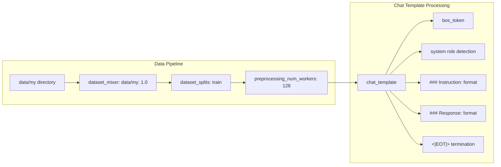
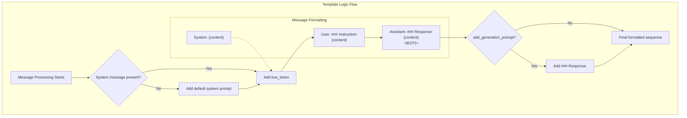

<!-- source: DeepWiki mcp.deepwiki.com · repo microsoft/DKI_LLM · page 2.3 Training Configuration · fetched 2026-10-26 -->

# Training Configuration

Relevant source files

The following files were used as context for generating this wiki page:

- [WarriorCoder/warriortrain/recipes/config_sft_warrior.yaml](WarriorCoder/warriortrain/recipes/config_sft_warrior.yaml)

This document covers the supervised fine-tuning (SFT) configuration system used in the WarriorCoder pipeline for training coding-specialized language models. The configuration defines model parameters, data processing settings, training hyperparameters, and the chat template system that formats instruction-response pairs during training.

For information about the data generation and filtering stages that produce the training data, see [Data Generation Pipeline](#2.1). For details on executing the training process, see [Training Execution](#2.4).

## Configuration File Structure

The WarriorCoder training configuration is centralized in a single YAML file that defines all aspects of the SFT process. The configuration is organized into three main sections that control different aspects of the training pipeline.

```mermaid
flowchart TD
    CONFIG["config_sft_warrior.yaml"]
    
    subgraph "Model Arguments"
        MODEL_PATH["model_name_or_path"]
        TORCH_DTYPE["torch_dtype"]
        ATTN_IMPL["attn_implementation"]
    end
    
    subgraph "Data Training Arguments" 
        CHAT_TEMPLATE["chat_template"]
        DATASET_MIXER["dataset_mixer"]
        DATASET_SPLITS["dataset_splits"]
        PREPROCESSING["preprocessing_num_workers"]
    end
    
    subgraph "SFT Trainer Config"
        PRECISION["bf16"]
        EVAL_CONFIG["do_eval, eval_strategy"]
        GRADIENT_CONFIG["gradient_accumulation_steps"]
        LEARNING_CONFIG["learning_rate, lr_scheduler_type"]
        BATCH_CONFIG["per_device_train_batch_size"]
        SAVE_CONFIG["save_strategy, save_steps"]
    end
    
    CONFIG --> MODEL_PATH
    CONFIG --> TORCH_DTYPE
    CONFIG --> ATTN_IMPL
    CONFIG --> CHAT_TEMPLATE
    CONFIG --> DATASET_MIXER
    CONFIG --> DATASET_SPLITS
    CONFIG --> PREPROCESSING
    CONFIG --> PRECISION
    CONFIG --> EVAL_CONFIG
    CONFIG --> GRADIENT_CONFIG
    CONFIG --> LEARNING_CONFIG
    CONFIG --> BATCH_CONFIG
    CONFIG --> SAVE_CONFIG
```

Sources: [WarriorCoder/warriortrain/recipes/config_sft_warrior.yaml:1-43]()

## Model Arguments

The model configuration section specifies the base model and hardware optimizations used for training. These parameters directly control the underlying transformer architecture and computational efficiency.

| Parameter | Value | Purpose |
|-----------|-------|---------|
| `model_name_or_path` | `model_weights/deepseek-coder-6.7b-base` | Base model path for initialization |
| `model_revision` | `main` | Git revision/branch to use |
| `torch_dtype` | `bfloat16` | Mixed precision training format |
| `attn_implementation` | `flash_attention_2` | Attention mechanism optimization |

The configuration targets the DeepSeek Coder 6.7B base model and enables FlashAttention-2 for memory-efficient attention computation during training. The bfloat16 precision reduces memory usage while maintaining numerical stability.

Sources: [WarriorCoder/warriortrain/recipes/config_sft_warrior.yaml:1-5]()

## Data Training Configuration

The data training section controls how the instruction-response datasets are processed and formatted for supervised fine-tuning. This includes the chat template system and dataset mixing ratios.

The `dataset_mixer` configuration assigns full weight (1.0) to the `data/my` directory, indicating this contains the processed instruction dataset from the earlier pipeline stages. The system uses 128 worker processes for parallel data preprocessing to accelerate the data loading phase.

Sources: [WarriorCoder/warriortrain/recipes/config_sft_warrior.yaml:9-13]()

## SFT Training Parameters

The supervised fine-tuning configuration defines the core training hyperparameters that control the optimization process, evaluation strategy, and model checkpointing behavior.

### Training Hyperparameters

| Parameter | Value | Description |
|-----------|-------|-------------|
| `learning_rate` | `1.0e-05` | AdamW optimizer learning rate |
| `num_train_epochs` | `3` | Total training epochs |
| `lr_scheduler_type` | `cosine` | Cosine annealing schedule |
| `warmup_ratio` | `0.2` | Learning rate warmup proportion |

### Batch and Memory Configuration

| Parameter | Value | Description |
|-----------|-------|-------------|
| `per_device_train_batch_size` | `8` | Training batch size per GPU |
| `per_device_eval_batch_size` | `8` | Evaluation batch size per GPU |
| `gradient_accumulation_steps` | `16` | Steps to accumulate gradients |
| `max_seq_length` | `2048` | Maximum sequence length |
| `gradient_checkpointing` | `true` | Enable memory-efficient backprop |

The effective batch size is `per_device_train_batch_size × gradient_accumulation_steps × num_gpus`, allowing for large effective batch sizes while fitting within GPU memory constraints.

### Evaluation and Checkpointing

| Parameter | Value | Description |
|-----------|-------|-------------|
| `do_eval` | `true` | Enable evaluation during training |
| `eval_strategy` | `epoch` | Evaluate at end of each epoch |
| `save_strategy` | `steps` | Save checkpoints by step count |
| `save_steps` | `56` | Checkpoint frequency |
| `save_total_limit` | `30` | Maximum checkpoints to retain |

Sources: [WarriorCoder/warriortrain/recipes/config_sft_warrior.yaml:15-42]()

## Chat Template System

The chat template defines the exact format used to convert instruction-response pairs into training sequences. The template handles system prompts, user instructions, and assistant responses with specific formatting tokens.

### Template Components

The chat template implements a structured conversation format with these key elements:

- **System Role Detection**: Checks for existing system messages and adds a default DeepSeek Coder system prompt if none exists
- **Instruction Formatting**: User messages are formatted with `### Instruction:\n` prefix
- **Response Formatting**: Assistant messages use `### Response:\n` prefix and terminate with `<|EOT|>\n`
- **Generation Prompt**: Optionally adds `### Response:` for inference-time completion

The default system prompt establishes the model's identity as "an AI programming assistant, utilizing the Deepseek Coder model" and restricts responses to computer science topics.

Sources: [WarriorCoder/warriortrain/recipes/config_sft_warrior.yaml:8]()

---

