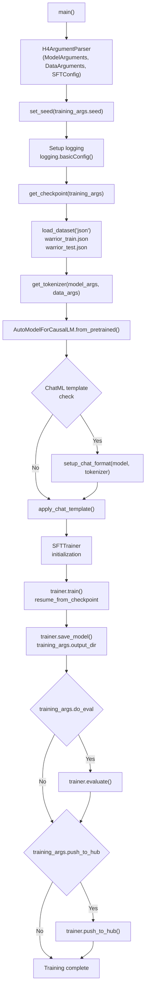
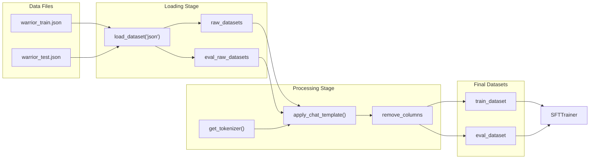
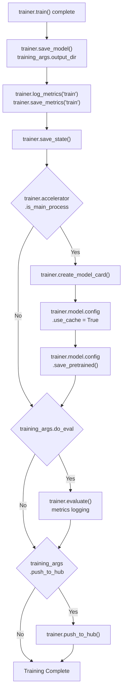

<!-- source: DeepWiki mcp.deepwiki.com · repo microsoft/DKI_LLM · page 2.4 Training Execution · fetched 2026-10-26 -->

# Training Execution

<details>
<summary>Relevant source files</summary>

The following files were used as context for generating this wiki page:

- [WarriorCoder/warriortrain/scripts/run_sft_warrior.py](WarriorCoder/warriortrain/scripts/run_sft_warrior.py)

</details>


This document covers the supervised fine-tuning execution process for the WarriorCoder system, including the main training script, data pipeline, and model output procedures. For information about training configuration parameters and chat templates, see [Training Configuration](#2.3). For details about the data generation and preprocessing stages, see [Data Generation Pipeline](#2.1).

## Training Script Overview

The WarriorCoder training execution is handled by the `run_sft_warrior.py` script, which implements a supervised fine-tuning pipeline using the HuggingFace Alignment Handbook framework and TRL (Transformer Reinforcement Learning) library.

The script follows a standard structure for modern LLM fine-tuning:

| Component | Purpose | Key Classes/Functions |
|-----------|---------|----------------------|
| Argument parsing | Configuration management | `H4ArgumentParser`, `ModelArguments`, `DataArguments`, `SFTConfig` |
| Data loading | Training/evaluation data | `load_dataset`, `apply_chat_template` |
| Model setup | Base model initialization | `AutoModelForCausalLM`, `get_tokenizer`, `setup_chat_format` |
| Training execution | Fine-tuning process | `SFTTrainer` |
| Output handling | Model saving and evaluation | `trainer.save_model`, `trainer.evaluate` |

Sources: [WarriorCoder/warriortrain/scripts/run_sft_warrior.py:1-228]()

## Training Execution Flow



Sources: [WarriorCoder/warriortrain/scripts/run_sft_warrior.py:49-227]()

## Data Pipeline Execution

The training execution uses a specific data loading and preprocessing pipeline that prepares the WarriorCoder datasets for supervised fine-tuning:



The `apply_chat_template` function processes the raw conversation data with specific parameters:

- `task`: "sft" (supervised fine-tuning)
- `auto_insert_empty_system_msg`: False
- `preprocessing_num_workers`: Configurable parallelization
- Column names are removed after template application

Sources: [WarriorCoder/warriortrain/scripts/run_sft_warrior.py:88-154]()

## SFTTrainer Configuration and Execution

The core training execution is managed by the `SFTTrainer` class with the following configuration:

| Parameter | Value/Source | Purpose |
|-----------|--------------|---------|
| `model` | `model` or `model_args.model_name_or_path` | Base model for fine-tuning |
| `model_init_kwargs` | `model_kwargs` dict | Model initialization parameters |
| `args` | `training_args` (SFTConfig) | Training hyperparameters |
| `train_dataset` | `train_dataset` | Processed training data |
| `eval_dataset` | `eval_dataset` | Processed evaluation data |
| `dataset_text_field` | "text" | Field containing conversation text |
| `max_seq_length` | `training_args.max_seq_length` | Maximum sequence length |
| `tokenizer` | `tokenizer` | Tokenizer instance |
| `packing` | True | Enable sequence packing for efficiency |
| `peft_config` | `get_peft_config(model_args)` | Parameter-efficient fine-tuning config |

The training loop handles checkpoint resumption automatically:

```python
checkpoint = None
if training_args.resume_from_checkpoint is not None:
    checkpoint = training_args.resume_from_checkpoint
elif last_checkpoint is not None:
    checkpoint = last_checkpoint
train_result = trainer.train(resume_from_checkpoint=checkpoint)
```

Sources: [WarriorCoder/warriortrain/scripts/run_sft_warrior.py:159-187]()

## Model Output and Persistence

The training execution includes comprehensive model saving and optional evaluation:



The model card creation includes metadata:
- `finetuned_from`: Original base model path
- `dataset`: Dataset mixer keys
- `dataset_tags`: Same as dataset keys
- `tags`: ["alignment-handbook"]

Sources: [WarriorCoder/warriortrain/scripts/run_sft_warrior.py:188-223]()

## Special Handling for ChatML Format

The training execution includes special handling for ChatML (Chat Markup Language) format models:

```python
if "<|im_start|>" in tokenizer.chat_template and "gemma-tokenizer-chatml" not in tokenizer.name_or_path:
    model = AutoModelForCausalLM.from_pretrained(model_args.model_name_or_path, **model_kwargs)
    model, tokenizer = setup_chat_format(model, tokenizer)
    model_kwargs = None
```

This conditional setup ensures proper token handling for models that use ChatML formatting, while avoiding conflicts with Gemma tokenizers that already have ChatML support.

Sources: [WarriorCoder/warriortrain/scripts/run_sft_warrior.py:121-124]()

## Execution Command Structure

The script is designed to be executed as a standalone Python script with configuration provided through command-line arguments parsed by `H4ArgumentParser`. The execution flow ensures proper distributed training support through HuggingFace Accelerate, with logging that includes process rank and device information for multi-GPU setups.

Sources: [WarriorCoder/warriortrain/scripts/run_sft_warrior.py:49-78](), [WarriorCoder/warriortrain/scripts/run_sft_warrior.py:226-227]()

---

