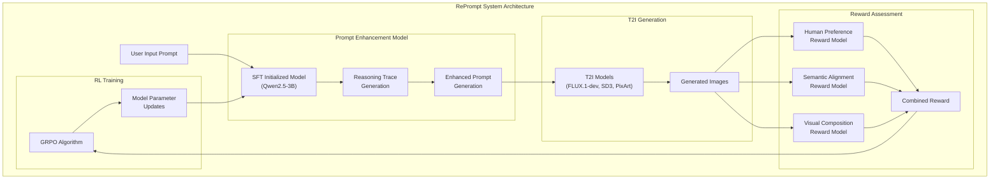
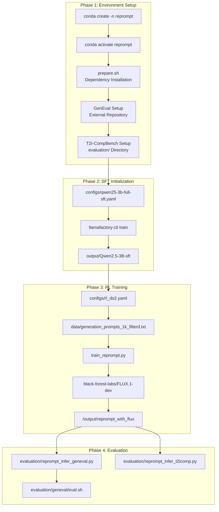

<!-- source: DeepWiki mcp.deepwiki.com · repo microsoft/DKI_LLM · page 3 RePrompt System · fetched 2026-10-26 -->

# RePrompt System

<details>
<summary>Relevant source files</summary>

The following files were used as context for generating this wiki page:

- [RePrompt/README.md](RePrompt/README.md)
- [docs/reprompt/reprompt_index.html](docs/reprompt/reprompt_index.html)

</details>


This document covers the RePrompt (Reasoning-Augmented Reprompting) system, a reinforcement learning framework designed to enhance text-to-image generation by training language models to produce better prompts. RePrompt uses explicit reasoning to transform short, under-specified prompts into detailed, structured prompts that improve T2I generation quality through multi-reward optimization.

For information about other systems in this repository, see [WarriorCoder System](#2) and [SER System](#4).

## System Overview

RePrompt addresses the fundamental challenge in text-to-image generation where models struggle with short or vague user prompts. Instead of relying on handcrafted rules or stylistic rewrites, RePrompt trains a language model to generate structured, self-reflective prompts by optimizing for actual image-level outcomes using reinforcement learning.

The system operates through a multi-stage pipeline that combines supervised fine-tuning initialization with reinforcement learning optimization, using multiple reward models to assess generated images across different quality dimensions.



Sources: [docs/reprompt/reprompt_index.html:6-7](), [docs/reprompt/reprompt_index.html:151-153](), [RePrompt/README.md:7]()

## Training Pipeline Components

The RePrompt system consists of four main execution phases, each implemented through specific scripts and configurations:



Sources: [RePrompt/README.md:16-21](), [RePrompt/README.md:30-34](), [RePrompt/README.md:39-47](), [RePrompt/README.md:52-63]()

## Key System Components

### Training Configuration and Scripts

| Component | File Path | Purpose |
|-----------|-----------|---------|
| SFT Configuration | `configs/qwen25-3b-full-sft.yaml` | Supervised fine-tuning parameters for base model initialization |
| RL Configuration | `configs/rl_ds2.yaml` | Reinforcement learning training configuration with DeepSpeed |
| Main Training Script | `train_reprompt.py` | Core RL training loop implementation |
| Training Data | `data/generation_prompts_1k_filterd.txt` | Filtered prompt dataset for training |

### Evaluation Infrastructure

| Component | File Path | Purpose |
|-----------|-----------|---------|
| GenEval Inference | `evaluation/reprompt_infer_geneval.py` | Distributed inference on GenEval benchmark |
| GenEval Evaluation | `evaluation/geneval/eval.sh` | GenEval metric calculation script |
| T2I-CompBench Inference | `evaluation/reprompt_infer_t2icomp.py` | Distributed inference on T2I-CompBench |

### Model Integration Points

The system integrates with several external model components:

- **Base Language Model**: Qwen2.5-3B serves as the foundation for prompt enhancement
- **T2I Models**: FLUX.1-dev as primary generation backend, with support for SD3 and PixArt
- **Reward Models**: Multi-dimensional assessment including human preference, semantic alignment, and visual composition

Sources: [RePrompt/README.md:33](), [RePrompt/README.md:42-46](), [RePrompt/README.md:55](), [RePrompt/README.md:62]()

## Training Process Architecture

The RePrompt training process implements a sophisticated multi-reward reinforcement learning approach:

```mermaid
graph LR
    subgraph "Input Processing"
        RAW_PROMPT["Raw User Prompt"]
        TOKENIZER["Model Tokenizer"]
        INPUT_IDS["Input Token IDs"]
    end
    
    subgraph "Prompt Enhancement Generation"
        QWEN_MODEL["Qwen2.5-3B Model<br/>(output/Qwen2.5-3B-sft)"]
        REASONING_GEN["Reasoning Trace<br/>Generation"]
        ENHANCED_GEN["Enhanced Prompt<br/>Generation"]
        PROMPT_PAIRS["(Reasoning, Enhanced)<br/>Pairs"]
    end
    
    subgraph "Image Generation"
        FLUX_MODEL["FLUX.1-dev Model<br/>(black-forest-labs/FLUX.1-dev)"]
        T2I_INFERENCE["Text-to-Image<br/>Generation"]
        CANDIDATE_IMAGES["Candidate Images"]
    end
    
    subgraph "Multi-Reward Assessment"
        REWARD_MODELS["Reward Models"]
        PREFERENCE_SCORE["Human Preference<br/>Score"]
        SEMANTIC_SCORE["Semantic Alignment<br/>Score"]
        VISUAL_SCORE["Visual Composition<br/>Score"]
        WEIGHTED_REWARD["Weighted Combined<br/>Reward"]
    end
    
    subgraph "RL Update"
        GRPO_ALGORITHM["GRPO Algorithm"]
        GRADIENT_CALC["Policy Gradient<br/>Calculation"]
        PARAM_UPDATE["Parameter Update"]
    end
    
    RAW_PROMPT --> TOKENIZER
    TOKENIZER --> INPUT_IDS
    INPUT_IDS --> QWEN_MODEL
    QWEN_MODEL --> REASONING_GEN
    REASONING_GEN --> ENHANCED_GEN
    ENHANCED_GEN --> PROMPT_PAIRS
    
    PROMPT_PAIRS --> FLUX_MODEL
    FLUX_MODEL --> T2I_INFERENCE
    T2I_INFERENCE --> CANDIDATE_IMAGES
    
    CANDIDATE_IMAGES --> REWARD_MODELS
    REWARD_MODELS --> PREFERENCE_SCORE
    REWARD_MODELS --> SEMANTIC_SCORE
    REWARD_MODELS --> VISUAL_SCORE
    
    PREFERENCE_SCORE --> WEIGHTED_REWARD
    SEMANTIC_SCORE --> WEIGHTED_REWARD
    VISUAL_SCORE --> WEIGHTED_REWARD
    
    WEIGHTED_REWARD --> GRPO_ALGORITHM
    GRPO_ALGORITHM --> GRADIENT_CALC
    GRADIENT_CALC --> PARAM_UPDATE
    PARAM_UPDATE --> QWEN_MODEL
```



Sources: [RePrompt/README.md:42-47](), [docs/reprompt/reprompt_index.html:137]()

## Evaluation Methodology

RePrompt uses two primary evaluation benchmarks to assess prompt enhancement quality:

### GenEval Benchmark Integration

The GenEval evaluation pipeline uses distributed inference to assess spatial layout fidelity and compositional generalization:

```bash
torchrun --nnodes=1 --nproc_per_node=8 --node_rank=0 evaluation/reprompt_infer_geneval.py
sh evaluation/geneval/eval.sh
```

### T2I-CompBench Assessment

The T2I-CompBench evaluation focuses on compositional understanding across diverse T2I backbones:

```bash
torchrun --nnodes=1 --nproc_per_node=8 --node_rank=0 evaluation/reprompt_infer_t2icomp.py
```

Both evaluation scripts use PyTorch distributed training (`torchrun`) with 8 GPUs to handle the computational load of generating and assessing large numbers of images.

Sources: [RePrompt/README.md:55-56](), [RePrompt/README.md:62](), [RePrompt/README.md:23](), [RePrompt/README.md:25]()

## Command Execution Flow

The complete RePrompt training and evaluation workflow follows this sequence:

| Step | Command | Purpose |
|------|---------|---------|
| 1 | `conda create -n reprompt && conda activate reprompt` | Environment isolation |
| 2 | `sh prepare.sh` | Dependency installation |
| 3 | `FORCE_TORCHRUN=1 llamafactory-cli train configs/qwen25-3b-full-sft.yaml` | SFT initialization |
| 4 | `CUDA_VISIBLE_DEVICES=0,1,2,3,4,5,6,7 accelerate launch --config_file=configs/rl_ds2.yaml train_reprompt.py` | RL training |
| 5 | `torchrun --nnodes=1 --nproc_per_node=8 --node_rank=0 evaluation/reprompt_infer_geneval.py` | GenEval inference |
| 6 | `sh evaluation/geneval/eval.sh` | GenEval metric calculation |
| 7 | `torchrun --nnodes=1 --nproc_per_node=8 --node_rank=0 evaluation/reprompt_infer_t2icomp.py` | T2I-CompBench inference |

The system requires significant computational resources, utilizing 8 GPUs for both training and evaluation phases, with distributed training handled through Accelerate and PyTorch's distributed launcher.

Sources: [RePrompt/README.md:17-21](), [RePrompt/README.md:33](), [RePrompt/README.md:42-46](), [RePrompt/README.md:55-62]()

---

