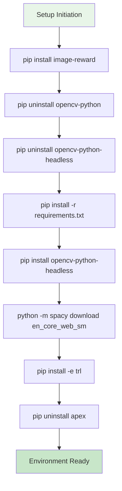
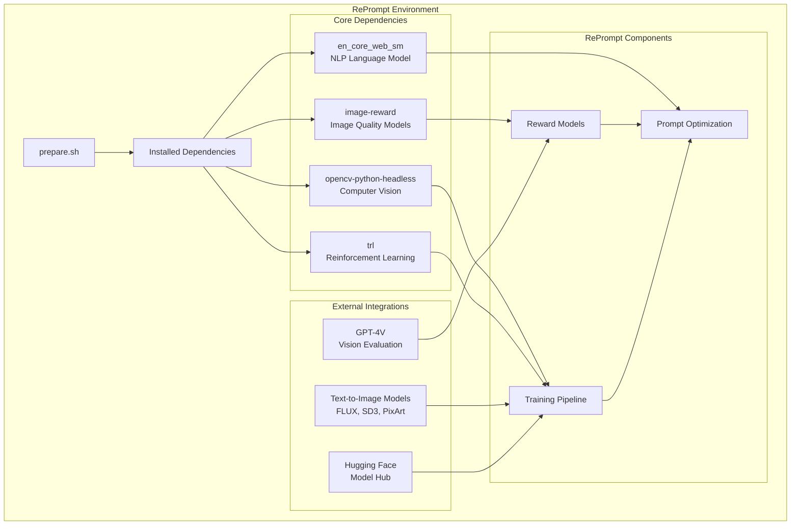

<!-- source: DeepWiki mcp.deepwiki.com · repo microsoft/DKI_LLM · page 3.1 Environment Setup · fetched 2026-10-26 -->

# Environment Setup

<details>
<summary>Relevant source files</summary>

The following files were used as context for generating this wiki page:

- [RePrompt/prepare.sh](RePrompt/prepare.sh)

</details>


This document covers the environment setup process for the RePrompt system, which implements reasoning-augmented reprompting for text-to-image generation optimization. The setup involves installing specific dependencies for reinforcement learning, computer vision, natural language processing, and text-to-image model integration.

For information about the RePrompt training process and technical implementation details, see [Training Process](#3.2).

## Setup Overview

The RePrompt system requires a carefully orchestrated installation sequence to handle potential package conflicts, particularly with OpenCV and APEX compatibility issues. The setup process installs components for image reward modeling, natural language processing, reinforcement learning frameworks, and computer vision libraries.

## Installation Process

The primary setup is automated through the preparation script located at [RePrompt/prepare.sh:1-8](). This script follows a specific sequence to avoid dependency conflicts:

### Dependency Installation Flow



**Sources:** [RePrompt/prepare.sh:1-8]()

### Package Management Strategy

The installation sequence addresses several compatibility considerations:

| Step | Package | Purpose | Notes |
|------|---------|---------|--------|
| 1 | `image-reward` | Image quality assessment models | Installed first to establish base dependencies |
| 2-3 | OpenCV removal | Clear existing OpenCV installations | Prevents version conflicts |
| 4 | Main requirements | Core RePrompt dependencies | From requirements.txt file |
| 5 | `opencv-python-headless` | Computer vision without GUI | Headless version for server environments |
| 6 | `en_core_web_sm` | English language model for spaCy | NLP processing for prompt analysis |
| 7 | `trl` (editable) | Transformer Reinforcement Learning | Development installation for RL training |
| 8 | APEX removal | Clear NVIDIA APEX | Compatibility cleanup |

**Sources:** [RePrompt/prepare.sh:1-8]()

## System Integration Architecture

The environment setup enables integration between multiple system components:



**Sources:** [RePrompt/prepare.sh:1-8]()

## Execution Instructions

To set up the RePrompt environment, execute the preparation script:

```bash
bash RePrompt/prepare.sh
```

The script handles the complete installation sequence automatically, including dependency conflict resolution and package compatibility management.

## Critical Installation Notes

### OpenCV Conflict Resolution
The setup process deliberately removes existing OpenCV installations before installing the headless version [RePrompt/prepare.sh:2-3]() and [RePrompt/prepare.sh:5](). This prevents conflicts between different OpenCV variants that can cause import errors.

### TRL Development Installation
The Transformer Reinforcement Learning library is installed in editable mode [RePrompt/prepare.sh:7](), enabling development modifications to the reinforcement learning components used in prompt optimization.

### APEX Compatibility
The final step removes NVIDIA APEX [RePrompt/prepare.sh:8]() to prevent compatibility issues with other acceleration frameworks used in the RePrompt training pipeline.

**Sources:** [RePrompt/prepare.sh:1-8]()

---

