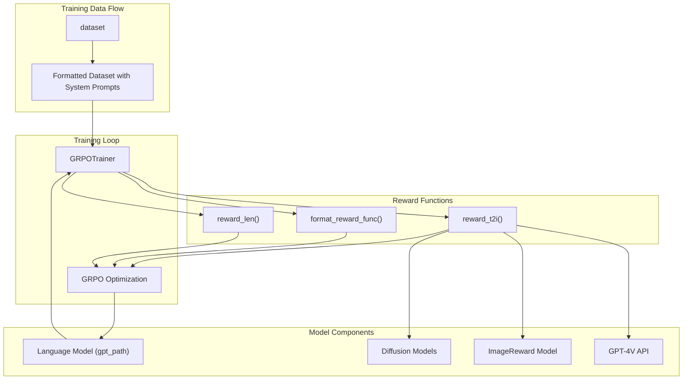
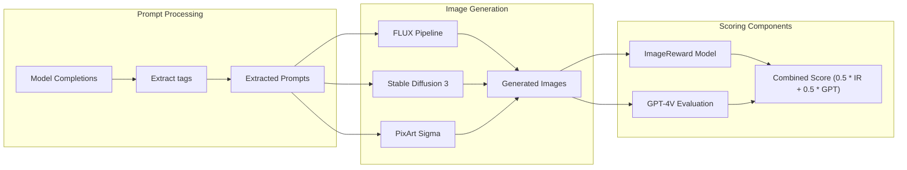
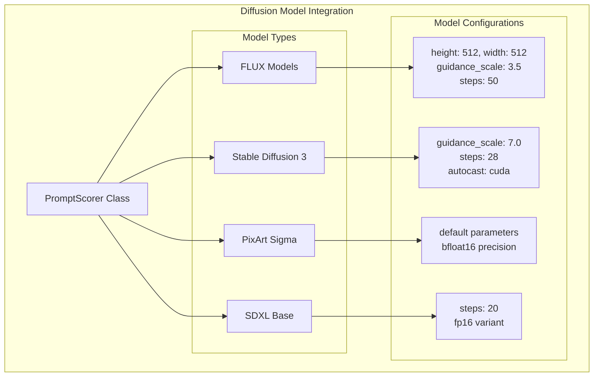
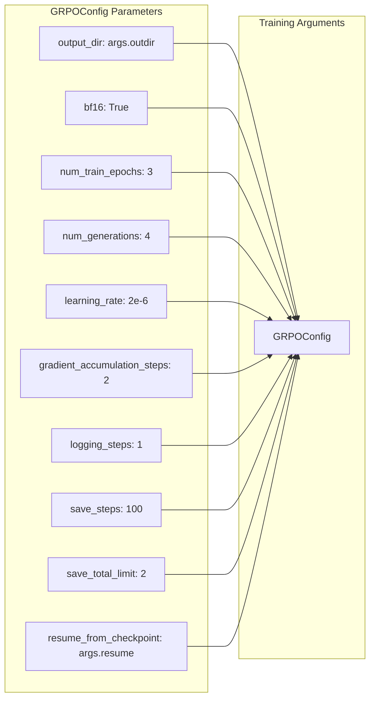
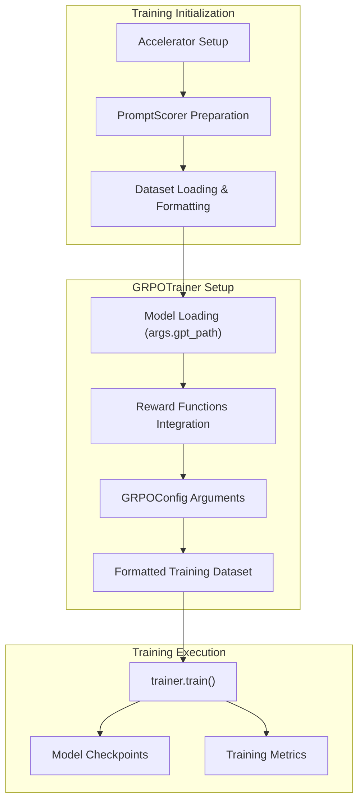

<!-- source: DeepWiki mcp.deepwiki.com · repo microsoft/DKI_LLM · page 3.2 Training Process · fetched 2026-10-26 -->

# Training Process

<details>
<summary>Relevant source files</summary>

The following files were used as context for generating this wiki page:

- [RePrompt/train_reprompt.py](RePrompt/train_reprompt.py)

</details>


This document covers the technical implementation of the RePrompt training pipeline, which uses Group Relative Policy Optimization (GRPO) to train language models for enhanced text-to-image prompt generation. The training process combines multiple reward signals including image generation quality assessment, format validation, and prompt length optimization.

For environment setup and dependencies, see [Environment Setup](#3.1). For the overall RePrompt system architecture, see [RePrompt System](#3).

## Training Architecture Overview

The RePrompt training process implements a reinforcement learning pipeline that optimizes prompt generation through multiple reward functions. The core training logic is orchestrated by the `GRPOTrainer` class, which trains a language model to generate better prompts for text-to-image generation.



**Training Pipeline Components**

Sources: [RePrompt/train_reprompt.py:213-285]()

## Reward System Design

The training process uses a multi-faceted reward system with three distinct reward functions that evaluate different aspects of prompt generation quality.

### Image Quality Reward (`reward_t2i`)

The primary reward function evaluates the quality of images generated from the model's prompt outputs. It combines ImageReward scoring with GPT-4V evaluation for comprehensive assessment.



**Reward Calculation Process:**

| Component | Weight | Score Range | Purpose |
|-----------|---------|-------------|---------|
| ImageReward | 0.5 | Normalized to [0,1] | Aesthetic and prompt-image alignment |
| GPT-4V | 0.5 | Normalized from [0,10] to [0,1] | Object counts, attributes, relationships |

Sources: [RePrompt/train_reprompt.py:232-249](), [RePrompt/train_reprompt.py:122-184](), [RePrompt/train_reprompt.py:188-198]()

### Format Validation Reward (`format_reward_func`)

This reward function ensures the model generates responses in the required structured format with proper reasoning and answer tags.

**Required Format Pattern:**
```
Let me solve this step by step.

<answer>[detailed prompt]</answer>
```

The function uses regex pattern matching to validate the complete format structure:

```python
pattern = r'Let me solve this step by step.\n\n<answer>.*?</answer>$'
```

**Reward Values:**
- `1.0`: Perfect format match
- `-1.0`: Format violation

Sources: [RePrompt/train_reprompt.py:251-257]()

### Length Optimization Reward (`reward_len`)

This reward function encourages optimal prompt length by extracting the content within `<answer>` tags and evaluating word count boundaries.

**Length Criteria:**
- **Optimal Range**: 15-77 words
- **Reward**: `1.0` for optimal length, `-1.0` for outside range, `0.0` for parsing errors

Sources: [RePrompt/train_reprompt.py:259-271]()

## Model Integration

### Diffusion Model Support

The `PromptScorer` class supports multiple state-of-the-art text-to-image models with model-specific configuration parameters.



**Model Detection Logic:**
- FLUX models: Detected by `'FLUX' in self.sdmodel_name`
- SD3 models: Detected by `'stable-diffusion-3' in self.sdmodel_name`  
- PixArt models: Detected by `"PixArt" in self.sdmodel_name`
- SDXL models: Detected by `"stable-diffusion-xl" in self.sdmodel_name`

Sources: [RePrompt/train_reprompt.py:50-80](), [RePrompt/train_reprompt.py:84-119]()

### ImageReward Integration

The ImageReward model provides aesthetic and prompt-alignment scoring for generated images. The integration uses the pre-trained `ImageReward-v1.0` model.

**Initialization:**
```python
self.imagereward_model = RM.load("ImageReward-v1.0")
```

Sources: [RePrompt/train_reprompt.py:81-82]()

### GPT-4V API Integration

GPT-4V evaluation provides sophisticated image assessment focusing on prompt alignment and image authenticity. The API integration includes error handling and score normalization.

**Evaluation Criteria:**
- Primary: Prompt alignment (object counts, attributes, entities, relationships)
- Secondary: Image authenticity
- Score normalization: `(score - 5) / 5.0` to convert [0,10] range to [0,1]

Sources: [RePrompt/train_reprompt.py:122-183]()

## Training Configuration

The training process uses `GRPOConfig` to define training parameters and optimization settings.

### Training Parameters



### Command Line Arguments

| Argument | Default Value | Purpose |
|----------|---------------|---------|
| `--data` | `/data` | Training data file path |
| `--sdmodel_name` | `stabilityai/stable-diffusion-xl-base-1.0` | Diffusion model identifier |
| `--gpt_path` | `deepseek-ai/DeepSeek-R1-Distill-Qwen-1.5B` | Base language model path |
| `--max_new_tokens` | `-1` | Maximum generation length |
| `--resume` | `None` | Checkpoint resume path |
| `--outdir` | `Qwen2.5-3B-GRPO-FLUX-8k` | Output directory |

Sources: [RePrompt/train_reprompt.py:200-210](), [RePrompt/train_reprompt.py:274-277]()

## Training Execution

### Dataset Preparation

The training process transforms raw prompts into a structured conversational format with system instructions for the prompt optimization task.

**Data Transformation Process:**
1. Load prompts from file: `dataset = [x.strip() for x in list(open(args.data,'r'))]`
2. Format as conversations with system prompt, user request, and assistant response starter
3. Each sample includes original prompt (`ori_prompt`) for reward calculation

**System Prompt Template:**
```
You are Prompt Wizard assistant, designed to act as the ultimate creative muse for image generation model users. Your core purpose is to translate user request into an effective, detailed, imaginative, and optimized prompt that unlock the full potential of image generation model. You can reasoning style, subject's characteristics, background details, and interactions with color and lighting of the image. The reasoning process and final prompt are enclosed within  and<answer> </answer> tags, respectively.
```

Sources: [RePrompt/train_reprompt.py:221-229]()

### Training Loop

The `GRPOTrainer` orchestrates the complete training process by integrating the base language model, reward functions, and training dataset.



**Accelerator Configuration:**
- DeepSpeed integration with micro batch size per GPU set to 1
- Distributed training support via `accelerator.prepare()`

Sources: [RePrompt/train_reprompt.py:213-285]()

---

