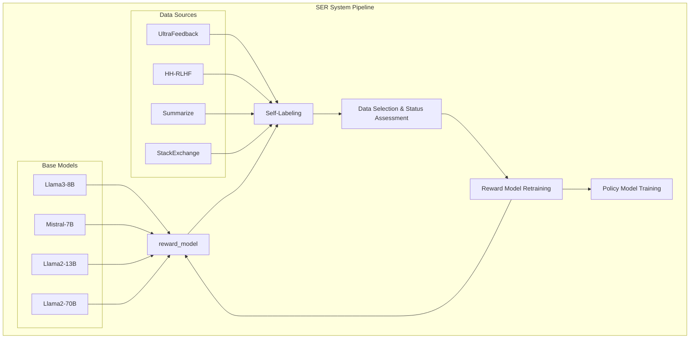
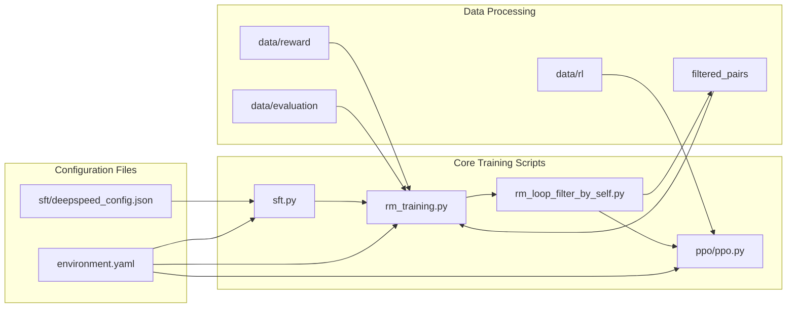
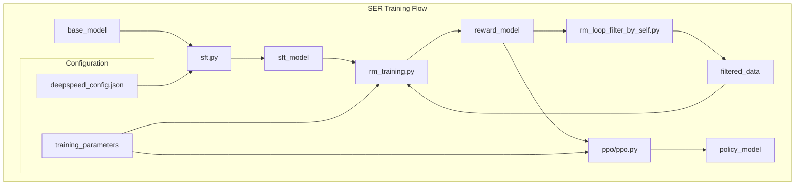

<!-- source: DeepWiki mcp.deepwiki.com · repo microsoft/DKI_LLM · page 4 SER System · fetched 2026-10-26 -->

# SER System

Relevant source files

The following files were used as context for generating this wiki page:

- [SER/README.md](SER/README.md)
- [docs/ser/ser_index.html](docs/ser/ser_index.html)

The SER (Self-Evolved Reward Learning) system implements an iterative approach to improve reward models for large language models by using self-generated feedback data. This system addresses the challenge of training reliable reward models in RLHF by reducing dependency on human-annotated data through a self-evolution mechanism.

For information about the PPO training implementation details, see [PPO Training](#4.1). For dependency and environment setup information, see [Dependencies and Setup](#4.2).

## Overview

SER operates on the principle that a reward model can generate additional training data to iteratively improve itself. The system consists of four main stages: self-labeling, data selection based on learning status assessment, reward model retraining, and policy model training. The first three stages iterate multiple rounds until the reward model converges.

The system has been extensively tested on datasets including HH-RLHF, UltraFeedback, Summarize, and Stack Exchange, using base models such as Llama 3-8B, Mistral-7B, Llama 2-13B, and Llama 2-70B.

Sources: [SER/README.md:1-144](), [docs/ser/ser_index.html:138-140]()

## System Architecture

The SER system is structured around several key Python scripts and configuration files that orchestrate the complete training pipeline. The architecture follows a modular design with distinct phases for supervised fine-tuning, reward model training, data filtering, and policy optimization.

Sources: [SER/README.md:29-131]()

## Training Pipeline

The SER training pipeline consists of five sequential steps, each implemented by specific scripts with detailed parameter configurations.

### Step 1: Environment Setup

The system requires a conda environment created from `environment.yaml`. This environment includes all necessary dependencies for distributed training, model inference, and data processing.

### Step 2: Data and Checkpoint Preparation  

The system supports multiple datasets and base models:

| Dataset | Source |
|---------|--------|
| UltraFeedback | HuggingFaceH4/ultrafeedback_binarized |
| Summarize | HuggingFaceH4/summarize-from-feedback |
| HH-RLHF | Anthropic/hh-rlhf |
| Stack Exchange | HuggingFaceH4/stack-exchange-preferences |

| Base Model | HuggingFace Path |
|------------|------------------|
| Llama 3-8B | meta-llama/Meta-Llama-3-8B |
| Mistral-7B | mistralai/Mistral-7B-v0.1 |
| Llama 2-13B | meta-llama/Llama-2-13b |
| Llama 2-70B | meta-llama/Llama-2-70b |

### Step 3: Supervised Fine-Tuning

The `sft.py` script initializes the base model using DeepSpeed for distributed training. Key parameters include:

- Sequence length: 512 tokens
- Training epochs: 8
- Batch size: 64 per device
- Learning rate: 2e-5 with cosine scheduling
- DeepSpeed configuration: `sft/deepspeed_config.json`

### Step 4: SER Loop Training

The core SER functionality is implemented through two scripts:

**Reward Model Training (`rm_training.py`)**:
- Uses Accelerate for multi-GPU training
- Batch sizes: 5 (train), 1 (eval)
- Training epochs: 2
- Evaluation every 2,500 steps
- Maximum sequence length: 512 tokens

**Data Filtering (`rm_loop_filter_by_self.py`)**:
- Filters pairwise data based on reward model confidence
- Separates useful and non-useful data for next iteration
- Uses configurable threshold parameters

### Step 5: Policy Model Training

The `ppo/ppo.py` script implements PPO (Proximal Policy Optimization) training:

- Learning rate: 1.4e-5
- Output max length: 128 tokens
- Batch size: 8, mini-batch size: 1
- PPO epochs: 4 per update
- KL divergence target: 0.1
- Total training steps: 20,000

Sources: [SER/README.md:14-131]()

## Key Components

### Supervised Fine-Tuning Module

The `sft.py` script serves as the foundation for reward model initialization. It utilizes DeepSpeed's ZeRO optimizer states and gradient accumulation for efficient distributed training. The script supports various model architectures and tokenizers, with configurable dataset loading and preprocessing.

### Reward Model Training Module

The `rm_training.py` script implements the core SER iterative learning mechanism. It supports:

- Accelerate-based distributed training across multiple GPUs
- Configurable evaluation strategies and checkpoint saving
- Integration with Weights & Biases for experiment tracking
- Custom dataset loading for reward modeling tasks

### Data Filtering Module

The `rm_loop_filter_by_self.py` script implements the learning status assessment and data selection mechanism. This component:

- Evaluates reward model confidence on unlabeled data
- Applies threshold-based filtering to select high-confidence samples
- Maintains separation between useful and remaining data for iterative training
- Supports configurable confidence thresholds

### PPO Training Module

The `ppo/ppo.py` script implements policy optimization using the trained reward model. Key features include:

- Integration with the reward model for policy gradient computation
- Configurable KL divergence constraints and adaptive control
- Batched generation for efficient policy sampling
- Support for early stopping and checkpoint management

Sources: [SER/README.md:29-131]()

---

