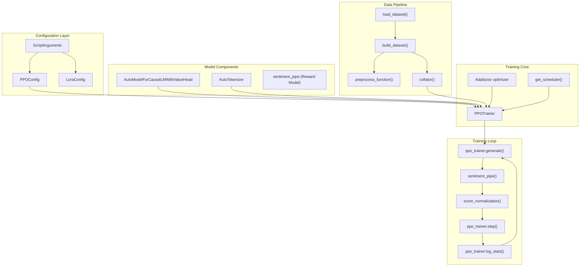
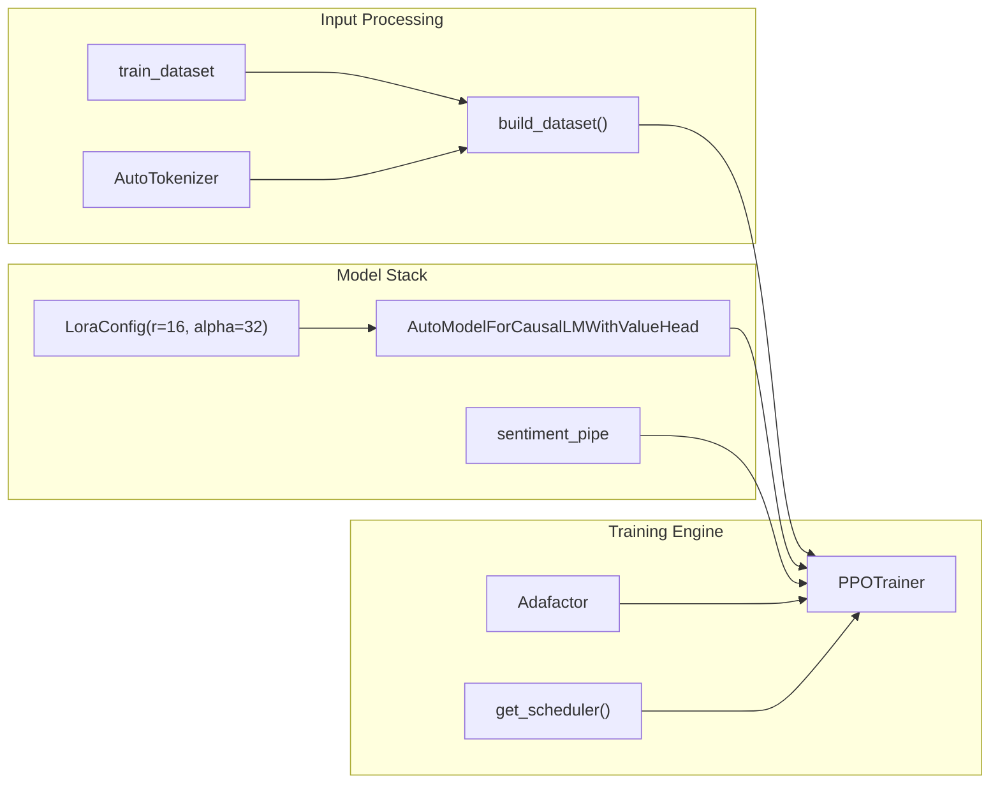
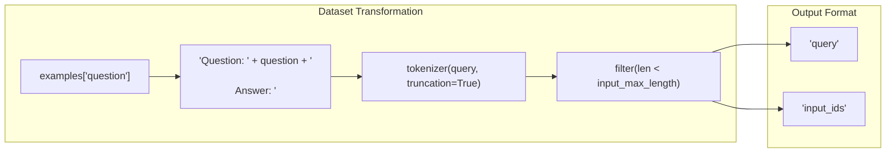
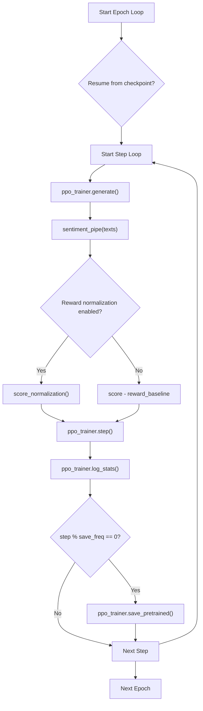

<!-- source: DeepWiki mcp.deepwiki.com · repo microsoft/DKI_LLM · page 4.1 PPO Training · fetched 2026-10-26 -->

# PPO Training

<details>
<summary>Relevant source files</summary>

The following files were used as context for generating this wiki page:

- [SER/ppo/ppo.py](SER/ppo/ppo.py)

</details>


This document covers the Proximal Policy Optimization (PPO) training implementation within the SER (Self-Evolved Reward) system. The PPO training component implements reinforcement learning from human feedback (RLHF) to align language models using a reward model. This is distinct from other training approaches in the repository - for supervised fine-tuning details, see [2.3](#2.3) and [2.4](#2.4).

## System Architecture

The PPO training system is built around the `PPOTrainer` from the TRL library and implements a complete RLHF pipeline with reward model integration. The system supports distributed training, LoRA fine-tuning, and flexible reward computation strategies.

### PPO Training Pipeline Architecture



**Sources:** [SER/ppo/ppo.py:1-364]()

### Core Component Relationships



**Sources:** [SER/ppo/ppo.py:83-236]()

## Configuration System

The PPO training system uses the `ScriptArguments` dataclass to manage all configuration parameters. This provides a comprehensive set of hyperparameters for controlling training behavior, model selection, and optimization settings.

### Key Configuration Parameters

| Parameter Category | Key Parameters | Default Values |
|-------------------|----------------|----------------|
| Model Configuration | `model_name`, `tokenizer_name`, `reward_model_name` | Required strings |
| Training Hyperparameters | `learning_rate`, `batch_size`, `mini_batch_size` | `1.4e-5`, `16`, `1` |
| PPO-Specific | `ppo_epochs`, `target_kl`, `init_kl_coef` | `4`, `0.1`, `0.2` |
| Generation Settings | `output_max_length`, `input_max_length` | `1024`, `1024` |
| Training Control | `steps`, `epochs`, `save_freq` | `20000`, `4`, `200` |

The configuration system supports both dataset loading modes through the `load_from_json` flag, enabling training on custom JSON datasets or Hugging Face datasets.

**Sources:** [SER/ppo/ppo.py:16-71]()

## Model Setup and Initialization

### Policy Model with LoRA

The system initializes an `AutoModelForCausalLMWithValueHead` with LoRA (Low-Rank Adaptation) configuration for efficient fine-tuning. The LoRA setup uses specific parameters optimized for causal language modeling:

```python
lora_config = LoraConfig(
    r=16,
    lora_alpha=32,
    lora_dropout=0.05,
    bias="none",
    task_type="CAUSAL_LM",
)
```

The model initialization process handles device placement and supports distributed training through the `Accelerator` framework.

**Sources:** [SER/ppo/ppo.py:181-196]()

### Reward Model Pipeline

The reward model is implemented as a sentiment analysis pipeline using the `pipeline` function from Transformers. It supports both bfloat16 and float16 precision and handles device mapping for distributed setups:

```python
sentiment_pipe = pipeline(
    "sentiment-analysis",
    model=reward_model_name,
    device_map={"": current_device},
    model_kwargs={"torch_dtype": torch.bfloat16 if script_args.bf16 is True else torch.float16},
    tokenizer=tokenizer,
    return_token_type_ids=False,
)
```

**Sources:** [SER/ppo/ppo.py:245-252]()

## Training Process

### Data Processing Pipeline

The training process begins with dataset preprocessing through the `build_dataset` function. This function transforms raw questions into the required format for PPO training:



**Sources:** [SER/ppo/ppo.py:112-138]()

### PPO Training Loop

The main training loop implements the standard PPO algorithm with two modes: with and without reward score normalization. The core steps are:

1. **Generation**: `ppo_trainer.generate()` produces responses to input questions
2. **Reward Computation**: `sentiment_pipe()` evaluates the quality of generated responses
3. **PPO Update**: `ppo_trainer.step()` performs the policy optimization step
4. **Logging**: `ppo_trainer.log_stats()` records training metrics

### Reward Score Processing

The system supports two reward processing modes controlled by `reward_score_normaliaztion`:

**With Normalization:**
```python
def score_normalization(score):
    if score < script_args.reward_baseline:
        score = script_args.reward_baseline
    return (score - script_args.reward_baseline) * (1 - -1) / (1 - script_args.reward_baseline) + -1
```

**Without Normalization:**
```python
rewards = [torch.tensor(output[0]["score"] - script_args.reward_baseline) for output in pipe_outputs]
```

**Sources:** [SER/ppo/ppo.py:168-171](), [SER/ppo/ppo.py:278-363]()

### Generation Parameters

The text generation process uses specific parameters optimized for PPO training:

| Parameter | Value | Purpose |
|-----------|-------|---------|
| `top_k` | `0.0` | Disables top-k sampling |
| `top_p` | `1.0` | Uses full probability distribution |
| `do_sample` | `True` | Enables sampling for diversity |
| `output_min_length` | `32` | Ensures minimum response length |
| `output_max_length` | `script_args.output_max_length` | Controls maximum response length |

**Sources:** [SER/ppo/ppo.py:265-275]()

### Training Loop Control Flow



**Sources:** [SER/ppo/ppo.py:278-363]()

## Integration and Dependencies

The PPO training system integrates with several key components:

- **Weights & Biases**: Experiment tracking through `wandb.login()` and PPO config
- **Accelerate**: Distributed training support via `Accelerator().local_process_index`
- **TRL Library**: Core PPO implementation through `PPOTrainer`, `PPOConfig`, and `AutoModelForCausalLMWithValueHead`
- **PEFT**: LoRA fine-tuning through `LoraConfig`
- **Transformers**: Tokenization, model loading, and reward model pipeline

The system automatically calculates the total training steps based on dataset size and batch configuration: `steps = int(len(dataset) / batch_size) * ppo_epochs`.

**Sources:** [SER/ppo/ppo.py:1-14](), [SER/ppo/ppo.py:144-164]()

---

