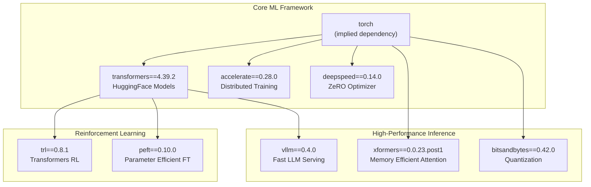
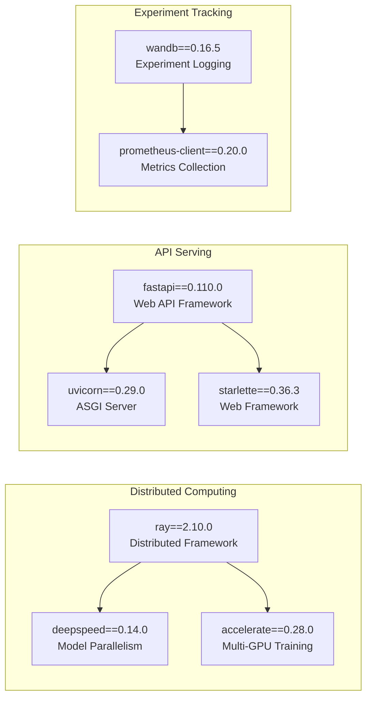
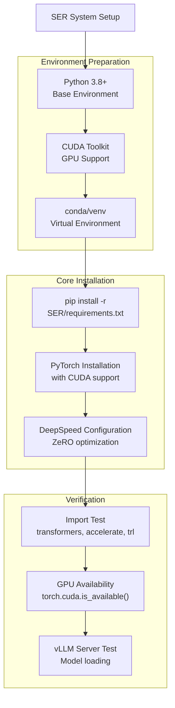

<!-- source: DeepWiki mcp.deepwiki.com · repo microsoft/DKI_LLM · page 4.2 Dependencies and Setup · fetched 2026-10-26 -->

# Dependencies and Setup

Relevant source files

The following files were used as context for generating this wiki page:

- [SER/requirements.txt](SER/requirements.txt)

This document covers the Python package dependencies and environment setup requirements for the SER (Self-Evolved Reward Learning) system. It provides a comprehensive breakdown of the required packages, their versions, and their roles within the SER training pipeline.

For information about the SER PPO training implementation details, see [PPO Training](#4.1). For general development environment setup across all systems, see [Development Environment](#5.1).

## Overview

The SER system requires a complex set of dependencies to support reinforcement learning, distributed training, model serving, and evaluation. The complete dependency specification is maintained in [SER/requirements.txt:1-121]().

## Core ML/DL Framework Dependencies

The SER system builds on several foundational machine learning frameworks that enable large language model training and inference.

### Primary Framework Stack

Sources: [SER/requirements.txt:1-121]()

## Data Processing and Evaluation Dependencies

The SER system requires comprehensive data handling and model evaluation capabilities for reward model training and policy optimization.

| Category | Package | Version | Purpose |
|----------|---------|---------|---------|
| **Data Processing** | `datasets` | 2.18.0 | HuggingFace datasets integration |
| | `pandas` | 2.2.1 | Data manipulation and analysis |
| | `pyarrow` | 15.0.2 | Columnar data format |
| | `multiprocess` | 0.70.16 | Parallel data processing |
| **Evaluation** | `evaluate` | 0.4.1 | HuggingFace evaluation metrics |
| | `bert-score` | 0.3.13 | Semantic similarity scoring |
| | `scikit-learn` | 1.4.1.post1 | ML evaluation metrics |
| **Tokenization** | `tokenizers` | 0.15.2 | Fast tokenization |
| | `sentencepiece` | 0.2.0 | Subword tokenization |
| | `tiktoken` | 0.6.0 | OpenAI tokenizer |

Sources: [SER/requirements.txt:18](), [SER/requirements.txt:24](), [SER/requirements.txt:64](), [SER/requirements.txt:9](), [SER/requirements.txt:105](), [SER/requirements.txt:92](), [SER/requirements.txt:102]()

## Distributed Computing and Serving Infrastructure

### Distributed Training and API Serving Stack

Sources: [SER/requirements.txt:82](), [SER/requirements.txt:19](), [SER/requirements.txt:1](), [SER/requirements.txt:26](), [SER/requirements.txt:112](), [SER/requirements.txt:115]()

## System Requirements and Setup Flow

### Dependency Installation Process

Sources: [SER/requirements.txt:1-121]()

## Critical Version Dependencies

Several packages have specific version requirements that are critical for SER system compatibility:

### Version-Sensitive Packages

| Package | Version | Compatibility Notes |
|---------|---------|---------------------|
| `transformers` | 4.39.2 | Required for specific model architectures |
| `accelerate` | 0.28.0 | DeepSpeed integration compatibility |
| `deepspeed` | 0.14.0 | ZeRO-3 offloading support |
| `vllm` | 0.4.0 | High-throughput inference engine |
| `trl` | 0.8.1 | PPO implementation for RLHF |
| `peft` | 0.10.0 | LoRA and QLoRA support |
| `bitsandbytes` | 0.42.0 | 4-bit quantization compatibility |

### GPU and CUDA Dependencies

The SER system requires GPU support for efficient training and inference:

- **CUDA Toolkit**: Version 11.8+ recommended
- **GPU Memory**: Minimum 24GB VRAM for training
- **Multi-GPU**: Supported via `accelerate` and `deepspeed`
- **Quantization**: 4-bit/8-bit via `bitsandbytes`

Sources: [SER/requirements.txt:105](), [SER/requirements.txt:1](), [SER/requirements.txt:19](), [SER/requirements.txt:114](), [SER/requirements.txt:107](), [SER/requirements.txt:65](), [SER/requirements.txt:10]()

## Optional Development Dependencies

Additional packages included for development, debugging, and extended functionality:

### Development Tools

| Category | Packages | Purpose |
|----------|----------|---------|
| **Parsing & Config** | `hjson`, `pyyaml`, `tyro` | Configuration file parsing |
| **Networking** | `aiohttp`, `requests`, `websockets` | HTTP client/server operations |
| **Utilities** | `click`, `rich`, `tqdm` | CLI tools and progress bars |
| **Scientific** | `numpy`, `scipy`, `matplotlib` | Numerical computing and plotting |

### Container and Deployment

- **Docker**: `docker-pycreds==0.4.0` for container credential management
- **Monitoring**: `psutil==5.9.8` for system resource monitoring
- **Async Support**: `asyncio` stack with `uvloop==0.19.0` for performance

Sources: [SER/requirements.txt:34](), [SER/requirements.txt:81](), [SER/requirements.txt:109](), [SER/requirements.txt:2](), [SER/requirements.txt:85](), [SER/requirements.txt:13](), [SER/requirements.txt:75](), [SER/requirements.txt:104](), [SER/requirements.txt:61](), [SER/requirements.txt:91](), [SER/requirements.txt:50]()

---

